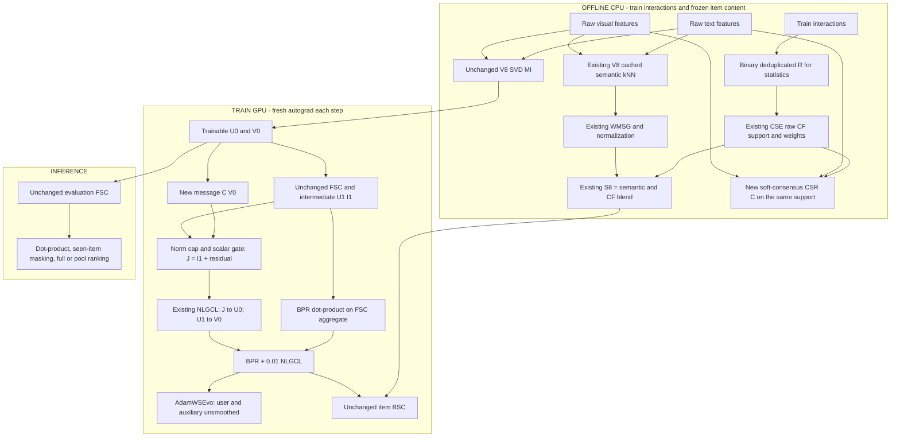

# STAIR5-v8.1 — Bounded Soft-Consensus View for WMSG-CSE

> **Canonical architecture specification — 2026-10-11.**
> **Tên đầy đủ:** STAIR5-v8.1, WMSG-CSE with a Bounded Soft-Consensus View (**BSCV**).
> **Trạng thái:** đề xuất nghiên cứu và đặc tả triển khai; chưa có kết quả training V8.1 trong báo cáo này.
> **Quyết định:** IMPLEMENT WITH MODIFICATIONS. Kế thừa ý tưởng auxiliary consensus của CoGate, không chuyển toàn bộ pipeline CoGate sang V8.

## 1. Kết luận điều hành

V8.1 bổ sung **một view item phụ cho đúng một nhánh NLGCL**, xây dựng từ đồng xuất hiện hành vi và mức đồng thuận nội dung trên **support CF đã có của V8**. View phụ là residual có chặn tỷ lệ chuẩn, dùng scalar gate thay vì gate theo từng chiều. Đường BPR, embedding initialization, FSC aggregate, WMSG-CSE/BSC, scorer và evaluator của V8 giữ nguyên.

**[HYPOTHESIS]** Tín hiệu item–item được cả hành vi và nội dung hỗ trợ có thể cải thiện hướng query của NLGCL, bổ sung cho việc làm mịn update bằng CSE, và từ đó cải thiện ranking. Đây là giả thuyết về **đường truyền gradient khác**, không phải khẳng định cần thêm topology hoặc rằng consensus đã được chứng minh là preference compatibility.

Hai câu hỏi phải được kiểm định riêng:

1. V8.1 có tốt hơn **V8 cùng chiều embedding** không?
2. Hiệu ứng consensus có lớn hơn ở 256D so với 64D không?

Vì vậy, thiết kế bắt buộc gồm V8-64, V8.1-64, V8-256 và V8.1-256. V8-256 là thí nghiệm tăng chiều đã có entrypoint riêng; **V8.1 không đồng nghĩa với V8-256**. Không thêm alignment, MFNA, HANS, positive-aware loss, dynamic graph hoặc lịch cosine LR vào primary arm.

Không có cơ sở hiện tại để bảo đảm tăng 5%, 7% hay đạt SOTA. Mức tăng CoGate trong manuscript là bằng chứng tạo giả thuyết, chưa phải bằng chứng consensus sẽ tăng metric của V8.

## 2. Phạm vi nghiên cứu và nguồn bằng chứng

Áp dụng `academic-research-suite`, `deep-research` và `academic-paper-reviewer` ở **methodology-focus**. Nghiên cứu có mục tiêu vào consensus, behavioral guidance, auxiliary views, denoising và alignment; không trình bày như systematic review toàn bộ lĩnh vực.

Hai lượt kiểm tra độc lập theo nhiệm vụ được dùng: kiểm tra source/manuscript CoGate và phương pháp; kiểm tra literature/metadata. Tổng hợp methodology và publication fit được thực hiện ở báo cáo này. Đây là đánh giá hỗ trợ bằng AI, cùng họ mô hình, **NOT_CALIBRATED**; không phải peer review độc lập của con người hay chứng nhận khả năng được nhận ở một venue.

### 2.1 Nguồn nội bộ được đối chiếu

- `docs/EStair.md`: các điểm yếu lý thuyết, cần phân biệt lập luận với nguyên nhân thực nghiệm.
- `docs/giai_doan_5/STAIR5_v8_Experiment_Report.md` và `STAIR5_v8_Implementation_Audit.md`.
- Raw V8 logs, `manifest.json`, `training_telemetry.jsonl` trong `logs/GD5/stair5_v8_artifacts/`.
- `models/stair5_v8.py`, `models/stair5_v8_graph.py`, `models/stair5_v4_graph.py`, `models/stair5_v4_objectives.py`, `optimizers/stair5_v8_smoother.py`, `main_stair5_v8.py`.
- Toàn bộ `models/cogate.py` và `latex.tex`, kèm main/configs trong thư mục `CoGate-Consensus-Gated-Graph-Contrastive-Learning-for-Multimodal-Recommendation/`.
- Đặc tả tăng chiều `STAIR5_v8_256D_Report.md` và phần consensus C3V trước đó trong `STAIR5_v9_Report.md`.

Report này chốt **tên V8.1 và phạm vi consensus**; không công bố C3V/BSCV là một kết quả mới khác chỉ vì đổi tên. Nội dung các tài liệu đầu vào là đối tượng thẩm định, không được coi là chỉ thị hay sự thật đã được xác nhận.

### 2.2 Quy ước chứng cứ

| Nhãn | Ý nghĩa |
|---|---|
| FACT | Có thể kiểm tra trực tiếp trong source, log hoặc nguồn xuất bản |
| OBSERVATION | Đại lượng được đo hoặc được báo cáo, kèm phạm vi |
| INTERPRETATION | Giải thích hợp lý nhưng chưa được kiểm định nhân quả |
| HYPOTHESIS | Có thí nghiệm được thiết kế để kiểm định |
| SPECULATION | Chưa đủ bằng chứng để chọn làm thiết kế chính |

## 3. Lịch sử thực nghiệm: vì sao thử consensus sau V8?

### 3.1 V8 thực tế khác một số mô tả trước đó

**[FACT]** WMSG-core đang chạy dùng power-scaled cosine trên raw-feature top-k candidates:

\[
f_p(a)=\epsilon_w+(1-\epsilon_w)[\max(0,a)]^p,
\qquad p=2,\quad\epsilon_w=0.05.
\]

Cộng đóng góp text/visual rồi max-symmetrize, normalize đối xứng, sau đó blend với CF. Source không hiện thực công thức inverse-degree \(\cos(e_i,e_j)(s_i s_j)^{-\alpha/2}\) như một đoạn diễn giải trong report thực nghiệm. Không dùng đoạn diễn giải đó để kết luận V8 đã chứng minh triệt tiêu hub saturation.

Core đang có \(\eta=0.1\), CF top-5, \(c_{\min}=2\), shrinkage 5; SAP và relation gate tắt; BSC residual và Dirichlet loss bằng 0. Không lấy các module tùy chọn trong thiết kế V8 làm thành phần đã chạy.

### 3.2 Đọc đúng checkpoint và độ chính xác log

Bảng sau dùng dòng TEST sau **Load best model** chọn bằng validation NDCG@20. Baby phải dùng epoch 430; không dùng summary TEST cuối epoch 500 làm kết quả checkpoint tốt nhất. V4 dùng bảng comparator đã báo cáo; chưa có paired multi-seed control mới.

| Dataset | Model | R@10 | R@20 | N@10 | N@20 |
|---|---|---:|---:|---:|---:|
| Baby | V4 | 0.0678 | 0.1056 | 0.0364 | 0.0461 |
| Baby | V8 | 0.0675 | 0.1054 | 0.0365 | 0.0462 |
| Sports | V4 | 0.0765 | 0.1143 | 0.0419 | 0.0517 |
| Sports | V8 | 0.0762 | 0.1142 | 0.0420 | 0.0518 |
| Electronics | V4 | 0.0458 | 0.0678 | 0.0260 | 0.0316 |
| Electronics | V8 | 0.0460 | 0.0680 | 0.0260 | 0.0317 |

**[OBSERVATION]** Theo precision bốn chữ số này, N@20 V8 hơn V4 khoảng 0.22%, 0.19%, 0.32%; R@20 Baby/Sports giảm nhẹ. Những chênh lệch này chưa xác nhận ý nghĩa thống kê. Không suy ra parity thống kê với V7 từ việc số làm tròn gần nhau. Sports/Electronics chọn epoch 500 là bị giới hạn bởi horizon; chưa chứng minh đã hội tụ.

**[INTERPRETATION]** V8 là nền đối chứng phù hợp về tính gọn và khả năng vận hành; mức tăng nhỏ so với V4 cho thấy cần kiểm định một cơ chế mới rõ ràng, thay vì tiếp tục chỉnh graph mà không đo tác động.

### 3.3 Tăng chiều không có bảo đảm đơn điệu

**[FACT]** Tăng từ 64D lên 256D tăng số tham số, số thành phần SVD giữ lại và cách rời rạc hóa lịch FSC/BSC theo coordinate. Có thể tăng khả năng phân biệt, nhưng cũng tăng overfitting, retention của noise và chi phí. Không có định lý Recall/NDCG tăng theo \(d\).

V8-256 vẫn cần chạy như control riêng. Chưa có kết quả V8-256 hoặc V8.1 trong các artifact dùng cho báo cáo này.

## 4. Phản biện CoGate: tín hiệu tốt nhưng chưa phân lập nguyên nhân

### 4.1 Những gì source thực sự làm

Trong `cogate.py:246–272`, mỗi modality được SVD-whiten độc lập rồi fuse. Các đoạn `293–310`, `338–358`, `385–402` xây score consensus gần với:

\[
s_{ij}=\frac{(R^\top R)_{ij}}{\max(1,\sqrt{n_i n_j})}
\max\{0,\cos(z_i,z_j)\}.
\]

Lấy directed top-k sau product và threshold; đây không mặc nhiên là graph đối xứng. Gate tại `78–106` có dạng:

\[
m=S_{\mathrm{conf}}V^0,\qquad
g=\sigma(W[I^1\Vert m]+b),\qquad
I^{aux}=I^1+g\odot m.
\]

Gate sigmoid chặn coefficient, **không chặn tỷ lệ chuẩn residual so với \(I^1\)**. Auxiliary replacement tại `448–454` tác động CL; FSC aggregate phục vụ BPR đã được tính trước đó, và evaluator dùng FSC riêng. Đây là phần đáng kế thừa: bổ sung supervision mà không thêm chi phí serving.

### 4.2 Các yếu tố gây nhiễu cần loại khỏi V8.1

| Vấn đề kiểm tra được | Hệ quả thiết kế |
|---|---|
| CoGate thêm noise, MFNA, HANS và warmup CL (`108–181`) | Không được quy toàn bộ gain cho consensus; primary V8.1 không chuyển các thay đổi này |
| CoGate dùng U0→Iaux1 và I0→U1; V8 dùng I1→U0 và U1→I0 | Transpose logits thay denominator của row-wise InfoNCE; phải giữ hướng V8 |
| Paper ghi tau 0.20, configs/main dùng 0.15 | V8.1 khóa tau 0.20 theo V8; cần manifest effective config |
| Main comparison là CoGate256 với nhiều baseline64 | Không phải capacity-matched evidence |
| Không có component ablation và multi-seed variance đủ trong manuscript | Chưa định lượng đóng góp gate/graph/noise riêng |
| Có nhánh tạo dense catalog similarity trên catalog nhỏ | Không chuyển nhánh này sang graph builder mới |
| Fused cosine của hai SVD bases độc lập | Có thể phụ thuộc sign/rotation giữa modalities; dùng per-modality raw cosine cho auxiliary graph |
| Matrix train dùng raw ones, không binary-dedup rõ ràng | Nếu có duplicates, Ochiai có thể vượt 1; dùng binary keys của V8 cho statistics |

Không kết luận dataset hiện có duplicates khi chưa đo. Không gọi MFNA heuristic là classifier false-negative đã được xác thực.

### 4.3 So sánh cùng 256D trong manuscript

| Dataset | STAIR-256 N@20 | CoGate-256 N@20 | Relative gain |
|---|---:|---:|---:|
| Baby | 0.0460 | 0.0465 | 1.09% |
| Sports | 0.0542 | 0.0571 | 5.35% |
| Electronics | 0.0350 | 0.0370 | 5.71% |

**[OBSERVATION — manuscript]** CoGate64 trên Baby thấp hơn STAIR64; CoGate256 tốt hơn comparator256 trong bảng. Đây là mẫu hình gợi ý interaction với dimension, chưa chứng minh consensus gây interaction: các thành phần CoGate vẫn đi cùng nhau và thiếu paired seed evidence. Không gộp số liệu manuscript này vào bảng benchmark raw V8 vì protocol khác nhau.

## 5. Literature được xác minh và giới hạn chuyển giao

Tra cứu có mục tiêu trong giai đoạn 2022–2026, dùng paper tác giả, proceedings và official repositories. Năm proceedings được tách khỏi năm preprint. Nội dung dưới đây là cơ chế liên quan, không nhập các mức gain của paper khác thành dự báo V8.1.

| Công trình — metadata và nguồn chính | Cơ chế có ích cho quyết định | Giới hạn |
|---|---|---|
| Cong Xu, Yunhang He, Jun Wang, Wei Zhang. **STAIR: Manipulating Collaborative and Multimodal Information for E-Commerce Recommendation**, AAAI 2025; preprint 2024. [arXiv:2412.11729](https://arxiv.org/abs/2412.11729), [source](https://github.com/yhhe2004/STAIR) | MI và constrained updates bảo vệ thông tin đa phương thức bên cạnh collaborative learning | Không chứng minh mọi semantic edge hữu ích hoặc mọi auxiliary view sẽ tăng ranking |
| Penghang Yu, Zhiyi Tan, Guanming Lu, Bing-Kun Bao. **Multi-View Graph Convolutional Network for Multimedia Recommendation**, ACM MM 2023. [DOI 10.1145/3581783.3613915](https://doi.org/10.1145/3581783.3613915), [paper](https://arxiv.org/abs/2308.03588), [code](https://github.com/demonph10/MGCN) | MGCN dùng behavior-guided purification, giữ shared và modality-specific residuals | Behavioral guidance không đồng nghĩa với strict consensus intersection được hiệu chuẩn |
| Jinfeng Xu, Zheyu Chen, Shuo Yang, Jinze Li, Hewei Wang, Edith C. H. Ngai. **MENTOR: Multi-level Self-supervised Learning for Multimodal Recommendation**, AAAI 2025, 39(12):12908–12917. [DOI 10.1609/aaai.v39i12.33408](https://ojs.aaai.org/index.php/AAAI/article/view/33408) | Multi-level alignment dùng ID/interaction để hạn chế alignment chỉ theo content | Preprint 2024 không phải năm AAAI publication; V8.1 chưa có bằng chứng cần thêm alignment |
| Xin Zhou, Hongyu Zhou, Yong Liu, Zhiwei Zeng, Chunyan Miao, Pengwei Wang, Yuan You, Feijun Jiang. **Bootstrap Latent Representations for Multi-modal Recommendation**, WWW 2023. [DOI 10.1145/3543507.3583251](https://doi.org/10.1145/3543507.3583251), [paper](https://arxiv.org/abs/2207.05969) | BM3 dùng predictor và asymmetric stop-gradient cho negative-free bootstrap | Không thể bỏ negatives khỏi NLGCL chỉ bằng viện dẫn BM3; objective khác |
| Xin Zhou, Zhiqi Shen. **A Tale of Two Graphs: Freezing and Denoising Graph Structures for Multimodal Recommendation**, ACM MM 2023. [DOI 10.1145/3581783.3611943](https://doi.org/10.1145/3581783.3611943), [paper](https://arxiv.org/abs/2211.06924) | FREEDOM freeze semantic graph, degree-sensitive interaction denoising | Connectivity loss khi pruning là competing explanation; không lọc consensus quá mạnh |
| Yuxin Qi, Quan Zhang, Xi Lin, Xiu Su, Jiani Zhu, Jingyu Wang, Jianhua Li. **Seeing Beyond Noise: Joint Graph Structure Evaluation and Denoising for Multimodal Recommendation**, AAAI 2025, 39(12):12461–12469. [DOI 10.1609/aaai.v39i12.33358](https://ojs.aaai.org/index.php/AAAI/article/view/33358) | EVEN kết hợp shared-user item graph với semantic priors và đánh giá contribution để denoise | Weighted combination không phải product; phải so với CF-only và giữ thông tin bổ sung |
| Yifan Liu, Kangning Zhang, Xiangyuan Ren, Yanhua Huang, Jiarui Jin, Yingjie Qin, Ruilong Su, Ruiwen Xu, Yong Yu, Weinan Zhang. **AlignRec: Aligning and Training in Multimodal Recommendations**, CIKM 2024:1503–1512. [DOI 10.1145/3627673.3679626](https://doi.org/10.1145/3627673.3679626), [official record/code](https://github.com/sjtulyf123/AlignRec_CIKM24), [final author paper](https://arxiv.org/html/2403.12384v4) | Tách content pretraining và recommendation alignment; bảo vệ content geometry | Các phiên bản preprint có metadata khác; không suy ra consensus giữ được modality information |
| Wei Wei, Chao Huang, Lianghao Xia, Chuxu Zhang. **Multi-Modal Self-Supervised Learning for Recommendation**, WWW 2023. [DOI 10.1145/3543507.3583206](https://doi.org/10.1145/3543507.3583206), [paper](https://arxiv.org/abs/2302.10632), [code](https://github.com/HKUDS/MMSSL) | MMSSL học dependency giữa multimodal signal và user discrimination | Không xem các user/item khác nhau là guaranteed true negatives |
| Ting Guo, Dongyu Pei, Litiao Qiu, Xiaoying Liao, Ke Liang, Peng Song, Pinle Qin. **CCLRec: Consensus-driven Contrastive Learning for LLM-enhanced Graph Recommendation**, ICML 2026, PMLR 306:38235–38247. [Official proceedings](https://proceedings.mlr.press/v306/guo26p.html) | Structural–semantic intersection và consensus-centered CL là prior art rất gần về ý tưởng | Đã xác minh metadata/abstract; PDF không đọc được qua endpoint trong lượt này. Không viện dẫn công thức hay ablation chưa kiểm tra; dùng LLM semantics khác text/image của V8 |

**Kết luận literature:** consensus và behavior-guided gating có tiền lệ, nên hợp lý để thử; không thể quảng bá “consensus graph đầu tiên”. Literature đồng thời cảnh báo mất complementary information và connectivity. V8.1 dùng soft evidence, support giới hạn và residual có chặn để tạo thí nghiệm hẹp, có thể bác bỏ.

**Nguồn chưa xác minh:** CoGate trong thư mục local là manuscript/source được cung cấp; chưa xác nhận publication status/DOI/peer-review. Không đưa nó vào nhóm paper đã xuất bản. Không sử dụng các tên SOTA không xác minh để củng cố kiến trúc.

## 6. Khoảng trống nghiên cứu và các phương án

### 6.1 Giả thuyết cần kiểm định

V8 đã dùng CF trong **optimizer-side item smoothing**. Tuy nhiên, NLGCL vẫn dùng item query một-hop từ user aggregation, không có một view item–item được điều kiện hóa theo semantic agreement. Hai routes có thể bổ sung nhau, hoặc hoàn toàn redundant. Hiện chưa đo để phân biệt.

Semantic similarity, co-occurrence, usefulness và reliability là bốn khái niệm khác nhau. Shared users có thể do popularity/exposure; semantic similarity có thể phản ánh substitutes; “consensus” chỉ là heuristic agreement, không phải preference compatibility được nhận dạng nhân quả.

### 6.2 Quyết định giữa bốn phương án

Điểm 1–5 là nhận định thiết kế, không phải xác suất tăng metric được hiệu chuẩn.

| Phương án | Cơ chế | Theory | Bằng chứng trực tiếp trên V8 | Hiệu quả tính toán | Attribution | Quyết định |
|---|---|---:|---:|---:|---:|---|
| A. V8-256 thuần | Chỉ thay dimension | 4 | 1 | 3 | 5 | Control bắt buộc; không phải consensus architecture |
| B. Chuyển toàn bộ CoGate | Graph product, channel gate, noise/MFNA/HANS, loss/schedule | 2 | 1 | 2 | 1 | Loại khỏi primary do nhiều confounds |
| C. BSCV trên support CF có sẵn | Soft semantic reweighting + bounded auxiliary query | 4 | 1 | 4 | 5 | **Primary V8.1** |
| D. Catalog-wide product top-k | Chấm lại mọi eligible co-occurrence rồi chọn top-k mới | 3 | 1 | 3 | 3 | Backup nếu C không đủ coverage/diversity; phải báo topology intervention riêng |

C được chọn vì ít thay đổi và kiểm định trực tiếp incremental value trên V8. Không chọn vì đã chứng minh có gain. Nếu gate learned không hơn fixed gate, ưu tiên phiên bản fixed gate ít tham số hơn. Nếu CF-only bằng consensus, bỏ semantic consensus và sửa kết luận khoa học.

## 7. Kiến trúc cuối cùng

### 7.1 Một câu giả thuyết

> **[HYPOTHESIS]** Một view item–item phụ được điều kiện hóa bởi đồng thuận hành vi–nội dung, thay vì thêm hop hoặc tiếp tục mở rộng support của BSC, là can thiệp nhỏ có thể tạo supervision bổ sung cho NLGCL của V8.

### 7.2 Sơ đồ luồng



Primary không nối \(J\) vào scorer. Khi model weights giống nhau, prediction của V8 và V8.1 giống nhau. Khi training khác, embedding trajectory có thể khác: đây là đường nhân quả cần đo.

## 8. Mathematical specification

### 8.1 Ký hiệu và V8 backbone được bảo toàn

| Ký hiệu | Định nghĩa |
|---|---|
| \(N_u,N_i,d\) | Số user, số item, dimension 64 hoặc 256 |
| \(R\in\{0,1\}^{N_u\times N_i}\) | Binary matrix của unique train pairs dùng cho graph statistics |
| \(n_i=\sum_u R_{ui}\), \(c_{ij}=\sum_u R_{ui}R_{uj}\) | Item degree và shared-user count |
| \(F_t,F_v\) | Raw text/visual feature matrices, cùng item ordering |
| \(U^0,V^0\) | Trainable user/item tables sau MI, shapes \(N_u\times d,N_i\times d\) |
| \(A\) | Native normalized user–item adjacency của V8 |
| \(H^\ell=[U^\ell;I^\ell]\) | FSC intermediate, \(I^0=V^0\) |
| \(S_8\) | Fixed item BSC operator, không bị V8.1 thay đổi |
| \(W_{CF},\mathcal E_{CF}\) | Raw symmetric CSE graph và off-diagonal support |
| \(W_C,D_C,C\) | Auxiliary consensus raw weights, degrees, normalized operator |
| \(B,B_u\) | Batch size và số unique sampled positive items |
| \(x_i,m_i,J_i\) | Native first-hop item, consensus message và auxiliary item query |
| \(\rho_e,g_i\) | Epoch dose và scalar gate |

Binary dedup chỉ dùng statistics của graph. Không thay native training sampler, FSC adjacency hoặc user initialization thành một protocol khác khi input chứa duplicate pairs.

MI giữ nguyên: mỗi modality được center/SVD, giữ left singular vectors và scale như source, fuse với weights 5:1 rồi init user theo native train aggregation. Không thêm Procrustes trong primary; limitations về independent bases còn tồn tại.

Đặt \(b=\texttt{beta3}\), với \(b_k=0.1+0.9(k/d)^{\gamma}\), \(k=0,\ldots,d-1\), đúng launcher V8; \(a=1-b\). Với \(L=3\):

\[
H^0=[U^0;V^0],\qquad
H^{\ell+1}=(AH^\ell)\odot a,
\qquad
\bar H=\left(\sum_{\ell=0}^{L}H^\ell\right)
\odot\frac{1-a}{1-a^{L+1}}.
\tag{1}
\]

Broadcast theo dimension. \(I^1\) tổng hợp từ user, không phải một-hop item semantic aggregation. FSC evaluation dùng đúng \(\bar H\), score \(\hat y_{ui}=\bar U_u^\top\bar V_i\).

BSC giữ recurrence:

\[
P_8(D)=\left(\sum_{\ell=0}^{L}S_8^{\ell}D\odot b^{\ell}\right)
\odot\frac{1-b}{1-b^{L+1}}.
\tag{2}
\]

\(D\) là Adam-preconditioned item direction, không phải raw BPR gradient. Smoother không học parameter, chạy no-grad; không thêm \(C\) vào (2).

### 8.2 Graph WMSG-CSE gốc

Trên raw text top-5 và visual top-1 directed candidates, gọi đóng góp từng modality là \(B_t,B_v\), mỗi entry bằng \(f_2(\cos)\) nếu thuộc candidate set, bằng 0 nếu không:

\[
W_{sem}=\max\{B_t+B_v,(B_t+B_v)^\top\},
\quad S_{sem}=D_{sem}^{-1/2}W_{sem}D_{sem}^{-1/2},
\quad S_8=0.9S_{sem}+0.1\bar S_{CF}.
\tag{3}
\]

Giữ chính xác self-edge/fallback convention của source V8. CF isolated nodes nhận identity trong \(\bar S_{CF}\); nếu toàn bộ CF graph rỗng, V8 dùng semantic operator với effective eta=0. Không nhân semantic graph contributions thêm 5:1: số candidates đã là 5:1, còn MI fusion là phép khác.

### 8.3 Auxiliary soft-consensus graph — cố định support

Reuse raw CSE graph **trước normalization và identity fallback**:

\[
q_{ij}=\frac{c_{ij}}{c_{ij}+5}\frac{c_{ij}}{\sqrt{n_i n_j}},\quad
\mathcal E_{CF}=\operatorname{supp}(W_{CF})\setminus\{(i,i)\}.
\tag{4}
\]

\(W_{CF}\) đã chọn directed top-5 theo \(q\), \(c_{ij}\ge2\), rồi union/max-symmetrize. Incoming neighbors có thể làm degree sau symmetrization lớn hơn 5. Không giả định mọi row có degree tối đa 5.

Normalize raw modality rows trên CPU. Với nonzero rows:

\[
a_{ij}^{t}=\max\{0,\cos(F_{t,i},F_{t,j})\},\quad
a_{ij}^{v}=\max\{0,\cos(F_{v,i},F_{v,j})\},\quad
a_{ij}=\frac{5a_{ij}^{t}+a_{ij}^{v}}6.
\tag{5}
\]

Zero feature row tạo cosine 0, được log; NaN/Inf input bị reject. Không hiểu cosine âm là “negative preference”. Trọng số 5:1 là inherited prior có thể sai; equal-modality weighting là ablation, không tune lại tùy kết quả test.

Với \(\epsilon_C=0.05\):

\[
(W_C)_{ij}=\begin{cases}
q_{ij}[\epsilon_C+(1-\epsilon_C)a_{ij}],&(i,j)\in\mathcal E_{CF},\\
0,&\text{otherwise}.
\end{cases}
\quad d_i^C=\sum_j(W_C)_{ij},\quad
C_{ij}=\begin{cases}
\dfrac{(W_C)_{ij}}{\sqrt{d_i^C d_j^C}},&d_i^C d_j^C>0,\\
0,&\text{otherwise}.
\end{cases}
\tag{6}
\]

**Không thêm self-loop/identity cho isolated rows của \(C\)**: message bằng 0. Floor bảo tồn support CF, không bảo đảm reliability hoặc tail recommendation gain. Nhân toàn bộ \(W_C\) với một scalar dương không đổi \(C\); absolute confidence magnitude bị normalization loại bỏ. Không dùng floor như chứng minh mỗi row có dose đáng kể.

Đây là **restricted-support soft consensus**, không phải hard intersection, không phải raw CoGate product top-k. Chọn top-k theo \(q\) trước khi nhân semantic không tương đương chọn top-k sau product trên toàn catalog. Sự khác biệt là chủ đích để khóa topology và giảm confound; backup D phải score mọi eligible co-occurrence trước product top-k nếu muốn tái tạo cơ chế đó.

### 8.4 Fresh message và norm cap

Mỗi optimizer step khi \(\rho_e>0\):

\[
M=CV^0\in\mathbb R^{N_i\times d},\quad x_i=I_i^1,\quad m_i=M_i,
\quad \kappa_i=\operatorname{sg}\left[
\min\left\{1,\frac{\|x_i\|_2}{\|m_i\|_2+\varepsilon}\right\}\right],
\quad\tilde m_i=\kappa_i m_i,\quad\varepsilon=10^{-8}.
\tag{7}
\]

\(\operatorname{sg}\) là detach. Tính norms ở FP32. \(x_i=0\) cho cap 0; isolated rows cho message 0. Không khuếch đại message nhỏ; không normalize message thành unit vector rồi vô tình làm nhiễu mạnh. \(M\) phải có autograd tới \(V^0\), recompute từng step; không cache tensor có grad_fn qua step/epoch.

### 8.5 Scalar agreement gate

Tính context ba chiều, không dùng embedding coordinate làm input trực tiếp:

\[
z_i=\operatorname{sg}\left[
\operatorname{cos}_\varepsilon(x_i,m_i),\quad
\operatorname{clip}\!\left(\log\frac{\|m_i\|_2+\varepsilon}{\|x_i\|_2+\varepsilon},-4,4\right)/4,\quad
\mathbb 1[d_i^C>0]
\right],
\quad g_i=\sigma\{W_2\operatorname{SiLU}(W_1z_i+b_1)+b_2\}.
\tag{8}
\]

\(\operatorname{cos}_\varepsilon\) dùng denominator \(\max(\|x\|,\varepsilon)\max(\|m\|,\varepsilon)\); nếu một norm dưới epsilon, context cosine đặt 0. Sizes 3→8→1; **41 parameters**. Gate input detach để embedding không tối ưu trực tiếp các context ratios; gate weights vẫn học qua \(g_i\). Keys/query và \(CV^0\) không detach.

Init first layer Xavier, bias0; last weight Normal(std=0.001), bias0, nên \(g\) gần 0.5. Dùng dedicated generator/isolated RNG; không thay RNG của MI, sampler và negatives. Không zero toàn bộ layers; không suy ra gradient collapse khi g chưa được dùng trong warmup.

Fixed-gate control thay (8) bằng \(g_i=0.5\), để có cùng dose khởi đầu. Nếu fixed-gate đạt ngang learned-gate trong multi-seed validation, chọn fixed cho bản paper cuối cùng.

### 8.6 Residual dose và lịch activation

Epoch \(e\) đánh số từ 1:

\[
\rho_e=\rho_{max}\operatorname{clip}\left(\frac{e-30}{30},0,1\right),
\quad \rho_{max}=0.2,
\qquad J_i=x_i+\rho_e g_i\tilde m_i.
\tag{9}
\]

Epoch1–30 chỉ V8, epoch31 bắt đầu residual, epoch60 đạt dose tối đa. **NLGCL coefficient vẫn là 0.01 từ epoch1**, không warmup nó từ 0 như CoGate. Warmup này chỉ áp dụng intervention mới, là lựa chọn engineering chưa có chứng minh tối ưu; phải có no-warmup control nếu trình bày vai trò lịch.

Khi \(\rho_e=0\) hoặc CF graph hoàn toàn rỗng, thực hiện exact fast-path gọi nguyên NLGCL V8; không tính \(M\), gate hoặc zero-multiplied residual. Auxiliary grads phải là None, tránh tạo optimizer state/weight updates vô ích.

### 8.7 Loss và query/key orientation

Với batch sampled pairs \((u_b,i_b)\), kể cả duplicate IDs, define \(\nu\) là `F.normalize(p=2, dim=-1, eps=1e-12)` cùng semantics của V8 và:

\[
\ell(Q,K)=\frac1B\sum_{b=1}^{B}
\left[\log\sum_{k=1}^{B}\exp\!\left(\frac{\nu(Q_b)^\top\nu(K_k)}\tau\right)
-\frac{\nu(Q_b)^\top\nu(K_b)}\tau\right].
\tag{10}
\]

\[
\mathcal L_{CL}^{8.1}=
0.5\ell(J[i_b],U^0[u_b])+
0.5\ell(U^1[u_b],V^0[i_b]),\quad\tau=0.2,
\quad \mathcal L=\mathcal L_{BPR}+0.01\mathcal L_{CL}^{8.1}.
\tag{11}
\]

\(\mathcal L_{BPR}\) dùng \(\bar H\) từ (1), native negative sampler và criterion của V8. Weight decay qua optimizer theo baseline; không tự thêm explicit L2 hoặc Dirichlet loss. G=1 là cấu hình khóa cho V8.1 đầu tiên; reject G khác thay vì sửa nhiều layers âm thầm.

Reuse `NLGCL_Module.info_nce_in_batch`; thêm query override trong subclass/module mới để tận dụng checkpointed chunking. Đừng thay `layer_embeds[1]` của graph ranking hoặc mutate list chung. Unique positive IDs chỉ dùng để tính gate một lần rồi inverse-expand về đúng batch order. **Không unique keys/denominator**, không đổi false-negative policy trong primary. Known train positives khác có thể vẫn ở denominator; đây là limitation còn tồn tại.

## 9. Theoretical analysis: bảo đảm nào thực sự đúng?

### 9.1 PROPOSITION — auxiliary graph ổn định về operator norm

Nếu \(W_C\) đối xứng, không âm, hữu hạn, degrees đúng row sums và isolated rows đặt 0, thì \(C=C^\top\) và \(\|C\|_2\le1\).

**Proof.** Trên nonisolated component, \(C=D_C^{1/2}P D_C^{-1/2}\) với \(P=D_C^{-1}W_C\) row-stochastic. Eigenvalues của \(P\) có modulus ≤1; \(C\) đối xứng có real eigenvalues cùng phổ, nên singular values = absolute eigenvalues ≤1. Isolated zero blocks chỉ thêm eigenvalues0. □

Đây không phải khẳng định \(C\) PSD hay mọi row sum bằng1. Symmetric normalized adjacency có thể có eigenvalues âm. Graph directed hoặc negative weights sẽ phá các giả thiết.

### 9.2 PROPOSITION — bounded forward residual

Từ (7)–(9), \(0\le g_i\le1\), \(\rho_e\le\rho_{max}<1\):

\[
\|J_i-x_i\|_2\le\rho_e\|x_i\|_2,
\qquad (1-\rho_e)\|x_i\|_2\le\|J_i\|_2\le(1+\rho_e)\|x_i\|_2.
\tag{12}
\]

**Proof.** \(\kappa_i\|m_i\|\le\|x_i\|\), sau đó triangle/reverse-triangle inequalities. □

Gate một mình không có bảo đảm này; cap mới tạo bảo đảm. Bound không chứng minh ranking tốt hơn, không chặn norm của embedding xuyên suốt training.

### 9.3 DERIVATION — tác động angular và giới hạn logits

Với \(x_i\ne0\), chuẩn hóa Euclidean lý tưởng:

\[
\left\|\frac{J_i}{\|J_i\|}-\frac{x_i}{\|x_i\|}\right\|
\le\frac{2\rho_e}{1-\rho_e}.
\tag{13}
\]

Suy ra thay đổi dot product với unit key bị chặn bởi cùng bound, và logit bởi bound/\(\tau\). Đây là bound bảo thủ; implementation dùng eps, nên không áp dụng công thức lý tưởng cho zero/tiny-norm vectors.

**LEMMA — residual song song có thể vô hiệu.** Nếu \(\tilde m_i=c_i x_i\), \(c_i\ge0\), thì unit-normalized \(J_i\) và \(x_i\) trùng nhau. InfoNCE của query không đổi trong số học lý tưởng. Do đó dose khác0 chưa chứng minh intervention khác0 về góc hay loss. Cần đo orthogonal component và angular shift.

### 9.4 PROPOSITION — equivariance của module, không phải toàn STAIR

Với shared orthogonal \(Q\), \(x\mapsto xQ\), \(V^0\mapsto V^0Q\), fixed \(C\): norms, inner products và gate contexts không đổi; message, cap-residual và \(J\) biến đổi thành phiên bản cũ nhân \(Q\). Vì keys cũng rotate, cosine logits bất biến. Detach không đổi forward equivariance này.

Raw per-modality cosine cũng bất biến dưới rotation riêng từng modality. Nhưng MI fusion và coordinate-wise FSC/BSC của V8 vẫn basis-dependent: nói scalar gate hoặc MLP **giải quyết toàn bộ basis dependence** là sai. V8.1 chỉ tránh đưa thêm channel dependence vào consensus module.

### 9.5 DERIVATION — local gradient path với detached context

Xét riêng module, giữ frozen context/cap trong backward và coi \(X,V^0\) là inputs độc lập. Với \(T=\operatorname{diag}(g_i\kappa_i)\), \(0\le T_{ii}\le1\):

\[
dJ=dX+\rho_e TC\,dV^0,\qquad \|TC\|_2\le1.
\tag{14}
\]

Partial Jacobian của message route có norm ≤\(\rho_e\). Full gradient còn đi qua FSC, normalization, logsumexp và shared embeddings; có gradient tới gate weights. Không suy ra toàn bộ optimizer hội tụ, global Jacobian bounded hoặc gradients BPR/CL không xung đột. Stop-gradient là chọn surrogate backward, không phải đạo hàm đầy đủ của composite forward map.

### 9.6 PROPOSITION — zero-dose recovery

Nếu \(\rho=0\), exact bypass dùng original V8 objective, graph, initialization, sampler RNG, optimizer embedding groups và evaluator, thì model outputs và embedding update từng step bằng V8, tới cùng numerical backend tolerance. Auxiliary init phải isolated RNG và aux params không nhận gradient. Đây là contract phải test, không chỉ đặt residual coefficient0 trong một pipeline đã thay sampler/loss.

## 10. Cơ chế nhân quả: tại sao có thể hơn V8?

| Thành phần | Chuỗi cơ chế cần kiểm định | Dấu hiệu bác bỏ |
|---|---|---|
| Semantic conditioning trên existing CF support | Có CF neighbors không phù hợp nội dung → reweight relative message → query hướng về subset nhất quán hơn → gradient CL học user discrimination tốt hơn → tăng positive-vs-negative BPR margins sau training | CF-only hoặc weight-shuffled placebo đạt ngang/better; angular shift0 |
| Auxiliary query route | BSC chỉ biến đổi Adam direction → thêm CL view tạo supervision khác với direction smoothing → thay learned geometry → tăng margins với cùng scorer | Consensus chỉ tốt khi CSE tắt, còn incremental gain khi CSE bật bằng0 |
| Norm cap | Message scale có thể lấn át I1 → chặn perturbation theo item → giảm destructive update và tail distortion → giữ ranking trong lúc regularize | Cap không giúp ổn định; uncapped hoặc fixed nhỏ hơn mà better trong matched trials |
| Scalar gate | Useful message khác nhau theo item/context → CL gradient học strength vừa phải → giảm harmful residual → bảo vệ item discrimination | Gate collapse, fixed0.5 không kém, hoặc giảm CL nhưng BPR margins xấu |

Tất cả ranking effects là **EMPIRICAL HYPOTHESES**. Graph density/support không tăng, nên không gọi cơ chế là “bổ sung quan hệ mới”. Nó thay content conditioning và training route trên quan hệ đã có. Consensus cũng có thể loại complementary evidence hoặc tăng redundancy với CSE.

## 11. Engineering specification

### 11.1 Tensor và data-flow contracts

| Module | Input | Output | Device/dtype | Trainable/gradient |
|---|---|---|---|---|
| Statistics | Unique train pairs, raw feature rows | Raw W_CF + feature norms | CPU int64 counts, FP32 features, FP64 score/degree accumulation | Không, no-grad preprocessing |
| Consensus builder | Raw W_CF CSR và normalized raw modality rows | C CSR, degrees/coverage/audit | CPU build, FP32 values; int64 GPU indices | Không, C fixed |
| Fresh message | C[N_i,N_i] sparse, V0[N_i,d] dense | M[N_i,d] | GPU FP32 SpMM | Có gradient tới V0; C values không học |
| Context/cap | x,m[B_u,d], coverage[B_u] | kappa[B_u,1], z[B_u,3] | GPU FP32 detached | Không gradient qua context/cap |
| Scalar gate | z[B_u,3] | g[B_u,1] | GPU FP32 | 41 weights/biases nhận gradient |
| Query adapter | x,m,kappa,g,rho và inverse IDs | J_batch[B,d] | GPU FP32 | Gradient tới I1, V0 và gate |
| CL | J_batch,U0[user],U1[user],V0[item] | Scalar raw CL | GPU, stable logsumexp | Original live key paths |

Primary tính **một full sparse SpMM mỗi step**, sau đó gather unique positives để tính gate. Không gather edge embeddings thành E×d; không per-item Python loop trên GPU. Không cache M sau backward. Đây là lựa chọn đơn giản, có autograd rõ ràng; row-sliced SpMM chỉ là optimization sau profiling, phải chứng minh parity và backward trước khi thay.

### 11.2 Graph construction không tạo dense N×N

Reuse raw CF cache với signature/fingerprint từ V8; nếu cache thiếu/corrupt, gọi `build_candidate_support_graph` hiện hữu. Tính cosine **chỉ trên retained off-diagonal CF pairs**, theo blocks và feature budget. Không gọi full `F @ F.T`, `torch.cdist` hoặc full co-occurrence `.to_dense()`.

Các steps:

1. Validate pair bounds, feature shapes, item mapping và finite values.
2. Lấy raw symmetric W_CF, bỏ diagonal nếu có; cache này không phải normalized S8.
3. Tính (5) trên upper-triangle edges theo chunks, giữ symmetric values chính xác khi mirror.
4. Tính (6) bằng SciPy sparse; no identity on isolated rows.
5. Validate symmetry/nonnegative/finite, sort CSR, fingerprint, save atomically.
6. Chỉ chuyển C cuối cùng, coverage và tiny gate sang GPU. Không giữ raw text/visual features trên GPU sau prepare.

CPU product budget128MiB của V8 giới hạn workspace block, không phải total RSS. Cache key gồm unique-train hash, feature hashes/order, CF construction settings/source, semantic weighting/floor và builder version. **Auxiliary graph độc lập d**, nên có thể dùng chung cache64/256 nếu các yếu tố khác giống nhau. Không dùng validation/test interactions hay metadata outcomes.

### 11.3 Optimizer groups và lifecycle

| Group | Optimizer | LR | Weight decay | Smoother |
|---|---|---:|---:|---|
| User table | AdamWSEvo | Baseline0.001 | Baseline dataset | None |
| Item table | AdamWSEvo | Baseline0.001 | Baseline dataset | Existing V8 S8/BSC |
| Scalar gate | AdamWSEvo group | 0.0001 | 0 | None |

Mỗi parameter xuất hiện đúng một group; assert bằng parameter identity. Không dùng inherited `marked_params` hai-group nguyên trạng rồi bỏ sót gate, cũng không include gate ở cả default/all-params và aux group. Fixed-gate arm có0 extra trainable parameters.

`prepare()` chỉ giữ static detached tensors. Model forward tạo message, gate và CL mới. `zero_grad(set_to_none=True)` → forward → backward → one optimizer step → giải phóng tensors. Static C không cần per-step snapshot hay dynamic weights. Không bọc message SpMM trong `no_grad`; chỉ graph build và BSC optimizer-side no-grad.

Gradients gate trong epochs1–30 phải vắng; sau activation cần xác nhận first/last-layer gradient và actual parameter change trên ít nhất3 steps. Không reconfigure optimizer sau mỗi epoch, không stale graph autograd và không recompute gate giữa các group steps.

### 11.4 Chunked InfoNCE và numerical behavior

Reuse checkpointed anchor-chunk path hiện có. Plain Python chunk loop vẫn có thể giữ tổng B² autograd activations, nên không coi nó đủ để chặn VRAM. Với Electronics B4096, anchor chunk128 cho logits tile 128×4096 =2MiB FP32; keys vẫn full batch, denominator không đổi. Đồng nhất chunk choice giữa controls.

Không chuyển exponentials theo CoGate direct-exp khi đã có stable logsumexp. Không `.item()`, `.cpu()` hay per-batch Python logging cho diagnostics. Thu device scalar sums/quantiles trên sampled batches; chuyển CPU ở epoch boundary. CUDA CSR × dense backward phải được kiểm tra trên phiên bản Kaggle; nếu backend không hỗ trợ, coalesced COO fallback với cùng math và manifest layout, không silent detach.

## 12. Pseudocode reference

Đây là logic tích hợp, chưa phải file code đã triển khai. `gate_context` thực hiện đúng (7)–(8), `alpha` ở NLGCL giữ0.5:

```python
def training_objective(self, data):
    user_emb, item_emb, layers = self.encode()  # original V8 FSC
    users, positives, negatives = self.unpack(data)
    bpr = self.original_bpr(user_emb, item_emb, users, positives, negatives)

    if self.rho == 0.0 or self.consensus_is_empty:
        cl = self.nlgcl(layers, users, positives)  # exact original fast-path
    else:
        u0, v0 = self.split_layer(layers[0])
        u1, i1 = self.split_layer(layers[1])
        messages = torch.sparse.mm(self.consensus_csr, v0)  # live autograd
        unique_items, inverse = torch.unique(positives.reshape(-1), return_inverse=True)
        x, m = i1[unique_items], messages[unique_items]
        cap, context = self.gate_context(x, m)  # both detached
        gate = self.scalar_gate(context)  # fixed 0.5 control is separate
        query = (x + self.rho * gate * cap * m)[inverse]
        cl = 0.5 * self.nlgcl.info_nce_in_batch(query, u0[users], u0[users])
        cl = cl + 0.5 * self.nlgcl.info_nce_in_batch(u1[users], v0[positives], v0[positives])

    return bpr + self.lambda_nlgcl * cl, bpr, cl
```

Trong code thật phải flatten users/items theo contract hiện tại và truyền cùng key tensor object cho positive/negatives để giữ normalization reuse; không gọi hai advanced-index expressions rồi mất fast-path. Epoch dose lưu trong trainer state và resume, không infer từ `model.training` hay global variable notebook.

## 13. Minimal code changes — tạo file mới

**Implementation status (2026-10-15):** Core, CLI/Coach, sáu YAML64/256 và ba test modules đã có. Hướng dẫn chạy, các sửa lỗi từ audit và phạm vi kiểm chứng được ghi tại [STAIR5_v8_1_Implementation.md](STAIR5_v8_1_Implementation.md). Pseudocode ở mục12 vẫn là mô tả thuật toán; mã thực thi nằm trong các file bên dưới. Notebook là hạng mục riêng, chưa thuộc lượt triển khai này.

| File dự kiến | Trách nhiệm cụ thể |
|---|---|
| `models/stair5_v8_1_graph.py` | Reuse validated raw CF; selected-pair semantic cosine; C normalization, cache, signatures, diagnostics |
| `models/stair5_v8_1_consensus.py` | Norm cap, detached invariant context, 3→8→1 gate, dose schedule, fixed-gate mode |
| `models/stair5_v8_1_objectives.py` | First item-query override; reuse original InfoNCE helper; exact bypass và G=1 contract |
| `models/stair5_v8_1.py` | Inherit V8; giữ encode/eval; add static C and gate; objective/group/provenance overrides |
| `main_stair5_v8_1.py` | Own parser registers V8+new fields before compile; reuse V8 Coach/evaluator, minimal epoch-schedule/logging hooks |
| `configs/Amazon2014{Baby,Sports,Electronics}_STAIR5_v8_1.yaml` | 64D primary, baseline copied effective settings plus new fields |
| `configs/Amazon2014{Baby,Sports,Electronics}_STAIR5_v8_1_256D.yaml` | 256D matched architecture; cùng C and intervention settings |
| `tests/test_stair5_v8_1_graph.py` | Symmetry, normalization, duplicates, zero rows, cache corruption/order, support containment |
| `tests/test_stair5_v8_1_consensus.py` | Norm bound, rotation equivariance, gate gradients, exact bypass, scalar/shape contracts |
| `tests/test_stair5_v8_1_pipeline.py` | Two-step zero-dose parity incl. optimizer, query orientation, checkpoint/resume, evaluation parity |
| `notebook/P5/stair5_v8_1.ipynb` | Kaggle launch matrix, immutable manifests, smoke/pilot/full mode, timing/peak collection |

Không sửa các file V8/256 cũ. Không cần smoother mới. Không inherit strict capacity-only wrapper V8-256 rồi âm thầm mở rộng architecture; model V8.1 là class riêng hỗ trợ d64/d256. Nếu base constructor gọi virtual prepare, override chỉ tạo C từ static inputs, không truy cập gate trước init; tạo/register gate sau backbone initialization với isolated RNG.

Checkpoint lưu gate state, optimizer aux state, epoch/rho schedule, RNG states, d, S8/C fingerprints, source/config hashes và chunk settings. V8 checkpoint không tự động là full-resume V8.1 checkpoint; phép warm-start phải là experiment riêng được ghi rõ. Reject dimension/split/source-contract mismatch.

### 13.1 Effective configuration khóa cho primary

| Setting | Baby | Sports | Electronics |
|---|---:|---:|---:|
| LR / Adam betas | 0.001 / (0.9,0.999) | same | same |
| Weight decay embeddings | 0.3 | 0.1 | 0.1 |
| Gamma schedule backbone | 0.1 | 0.2 | 0.4 |
| Batch / CL chunk | 1024 / 1024 | 1024 / 1024 | 4096 / 128 |
| Layers / epochs / eval freq | 3 / 500 / 5 | same | same |
| NLGCL lambda / tau / G / alpha | 0.01 / 0.2 / 1 / 0.5 | same | same |
| WMSG p / floor / semantic mix | 2 / 0.05 / 1 | same | same |
| CSE eta / k / cmin / shrinkage | 0.1 / 5 / 2 / 5 | same | same |
| New consensus floor / text weight | 0.05 / 5/6 | same | same |
| New rho max / warmup / ramp | 0.2 / 30 / 30 | same | same |
| New gate / hidden / LR scale | scalar / 8 / 0.1 | same | same |

CLI đề xuất `--consensus-mode off|soft|cf-only|placebo`, `--consensus-gate learned|fixed`, `--consensus-rho`, `--consensus-warmup`, `--consensus-ramp`, `--consensus-floor`, `--consensus-text-weight`, `--lr-aux-scale`. Validate ranges, reject unsupported combinations; fixed gate0.5, max rho<1. Dtype FP32, TF32/AMP policy matched to control; alignment/relation/Dirichlet/noise/hard-negative options tắt.

## 14. Compute và memory

### 14.1 Asymptotic cost

Gọi \(E_C=\operatorname{nnz}(C)\), \(D_t,D_v\) là raw feature widths. Extra CPU preprocessing trên retained support: \(O(E_C(D_t+D_v))\), memory theo chunk budget + retained CSR; không cần \(N_i^2\) dense similarity. Nếu rebuild CF, chi phí sparse co-occurrence có thể lớn theo user-history lengths; không mặc nhiên linear theo interactions.

Extra mỗi active training step: một forward SpMM \(O(E_Cd)\), backward tới V0 một sparse transpose product cùng order, gather/context \(O(B_ud)\), gate \(O(24B_u)\). Không channel gate \(O(N_i d^2)\). Incremental trainable params41; inference thêm0 graph operations vì auxiliary bỏ khỏi eval.

### 14.2 Analytical payload và telemetry cũ

CSR payload tính conservative int64 crow/col, FP32 values: \(12E_C+8(N_i+1)\) bytes. Theo support bound từ raw CF nnz của manifests:

| Dataset | N_u / N_i | E_C upper bound | C CSR MiB | M64 MiB | M256 MiB |
|---|---:|---:|---:|---:|---:|
| Baby | 19,445 / 7,050 | 23,054 | 0.318 | 1.721 | 6.885 |
| Sports | 35,598 / 18,357 | 43,334 | 0.636 | 4.482 | 17.927 |
| Electronics | 192,403 / 63,001 | 174,488 | 2.478 | 15.381 | 61.524 |

M là một FP32 tensor \(N_i\times d\); backward/workspace có thể cần thêm tensor cùng kích thước. Với Electronics256, riêng message + một tương tự đã khoảng123MiB, chưa tính native activations, kernels, allocator và full-ranking buffers. 41 gate params và Adam tensors chỉ656bytes payload, không phải total module overhead.

**[OBSERVATION — V8-64 training telemetry]**:

| Dataset | Mean train epoch s | Peak allocated MiB | Peak reserved MiB |
|---|---:|---:|---:|
| Baby | 2.199 | 145.172 | 244 |
| Sports | 4.678 | 223.713 | 458 |
| Electronics | 59.076 | 800.670 | 1,578 |

Đây là train-epoch counters, chưa cert peak preprocessing/evaluation/process. Electronics Coach.fit31602.47s (~8.78h) chứa overhead eval; không dự báo wall time V8.1/256 bằng nhân4 máy móc. FP32 weights+grads+two Adam moments của user/item256 riêng Electronics đã ~997.672MiB; **không thể yêu cầu cả V8.1-256 dưới800MiB**.

Không bảo đảm “không OOM” trên mọi GPU từ ledger. Profile train và full-ranking eval riêng, cả allocated/reserved và process VRAM; sparse no-N² loại một nguy cơ, không loại tất cả. Nếu budget Kaggle không đủ thời gian, phân chia run/resume bằng checkpoint đầy đủ; không giảm batch hay epoch riêng V8.1 mà giữ control khác.

## 15. Experimental design — kiểm định consensus × dimension

### 15.1 Primary factorial

| Arm | d | Auxiliary | CSE/BSC | Mục đích |
|---|---:|---|---|---|
| A | 64 | off | Original V8 | Comparator chính của architectural effect |
| B | 64 | BSCV | Original V8 | Consensus effect ở64 |
| C | 256 | off | Original V8 | Dimension control |
| D | 256 | BSCV | Original V8 | Consensus effect ở256 và interaction |

Cho metric \(M_{d,c}\), với \(c\in\{0,1\}\):

\[
\Delta_C^{64}=M_{64,1}-M_{64,0},\quad
\Delta_C^{256}=M_{256,1}-M_{256,0},\quad
\mathcal I=\Delta_C^{256}-\Delta_C^{64}.
\tag{15}
\]

Chỉ \(\mathcal I>0\) với uncertainty phù hợp mới hỗ trợ “consensus hưởng lợi nhiều hơn khi tăng chiều”. Chỉ D>A không đủ. Nếu C>A nhưng D≈C thì gain thuộc dimension, không consensus. Nếu B>A và D>C nhưng interaction≈0 thì consensus có ích nhưng không evidence dimension synergy.

### 15.2 Fair protocol

Giữ split/mapping/features, MI/backend, LR/decay, batch, negatives, epoch horizon, eval frequency, masks và selector validation N@20. Same sampled seeds tối thiểu3, ưu tiên5: `{1,2,3,4,5}`. Giữ precision/chunk/hardware trong từng matched pair; collect commit, environment, effective config, graph hashes và sample counts.

Primary N@20, key secondary R@20; báo đủ R@10/N@10. Ranking full/pool theo baseline, không chuyển pool size để tăng metric. Model selection/thresholds chỉ validation. Test chỉ dùng sau khi chốt architecture/config/selection, không chọn best arm hay rho theo test. Nếu bổ sung longer horizon do Sports/Electronics right-censoring, áp dụng cả arms như một protocol mới.

Giữ inherited hyperparameters trước. New rho pilot `{0,0.1,0.2}`, fixed prior floor0.05/5:1; không Cartesian-search toàn bộ gates, floors, LR, negatives và dimension. Hai variants có cùng số lượt pilot; báo compute/search budget. Không tạo hidden tuning advantage cho BSCV.

## 16. Ablation matrix — một câu hỏi mỗi phép so sánh

| Arm/contrast | Research question | Nếu giả thuyết đúng | Nếu sai |
|---|---|---|---|
| V8 vs rho0 V8.1 | Integration có thật sự parity? | Scores, losses, grads và2step updates matched | Sửa implementation, chưa diễn giải metric |
| Soft-C vs CF-only C, cùng support/dose | Semantic conditioning thêm giá trị? | Soft-C hơn CF-only reproducibly | Consensus không cần thiết; chỉ extra CF route hoặc tuning |
| Soft-C vs semantic-weight shuffle trong degree strata | Agreement placement có quan trọng? | Soft-C hơn placebo | Gain có thể chỉ do regularization/scale |
| Learned vs fixed0.5 gate, cùng rho | Gate có học useful dosage? | Better ranking và gate diagnostic có lý | Chọn fixed gate cho giản lược |
| Capped vs uncapped cùng small rho | Scale cap có bảo vệ optimization? | Ít extreme residual/margin regression | Cap chưa cần thiết hoặc too conservative |
| CSE off/on × auxiliary off/on ở64 | Route có redundant với CSE? | Incremental effect khi CSE on vẫn có | Không claim bổ sung cho V8 |
| 5:1 vs 1:1 modality evidence | Inherited modality prior có phù hợp? | Một prior nhất quán tốt hơn trên validation | Đừng gọi5:1 là ưu tiên tối ưu |
| No-warmup vs 30+30 activation | Warmup mới có cần thiết? | Reduced early damage với equal horizon | Ưu tiên schedule đơn giản hơn |

CF-only C dùng W_CF raw off-diagonal với zero-isolate normalization, không dùng S8 hay identity fallback. Placebo permute symmetric semantic multipliers trong degree-pair strata rồi **normalize lại**, giữ support; log mức weighted-degree thay đổi vì không preserve exact degrees. Không coi matched support là matched spectrum. Semantic-only query graph là secondary mechanism study nếu primary có gain, không bắt buộc mở thêm full benchmark ngay.

## 17. Diagnostics trực tiếp cho cơ chế

| Diagnostic | Định nghĩa | Hỗ trợ / bác bỏ |
|---|---|---|
| Coverage theo train-degree quintile | \(\Pr(d_i^C>0\mid i\in Q_k)\); count items và held-out positives theo strata chỉ để evaluation | Low tail coverage → hạn chế coverage, không tuyên bố sparse robustness |
| Semantic evidence | Histogram a_t,a_v,a, correlation với q; compare before/after normalization | a gần constant → Soft-C≈CF-only; hypothesis denoising yếu |
| Support overlap | Jaccard(E_C,E_CF)=1 khi floor>0; overlap với semantic kNN | Xác nhận không có topology expansion; không claim new edges |
| Residual ratio | \(r_i=\|J_i-x_i\|/(\|x_i\|+\varepsilon)\) | Kiểm bound r≤rho; r≈0 dù active → inactive mechanism |
| Angular shift | \(\theta_i=\arccos(\operatorname{clip}(\nu(J_i)^\top\nu(x_i),-1,1))\) | Angular shift≈0 → normalized CL gần baseline dù residual lớn |
| Orthogonal message | \(o_i=\|\tilde m_i-(\nu(x_i)^\top\tilde m_i)\nu(x_i)\|/(\|x_i\|+\varepsilon)\) trên nonzero x | o thấp → consensus redundant về hướng |
| Gate distribution | Mean/std, fractions g<0.05,g>0.95, degree-stratified | Saturation/constant gate → learned mechanism chưa cần |
| Gate training | Norm grads từng layer, parameter displacement sau active steps | Không có grads sau activation → integration bug hoặc zero message |
| Gradient compatibility | Cos và norm ratio giữa grad BPR và incremental CL gradient trên cùng fixed diagnostic batch | Persistent harmful conflict và worse ranking → residual không giải quyết compatibility |
| BPR margin | \(\bar U_u^\top\bar V_{i^+}-\bar U_u^\top\bar V_{i^-}\) trên fixed validation negatives | CL giảm nhưng margin không tốt hơn → loss optimization không chuyển sang ranking |
| Tail ranking/popularity | R20/N20 theo degree bins, mean train degree của recommended items, catalog coverage | Head-only gain hoặc tail decline → giới hạn fairness/reliability claim |
| Collapse/retention | Effective rank từ eigenvalues của small d×d embedding covariance; content-neighbor recall | Rank giảm mạnh/retention xấu → không claim bảo tồn semantic information |
| Efficiency | Build seconds, median/mean step/epoch, allocated/reserved train+eval | Chi phí vượt lợi ích → chọn fixed/disable branch |

Gradient diagnostic dùng `autograd.grad` trên sampled batches ở pilot/epoch checkpoints, không hai backward toàn bộ dataset mỗi step. Incremental CL gradient phải so với native CL ở cùng model state; không chỉ so total CL gradient mới với BPR rồi gán nguyên nhân cho consensus. Held-out interactions chỉ đánh giá metrics, không đi vào graph/gate fitting.

## 18. Dataset-specific hypotheses

**Baby.** Ít interactions và catalog nhỏ hơn; consensus CF coverage có thể thấp với tail items. CoGate64 Baby đã giảm trong manuscript, là tín hiệu chống lại unconditional gain. Tránh threshold c≥5 và hard intersection; primary cmin2/floor giữ support. Nhận định này cần đo coverage/content informativeness, không tự suy ra Baby chắc chắn thiếu text tốt.

**Sports.** Text/image có thể đồng thuận theo nhóm sản phẩm, nhưng semantics dễ nối substitutes. CF+semantic agreement có thể củng cố popularity, không bảo đảm complementarity. Ưu tiên đo gradient conflict, per-degree margin và CF-only comparator.

**Electronics.** Catalog63,001 và train1,254,441 pairs cho nguồn CF lớn hơn tuyệt đối, không đồng nghĩa mọi tail node đủ evidence. Product descriptions có thể nhiều generic attributes; image tương đồng có thể là competitors. 256D có thể giữ nhiều discrimination hoặc noise hơn. Cần matched256 control, angular diagnostics và cost trên cùng T4; không dùng số gain CoGate để dự báo gain trên V8.

Đặc tính category/text quality/visual quality/popularity là giả thuyết dataset-specific cho đến khi có diagnostics. Không fabricates tỷ lệ sparsity, modality noise hay tăng metric dự kiến.

## 19. Reviewer #2 attack và mitigations

| Risk | Vì sao có thể xảy ra | Diagnostic / mitigation | Severity |
|---|---|---|---|
| Redundant với CSE | Cả hai dùng co-occurrence | CSE×consensus factorial; bỏ nếu không incremental | HIGH |
| Consensus không phải compatibility | Exposure/popularity/substitutes tạo agreement giả | Margin/gradient/tail diagnostics; không causal claim | HIGH |
| Tail suppression | CF statistics ít với tail | Coverage strata, zero-message fallback; report limitations | HIGH |
| Semantic product mất complementary information | Behavior hữu ích có content dissimilarity | CF-only control, positive floor; không strict AND | HIGH |
| Normalization xóa confidence scale | C invariant global scaling | Không gọi q là calibrated reliability; đo relative weights | MEDIUM |
| Angularly ineffective | Message collinear I1 | Angular/perpendicular diagnostics; stop nếu rho grid không có effect | HIGH |
| Learned gate tối ưu CL thay ranking | Gate nhận indirect ranking-related supervision | Fixed-gate control; BPR margins, validation N20 | HIGH |
| Gradient conflict | New CL gradient đối nghịch BPR | Sampled grad cos; dose cap/ramp hoặc bỏ branch | HIGH |
| False negatives còn tồn tại | Native in-batch denominator | Báo limitation; không trộn sửa objective trong primary | MEDIUM |
| Tiny vector numerical issues | Cos/norm ratios ở gần0 | eps, FP32, invalid-input rejection, finite-grad tests | HIGH |
| Dimension/tuning confound | D256 cùng new branch được so A64 | Full2×2, equal search budget, same seeds | CRITICAL |
| Leakage | Build graph từ all interactions | Train-hash-only builder, separate held-out evaluation | CRITICAL |
| Baseline parity lỗi | Gate init đổi RNG, CL bị transpose | RNG isolation, exact fast-path/two-step contract tests | CRITICAL |
| VRAM/time vượt budget | Extra live message/backward; eval dense buffers | Full train+eval profile, CSR/COO tested, full-state resume | HIGH |
| Novelty yếu | MGCN/CoGate/CCLRec đã có guidance/consensus | So nearest prior art; claim hẹp, require causal ablations | HIGH |
| Đọc sai best checkpoint | Summary của epoch cuối thay selected load | Parse explicit load-best then TEST; manifests | HIGH |

Không thêm PCGrad, alignment hay band filters để xử lý mọi risk ngay. Mỗi phương án thêm module phải có diagnostic evidence và một experiment mới riêng.

## 20. Statistical validation và GO / NO-GO

### 20.1 Multi-seed và meaningful gain

Báo mean±std metric, paired per-seed differences và CI của gain. Không coi thousands of users là independent model seeds. Với3 seeds chỉ có evidence sơ bộ;5 seeds vẫn cần thận trọng với normality assumptions và power. Paired t-test phù hợp khi assumptions hợp lý; Wilcoxon exact cũng có giới hạn power với n nhỏ. Nếu claim tăng trên3 datasets/2metrics, điều chỉnh multiplicity (ví dụ Holm), báo effect size và uncertainty chứ không chỉ p-value.

Historical V8 artifacts có một seed nên chưa ước lượng noise floor. Đo noise bằng V8 multi-seed trước khi gọi0.2–0.5% là meaningful. Target practical effect đăng ký trước full run, sau baseline variance nhưng **trước xem test V8.1**. Mục tiêu5% là aspiration, không phải điều kiện toán học có thể hứa.

### 20.2 Staged execution

| Stage | Work | Điều kiện chuyển / dừng |
|---|---|---|
| 0 | CPU graph audit, support/cos/coverage, C/S8 hashes | Reject invalid graph, leakage, changed S8; ghi tail isolation trước training |
| 1 | 2–5step smoke64/256, rho0 parity; forced active epoch61 để test gradients | Finite loss/grad, correct groups, norm bounds, live V0 and gate grads; chưa suy ra metric |
| 2 | Matched100epoch pilot Baby/Sports, baseline và rho{0.1,0.2}; epochs61–70 là10epoch fully active diagnostic window | Nếu dose/angular gần0 hoặc consistent validation regression, NO-GO; không chỉ chạy10epoch từ epoch1 rồi kết luận gate vô dụng |
| 3 |500epoch Baby/Sports matched full, fixed-gate/CF-only/placebo shortlist | Gain có directional consistency và cost hợp lý → Electronics pilot/full |
| 4 | Electronics64/256 matched cost+metric runs, full resume nếu cần | Không đổi protocol riêng arm; budget/hardware ghi rõ |
| 5 | Multi-seed final2×2 và focused ablations | Freeze config bằng validation; evaluate selected test once; statistical report |

**NO-GO:** rho0 parity lỗi; không active semantic mechanism; consistent regression; placebo/CF-only giải thích hết gain; tail harm chưa giải thích.

**WEAK-GO:** trend dương nhưng trong seed variance hoặc chưa tách dimension/gate effect. Giữ như pilot, không tuyên bố superior.

**GO:** matched consensus gain tái lập, CI/effect hỗ trợ claim đã đăng ký, không regression đáng kể ở primary secondary metrics/tail, chi phí chấp nhận được.

**STRONG-GO:** thêm evidence placebo/fixed/CF-only bác bỏ các giải thích đơn giản, interaction được kiểm định nếu claim dimension synergy, và gain đủ practical relevance. Không yêu cầu dữ liệu phải đạt5% để gọi một hypothesis đúng; nếu không đạt thì báo đúng mức.

Efficiency target pilot: extra mean active train-epoch time không quá20% so với cùng-dimension V8, trên cùng hardware/backend. Đây là engineering target chưa đo, không guarantee. Vượt20% cần profiling/giản lược và report trade-off; không tự đổi evaluator/batch để đạt target.

## 21. Novelty và publication positioning

| Thành phần | Định vị |
|---|---|
| V8 MI/FSC/BSC/WMSG/CSE | BORROWED / inherited project components |
| Agreement auxiliary graph và CL route | ADAPTED từ CoGate, liên hệ gần với MGCN và CCLRec |
| Scalar gate | STANDARD gating; invariant context là thiết kế hạn chế dependence, không thuật toán hoàn toàn mới |
| Norm cap + detached context/cap | STANDARD building blocks, engineering choice có bounds cụ thể |
| Restricted same-support semantic conditioning | Problem/testing formulation để tách weighting và topology, không “khám phá topology” |
| Dimension×consensus/CSE controls và angular inactivity diagnostic | Có tiềm năng thành analysis contribution nếu experiments chứng minh bottleneck |

Component novelty thấp; combination novelty vừa phải và phụ thuộc kết quả; problem-formulation novelty cần chứng minh rằng consensus view bổ sung cho optimizer-side CSE, thay vì đổi một knob. Không claim novelty vì “chưa ai đưa module này vào STAIR”.

Nếu V8.1 không tăng reproducibly, V8 vẫn là kiến trúc paper chính; dimension-only results phải là capacity sensitivity. Nếu V8.1 tăng, paper có thể trình bày V8 backbone + bounded consensus extension với ablations matched dimension và cost. Không gọi A*/Q1-quality từ thiết kế trước experiments; novelty/superiority phải được adjudicate bằng closest related methods và dữ liệu.

## 22. Implementation roadmap và quyết định cuối cùng

1. Chốt graph builder trên raw cached CF, per-modality selected cosine và zero-isolate normalization; viết graph tests.
2. Triển khai cap/context/scalar gate và objective query override trong files mới; xác nhận multi-step gradients, equivariance và rho0 update parity.
3. Tích hợp new launcher/configs64/256, optimizer groups, source/graph contracts và checkpoint resume; không sửa V8 evaluator.
4. Profile CSR autograd và chunked CL trên Kaggle64/256; thực hiện pilot sau activation với diagnostics.
5. Chỉ chuyển full multi-seed benchmark nếu incremental value so với cùng-dimension V8 có evidence.

**Final verdict: IMPLEMENT WITH MODIFICATIONS.** Triển khai V8.1-BSCV như một can thiệp auxiliary hẹp, không full CoGate transplant. Kế hoạch cho phép kết luận consensus tốt, vô ích, redundant hoặc chỉ có ích ở256D. Bất kỳ kết luận nào cũng phải được rút ra từ matched controls; báo cáo này không biến kỳ vọng tăng metric thành kết quả thực nghiệm.

## 23. Quality checklist

- [x] Phân biệt source/log facts, manuscript observations và hypotheses.
- [x] Đã sửa diễn giải WMSG và best-checkpoint không nhất quán trong bằng chứng đầu vào.
- [x] Đã đối chiếu CoGate source/manuscript, loss orientation, dimension và schedule confounds.
- [x] Literature quan trọng có exact title, authors, venue/year và primary links; CoGate local không giả định published.
- [x] Graph/statistics train-only, không dense catalog matrices, không active autograd trong prepare.
- [x] Ký hiệu, tensor shapes, cap/gate/loss/schedule/optimizer và resume contracts được định nghĩa.
- [x] Bounds có proof hoặc derivation; không claim giải quyết toàn bộ basis dependence hay optimizer convergence.
- [x] Có CF-only, fixed-gate, placebo, redundancy và dimension interaction controls.
- [x] Có falsification diagnostics, statistical/efficiency plan và GO/NO-GO.
- [x] Không fabrication gain, GPU peak mới hay lời hứa no-OOM.
- [x] Deliverable này là kiến trúc/implementation plan; source V8.1 và training vẫn là bước tiếp theo.
