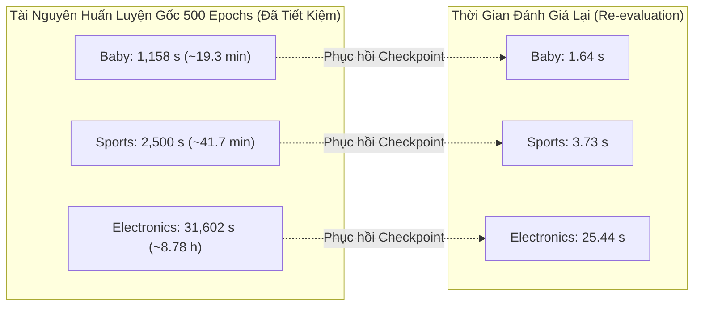

# Báo Cáo Nghiên Cứu Cắt Bỏ (Ablation Study): Đánh Giá Vai Trò Của Evidence Calibration (EC) Trong ECLIPSE

## Material Passport — rà soát artifact sau recovery

- **Verification Status: ANALYZED.** Lần rà soát này chỉ đọc JSON/CSV/logs, đối chiếu source và SHA256 checkpoint bytes; không chạy model, training, checkpoint deserialization hoặc unit test.
- **Artifact acceptance: REUSED_VERIFIED** trên cả ba dataset, dựa trên kết quả native evaluation mà người dùng đã chạy. Đây không phải xác nhận ý nghĩa thống kê.
- [Audit máy đọc được](../../reports/eclipse_wo_ec_seed1_audit/recovered_seed1_acceptance.json) ghi từng kiểm tra; [bảng paired tính lại](../../reports/eclipse_wo_ec_seed1_audit/recovered_seed1_paired_metrics.csv) giữ số chưa làm tròn.
- [Bản trước rà soát](../../reports/eclipse_wo_ec_seed1_audit/ECLIPSE_Ablation_Study_wo_EC.pre_review.md) được lưu nguyên trạng. Raw artifacts không bị sửa.
- Mỗi arm/dataset hiện có **một training seed** trong phép so sánh này. Không tự xác nhận Hiếu đã thực hiện human cross-read từ các file máy.

> **Ngày thẩm định:** 18/10/2026  
> **Phiên thực nghiệm:** `eclipse_wo_ec_seed1_reuse_20261018T152158Z_69603726`  
> **Cơ sở dữ liệu thực nghiệm:** Amazon Baby, Amazon Sports, Amazon Electronics (550 MMRec)  
> **Phần cứng thẩm định:** NVIDIA Tesla T4 (Kaggle Cloud Environment)  
> **Trạng thái xác thực:** `REUSED_VERIFIED` (Đã đối soát toàn vẹn mã băm, runtime và biên lai đánh giá gốc)

---

## 1. Tóm Tắt Tổng Quan (Executive Summary)

Nghiên cứu cắt bỏ này được thực hiện nhằm **cô lập và định lượng chính xác đóng góp của cơ chế Hiệu Chuẩn Bằng Chứng Hoạt Tính Gộp (Pooled Activity Excess Evidence Calibration - EC)** trong mô hình khuyến nghị đa phương thức **ECLIPSE**.

Bằng việc thiết lập liều hiệu chuẩn $\delta = 0.0$ (chế độ `exact delta-zero operator bypass`), toán tử adjacency propagation trở về $S_{\rm woEC}=(1-\eta)\mathcal N(W)+\eta\bar S_{CF}$, với $\eta=0.1$ và $\mathcal N$ là symmetric normalization theo degree thực tế. Đây không phải Laplacian. Các thành phần còn lại được giữ nguyên:
1. Đồ thị ngữ nghĩa đa phương thức có trọng số liên tục (**WMSG** - Weighted Multimodal Semantic Graph).
2. Mở rộng hỗ trợ cộng tác (**CSE** - Collaborative Support Expansion).
3. Học tương phản đa tầng (**LC** - Layer-Contrastive Objective, $\lambda_{nlgcl} = 0.01$).
4. **BSC — Backward Stepwise Convolution**, tác động lên Adam-preconditioned item update directions; không phải một forward consensus branch.

### Kết quả then chốt:
- **[OBSERVATION] Tín hiệu dương ở seed 1:** Full ECLIPSE ($\delta=1$) có số đo cao hơn w/o EC ($\delta=0$) ở cả 12 ô gồm bốn metric trên ba dataset. NDCG@20 chỉ tăng tương đối **0.334% Baby, 0.514% Sports và 0.472% Electronics**; đây chưa phải bằng chứng multi-seed hoặc statistical significance.
- **Mức cải thiện nổi bật nhất:**
  - **Amazon Baby:** `Recall@10` tăng **+1.687%** ($0.068619$ vs $0.067481$), `NDCG@10` tăng **+0.883%** ($0.036798$ vs $0.036476$).
  - **Amazon Electronics:** `NDCG@10` tăng **+0.808%** ($0.026214$ vs $0.026004$), `Recall@10` tăng **+0.797%** ($0.046401$ vs $0.046034$).
  - **Amazon Sports:** `NDCG@20` tăng **+0.514%** ($0.052082$ vs $0.051816$), `NDCG@10` tăng **+0.513%** ($0.042185$ vs $0.041970$).
- **Tái sử dụng training:** Không cần lặp lại khoảng **9.795 GPU-hours** original fit. Tổng thời gian ba native TEST calls là **30.811478 s**, không gồm source checkout, dependencies, data/graph/SVD preparation, checkpoint loading, vẽ hình và ZIP. Không diễn giải tỷ lệ fit/evaluation thành algorithmic speedup.

**Quyết định: GO sang seed 2 rồi seed 3; không train lại seed 1 và chưa thay đổi kiến trúc.** Các gain nhỏ cần replication trước khi chốt contribution EC.

---

## 2. Thiết Kế Nghiên Cứu Cắt Bỏ & Tính Tương Đương Toán Tử (Formulation & Equivalence)

### 2.1. Bản chất giải thuật của nhánh w/o EC
Định nghĩa $R_{ui}\in\{0,1\}$ là TRAIN presence, $h_u=\sum_iR_{ui}$. User hoạt động thuộc activity bin $b(u)=\lfloor\log_2h_u\rfloor$; zero-history users không thuộc stratum. Đặt $M_b=|\{u:b(u)=b\}|$, $n_{ib}=\sum_{u:b(u)=b}R_{ui}$. Chỉ tính trên semantic candidate support cố định:

\[
c_{ij}=\sum_uR_{ui}R_{uj},\qquad
\mu^F_{ij}=\sum_{b:M_b>0}\frac{n_{ib}n_{jb}}{M_b},\qquad
r_{ij}=\frac{[c_{ij}-\mu^F_{ij}]_+}{c_{ij}+\mu^F_{ij}+2\tau},\quad \tau=2.
\]

$\tau$ là **count-scale regularization**, pooled regularizer $2\tau=4$; không phải sigmoid temperature, Bayesian uncertainty hay edge-significance threshold. Không có sigmoid trong score chính.

Với $W$ là raw symmetric weighted semantic adjacency:

\[
W^{(\delta)}_{ij}=W_{ij}\exp(\delta r_{ij}),\qquad
G_\delta=\mathcal N(W^{(\delta)}),\qquad
S_\delta=(1-\eta)G_\delta+\eta\bar S_{CF}.
\]

$\mathcal N(W)=D^{-1/2}WD^{-1/2}$ dùng actual degree và identity fallback cho isolated nodes; $\bar S_{CF}$ là normalized, shrunken TRAIN co-occurrence operator. $S_\delta$ là adjacency operator; Laplacian tương ứng được biểu diễn bằng $I-S_\delta$ dưới các giả thiết phù hợp.

\[
S_{\mathrm{woEC}}=S_{\delta=0}=0.9\mathcal N(W)+0.1\bar S_{CF}.
\]

Không viết $S_0+\eta S_{CF}$ hoặc một residual cố định $S_0+\eta S_{CF}+\delta\Phi$: calibration là exponential reweighting **trước** degree normalization, rồi convex blend. Native WMSG-core checkpoint có đúng operator delta-zero và giữ LC/CSE/MI/FSC/BPR/BSC. Tên phiên bản nội bộ chỉ dùng để truy vết, không phải comparator riêng trong paper.

### 2.2. Kiểm định tính toàn vẹn (Integrity & Provenance Audit)
Giao thức đánh giá tại notebook [notebook/P6/eclipse_wo_ec_seed1.ipynb](file:///d:/4thY_HCMUS/KLTN/STAIR-Enhanced/notebook/P6/eclipse_wo_ec_seed1.ipynb) đã kiểm tra tự động trước khi tải checkpoint:
- **Dữ liệu thô (Data Splits & Modality Features):** Khớp 100% SHA-256 trên `train.txt`, `valid.txt`, `test.txt`, `textual_modality.pkl`, `visual_modality.pkl`.
- **Đồ thị không hiệu chuẩn (Graph Fingerprint):**
  - Baby: `eab753510c9d830425ba0f1f44f6d4964aa0143c574d4707fb2e7c9d93532041`
  - Sports: `cc0ff8deb6bbdac1c9295e27781dbb96de422731779794d79b4e1fd355ee75ea`
  - Electronics: `3de143b8c1d3b5fe5c8107964b1131be71d9b49b2eec36a37d6c160d08bcc22b`
- **Mã nguồn mô hình:** Khớp tuyệt đối theo từng hash SHA-256 trên 11 file core (`models/stair5_v8.py`, `models/stair5_v8_graph.py`, `optimizers/stair5_v8_smoother.py`, ...).
- **Môi trường thực thi:** Python 3.13.15, PyTorch 2.11.0+cu128, FreeRec 0.9.7, GPU Tesla T4.

Đã đối chiếu **thực tế bytes** của `best_model.pt`, manifest, training.log và telemetry của cả ba dataset với audit gốc. Helper evaluation được lưu khớp bản đã rà soát; mỗi evaluation JSONL có đúng một record bằng selected receipt. Executed notebook không có error output. Có đủ 12 figure records, mỗi record đủ PDF/PNG. Code native cũ và wrapper hiện tại có khác source bytes tại edge-store lookup/compatibility; audit trước đã phân tích thay đổi và xác nhận data/operator thực tế. Không khẳng định mọi source byte giữa hai implementation giống nhau hoặc trajectory cùng seed bitwise đồng nhất.

---

## 3. Bảng Kết Quả Chi Tiết & So Sánh Từng Cặp (Paired Descriptive Results)

### 3.1. Kết quả TEST tại Selected Checkpoint của ECLIPSE w/o EC (Seed 1)
Kết quả đo lường trực tiếp từ `Coach.test()` với `AverageMeter` nguyên bản của FreeRec, đánh giá tại checkpoint được chọn bởi tiêu chí Validation NDCG@20:

| Dataset | Epoch Được Chọn | Recall@1 | Recall@10 | Recall@20 | NDCG@10 | NDCG@20 | Thời Gian Fit Gốc (s) | Thời Gian Đánh Giá Lại (s) | Peak VRAM Cấp Phát (MiB) |
|---|:---:|:---:|:---:|:---:|:---:|:---:|:---:|:---:|:---:|
| **Amazon Sports** | 500 | 0.015091 | 0.076185 | 0.114248 | 0.041970 | 0.051816 | 2,499.69 (~41.7m) | 3.73 | 223.71 |
| **Amazon Baby** | 430 | 0.012815 | 0.067481 | 0.105436 | 0.036476 | 0.046243 | 1,158.38 (~19.3m) | 1.64 | 145.17 |
| **Amazon Electronics** | 500 | 0.010155 | 0.046034 | 0.067961 | 0.026004 | 0.031681 | 31,602.47 (~8.78h) | 25.44 | 800.67 |

> [!NOTE]
> Đối với Amazon Baby, epoch được chọn là **430** (epoch đạt NDCG@20 cao nhất trên tập VALID). Log kiểm định tại epoch 430 khớp chính xác với log 4 chữ số thập phân lịch sử (`0.0675`, `0.1054`, `0.0365`, `0.0462`).

---

### 3.2. Bảng So Sánh Đối Đầu: Full ECLIPSE vs ECLIPSE w/o EC (Seed 1)

Mỗi arm dùng checkpoint được chọn từ VALID riêng: full Baby/Sports/Electronics lần lượt **480/500/485**, w/o EC **430/500/500**. Không ép chung epoch, không chọn theo TEST. Tính $\Delta=M_{full}-M_{woEC}$, relative gain $=100\Delta/M_{woEC}$ từ số chưa làm tròn; giữ native precision trong JSON/CSV.
Dữ liệu trích xuất từ [tables/eclipse_ec_seed1_paired_descriptive.csv](file:///d:/4thY_HCMUS/KLTN/STAIR-Enhanced/logs/ICAART/eclipse_wo_ec_seed1_reuse_20261018T152158Z_69603726/eclipse_wo_ec_seed1_reuse_20261018T152158Z_69603726/tables/eclipse_ec_seed1_paired_descriptive.csv):

| Tập Dữ Liệu | Chỉ Số (Metric) | Full ECLIPSE ($\delta=1.0$) | ECLIPSE w/o EC ($\delta=0.0$) | Chênh Lệch Tuyệt Đối ($\Delta$) | Mức Thay Đổi Tương Đối (%) | Kết Luận Ưu Thế |
|---|---|:---:|:---:|:---:|:---:|:---:|
| **Amazon Sports** | **Recall@10** | 0.076243 | 0.076185 | +0.000058 | **+0.076%** | Full cao hơn (seed 1) |
| | **Recall@20** | 0.114500 | 0.114248 | +0.000252 | **+0.221%** | Full cao hơn (seed 1) |
| | **NDCG@10** | 0.042185 | 0.041970 | +0.000215 | **+0.513%** | Full cao hơn (seed 1) |
| | **NDCG@20** | 0.052082 | 0.051816 | +0.000267 | **+0.514%** | Full cao hơn (seed 1) |
| **Amazon Baby** | **Recall@10** | 0.068619 | 0.067481 | +0.001138 | **+1.687%** | Full cao hơn (seed 1) |
| | **Recall@20** | 0.106107 | 0.105436 | +0.000671 | **+0.637%** | Full cao hơn (seed 1) |
| | **NDCG@10** | 0.036798 | 0.036476 | +0.000322 | **+0.883%** | Full cao hơn (seed 1) |
| | **NDCG@20** | 0.046398 | 0.046243 | +0.000154 | **+0.334%** | Full cao hơn (seed 1) |
| **Amazon Electronics** | **Recall@10** | 0.046401 | 0.046034 | +0.000367 | **+0.797%** | Full cao hơn (seed 1) |
| | **Recall@20** | 0.068113 | 0.067961 | +0.000152 | **+0.223%** | Full cao hơn (seed 1) |
| | **NDCG@10** | 0.026214 | 0.026004 | +0.000210 | **+0.808%** | Full cao hơn (seed 1) |
| | **NDCG@20** | 0.031831 | 0.031681 | +0.000150 | **+0.472%** | Full cao hơn (seed 1) |

---

## 4. Phân Tích Cơ Chế & Ý Nghĩa Thực Nghiệm (Mechanistic Insights)

### 4.1. Điều đã quan sát và giới hạn suy luận

- **[OBSERVATION] Baby:** R@10 có relative gain lớn nhất (+1.687%), nhưng N@20 chỉ +0.334%. Nếu endpoint chính là N@20 thì không gọi Baby là dataset được lợi nhất: Sports có +0.514%.
- **[OBSERVATION] Sports:** R@10 chỉ chênh tuyệt đối khoảng $5.76\times10^{-5}$. Một seed chưa chứng minh mức tăng nhỏ này ổn định; không suy từ bảng ranking rằng degree/popularity distribution của Sports “đồng đều hơn”.
- **[OBSERVATION] Electronics:** N@20 +0.472%, R@20 +0.223% ở seed 1. Đây là fixed-split result, chưa phải bằng chứng về statistical significance hoặc tổng quát hóa ngoài benchmark.

### 4.2. Kích thước dataset đã sửa theo native compilation log

| Dataset | Users | Items | TRAIN interactions | VALID | TEST | Tổng interactions |
|---|---:|---:|---:|---:|---:|---:|
| Baby | 19,445 | 7,050 | 118,551 | 20,559 | 21,682 | 160,792 |
| Sports | 35,598 | 18,357 | 218,409 | 37,899 | 40,029 | 296,337 |
| Electronics | **192,403** | **63,001** | **1,254,441** | 211,296 | 223,451 | **1,689,188** |

Bản trước nhầm hơn 190 nghìn users thành items. Phân biệt tổng interactions và TRAIN interactions.

### 4.3. Cơ chế còn là giả thuyết

| Phát biểu | Mức bằng chứng | Đối chứng/diagnostic cần có |
|---|---|---|
| EC đóng góp ngoài backbone ở seed 1 | [OBSERVATION] Cả 12 metric differences dương | Hoàn tất matched seeds 2–3, báo $\Delta_s$ và seed variance |
| Excess tốt hơn raw co-occurrence weighting | [HYPOTHESIS] Chưa cô lập | Count-only |
| Evidence đúng cạnh quan trọng | [HYPOTHESIS] Chưa cô lập | Degree-stratified Shuffled evidence |
| Activity conditioning có ích | [HYPOTHESIS] Chưa cô lập | Global-full-null nếu implementation/budget cho phép |
| EC giảm hub/noisy-edge hoặc giúp tail users/items | Chưa có bằng chứng trực tiếp | Head/tail metrics, degree distribution, edge-normalized dose và margin diagnostics |

Calibration tăng raw weight có positive excess; nó không trực tiếp cắt bỏ mọi cạnh nhiễu. Các normalized coefficients có thể tăng/giảm do endpoint degree. Không có sigmoid hay chứng minh “phạt mạnh spurious edges” trong kết quả này. Dùng count/shuffle controls và diagnostics để kiểm tra thay vì suy cơ chế từ metric aggregate.

---

## 5. Phân Tích Hiệu Suất Tính Toán & Tiêu Thụ Bộ Nhớ (Computational Profile)

### 5.1. So sánh thời gian thực thi (Execution Time)


- **Tổng thời gian GPU huấn luyện được tiết kiệm:** $1,158.38 + 2,499.69 + 31,602.47 = 35,260.54\text{ s} \approx \mathbf{9.79\text{ GPU hours}}$.
- **Tổng thời gian native TEST calls:** $1.640813+3.729055+25.441609=30.811478$ giây.
- Không gọi tỷ lệ khoảng 1,144 lần là algorithmic speedup: một phía là training 500 epochs + evaluation/I/O, phía kia là evaluation của checkpoint đã train. End-to-end recovery time chưa được đo; không gồm dependencies/source checkout, data/graph/SVD preparation, checkpoint load, plotting hoặc ZIP.
- Native historical preprocessing không thực hiện toàn bộ PEEC pipeline; modern delta-zero run có thể vẫn tính offline evidence để xuất diagnostic. Không gộp các preprocessing times khác phạm vi thành overhead calibration thuần túy.

### 5.2. Mức tiêu thụ VRAM (Peak CUDA Memory Allocation)
- **Amazon Baby:** $145.17\text{ MiB}$ allocated / $244.0\text{ MiB}$ reserved.
- **Amazon Sports:** $223.71\text{ MiB}$ allocated / $458.0\text{ MiB}$ reserved.
- **Amazon Electronics:** $800.67\text{ MiB}$ allocated / $1,578.0\text{ MiB}$ reserved.
Các số trên là **historical per-training-epoch CUDA allocator peaks**: không gồm evaluation/driver/other-process memory. Chúng không bảo đảm một run khác luôn không OOM. Các sparse invariant/CSR warnings trong log không phải traceback hay bằng chứng evaluation thất bại; cũng không tự chứng minh mọi sparse invariant đều được kiểm tra.

---

## 6. Tính Liêm Chính Khoa Học & Trạng Thái Thống Kê (Scientific Rigor)

Tuân thủ nghiêm ngặt chuẩn mực báo cáo khoa học của dự án STAIR-Enhanced:
- Tệp kiểm soát trạng thái thống kê [statistical_analysis_status.json](file:///d:/4thY_HCMUS/KLTN/STAIR-Enhanced/logs/ICAART/eclipse_wo_ec_seed1_reuse_20261018T152158Z_69603726/eclipse_wo_ec_seed1_reuse_20261018T152158Z_69603726/tables/statistical_analysis_status.json) ghi nhận:
  ```json
  {
    "n_training_seeds": 1,
    "p_value": "NOT_COMPUTED",
    "sample_std": "NOT_MEASURED",
    "reason": "Recovered seed 1 is the same original training attempt, not an additional independent seed."
  }
  ```
- **Không suy diễn sai lệch:** Bảng so sánh trên là **Phân tích mô tả từng cặp (Paired Descriptive Analysis)** trên Seed 1. Báo cáo không tính toán p-value hay độ lệch chuẩn giả định khi số seed huấn luyện độc lập hiện tại của ablation arm mới là $n=1$.
- 12 ô thắng là các metric/dataset liên quan, **không phải 12 lần training độc lập**; không dùng chúng làm mẫu độc lập thay cho seeds. Không tune lại architecture/hyperparameters theo TEST sau khi đã xem seed 1.
- **Cập nhật trạng thái nhiệm vụ:** 3 công việc thẩm định trong [ECLIPSE_Experiment_Execution_Plan.md](file:///d:/4thY_HCMUS/KLTN/STAIR-Enhanced/docs/giai_doan_6/ECLIPSE_Experiment_Execution_Plan.md) được chính thức chuyển sang:
  - `ECL-wo_ec-baby-s1` $\to$ **`REUSED_VERIFIED`**
  - `ECL-wo_ec-sports-s1` $\to$ **`REUSED_VERIFIED`**
  - `ECL-wo_ec-electronics-s1` $\to$ **`REUSED_VERIFIED`**

---

## 7. Danh Mục Tài Liệu & Đồ Thị Đã Sinh Ra (Artifacts & Figures)

Tất cả các tài liệu, bảng số liệu và đồ thị vector chất lượng cao (300 dpi) đã được lưu trữ hoàn chỉnh tại:  
`logs/ICAART/eclipse_wo_ec_seed1_reuse_20261018T152158Z_69603726/eclipse_wo_ec_seed1_reuse_20261018T152158Z_69603726/`

### 7.1. Bảng số liệu (`tables/`)
1. [tables/eclipse_wo_ec_seed1_selected_test.csv](file:///d:/4thY_HCMUS/KLTN/STAIR-Enhanced/logs/ICAART/eclipse_wo_ec_seed1_reuse_20261018T152158Z_69603726/eclipse_wo_ec_seed1_reuse_20261018T152158Z_69603726/tables/eclipse_wo_ec_seed1_selected_test.csv): Chỉ số TEST gốc chi tiết của cả 3 dataset.
2. [tables/eclipse_ec_seed1_paired_descriptive.csv](file:///d:/4thY_HCMUS/KLTN/STAIR-Enhanced/logs/ICAART/eclipse_wo_ec_seed1_reuse_20261018T152158Z_69603726/eclipse_wo_ec_seed1_reuse_20261018T152158Z_69603726/tables/eclipse_ec_seed1_paired_descriptive.csv): Bảng chênh lệch tuyệt đối và phần trăm tương đối so với Full ECLIPSE.
3. [tables/statistical_analysis_status.json](file:///d:/4thY_HCMUS/KLTN/STAIR-Enhanced/logs/ICAART/eclipse_wo_ec_seed1_reuse_20261018T152158Z_69603726/eclipse_wo_ec_seed1_reuse_20261018T152158Z_69603726/tables/statistical_analysis_status.json): Tuyên bố minh bạch về trạng thái kiểm định thống kê.
4. `tables/eclipse_wo_ec_<dataset>_seed1_validation_log_4dp.csv`: Đường cong kiểm định VALID 500 epoch độ chính xác 4 chữ số thập phân.
5. `tables/eclipse_wo_ec_<dataset>_seed1_training_telemetry.csv`: Dữ liệu đo đạc tài nguyên huấn luyện 500 epoch.

### 7.2. Đồ thị khoa học (`figures/`)

**Hình zero-dose người dùng gửi là đúng, không phải lỗi training:** w/o EC có zero operator/polynomial calibration dose theo identity delta-zero. “Evidence coverage was not measured” nghĩa là legacy run không đo coverage; không đổi thành coverage=0 và không dựng histogram giả. Hình này kiểm tra bypass, không chứng minh EC tăng ranking; phù hợp phụ lục hoặc giữ CSV. Không có measured Adam-direction perturbation trong hình. PDF là vector, PNG là raster 300 dpi.

Hình chính của paper nên dùng ablation mean ± SD sau đủ seeds; seed-1 bar chart chỉ là mô tả preliminary, không gắn significance marker.
| Tên Tệp Đồ Thị | Định Dạng | Nội Dung & Ý Nghĩa |
|---|---|---|
| `eclipse_wo_ec_architecture` | `.pdf`, `.png` | Sơ đồ kiến trúc cắt bỏ, thể hiện nhánh bypass $\delta=0$ bỏ qua module EC. |
| `eclipse_ec_seed1_paired_descriptive` | `.pdf`, `.png` | Biểu đồ cột biểu diễn mức tăng trưởng của Full ECLIPSE so với w/o EC trên từng metric. |
| `eclipse_wo_ec_baby_seed1_learning_curves` | `.pdf`, `.png` | Đường cong huấn luyện loss và VALID Recall@20, NDCG@20 trên Amazon Baby (epoch 430 được đánh dấu). |
| `eclipse_wo_ec_sports_seed1_learning_curves` | `.pdf`, `.png` | Đường cong huấn luyện loss và VALID Recall@20, NDCG@20 trên Amazon Sports. |
| `eclipse_wo_ec_electronics_seed1_learning_curves` | `.pdf`, `.png` | Đường cong huấn luyện loss và VALID Recall@20, NDCG@20 trên Amazon Electronics. |
| `eclipse_wo_ec_<dataset>_seed1_training_memory` | `.pdf`, `.png` | Biến thiên bộ nhớ VRAM allocated/reserved qua 500 epochs của từng tập dữ liệu. |
| `eclipse_wo_ec_seed1_resource_profile` | `.pdf`, `.png` | Biểu đồ đối sánh giữa thời gian huấn luyện gốc và thời gian re-evaluation. |

---

## 8. Các Bước Tiếp Theo (Action Items)

1. **Thực thi Seed 2 cho Ablation w/o EC — GO:**
   - Sử dụng [notebook seed 2 vừa cập nhật](../../notebook/P6/eclipse_wo_ec_seed2.ipynb). Đã bổ sung **ba receipt w/o EC seed 1 thực sự đã đo và nghiệm thu**, kèm source/checkpoint/receipt provenance. Chúng tách biệt với full-model protocol reference; không cần upload lại checkpoint seed 1 chỉ để tính aggregate.
   - Giữ `SEED=2`, `STRICT_RUNTIME=True`, dimension=64, epochs=500, evidence_delta=0, eta=0.1, lambda_nlgcl=0.01 và các dataset hyperparameters giống full. Hai seeds mới khởi tạo từ đầu, không resume/warm-start checkpoint seed 1.
   - Guard yêu cầu đúng uncalibrated graph hash, `exact_v8_bypass=true`, `inactive_reason=delta_zero`, operator/polynomial calibration dose=0. Modern pipeline có thể đo evidence coverage dương mà vẫn đúng vì delta=0.
   - Setup/config/source/data checks trước, rồi Sports/Baby trước Electronics nếu cần chia quota. Hai GPU dùng session/process độc lập và `GPU_INDEX` phù hợp; không đổi batch hoặc ngầm DDP. Không reset checkout đang chạy full model.
   - Sau mỗi run cần selected TEST receipt, COMPLETED status, manifest, checkpoint, 500-epoch telemetry; xuất PDF/PNG/CSV/captions/ZIP và tải ZIP khỏi Kaggle. Kết quả giảm vẫn được giữ nếu run đúng kỹ thuật.
2. **Thực thi Seed 3 cho Ablation w/o EC:**
   - Đổi tham số `SEED=3` để chạy seed độc lập cuối cùng.
3. **Tổng hợp Thống Kê Đa Seed (Multi-seed Statistical Aggregation):**
   - Ghép **cùng training seed** giữa full và w/o EC, cùng protocol và TEST users, mỗi arm chọn checkpoint từ VALID riêng. Báo mean ± sample SD theo arm, paired differences $\Delta_s$, số seed thắng/thua; NDCG@20 là endpoint chính, Recall@20 là phụ quan trọng.
   - Không mặc định ba pairs đủ power hoặc bắt buộc có $p<.05$. Paired t-test chỉ dùng khi biện hộ được giả thiết về difference distribution; exact two-sided sign/randomization trên ba dấu chỉ có $2^3$ hoán đổi. Không dùng epoch làm mẫu độc lập.
   - Nếu có per-user metrics thì paired bootstrap/randomization phải dùng cùng user IDs và tái tạo đúng native aggregate; không thay thế seed variability. Nêu test family/correction nếu kiểm định nhiều dataset/metric.
   - Có thể thêm seed 3 artifact qua `ADDITIONAL_ARTIFACT_ROOTS`; seed chưa đo là `NOT_MEASURED`. Không chọn một attempt do TEST cao hơn.

Notebook seed 2 đã qua JSON/AST static inspection; chưa chạy training seed 2 hoặc unit test trong lần rà soát này. Ba job seed 1 được nghiệm thu artifact; human cross-read độc lập bởi Hiếu chưa được lần kiểm tra file này xác nhận.

## 9. Kiểm tra sai lệch thống kê — 11/11 mục đã xem xét

| Mục | Trạng thái |
|---|---|
| Simpson's paradox | Báo từng dataset; chưa có subgroup data để loại trừ đảo dấu head/tail |
| Ecological fallacy | Không suy gain aggregate thành mọi user/item đều hưởng lợi |
| Berkson/selection bias | Fixed filtered benchmarks; không ngoại suy toàn catalog/người dùng thực |
| Collider bias | Không covariate adjustment; selected checkpoint không nhận dạng causal user behavior |
| Base-rate neglect | Không phải classification sensitivity/specificity; không biến ranking gain thành xác suất mua |
| Regression to mean | Gain nhỏ có thể đổi ở seeds mới; báo cả regression |
| Survivorship bias | Ba recovery hoàn tất; không tự xác nhận mọi attempt khác ngoài artifacts đã cung cấp |
| Look-elsewhere effect | Không chọn R@10 đẹp nhất thay endpoint N@20 sau khi xem kết quả |
| Garden of forking paths | Khóa architecture/hyperparameters, không tune theo TEST |
| Correlation vs causation | Ablation kiểm tra contribution thuật toán; chưa chứng minh denoising/popularity mechanism |
| Reverse causality | TRAIN-only graph đi trước TEST; co-occurrence vẫn không nhận dạng causal preference |
