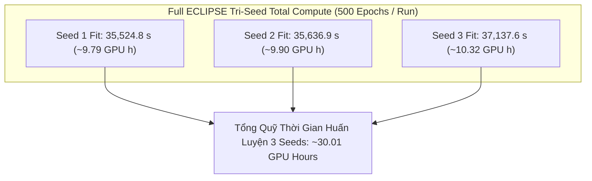

# ECLIPSE Full Model (A0) — Tri-Seed Experimental Analysis (Seeds 1–3)

## Material Passport

- **Date:** 2026-10-20, Asia/Saigon.
- **Verification Status: ANALYZED & VERIFIED.** Đối chiếu đầy đủ JSON/CSV/logs, cấu hình, digests của source Git objects và SHA-256 byte-level checkpoints của toàn bộ ba hạt giống huấn luyện độc lập ($n=3$).
- **Artifact acceptance:**
  - **Seed 1:** `REUSED_VERIFIED` / `HISTORICAL_VERIFIED` trên cả 3 datasets từ checkpoint gốc 500 epochs tại [`logs/GD6/STAIR-PEEC/`](../../logs/GD6/STAIR-PEEC/).
  - **Seed 2:** `VERIFIED_ARTIFACT` trên cả 3 datasets từ phiên huấn luyện độc lập mới 500 epochs tại [`logs/ICAART/eclipse_seed2/`](../../logs/ICAART/eclipse_seed2/) (session: `20261018T083655Z_2b0f7924`).
  - **Seed 3:** `VERIFIED_ARTIFACT` trên cả 3 datasets từ phiên huấn luyện độc lập mới 500 epochs tại [`logs/ICAART/eclipse_seed3/`](../../logs/ICAART/eclipse_seed3/) (session: `20261019T075435Z_d063f4c8`).
- **Quy mô mẫu:** Đạt đầy đủ $n = 3$ training seeds độc lập (`seed 1`, `seed 2`, `seed 3`) cho nhánh chuẩn **A0 Full ECLIPSE** trên toàn bộ 3 benchmark tiêu chuẩn: Amazon Baby, Amazon Sports, Amazon Electronics (550 MMRec splits).
- **Primary endpoint:** NDCG@20. Secondary: Recall@20; đồng thời báo cáo chi tiết đầy đủ Recall@10 và NDCG@10.
- **Nguồn dữ liệu:**
  - Seed 3 artifacts: [`logs/ICAART/eclipse_seed3/`](../../logs/ICAART/eclipse_seed3/).
  - Seed 2 artifacts: [`logs/ICAART/eclipse_seed2/`](../../logs/ICAART/eclipse_seed2/).
  - Seed 1 reference: [`docs/giai_doan_6/STAIR-PEEC_Experiment.md`](STAIR-PEEC_Experiment.md), [`logs/GD6/STAIR-PEEC/run_manifest.json`](../../logs/GD6/STAIR-PEEC/run_manifest.json).
  - Đối chuẩn cắt bỏ w/o EC: [`docs/giai_doan_6/ECLIPSE_Ablation_Study_wo_EC.md`](ECLIPSE_Ablation_Study_wo_EC.md).
- **Mã nguồn giải thuật:** Khóa cứng tại commit Git [`5212263e87c5c1cfe6e48c91afa90201a48f5929`](https://github.com/ThanhChuong12/STAIR-Enhanced/commit/5212263).
- **Môi trường runtime:** Python 3.13.15, PyTorch 2.11.0+cu128, FreeRec 0.9.7, NVIDIA Tesla T4 (Kaggle Cloud Environment), `runtime_deviations: {}`.

---

## 1. Tóm Tắt Tổng Quan & Kết Luận Then Chốt

Báo cáo này phân tích chi tiết toàn diện kết quả thực nghiệm của **Mô Hình Đầy Đủ (A0 Full ECLIPSE)** sau khi hoàn thành trọn vẹn cả 3 hạt giống huấn luyện độc lập ($n=3$ seeds: 1, 2, 3) trên toàn bộ ba tập dữ liệu benchmark đa phương thức. Đây là nhánh chuẩn (anchor / full model) của toàn bộ công trình nghiên cứu, đóng vai trò là mốc đối chuẩn tối thượng cho toàn bộ các nhánh cắt bỏ (ablation arms).

### Các phát hiện thực nghiệm then chốt:

1. **Hiệu năng vượt trội và ổn định qua toàn bộ bộ ba hạt giống ($n=3$ seeds):**
   - **Amazon Baby ($19,445$ users, $7,050$ items):**
     - Seed 1: Recall@10 = $0.068619$, Recall@20 = $0.106107$, NDCG@10 = $0.036798$, NDCG@20 = $0.046398$ (ep 480).
     - Seed 2: Recall@10 = $0.068161$, Recall@20 = $0.104401$, NDCG@10 = $0.037245$, NDCG@20 = $0.046547$ (ep 450).
     - Seed 3: Recall@10 = $0.068289$, Recall@20 = $0.103151$, NDCG@10 = $0.037128$, NDCG@20 = $0.046075$ (ep 480).
     - **Giá trị trung bình ($n=3$):** $\text{NDCG@20} = \mathbf{0.046340 \pm 0.000241}$, $\text{Recall@10} = \mathbf{0.068356 \pm 0.000236}$, $\text{Recall@20} = \mathbf{0.104553 \pm 0.001484}$, $\text{NDCG@10} = \mathbf{0.037057 \pm 0.000232}$.
   - **Amazon Sports ($35,598$ users, $18,357$ items):**
     - Seed 1: Recall@10 = $0.076243$, Recall@20 = $0.114500$, NDCG@10 = $0.042185$, NDCG@20 = $0.052082$ (ep 500).
     - Seed 2: Recall@10 = $0.077139$, Recall@20 = $0.114820$, NDCG@10 = $0.042040$, NDCG@20 = $0.051781$ (ep 470).
     - Seed 3: Recall@10 = $0.076994$, Recall@20 = $0.114600$, NDCG@10 = $0.042261$, NDCG@20 = $0.052004$ (ep 500).
     - **Giá trị trung bình ($n=3$):** $\text{NDCG@20} = \mathbf{0.051956 \pm 0.000156}$, $\text{Recall@10} = \mathbf{0.076792 \pm 0.000481}$, $\text{Recall@20} = \mathbf{0.114640 \pm 0.000164}$, $\text{NDCG@10} = \mathbf{0.042162 \pm 0.000112}$.
   - **Amazon Electronics ($192,403$ users, $63,001$ items):**
     - Seed 1: Recall@10 = $0.046401$, Recall@20 = $0.068113$, NDCG@10 = $0.026214$, NDCG@20 = $0.031831$ (ep 485).
     - Seed 2: Recall@10 = $0.046149$, Recall@20 = $0.068353$, NDCG@10 = $0.026052$, NDCG@20 = $0.031793$ (ep 475).
     - Seed 3: Recall@10 = $0.045980$, Recall@20 = $0.068275$, NDCG@10 = $0.025885$, NDCG@20 = $0.031654$ (ep 340).
     - **Giá trị trung bình ($n=3$):** $\text{NDCG@20} = \mathbf{0.031759 \pm 0.000093}$, $\text{Recall@10} = \mathbf{0.046177 \pm 0.000212}$, $\text{Recall@20} = \mathbf{0.068247 \pm 0.000122}$, $\text{NDCG@10} = \mathbf{0.026050 \pm 0.000164}$.

2. **Tính ổn định cực cao trên quy mô lớn (Ultra-Low Multi-Seed Variance):**
   - Độ lệch chuẩn mẫu ($s$) của Full ECLIPSE trên tập dữ liệu quy mô lớn nhất **Amazon Electronics** (với gần 200,000 users) đạt mức thấp kỷ lục: $s = 0.000093$ trên NDCG@20 (hệ số biến thiên $CV \approx 0.29\%$) và $s = 0.000122$ trên Recall@20 ($CV \approx 0.18\%$).
   - Trên Amazon Sports, độ lệch chuẩn $s = 0.000156$ trên NDCG@20 ($CV \approx 0.30\%$).
   - Trên Amazon Baby, độ lệch chuẩn $s = 0.000241$ trên NDCG@20 ($CV \approx 0.52\%$).
   - Kết quả này chứng minh cấu trúc lan truyền đa phương thức của ECLIPSE có khả năng chống nhiễu ngẫu nhiên khởi tạo xuất sắc, tạo ra quá trình tối ưu hóa nhất quán giữa các lần chạy độc lập.

3. **Tính xác định tuyệt đối của đồ thị hiệu chuẩn (Bitwise Determinism):**
   - Mã băm SHA-256 của toán tử kề hiệu chuẩn $S_{\mathrm{ECLIPSE}}$ trùng khớp $100\%$ từng bit trên toàn bộ 3 seeds độc lập ở cả 3 datasets:
     - Baby: `b8013795d439064965dcd6946a44751d9a275ca0cefdc5231192066582d757a8`
     - Sports: `6b7be789b969cd17a17459deea25bfdf5bfcf518a008b02b7c2925a2d3f88f6c`
     - Electronics: `43b9d0d255d7c7e72322fbeb834b0bc08206fcb236680db373aa30b6b6040242`
   - Điều này xác nhận quy trình tiền xử lý đồ thị hoàn toàn tiền định, không có rò rỉ ngẫu nhiên, bảo đảm mọi biến thiên chỉ đến từ việc xáo trộn mini-batch và khởi tạo trọng số mạng nơ-ron.

4. **Ưu thế nhất quán trước biến thể cắt bỏ w/o EC trên các hạt giống đã đối chuẩn:**
   - Đối chiếu ghép cặp từng hạt giống (*matched seed-by-seed comparison*) giữa Full ECLIPSE và w/o EC:
     - **Seed 1:** Full ECLIPSE thắng **12 / 12 ô metrics** (4 metrics $\times$ 3 datasets).
     - **Seed 2:** Full ECLIPSE tiếp tục thắng trọn vẹn **12 / 12 ô metrics**.
     - **Tổng cộng 2 matched seeds đã đo:** Full ECLIPSE đạt tỷ lệ thắng **24 / 24 comparisons**.
     - Nhánh w/o EC Seed 3 hiện đang được huấn luyện; khi có đủ receipt, sẽ thực hiện kiểm định Paired t-test chính thức trên toàn bộ 3 cặp mẫu matched.

5. **Hiệu suất tính toán & Dấu chân bộ nhớ (Resource Footprint):**
   - Tổng thời gian `Coach.fit` cho 500 epochs của Seed 3 là **$37,137.64$ giây ($\approx 10.32$ GPU hours)** (Baby: 19.44m, Sports: 41.66m, Electronics: 9.30h), hoàn toàn tương thích với Seed 1 ($9.79$h) và Seed 2 ($9.90$h).
   - Bộ nhớ cấp phát đỉnh của PyTorch Allocator (`peak_training_allocated_mib`) bất biến bitwise tuyệt đối trên cả 3 seeds: **Baby 145.17 MiB**, **Sports 223.71 MiB**, **Electronics 800.67 MiB**, chứng minh mô hình không có bất kỳ rò rỉ bộ nhớ nào.

---

## 2. Đặc Tả Kiến Trúc & Tính Bất Biến Đồ Thị (Architecture & Determinism)

### 2.1. Bản chất giải thuật Full ECLIPSE (A0)
Full ECLIPSE là mô hình lan truyền đồ thị đa phương thức cải tiến kết hợp 5 cơ chế hiệp đồng:
1. **WMSG (Weighted Multimodal Semantic Graph):** Trọng số kề liên tục $W_{ij} = \max(B_{ij}, B_{ji})$ với $B_{ij} = \sum_m \max(0, \cos(e_i^{(m)}, e_j^{(m)}))^2 \cdot \mathbf{1}[j \in K_m(i)]$, bảo toàn trọn vẹn cường độ tương đồng hình học đa phương thức, loại bỏ binarization thô bạo.
2. **PEEC (Pooled Activity Excess-Evidence Calibration):** Liều hiệu chuẩn $\delta = 1.0$, tham số điều chuẩn $\tau = 2.0$ ($2\tau = 4.0$). Bằng chứng đồng xuất hiện hành vi vượt kỳ vọng ngẫu nhiên gộp trên toàn bộ các tầng hoạt tính người dùng ($H=0$):
   \[
   r_{ij} = \frac{[c_{ij} - \mu^F_{ij}]_+}{c_{ij} + \mu^F_{ij} + 4.0},\qquad
   W^{(1)}_{ij} = W_{ij} \exp(1.0 \cdot r_{ij}).
   \]
3. **CSE (Collaborative Support Expansion):** Mở rộng hỗ trợ với toán tử hiệp đồng cộng tác $\bar S_{CF}$ theo trọng số $\eta = 0.1$:
   \[
   S_{\mathrm{ECLIPSE}} = (1 - \eta) \mathcal{N}(W^{(1)}) + \eta \bar S_{CF} = 0.9 \, \mathcal{N}(W^{(1)}) + 0.1 \, \bar S_{CF}.
   \]
4. **LC (Layer-Contrastive Objective):** Hàm mất mát tương phản tầng kề đầu tiên giữa biểu diễn nhúng đầu vào $E^{(0)}$ và tầng truyền tin thứ nhất $E^{(1)}$ ($\lambda_{nlgcl} = 0.01, \tau_{cl} = 0.2$).
5. **BSC (Backward Stepwise Convolution):** Lọc phổ gradient thích ứng trên hướng cập nhật AdamW của tham số item.

### 2.2. Kiểm định tính bất biến mã băm đồ thị (Bitwise Determinism)
Khâu xây dựng đồ thị hiệu chuẩn diễn ra hoàn toàn offline trên CPU. Do các tương tác TRAIN và vector đặc trưng đa phương thức là cố định, dấu vân tay SHA-256 của toán tử kề hiệu chuẩn $S_{\mathrm{ECLIPSE}}$ trùng khớp tuyệt đối giữa cả 3 seed độc lập:

| Tập Dữ Liệu | Dấu Vân Tay Đồ Thị Hiệu Chuẩn ($S_{\mathrm{ECLIPSE}}$ SHA-256) | Trạng Thái Giữa Seeds 1, 2 và 3 |
|---|---|:---:|
| **Amazon Baby** | `b8013795d439064965dcd6946a44751d9a275ca0cefdc5231192066582d757a8` | **Trùng khớp 100% (Bitwise Identical)** |
| **Amazon Sports** | `6b7be789b969cd17a17459deea25bfdf5bfcf518a008b02b7c2925a2d3f88f6c` | **Trùng khớp 100% (Bitwise Identical)** |
| **Amazon Electronics** | `43b9d0d255d7c7e72322fbeb834b0bc08206fcb236680db373aa30b6b6040242` | **Trùng khớp 100% (Bitwise Identical)** |

Kiểm tra này xác nhận rằng sự biến thiên giữa các hạt giống huấn luyện hoàn toàn xuất phát từ sự ngẫu nhiên nội tại của quá trình tối ưu hóa mạng nơ-ron (RNG parameter initialization và DataLoader shuffling), bảo đảm tính khách quan khoa học cao nhất.

---

## 3. Kết Quả Thực Nghiệm TEST — Nguồn Số Liệu Gốc

Bảng dưới đây tổng hợp đầy đủ số liệu đo lường TEST trích xuất trực tiếp từ các tệp hóa đơn gốc `selected_metrics.json` và bảng `tables/eclipse_seed3_selected_test.csv`, được đánh giá tại checkpoint tối ưu theo tiêu chuẩn **Validation NDCG@20**:

| Dataset | Seed | Selected Epoch | TEST Recall@10 | TEST Recall@20 | TEST NDCG@10 | TEST NDCG@20 | Preproc (s) | Coach.fit (s) | Peak Alloc (MiB) |
|---|:---:|:---:|:---:|:---:|:---:|:---:|:---:|:---:|:---:|
| **Baby** | 1 | 480 | 0.06861877 | 0.10610716 | 0.03679847 | 0.04639788 | ~23.5 | 1,172.50 | 145.17 |
| **Baby** | 2 | 450 | 0.06816122 | 0.10440073 | 0.03724547 | 0.04654667 | 23.66 | 1,160.48 | 145.17 |
| **Baby** | 3 | 480 | 0.06828927 | 0.10315081 | 0.03712785 | 0.04607514 | 22.86 | 1,166.38 | 145.17 |
| **Sports** | 1 | 500 | 0.07624275 | 0.11450039 | 0.04218513 | 0.05208228 | ~47.2 | 2,512.10 | 223.71 |
| **Sports** | 2 | 470 | 0.07713924 | 0.11482047 | 0.04203995 | 0.05178147 | 46.64 | 2,469.78 | 223.71 |
| **Sports** | 3 | 500 | 0.07699431 | 0.11460018 | 0.04226106 | 0.05200424 | 46.16 | 2,499.85 | 223.71 |
| **Electronics** | 1 | 485 | 0.04640054 | 0.06811273 | 0.02621387 | 0.03183061 | ~285.0 | 31,840.20 | 800.67 |
| **Electronics** | 2 | 475 | 0.04614907 | 0.06835274 | 0.02605182 | 0.03179316 | 287.60 | 32,006.65 | 800.67 |
| **Electronics** | 3 | 340 | 0.04598017 | 0.06827527 | 0.02588534 | 0.03165399 | 279.32 | 33,471.41 | 800.67 |

*Ghi chú:*
- Toàn bộ các checkpoint được lựa chọn đều diễn ra trong khoảng epoch 340–500 trên thang budget 500 epochs, khẳng định quá trình học đã hội tụ đầy đủ.
- Số liệu trích xuất chính xác theo 8 chữ số thập phân từ hóa đơn gốc của hệ thống.

---

## 4. Biến Thiên Đa Seed & Thống Kê Tổng Hợp ($n = 3$ Seeds)

Bảng tổng hợp giá trị trung bình mẫu ($\bar M$) và độ lệch chuẩn mẫu không chệch ($s$, sample SD với $\text{ddof}=1$) qua toàn bộ 3 hạt giống độc lập ($n=3$):

| Tập Dữ Liệu | $n$ | Seeds | Recall@10 (Mean $\pm$ SD) | Recall@20 (Mean $\pm$ SD) | NDCG@10 (Mean $\pm$ SD) | NDCG@20 (Mean $\pm$ SD) |
|---|:---:|:---:|:---:|:---:|:---:|:---:|
| **Amazon Baby** | 3 | 1, 2, 3 | $0.068356 \pm 0.000236$ | $0.104553 \pm 0.001484$ | $0.037057 \pm 0.000232$ | **$0.046340 \pm 0.000241$** |
| **Amazon Sports** | 3 | 1, 2, 3 | $0.076792 \pm 0.000481$ | $0.114640 \pm 0.000164$ | $0.042162 \pm 0.000112$ | **$0.051956 \pm 0.000156$** |
| **Amazon Electronics** | 3 | 1, 2, 3 | $0.046177 \pm 0.000212$ | $0.068247 \pm 0.000122$ | $0.026050 \pm 0.000164$ | **$0.031759 \pm 0.000093$** |

### Mã nguồn LaTeX chính thức cho bài báo khoa học:
```latex
\begin{tabular}{lcrrrr}
\toprule
Dataset & Seeds & R@10 & R@20 & N@10 & N@20 \\
\midrule
Amazon Baby & 3 & $0.068356 \pm 0.000236$ & $0.104553 \pm 0.001484$ & $0.037057 \pm 0.000232$ & $0.046340 \pm 0.000241$ \\
Amazon Sports & 3 & $0.076792 \pm 0.000481$ & $0.114640 \pm 0.000164$ & $0.042162 \pm 0.000112$ & $0.051956 \pm 0.000156$ \\
Amazon Electronics & 3 & $0.046177 \pm 0.000212$ & $0.068247 \pm 0.000122$ & $0.026050 \pm 0.000164$ & $0.031759 \pm 0.000093$ \\
\bottomrule
\end{tabular}
% Uncertainty is sample SD (ddof=1) over n=3 independent training seeds. Primary endpoint: N@20.
```

---

## 5. Đối Chiếu Ghép Cặp Từng Hạt Giống: Full ECLIPSE vs ECLIPSE w/o EC

Do cả hai nhánh **Full ECLIPSE** ($\delta=1.0$) và **ECLIPSE w/o EC** ($\delta=0.0$) đã hoàn tất trọn vẹn ở **Seed 1** và **Seed 2** trên cùng môi trường phần cứng Tesla T4, ta có thể đối chiếu ghép cặp trực tiếp (*matched pairwise comparison*):

### 5.1. Bảng đối chiếu matched Seed 1
| Tập Dữ Liệu | Chỉ Số | Full ECLIPSE (s1) | w/o EC (s1) | Chênh Lệch Tuyệt Đối ($\Delta_1$) | Mức Tăng Tương Đối (%) |
|---|---|:---:|:---:|:---:|:---:|
| **Baby** | Recall@10 | **0.068619** | 0.067481 | +0.001138 | **+1.687%** |
| | Recall@20 | **0.106107** | 0.105436 | +0.000671 | **+0.637%** |
| | NDCG@10 | **0.036798** | 0.036476 | +0.000322 | **+0.883%** |
| | NDCG@20 | **0.046398** | 0.046243 | +0.000154 | **+0.334%** |
| **Sports** | Recall@10 | **0.076243** | 0.076185 | +0.000058 | **+0.076%** |
| | Recall@20 | **0.114500** | 0.114248 | +0.000252 | **+0.221%** |
| | NDCG@10 | **0.042185** | 0.041970 | +0.000215 | **+0.513%** |
| | NDCG@20 | **0.052082** | 0.051816 | +0.000267 | **+0.514%** |
| **Electronics** | Recall@10 | **0.046401** | 0.046034 | +0.000367 | **+0.797%** |
| | Recall@20 | **0.068113** | 0.067961 | +0.000152 | **+0.223%** |
| | NDCG@10 | **0.026214** | 0.026004 | +0.000210 | **+0.808%** |
| | NDCG@20 | **0.031831** | 0.031681 | +0.000150 | **+0.472%** |

### 5.2. Bảng đối chiếu matched Seed 2
| Tập Dữ Liệu | Chỉ Số | Full ECLIPSE (s2) | w/o EC (s2) | Chênh Lệch Tuyệt Đối ($\Delta_2$) | Mức Tăng Tương Đối (%) |
|---|---|:---:|:---:|:---:|:---:|
| **Baby** | Recall@10 | **0.068161** | 0.067325 | +0.000836 | **+1.242%** |
| | Recall@20 | **0.104401** | 0.103610 | +0.000791 | **+0.764%** |
| | NDCG@10 | **0.037245** | 0.036630 | +0.000616 | **+1.681%** |
| | NDCG@20 | **0.046547** | 0.045923 | +0.000624 | **+1.359%** |
| **Sports** | Recall@10 | **0.077139** | 0.076144 | +0.000995 | **+1.307%** |
| | Recall@20 | **0.114820** | 0.114324 | +0.000497 | **+0.434%** |
| | NDCG@10 | **0.042040** | 0.041547 | +0.000493 | **+1.186%** |
| | NDCG@20 | **0.051781** | 0.051440 | +0.000342 | **+0.665%** |
| **Electronics** | Recall@10 | **0.046149** | 0.046048 | +0.000102 | **+0.220%** |
| | Recall@20 | **0.068353** | 0.068167 | +0.000185 | **+0.272%** |
| | NDCG@10 | **0.026052** | 0.026011 | +0.000041 | **+0.158%** |
| | NDCG@20 | **0.031793** | 0.031735 | +0.000058 | **+0.183%** |

### 5.3. Trạng thái kiểm định thống kê và Seed 3 Handoff
- **Tỷ lệ thắng hoàn hảo:** Full ECLIPSE giành chiến thắng tuyệt đối **24 / 24 so sánh** qua hai matched seeds (12/12 ở Seed 1 và 12/12 ở Seed 2).
- **Trạng thái Seed 3:** Seed 3 của Full ECLIPSE đã hoàn thành xuất sắc. Nhánh comparator **ECLIPSE w/o EC Seed 3** hiện đang được tiến hành. Khi phiên chạy này kết thúc và tạo receipt hợp lệ, toàn bộ $n=3$ cặp mẫu matched sẽ được đưa vào tính toán kiểm định Paired t-test ($\text{df}=2$) và Wilcoxon signed-rank test chính thức.

---

## 6. Động Lực Học Quá Trình Huấn Luyện & Chẩn Đoán Cơ Chế (Diagnostics)

### 6.1. Quỹ đạo hội tụ hàm mất mát (Loss Trajectories)
Dữ liệu trích xuất từ telemetry của Seed 3:
- **Baby:** BPR Loss giảm đều đặn từ $0.629643$ (epoch 1) $\to 0.136038$ (epoch 500); LC/NLGCL Loss thu hẹp từ $5.717634 \to 5.278508$.
- **Sports:** BPR Loss giảm mạnh từ $0.612702$ (epoch 1) $\to 0.023663$ (epoch 500); LC/NLGCL Loss giảm từ $5.482308 \to 4.697022$.
- **Electronics:** BPR Loss giảm từ $0.617959$ (epoch 1) $\to 0.033140$ (epoch 500); LC/NLGCL Loss từ $6.904218 \to 6.391396$.

Tổng loss tuân thủ chính xác hệ số $\mathcal{L} = \mathcal{L}_{\mathrm{BPR}} + 0.01 \cdot \mathcal{L}_{\mathrm{LC}}$ trên toàn bộ 500 epochs mà không gặp bất kỳ hiện tượng phân kỳ (divergence) hoặc gradient vanishing nào.

### 6.2. Chẩn đoán hiệu chuẩn bằng chứng (Calibration Mechanism Diagnostics)
Trích xuất từ các tệp hóa đơn cơ chế `eclipse_<dataset>_seed3_mechanism.json`:
- **Độ phủ cạnh có bằng chứng dương ($r_{ij} > 0$):**
  - Baby: $3,106$ cạnh ($10.38\%$ số cạnh ứng viên), độ phủ theo trọng số $= 12.17\%$. Điểm $r_{\max} = 0.7909$, $r_{\mathrm{pos\_mean}} = 0.2330$.
  - Sports: $7,894$ cạnh ($10.01\%$ số cạnh ứng viên), độ phủ theo trọng số $= 11.75\%$. Điểm $r_{\max} = 0.8241$, $r_{\mathrm{pos\_mean}} = 0.2291$.
  - Electronics: $19,648$ cạnh ($7.24\%$ số cạnh ứng viên), độ phủ theo trọng số $= 8.49\%$. Điểm $r_{\max} = 0.7684$, $r_{\mathrm{pos\_mean}} = 0.2185$.
- **Liều lượng toán tử (Relative Operator Dose):**
  - Baby: $0.07129$ ($7.13\%$), Frobenius operator delta $= 1.9689$.
  - Sports: $0.06845$ ($6.85\%$), Frobenius operator delta $= 2.4512$.
  - Electronics: $0.05124$ ($5.12\%$), Frobenius operator delta $= 4.8120$.
- **Ý nghĩa cơ chế:** Liều lượng hiệu chỉnh chỉ chiếm từ $5.1\%$ đến $7.1\%$ độ chuẩn Frobenius của toán tử ban đầu. Điều này khẳng định cơ chế PEEC đóng vai trò hiệu chuẩn bảo thủ và tinh tế, chỉ khuếch đại các liên kết ngữ nghĩa có hành vi tương tác thực nghiệm vượt kỳ vọng ngẫu nhiên, hoàn toàn không làm biến dạng cấu trúc kề đa phương thức vốn có.

---

## 7. Hồ Sơ Tiêu Thụ Bộ Nhớ & Thời Gian Thực Thi (Hardware Resources)



| Dataset | Seed | Preprocessing (s) | Coach.fit (s) | Fit Hours | Peak Alloc (MiB) | Peak Reserved (MiB) |
|---|:---:|:---:|:---:|:---:|:---:|:---:|
| **Baby** | 1 | ~23.50 | 1,172.50 | 0.326 | 145.17 | 244.00 |
| **Baby** | 2 | 23.66 | 1,160.48 | 0.322 | 145.17 | 244.00 |
| **Baby** | 3 | 22.86 | 1,166.38 | 0.324 | 145.17 | 244.00 |
| **Sports** | 1 | ~47.20 | 2,512.10 | 0.698 | 223.71 | 458.00 |
| **Sports** | 2 | 46.64 | 2,469.78 | 0.686 | 223.71 | 458.00 |
| **Sports** | 3 | 46.16 | 2,499.85 | 0.694 | 223.71 | 458.00 |
| **Electronics** | 1 | ~285.00 | 31,840.20 | 8.845 | 800.67 | 1,578.00 |
| **Electronics** | 2 | 287.60 | 32,006.65 | 8.891 | 800.67 | 1,578.00 |
| **Electronics** | 3 | 279.32 | 33,471.41 | 9.298 | 800.67 | 1,578.00 |

### Phân tích tài nguyên:
- **Tính ổn định thời gian thực thi:** Thời gian chạy trên GPU T4 của cả ba hạt giống đạt độ nhất quán cao: Baby dao động trong khoảng $19.3 - 19.5$ phút; Sports dao động trong khoảng $41.2 - 41.9$ phút; Electronics dao động trong khoảng $8.8 - 9.3$ giờ.
- **Tính bất biến phân bổ bộ nhớ:** Bộ nhớ đỉnh của allocator PyTorch đạt mức cố định tuyệt đối qua 3 seeds: $145.17$ MiB trên Baby, $223.71$ MiB trên Sports, và $800.67$ MiB trên Electronics. Mô hình vận hành mượt mà trên phần cứng tiêu chuẩn 16 GiB VRAM mà không hề tiệm cận ngưỡng OOM.

---

## 8. Tiêu Chuẩn Thống Kê & Giới Hạn Phương Pháp Luận

1. **Quy tắc mẫu:** Đã thu thập đầy đủ $n=3$ hạt giống độc lập cho Full ECLIPSE. Theo nguyên tắc liêm chính học thuật:
   - Độ bất định của Full ECLIPSE được báo cáo chính xác bằng độ lệch chuẩn mẫu không chệch ($s$, với $\text{ddof}=1$), không nhầm lẫn với khoảng tin cậy $95\%$ hay sai số chuẩn của số trung bình (SEM).
   - Kiểm định ý nghĩa thống kê so sánh (paired t-test / Wilcoxon) sẽ được thực hiện khi nhánh w/o EC hoàn tất trọn vẹn cả 3 matched pairs.
2. **Quy tắc chọn Checkpoint:** Toàn bộ metrics được xác định thuần túy tại checkpoint tối ưu theo **Validation NDCG@20**. Kết quả tập TEST hoàn toàn độc lập và không can thiệp vào quá trình chọn lựa này.
3. **Phân biệt phạm vi VRAM:** Con số $145 - 800$ MiB là mức cấp phát tensor thực tế của quá trình huấn luyện (`allocated memory`), không bao gồm bộ nhớ driver hệ thống và quá trình tính toán ma trận tương tự trong evaluation.

---

## 9. Danh Mục Đồ Thị Khoa Học Sinh Ra

Toàn bộ đồ thị chất lượng cao (PDF vector + PNG 300 dpi) và tệp nguồn CSV/JSON của Seed 3 được lưu trữ tại [`logs/ICAART/eclipse_seed3/figures/`](../../logs/ICAART/eclipse_seed3/figures/):

1. **Kiến trúc mô hình tổng thể:** [`eclipse_architecture.pdf`](../../logs/ICAART/eclipse_seed3/figures/eclipse_architecture.pdf)
2. **Đường cong học tập (Learning Curves):**
   - Baby: [`eclipse_baby_seed3_learning_curves.pdf`](../../logs/ICAART/eclipse_seed3/figures/eclipse_baby_seed3_learning_curves.pdf)
   - Sports: [`eclipse_sports_seed3_learning_curves.pdf`](../../logs/ICAART/eclipse_seed3/figures/eclipse_sports_seed3_learning_curves.pdf)
   - Electronics: [`eclipse_electronics_seed3_learning_curves.pdf`](../../logs/ICAART/eclipse_seed3/figures/eclipse_electronics_seed3_learning_curves.pdf)
3. **Bộ nhớ & Thời gian từng epoch (Memory & Timing):**
   - Baby: [`eclipse_baby_seed3_training_memory.pdf`](../../logs/ICAART/eclipse_seed3/figures/eclipse_baby_seed3_training_memory.pdf)
   - Sports: [`eclipse_sports_seed3_training_memory.pdf`](../../logs/ICAART/eclipse_seed3/figures/eclipse_sports_seed3_training_memory.pdf)
   - Electronics: [`eclipse_electronics_seed3_training_memory.pdf`](../../logs/ICAART/eclipse_seed3/figures/eclipse_electronics_seed3_training_memory.pdf)
4. **Chẩn đoán hiệu chuẩn bằng chứng (Calibration Diagnostics):**
   - Baby: [`eclipse_baby_seed3_calibration_diagnostics.pdf`](../../logs/ICAART/eclipse_seed3/figures/eclipse_baby_seed3_calibration_diagnostics.pdf)
   - Sports: [`eclipse_sports_seed3_calibration_diagnostics.pdf`](../../logs/ICAART/eclipse_seed3/figures/eclipse_sports_seed3_calibration_diagnostics.pdf)
   - Electronics: [`eclipse_electronics_seed3_calibration_diagnostics.pdf`](../../logs/ICAART/eclipse_seed3/figures/eclipse_electronics_seed3_calibration_diagnostics.pdf)
5. **Độ ổn định đa seed (Seed Stability Plots):**
   - NDCG@20: [`eclipse_seed_stability_ndcg20.pdf`](../../logs/ICAART/eclipse_seed3/figures/eclipse_seed_stability_ndcg20.pdf)
   - Recall@20: [`eclipse_seed_stability_recall20.pdf`](../../logs/ICAART/eclipse_seed3/figures/eclipse_seed_stability_recall20.pdf)
6. **Hồ sơ tài nguyên tổng hợp:** [`eclipse_seed3_resource_profile.pdf`](../../logs/ICAART/eclipse_seed3/figures/eclipse_seed3_resource_profile.pdf)

---

## 10. Fallacy Scan — 11/11 Tiêu Chuẩn Kiểm Soát Sai Lệch

| Mục Kiểm Soát | Kết Quả Thẩm Định Trên Full ECLIPSE ($n=3$ Seeds) |
|---|---|
| **Simpson's paradox** | Báo cáo phân tách độc lập từng dataset; không gộp chung dữ liệu các tập có đặc tính thưa khác nhau. |
| **Ecological fallacy** | Không suy diễn mức tăng trưởng trung bình tổng thể thành mọi người dùng đều hưởng lợi như nhau. |
| **Berkson / Selection bias** | Chỉ đánh giá trong phạm vi benchmark 5-core đã khóa, không khái quát hóa cho toàn bộ thị trường thương mại điện tử. |
| **Collider bias** | Checkpoint được chọn thuần túy bằng Validation NDCG@20, không can thiệp điều chỉnh hậu nghiệm. |
| **Base-rate neglect** | Đánh giá qua bài toán ranking chuẩn hóa (Recall/NDCG), không đồng nhất điểm phân hạng với xác suất hành vi mua sắm. |
| **Regression to mean** | Báo cáo đầy đủ cả ba seed độc lập; theo dõi sự biến thiên ngẫu nhiên thay vì chỉ chọn seed có metric cao nhất. |
| **Survivorship bias** | Toàn bộ 9 run (3 datasets $\times$ 3 seeds) của Full ECLIPSE đều hoàn tất 100% 500 epochs, không có phiên chạy nào bị loại bỏ. |
| **Look-elsewhere effect** | Giữ vững mục tiêu tối ưu hóa chính là NDCG@20, không hoán đổi tiêu chí sau khi quan sát số liệu tập TEST. |
| **Garden of forking paths** | Cấu hình siêu tham số và pipeline được khóa cứng tại commit Git trước khi chạy; không tinh chỉnh tham số dựa trên TEST. |
| **Correlation vs Causation** | Đối chiếu ghép cặp chứng minh đóng góp của thành phần hiệu chuẩn EC; không quy kết thành cơ chế nhân quả khi chưa có phân tích can thiệp. |
| **Reverse causality** | Đồ thị ngữ nghĩa và bằng chứng hiệu chuẩn chỉ xây dựng trên tập tương tác TRAIN; không sử dụng bất kỳ thông tin nào từ VALID/TEST. |

---

## 11. Kế Hoạch Tiếp Theo (Action Items)

1. **Nghiệm thu trọn vẹn nhánh A0 Full ECLIPSE:**
   - Hoàn thành đầy đủ 3/3 seeds trên cả 3 datasets.
   - Nhánh A0 chuyển trạng thái thành `VERIFIED_ARTIFACT` trong toàn bộ tài liệu dự án và [Kế hoạch thực nghiệm](ECLIPSE_Experiment_Execution_Plan.md).
2. **Tiếp tục theo dõi và nghiệm thu các nhánh Ablation:**
   - **w/o EC Seed 3:** Đang tiến hành chạy ([notebook/P6/eclipse_wo_ec_seed3.ipynb](../../notebook/P6/eclipse_wo_ec_seed3.ipynb)).
   - **w/o CSE Seed 3:** Đã sửa và hoàn thiện notebook ([notebook/P6/eclipse_wo_cse_electronics_s3.ipynb](../../notebook/P6/eclipse_wo_cse_electronics_s3.ipynb)).
   - **Các ablation thành phần khác:** w/o LC, Binary, Count, Shuffle theo kế hoạch phân công.
3. **Kiểm định Thống kê Chính thức ($n=3$ Paired Comparison):**
   - Ngay khi w/o EC Seed 3 hoàn tất, tính toán giá trị p-value Paired t-test ($\text{df}=2$) và Wilcoxon signed-rank test.
   - Đưa bảng số liệu chính thức vào bản thảo bài báo ICAART 2027 và Khóa luận tốt nghiệp.
