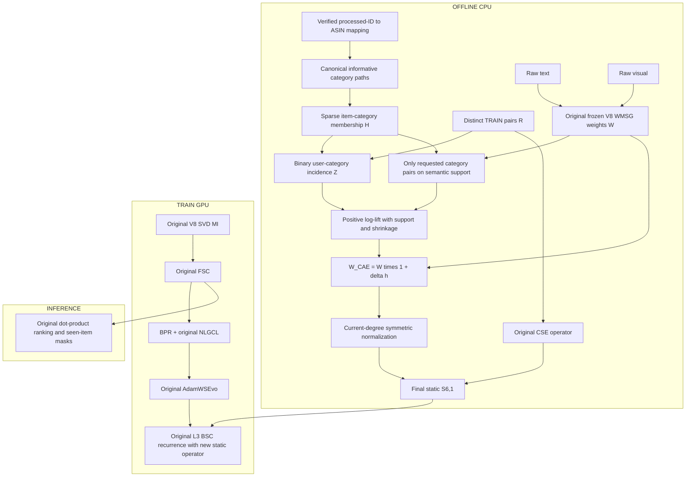

# STAIR6-v1 — Category-Association Enrichment for WMSG-CSE

> **Final research architecture specification — 2026-10-13.**
> **Tên kiến trúc:** STAIR6-v1, **CAE-WMSG-CSE** — Category-Association Enrichment of the Weighted Multimodal Semantic Graph with Candidate Support Expansion.
> **Tên file:** giữ `STAIR5_v1_Report.md` trong `giai_doan_6` theo yêu cầu; mô hình được gọi là **STAIR6-v1**, không phải STAIR5-v1 của Giai đoạn 5.
> **Verdict:** **REDESIGN** gate của đề xuất ban đầu. **CONDITIONAL IMPLEMENT** kiến trúc CAE sau khi có metadata và mapping xác minh được. **Hiện tại: NO-GO cho category-enabled training.**
> Đây là đặc tả nghiên cứu, không phải code đã triển khai hoặc kết quả thực nghiệm STAIR6-v1.

## 1. Executive summary

Hướng category có cơ sở để nghiên cứu, nhưng đề xuất CG-WMSG và bản phản biện đều đi quá xa khi đồng nhất category association với substitute/complement, direction và dấu của gradient. Những quan hệ này không được nhận dạng từ các trường dữ liệu hiện có.

Bản cuối cùng chọn một can thiệp hẹp: **làm giàu có giới hạn trọng số trên support semantic WMSG hiện hữu bằng positive category association ước lượng từ train**. Không thêm cạnh, không hard-prune cạnh yếu, không inferred negative edge, không thêm GAT/GRU/category loss, không thay initialization hoặc scorer. CSE, FSC, BPR, NLGCL và optimizer của V8 giữ nguyên.

**[HYPOTHESIS]** Category aggregation có thể cung cấp bằng chứng sở thích được chia sẻ ở mức nhóm, hữu ích cho các semantic neighbors có item-level co-occurrence yếu; hiệu chỉnh này có thể bổ sung cho CSE mà không tái tạo over-expansion của các bản trước.

**[FACT — dữ liệu hiện có]** Audit thư mục `data` và ZIP Baby chưa tìm thấy category metadata hoặc mapping ASIN–processed-item. Người dùng cũng xác nhận có khả năng chưa có. Vì vậy, không được bắt đầu category-enabled model bằng category giả, filename order hoặc suy đoán ASIN. Trước mắt V8 là fallback/đối chứng; bước kế tiếp là khôi phục đúng mapping và audit metadata.

Không dự báo NDCG@20 cụ thể hoặc khẳng định tăng 1–2%, 3%, 5–6%. Xác suất tăng metric chưa được hiệu chuẩn. Mục tiêu vượt V8 phải được kiểm định bằng matched controls và nhiều seeds.

## 2. Research scope, methodology và nguồn bằng chứng

Sử dụng `academic-research-suite`, `deep-research` và `academic-paper-reviewer` ở **methodology-focus**. Nghiên cứu có mục tiêu, không phải systematic review toàn bộ MMRec.

Nguồn được đối chiếu:

1. `docs/EStair.md`.
2. `docs/giai_doan_5/STAIR5_v8_Experiment_Report.md`.
3. `docs/giai_doan_5/STAIR5_v8_Implementation_Audit.md` và source V8 graph/model/launcher/smoother.
4. Raw V8 logs, manifests và epoch telemetry trong `logs/GD5/stair5_v8_artifacts/`.
5. Đề xuất đính kèm `1bb14ded-6c37-447e-8a30-4098dcfc6041/Pasted text.txt` và phản biện trong tin nhắn.
6. Inventory `data`, ZIP Baby và documentation Amazon 2014.
7. Primary papers/proceedings/source về categories, signed feedback và graph reliability.

Literature và methodology được kiểm tra ở hai nhiệm vụ tách biệt; publication fit/novelty được tổng hợp trong báo cáo. Các lượt này là hỗ trợ bằng AI, cùng họ mô hình, **NOT_CALIBRATED**, không phải review độc lập của con người hoặc chứng nhận A*/Q1.

| Nhãn | Ý nghĩa |
|---|---|
| FACT | Có thể xác minh trực tiếp từ source/data/source xuất bản |
| OBSERVATION | Kết quả đo hoặc được báo cáo, kèm phạm vi |
| INTERPRETATION | Giải thích chưa được kiểm định nhân quả |
| HYPOTHESIS | Có thí nghiệm để xác nhận hoặc bác bỏ |
| SPECULATION | Chưa đủ cơ sở làm thành phần chính |

Tài liệu đầu vào là đối tượng thẩm định, không phải mệnh lệnh phải giữ mọi module hoặc mọi claim.

## 3. Đọc lại V8: những gì đã chứng minh và chưa chứng minh

### 3.1 Source V8 thực tế

**[FACT]** WMSG-core dùng:

\[
f_p(a)=\epsilon_w+(1-\epsilon_w)[\max(0,a)]^p,
\quad p=2,\quad\epsilon_w=0.05.
\tag{1}
\]

Tính trên raw-feature candidates text top-5, visual top-1; cộng các directed modality contributions rồi max-symmetrize. Không áp dụng thêm multiplier 5/6 và 1/6 cho graph contributions. 5:1 trong MI là phép khác. Source không hiện thực inverse-frequency formula được mô tả ở mục 5.1 của report thực nghiệm.

Primary configuration: eta0.1, CF top5, cmin2, shrinkage5, d64, L3, NLGCL lambda0.01/tau0.2/G1/alpha0.5. SAP, relation proxy gate, BSC residual và Dirichlet loss tắt. Giữ p và gamma schedule backbone là hai ký hiệu khác nhau.

### 3.2 Kết quả ở selected checkpoint

Dòng TEST sau `Load best model` được dùng; Baby chọn epoch430, không lấy final-epoch summary500 thay nó. Dữ liệu làm tròn dưới đây không tạo thêm precision giả.

| Dataset | Model | R@10 | R@20 | N@10 | N@20 |
|---|---|---:|---:|---:|---:|
| Baby | V4 reported comparator | 0.0678 | 0.1056 | 0.0364 | 0.0461 |
| Baby | V8 selected TEST | 0.0675 | 0.1054 | 0.0365 | 0.0462 |
| Sports | V4 reported comparator | 0.0765 | 0.1143 | 0.0419 | 0.0517 |
| Sports | V8 selected TEST | 0.0762 | 0.1142 | 0.0420 | 0.0518 |
| Electronics | V4 reported comparator | 0.0458 | 0.0678 | 0.0260 | 0.0316 |
| Electronics | V8 selected TEST | 0.0460 | 0.0680 | 0.0260 | 0.0317 |

**[OBSERVATION]** N@20 tăng khoảng0.22%,0.19%,0.32% so với V4 theo bảng làm tròn; R20 Baby/Sports giảm nhẹ. Chưa có paired multi-seed variance để kết luận superiority hoặc equivalence. Sports/Electronics chọn epoch500 là right-censored theo horizon, không chứng minh đã hội tụ.

Không gọi đây là global SOTA từ việc vượt các phiên bản nội bộ. Không dùng top1 gain để khẳng định đã loại bỏ hub noise/category confusion. V8 có chi phí và kết quả khả quan; nguyên nhân nhân quả còn cần diagnostics.

### 3.3 Đúng phạm vi memory/time

| Dataset | Train pairs | Mean train epoch s | Peak allocated MiB | Peak reserved MiB |
|---|---:|---:|---:|---:|
| Baby | 118,551 | 2.199 | 145.172 | 244 |
| Sports | 218,409 | 4.678 | 223.713 | 458 |
| Electronics | 1,254,441 | 59.076 | 800.670 | 1,578 |

143.92/222.84MiB là averages được report, không phải peaks. 800.67MiB **lớn hơn** 800MiB. Train allocated counters không bao gồm tất cả preprocessing/evaluation/process VRAM. Coach.fit Electronics31602.47s (~8.78h) là quan sát trên run đó, không đảm bảo hoàn tất dưới mọi Kaggle time limit.

Implementation audit V8 ghi rõ revision là static inspection, không phải thực thi tests. Logs cho thấy các runs đã hoàn tất; chúng không biến mọi contract test thành đã chạy hoặc chứng minh không có lỗi.

## 4. Reviewer #2: phản biện cả đề xuất lẫn bản phản biện

| Claim/module | Adjudication | Sửa trong bản cuối |
|---|---|---|
| Same category ⇒ affinity1 ⇒ substitute | Không có nhãn hoặc cơ chế nhận dạng; broad roots quá thô | Canonical informative terminal categories; không gán relation labels |
| Category khác nhau ⇒ complementary | Sai như quy tắc phổ quát | Cross-category association chỉ là statistical evidence |
| MacBook/iPhone là substitutes | Ví dụ chưa được xác thực; không phải ground truth benchmark | Không dùng ví dụ làm nhãn huấn luyện hoặc proof |
| Jaccard trên mọi ancestors/brand/style/price | Trộn typed attributes và shared roots; có thể dominated bởi ancestors | Category paths, brand, price là các field khác nhau; primary chỉ taxonomy |
| Ochiai hoàn toàn loại popularity bias | Normalization không loại exposure/history confounding | Association đối chiếu marginals, có shrinkage, không causal debiasing claim |
| PMI giải quyết hoàn toàn popularity | Sparse counts tạo extreme PMI; exposure và taxonomy overlap vẫn tồn tại | Positive log-lift có support rule, bounded transform, neutral fallback |
| Piecewise Jaccard hoặc PMI dùng chung sigmoid | Jaccard[0,1], PMI âm/unbounded: scale mismatch | Không dùng piecewise mixed-scale affinity |
| Gate đối xứng không phân biệt relation types | Symmetry và relation type là hai vấn đề khác nhau | Giữ đối xứng để có spectral guarantee; không claim classification |
| “Asymmetric” min/max-price × Jaccard | Công thức vẫn invariant khi swap i,j | Loại khỏi primary |
| Positive sigmoid(substitute_score−threshold) làm giảm substitutes | Monotonicity ngược: score tăng thì sigmoid tăng | Loại công thức; sửa dấu chỉ sửa số học, không xác thực label |
| Temporal order xác định complement | Có TIMESTAMP nhưng review time không phải purchase sequence/session/exposure | Primary unordered train incidence; không suy ra direction |
| Gate loại100% false-positive semantic edges | Không có edge ground truth hoặc error estimate | Không hard-prune và không tuyên bố noise classification |
| Norm≤1 ⇒ AdamW hội tụ tuyệt đối | Không suy ra từ operator boundedness | Chứng minh riêng graph/polynomial bounds, giới hạn claim |
| Zero extra overhead | Extra CPU metadata/statistics/preprocessing có thật | “No new trainable parameters or train-time branch”; đo CPU cost |
| Dự báo5–6%, hoặc “thực tế1–2%” | Cả hai chưa có evidence cho V8 | Bỏ numerical forecasts |

### 4.1 Ý tưởng price/category retention đã có trong source V8

`compute_relation_proxy_gate()` tại `models/stair5_v8_graph.py` đã hiện thực optional RPG:

\[
g_{ij}^{RPG}=1-\kappa m_{ij}
\sigma\!\left(\frac{r^{price}_{ij}J(C_i,C_j)-\tau_s}{T_s}\right),\quad0\le\kappa\le0.25.
\tag{2}
\]

Có masks, generic-root removal, currency compatibility và verified mapping/snapshot requirements. WMSG-core chưa bật module này. Đưa lại chính module đó rồi đổi tên thành Giai đoạn6 không tạo novelty mạnh. Nếu nghiên cứu RPG, phải dùng như comparator riêng khi có valid price snapshot; không giả định nó đã cho gain.

### 4.2 Literature không thể được dùng như một proof ngoài phạm vi

*The Edge Spectrum* áp dụng cho choice-derived graphs và within-slate competition; chưa chứng minh weak WMSG/CF edges là complements. Không chuyển kết luận đó thành sign rule của Amazon category gate. [Author manuscript](https://arxiv.org/html/2608.29578v1).

Thay đổi direction không tự sửa sign mismatch. Muốn signed propagation cần explicit feedback hoặc relation/exposure supervision phù hợp và một benchmark protocol riêng.

## 5. Deep literature review — verified references và transfer boundary

| Verified work | Mechanism liên quan | Transfer boundary |
|---|---|---|
| **Attribute Association Driven Multi-Task Learning for Session-based Recommendation** — Xinyao Wang, Zhizhi Yu, Dongxiao He, Liang Yang, Jianguo Wei, Di Jin. IJCAI2025:3417–3425, DOI10.24963/ijcai.2025/380. [Proceedings](https://www.ijcai.org/proceedings/2025/380), [paper](https://www.ijcai.org/proceedings/2025/0380.pdf) | A²D-MTL dùng category transition/GAT, contextual sparse attention và category/item tasks | Ordered session prediction khác static full ranking; không kế thừa gain nếu chỉ lấy offline gate |
| **CLHHN: Category-aware Lossless Heterogeneous Hypergraph Neural Network for Session-based Recommendation** — Yutao Ma, Zesheng Wang, Liwei Huang, Jian Wang. ACM TWEB18(1), Article12, 2024; online2023. DOI10.1145/3626569. [Publisher](https://doi.org/10.1145/3626569), [institutional record](https://faculty.ccnu.edu.cn/mayutao/en/lwcg/380067/content/7405.htm) | Category/item nodes và heterogeneous hyperedges giữ session information | Không chứng minh static overlap đo compatibility. Full publisher text unavailable ở lượt này; không dùng detailed ablation chưa đọc |
| **An Attribute-Driven Mirror Graph Network for Session-based Recommendation** — Siqi Lai, Erli Meng, Fan Zhang, Chenliang Li, Bin Wang, Aixin Sun. SIGIR2022:1674–1683. DOI10.1145/3477495.3531935. [Official code/citation](https://github.com/WHUIR/MGS), [official program](https://sigir.org/sigir2022/program/program-sigir22.pdf) | Metadata-derived mirror view cho session learning | Attributes là thêm view, không phải rule cùng category hữu ích/cross-category nhiễu |
| **The Edge Spectrum of Choice-Derived Item Graphs: Strong and Weak Edges Encode Different Relations in Collaborative Filtering** — Keigo Sakurai, Takahiro Ogawa, Miki Haseyama. Accepted CIKM2026, arXiv2608.29578; conference tháng11 sau ngày audit13/10. [Manuscript](https://arxiv.org/abs/2608.29578), [official program](https://cikm2026.diag.uniroma1.it/program/) | Diagnosis của operator/gradient alignment trên impression-based news graphs | Không có cùng estimand với semantic/long-term co-occurrence của V8; không suy ra weak=complement |
| **Inferring Networks of Substitutable and Complementary Products** — Julian McAuley, Rahul Pandey, Jure Leskovec. KDD2015:785–794, DOI10.1145/2783258.2783381. [Author paper](https://cs.stanford.edu/people/jure/pubs/prodgraph-kdd15.pdf), [arXiv1506.08839](https://arxiv.org/abs/1506.08839) | Sceptre học product-link relations bằng text/hierarchy và supervised browsing/co-purchasing links | Category tree alone không đủ nhận dạng complements; không phải personalized ranking V8 |
| **HAKG: Hierarchy-Aware Knowledge Gated Network for Recommendation** — Yuntao Du, Xinjun Zhu, Lu Chen, Baihua Zheng, Yunjun Gao. SIGIR2022:1390–1400, DOI10.1145/3477495.3531987. [Paper](https://arxiv.org/abs/2204.04959), [official source](https://github.com/yuntaod/HAKG) | Static recommendation dùng hierarchical KG representations và gated CF/knowledge fusion | Tiền lệ hierarchy hữu ích, nhưng không validate PMI gate; KG/model/objectives thay đổi cùng nhau |
| **Sign-Aware Multimodal Graph Recommendation** — Yahong Lian, Haotian Tian, Chunyao Song, Tingjian Ge. AAAI2026,40(18):15225–15233. DOI10.1609/aaai.v40i18.38547. [Official paper](https://ojs.aaai.org/index.php/AAAI/article/view/38547) | SiMGR có explicit ratings để định nghĩa signed feedback và personalized thresholds | Không suy ra signed edge từ category/price. Thêm ratings là thêm information/protocol, cần matched control |
| **A Tale of Two Graphs: Freezing and Denoising Graph Structures for Multimodal Recommendation** — Xin Zhou, Zhiqi Shen. ACM MM2023:935–943, DOI10.1145/3581783.3611943. [Paper](https://arxiv.org/abs/2211.06924), [official source](https://github.com/enoche/FREEDOM) | FREEDOM freeze item graph và degree-sensitive interaction denoising | Hỗ trợ thử static refinement trước dynamic architecture; không guarantee gain trên stronger V8 |
| **STAIR: Manipulating Collaborative and Multimodal Information for E-Commerce Recommendation** — Cong Xu, Yunhang He, Jun Wang, Wei Zhang. AAAI2025; preprint2024. [Paper](https://arxiv.org/abs/2412.11729), [source](https://github.com/yhhe2004/STAIR) | MI/FSC/constrained updates làm nền kiến trúc | Graph retention không tự chứng minh preference usefulness |

**Correction:** A²D-MTL Table3 thực sự có Diginetica P20 w/oCATE52.92, full61.94. Do đó phát biểu blanket “paper này chỉ hỗ trợ gain2–3%” không đúng. Ablation của cả session model cũng không phải dự báo gain cho một category gate của STAIR. Không chuyển P20 sang N20 hoặc chọn một phần trăm khác để gọi là “thực tế”.

**Novelty conclusion:** category graphs, hierarchy và behavioral guidance đều có prior art. Đóng góp nếu có phải là một diagnosis được kiểm định và controlled graph correction, không phải lần đầu dùng category trong recommendation.

## 6. Metadata feasibility audit — kết quả và điều kiện bắt buộc

### 6.1 Inventory hiện tại

**[FACT — snapshot13/10/2026]** Recursive inventory `data` có41files, gồm Baby/ProcessedBaby, TikTok/ProcessedTikTok và archive; không có filename khớp category/metadata/mapping/ASIN/item2/id2. Amazon Baby folder và ZIP có đúng:

```text
train.txt
valid.txt
test.txt
textual_modality.pkl
visual_modality.pkl
```

Header split Baby: `USER ITEM TIMESTAMP`; kiểm tra cả ba splits cho thấy ITEM là numeric IDs, không phải ASIN strings có thể dùng trực tiếp. Chưa có original-ASIN mapping xác minh được trong bundle này. Local Sports/Electronics processed datasets không có trong inventory; logs của chúng không cung cấp item-category mapping. Không kết luận metadata không tồn tại ở mọi nguồn ngoài workspace; kết luận là **chưa có artifact đủ dùng ở đây**.

Official Amazon2014 metadata có categories dạng list of paths và ASIN, price tại thời điểm crawl. Các trường `related` chứa external behavioral links; không dùng vào primary vì split-time provenance chưa rõ. [Official dataset documentation](https://cseweb.ucsd.edu/~jmcauley/datasets/amazon/links.html).

### 6.2 Phải khôi phục mapping trước, không chỉ tải metadata

Processed item IDs không được gán ASIN bằng thứ tự file metadata, sorted ASIN hoặc nearest-neighbor feature matching gần đúng. Hash identity có thể xác nhận hai artifacts giống nhau nhưng không chứng minh một mapping suy đoán là đúng.

Hai đường hợp lệ:

1. Lấy mapping từ chính pipeline/provider đã tạo splits và feature-row order V8; kiểm tra một-một trên toàn processed catalog.
2. Nếu không thể khôi phục, tạo một dataset variant mới từ raw data bằng preprocessing tái lập có explicit mapping, rồi **re-run V8 control và STAIR6-v1 trên chính variant đó**. Không so trực tiếp với bảng lịch sử như thể split/mapping unchanged.

Metadata cần có snapshot/provenance hợp lý với benchmark. Không trộn taxonomy hiện tại2026 hoặc post-test behavior vào Amazon2014 mà không khai báo changed-information experiment.

### 6.3 Input artifacts đề xuất

| Artifact | Required content |
|---|---|
| `item_id_to_asin.json` | Array N_i hoặc explicit contiguous-ID table; every catalog ID maps exactly once |
| `item_categories.jsonl` | item_id, asin, categories as canonical full paths, source snapshot, validity status |
| `category_metadata_manifest.json` | Split/feature/mapping/metadata hashes, source URL, retrieval/snapshot evidence, canonicalization version |
| `category_audit.json` | Coverage, root-only/missing/depth/label frequencies, mapping errors, edge-level informative coverage |

100% **ID mapping validity** bắt buộc; category completeness có thể thấp hơn100% với neutral fallback. Quy tắc coverage>90% chưa đủ:100% root-only metadata vẫn vô ích. Không chọn threshold coverage bằng cách xem test metric.

Nếu enabled nhưng mapping/file không hợp lệ: **fail-fast**. Nếu category riêng một item thiếu: neutral multiplier1. Nếu mọi category đều thiếu/generic hoặc tất cả scores0: effective CAE inactive, báo NO-GO; không gọi baseline run đó là một thành công category.

## 7. Candidate architectures và lựa chọn

| Candidate | Hypothesis | Risk / simplicity | Verdict |
|---|---|---|---|
| A. Hierarchy/price retention gate | Taxonomy similarity dự báo harmful semantic edges | Không có relation labels; gần RPG đã có; có thể giảm useful substitutes/complements | Backup heuristic control, không primary |
| B. Positive category-association enrichment | Pooling train preferences theo taxonomy cung cấp evidence ở mức nhóm ngoài item co-occurrence | Static, zero parameters, cùng support; vẫn có exposure/popularity confounding | **Primary CAE**, có điều kiện metadata |
| C. Item–category diffusion/hypergraph | Category paths tạo connectivity thiếu | Thêm topology và propagation, broad-category over-smoothing; gần failure v5.2 | Reject cho bảnv1 |
| D. Signed/directed relation propagation | Relation feedback nhận dạng signs/ordering | Cần explicit relation/exposure/rating supervision chưa có; đổi protocol | Separate future project, không bật bằng heuristic |

Điểm đánh giá qualitative: B có attribution và feasibility tốt nhất **khi metadata hợp lệ**, không có evidence trực tiếp rằng ranking gain cao nhất. Hiện tại cả các category candidates đều thiếu input. Không invent latent categories rồi vẫn gọi là taxonomy model; đó sẽ là một hypothesis và tên kiến trúc khác.

## 8. Final architecture: CAE-WMSG-CSE

### 8.1 Core hypothesis

> **[HYPOTHESIS]** Bằng chứng positive association ở mức informative category có thể cải thiện relative weighting giữa các semantic neighbors của V8, đặc biệt khi item-level CF sparse, mà không cần loại cạnh hoặc mở rộng topology.

Đây không phải assertion category-blindness đã được chứng minh là nguyên nhân saturation của V8. Stage0 phải tìm evidence trước.

### 8.2 Design principles

- Giữ frozen semantic candidates, WMSG equation(1), modality fusion order và CSE của V8.
- Category chỉ là static train-derived evidence, không economic relation classifier.
- Không cấp affinity1 cho cùng category; không dùng broad roots làm informative labels.
- Thiếu hoặc yếu evidence ⇒ neutral. Negative/zero association không được hiểu là dislike.
- Thay duy nhất final item BSC graph; MI/FSC/loss/scorer/evaluation nguyên trạng.
- Support giữ nguyên, weights symmetric nonnegative, có strength0 parity.
- Đo **normalized operator và BSC-output dose**, không chỉ raw multiplier.
- Metadata hợp lệ là prerequisite, không phải optional warning bị bỏ qua.

### 8.3 Architecture diagram



Category/statistics không nằm trong inference hoặc per-step graph-learning branch. Đường gradient chỉ khác qua item update direction được BSC làm mịn bởi graph mới.

## 9. Mathematical specification

### 9.1 Symbols

| Symbol | Definition |
|---|---|
| N_u,N_i,d | User/item counts và embedding dimension; primary d64 |
| R | Binary CSR matrix N_u×N_i của unique train pairs cho statistics |
| W,E_sem | Raw symmetric semantic WMSG weights và support gốc V8 |
| H | Sparse nonnegative item-category memberships, shape N_i×C |
| Z | Binary user-category incidence, shape N_u×C |
| U_* | Users có ít nhất một train item được gắn informative category |
| N_* | Cardinality của U_*; population dùng cho association |
| n_a,n_ab | Distinct user counts của category a và pair(a,b) trong U_* |
| h_ab,h_ij | Bounded positive category association và edge-level pooled score |
| delta | Enrichment strength; primary0.5, grid0/0.25/0.5/1 |
| N(W) | Symmetric normalized adjacency với V8 isolated-node convention |
| S_CF,S8,S6,1 | Native normalized CSE, baseline V8 và CAE final operators |
| D_t | Incoming Adam-preconditioned item direction |

H_i row sum bằng1 nếu item có informative labels; bằng0 nếu không. R dedup chỉ phục vụ graph statistics; native sampler, FSC adjacency và user MI không bị thay semantics khi có duplicate records.

### 9.2 Canonical taxonomy membership

Một category ID là **full terminal path**, không chỉ last label string. Unicode normalization, whitespace và duplicate paths được xử lý deterministic; giữ parent context. `Electronics > Cameras > Accessories` khác `Electronics > Computers > Accessories`.

Primary dùng terminal informative paths; không expand tất cả ancestors thành labels đồng thời. Root-only hoặc explicitly generic path không informative. Nếu một path là prefix của path cụ thể hơn trong cùng item, chỉ giữ path cụ thể hơn. Không invent mức taxonomy cố định cho mọi dataset; report depth distribution và truncation rules.

Với set A_i gồm m_i valid distinct paths:

\[
H_{ia}=\begin{cases}1/m_i,&a\in A_i,\ m_i>0,\\0,&\text{otherwise}.\end{cases}
\tag{3}
\]

Multi-label normalization tránh score tăng đơn thuần vì item có nhiều labels. Brand, style và price tier không nhập chung vào A_i. Ontology có thể chưa đầy đủ; không tự học category embedding để che giấu metadata thiếu trong primary.

### 9.3 Train-only category statistics

\[
Z_{ua}=\mathbb1\!\left[\sum_iR_{ui}\mathbb1[H_{ia}>0]>0\right],
\quad U_*=\{u:\sum_aZ_{ua}>0\},
\quad n_a=\sum_{u\in U_*}Z_{ua},
\quad n_{ab}=\sum_{u\in U_*}Z_{ua}Z_{ub}.
\tag{4}
\]

Dùng binary Z, không đếm repeated clicks/reviews nhiều lần. Population N_* loại users không có observable category information; vẫn có missingness/exposure bias, không gọi representative population correction.

Compute pair counts chỉ cho categories gắn hai đầu existing semantic edges. Không materialize full dense C²/N_i² hoặc HhHᵀ. Statistics là long-term co-interest incidence, **không** session transitions hoặc simultaneous basket counts.

### 9.4 Bounded positive association

Với a≠b, positive valid counts, define:

\[
\ell_{ab}=\log\!\left(\frac{n_{ab}N_*}{n_an_b}\right).
\tag{5}
\]

Tránh0/0: chỉ evaluate khi n_ab≥c_cat=2 và n_a,n_b,N_*>0. Fix t_cat=5 cho first pilot; đây là regularization choice, không được chứng minh là calibrated category reliability.

\[
h_{ab}=\begin{cases}
\dfrac{n_{ab}}{n_{ab}+t_{cat}}\tanh\{\max(0,\ell_{ab})\},
&a\ne b,\ n_{ab}\ge c_{cat},\\
0,&\text{otherwise}.
\end{cases}
\tag{6}
\]

**h_aa=0**: Z column self-overlap là tautological, không phải một quan sát relation độc lập. Với multi-label pair, chỉ off-diagonal category combinations đóng góp; không renormalize phần còn lại thành full score nếu diagonal bị bỏ.

Rare-pair PMI vẫn có thể lớn; shrinkage/support giảm nhưng không loại winner's curse/exposure confounding. Scores không phải probability, confidence interval, complementarity hay causal utility. Không dùng negative lift để xóa cạnh: thiếu association không chứng minh harmful propagation.

### 9.5 Item-edge enrichment trên frozen support

Với mỗi existing semantic edge(i,j):

\[
h_{ij}=\sum_{a\in A_i}\sum_{b\in A_j}H_{ia}h_{ab}H_{jb},
\qquad g_{ij}=1+\delta h_{ij},
\quad W^{CAE}_{ij}=W_{ij}g_{ij}.
\tag{7}
\]

Primary delta0.5; validation pilot grid {0,0.25,0.5,1}. Vì h∈[0,1], g∈[1,2] với delta≤1. Không dùng một dose cực nhỏ mặc định rồi giả định nó meaningful; Stage0 kiểm actual perturbation. Một grid bounded không guarantee gain.

Nếu A_i hoặc A_j rỗng, h_ij=0 và raw edge giữ nguyên. Nếu evidence đồng đều trên một component, normalization có thể xóa phần lớn effect. Tuy raw edges không bị giảm/xóa, **normalized weight của edge không được enrich có thể giảm vì degrees tăng**. Không claim giữ mọi propagation magnitude.

### 9.6 Normalization và CSE blend

\[
d_i^{CAE}=\sum_jW^{CAE}_{ij},\quad
S^{CAE}_{sem}=\mathcal N(W^{CAE}),\quad
S_{6,1}=(1-\eta_{eff})S^{CAE}_{sem}+\eta_{eff}\bar S_{CF}.
\tag{8}
\]

N uses current degrees: D^(-1/2)WD^(-1/2) trên active nodes, isolated identity như V8. CF giữ top5/cmin2/shrinkage5/native fallback, eta0.1. Nếu toàn raw CF rỗng, effective eta0 như V8; không inject global identity0.1 để gọi là CF evidence.

Category gate chỉ trên semantic branch, không reweight CF hoặc thêm item-category diffusion. delta0 bypass trả đúng native V8 graph, không reconstruct một near-equivalent graph bằng dtype/order khác.

### 9.7 Unchanged MI/FSC/loss/prediction

Giữ b_k=0.1+0.9(k/d)^gamma, k=0,…,d−1, a=1−b; L3. MI centered per-modality SVD và fusion native. Với H^0=[U0;V0]:

\[
H^{l+1}=(A_{UI}H^l)\odot a,
\quad\bar H=\left(\sum_{l=0}^LH^l\right)\odot\frac{1-a}{1-a^{L+1}},
\quad\hat y_{ui}=\bar U_u^\top\bar V_i.
\tag{9}
\]

NLGCL giữ **I1 query→U0 keys** và **U1 query→V0 keys**, original in-batch denominator/duplicates, tau0.2/alpha0.5/G1. BPR dùng original negative sampler:

\[
\mathcal L=\mathcal L_{BPR}+0.01\mathcal L_{NLGCL}^{V8}.
\tag{10}
\]

Không thêm category loss, consensus view V8.1, noise, signed negatives, alignment hoặc dimension256 vào primary. Không tự thêm explicit L2 khi baseline decay đã qua optimizer.

## 10. Theoretical validation

### 10.1 PROPOSITION — symmetry, nonnegativity, support

Z counts đối xứng ⇒ h_ab=h_ba. Equation(7) và identical membership rule ⇒ h_ij=h_ji; 0≤h_ij≤1 vì H row sums≤1. Do g≥1, W_CAE đối xứng không âm và có **exactly the same support as W**, cùng isolated nodes.

Đây là construction guarantee, không phải correctness của category semantics.

### 10.2 THEOREM — normalized graph và convex blend

Với symmetric nonnegative finite W_CAE và valid degrees, ||S_sem_CAE||₂≤1; thêm isolated identity blocks vẫn giữ bound.

**Proof.** Trên nonisolated block, S=D^(1/2)PD^(−1/2) với P=D^(−1)W row-stochastic. Eigenvalues modulus≤1; S symmetric có singular values bằng absolute eigenvalues. Identity isolated blocks thêm eigenvalue1. CF cũng thỏa cùng construction, nên triangle inequality của convex blend cho:

\[
\|S_{6,1}\|_2\le(1-\eta_{eff})\|S^{CAE}_{sem}\|_2+
\eta_{eff}\|\bar S_{CF}\|_2\le1.
\tag{11}
\]

Đây là **normalized adjacency**, không phải normalized Laplacian có norm thường lên tới2. S có thể có negative eigenvalues dù edge weights không âm; không claim PSD. “Spectral radius” và “spectral norm” trùng về maximum absolute eigenvalue ở đây vì symmetric, không nói vậy cho arbitrary directed operators.

### 10.3 DERIVATION — edge-ratio và perturbation limits

Với0≤delta≤1 và existing edge d_i,d_j>0:

\[
d_i\le d_i^{CAE}\le(1+\delta)d_i,
\quad\frac1{1+\delta}\le
\frac{S^{CAE}_{sem,ij}}{S^{V8}_{sem,ij}}
=g_{ij}\sqrt{\frac{d_id_j}{d_i^{CAE}d_j^{CAE}}}
\le1+\delta.
\tag{12}
\]

Suy ra ||S_sem_CAE−S_sem_V8||_F≤delta||S_sem_V8||_F; isolated identity blocks không đổi. Bound bảo thủ, không lower-bound effect. Nếu W' = cW với c>0, N(W')=N(W): uniform-strength placebo đúng là parity trong exact arithmetic.

### 10.4 PROPOSITION — BSC finite polynomial boundedness

Cho column j của Adam direction, BSC có weights:

\[
w_{lj}=\frac{(1-b_j)b_j^l}{1-b_j^{L+1}},\quad
\sum_{l=0}^Lw_{lj}=1,\quad
P_j(S)=\sum_{l=0}^Lw_{lj}S^l.
\tag{13}
\]

Vì0≤b_j<1 và ||S||₂≤1, ||P_j(S)||₂≤1; do đó ||P(S)D||_F≤||D||_F. Incoming D có thể lớn; đây không phải absolute gradient bound hoặc global AdamW convergence.

Finite L3 recurrence không cần infinite-series convergence. Nếu xét infinite Neumann series như phân tích phụ, condition ||b_jS||₂≤b_j<1 là đủ; không được bỏ condition này.

### 10.5 DERIVATION — BSC sensitivity to graph change

Với contractions S,T:

\[
\|S^l-T^l\|_2\le l\|S-T\|_2,
\quad \|P_j(S)-P_j(T)\|_2
\le\left(\sum_{l=1}^Ll w_{lj}\right)\|S-T\|_2.
\tag{14}
\]

Telescoping sum cho bất đẳng thức đầu, triangle inequality cho sau. Vì L3, coefficient≤3. Có upper bound ổn định, không guarantee đổi direction đủ lớn hoặc đúng hướng. Dose phải đo trực tiếp trên random probe và real Adam directions.

### 10.6 Limits: basis, smoothing và gradients

Category graph/statistics độc lập latent coordinates; operator row-domain thỏa S(EQ)=(SE)Q với shared orthogonal Q. Coordinate-dependent FSC/BSC của backbone vẫn không invariant dưới arbitrary mixing Q; CAE không sửa vấn đề này. Không có cross-modal alignment claim.

Nonnegativity/norm bound không ngăn over-smoothing, head dominance hoặc BPR conflicts. “Enrich positive association” không tự chứng minh update compatibility. Không có trainable category parameters, nên differentiability của hard taxonomy/support rule không cần; tensors graph phải detached/no-grad, chỉ embeddings nhận training gradient.

## 11. Why this might improve V8 — causal chains và falsification

| Hypothesis route | Chuỗi nhân quả được kỳ vọng | Kết quả bác bỏ |
|---|---|---|
| Pooled evidence ngoài item co-occurrence | Item pair thiếu shared users → distinct categories vẫn có train co-interest → CAE đổi relative semantic weights → BSC bảo tồn/truyền update tới phù hợp hơn → positive-vs-negative score margin tăng | Gain không tập trung ở group thiếu CF; item-CF-only hoặc category shuffle tốt ngang |
| Hạn chế topology risk | Fixedsupport/no extra hop → không tạo noisy2hop neighborhoods như v5.2 → weight intervention có thể nhỏ nhưng useful | Norm dose/ranking giảm dù support giữ nguyên; over-smoothing vẫn tăng |
| Neutral uncertain evidence | Missing/weak association không trực tiếp xóa edge → tránh hard-filter connectivity loss → tail groups ít bị damage | Normalization spillover làm tail metric xấu; cần bỏ/giảm delta |

Không khẳng định bằng chứng hiện tại đã đo được bottleneck. Chỉ chọn CAE sau diagnostics cho thấy category signal đa dạng, tin cậy đủ và có operator effect. Nếu chỉ thay raw weights nhưng normalized S và BSC output gần nguyên trạng, lặp lại dosage paradox của các bản cũ.

## 12. Implementation-ready specification

### 12.1 Data structures và sparse computation

| Module | Input → output | Device/dtype | Trainable |
|---|---|---|---|
| Mapping audit | ID/ASIN/feature/split manifests → verified mapping | CPU, int64/string | No |
| Taxonomy canonicalizer | list paths/item → sparse H[N_i,C], masks, ontology | CPU CSR FP32; int64 IDs | No |
| Train incidence | binary R + H support → Z[N_u,C] binary CSR/CSC | CPU int64 counts/bool incidence | No |
| Requested associations | category combinations on E_sem → pair-key→n_ab,h_ab | CPU sorted postings/intersection; FP64 ratios | No |
| Edge enrichment | raw W + H + h_pair → W_CAE same support | CPU CSR FP32 values; FP64 degree accumulation | No |
| Final normalization | W_CAE + native CF → S6,1[N_i,N_i] | CPU build, final GPU CSR | No |
| Smoother | S6,1 + D_t[N_i,d] → smoothed direction | GPU FP32 `torch.sparse.mm`, no-grad | No |
| Backbone | native embeddings/FSC/loss → scores and gradients | GPU, native FP32 protocol | Original embedding parameters |

Do not materialize N_i×N_i category affinity, C×C dense, HhHᵀ dense, full pair embeddings or dense co-occurrence. Count only requested category pairs, using sorted distinct-user postings intersections or bounded sparse blocks. Compute W_CAE upper triangle then mirror exact values; reuse original support ordering.

Multi-label cost is O(sum_(i,j in E_und) m_i m_j). If category path count is pathological, reject malformed metadata or process combinations in chunks; không silent truncate useful labels rồi gọi exact model. Taxonomy granularity/capping nếu cần là explicit changed preprocessing, validation-independent.

### 12.2 Preprocessing pseudocode

```python
def build_cae_operator(v8_state, train_pairs, item_mapping, categories, delta):
    if delta == 0:
        return v8_state.operator  # exact original bypass
    mapping = verify_catalog_mapping(item_mapping, v8_state.provenance)
    memberships = canonical_terminal_memberships(categories, mapping)
    if memberships.has_no_informative_rows:
        raise InactiveCategorySignal("Category-enabled experiment has no usable taxonomy")
    incidence = binary_user_category_incidence(unique_train_pairs(train_pairs), memberships)
    requested = category_pairs_on_existing_edges(v8_state.raw_semantic, memberships)
    evidence = shrunken_positive_log_lift(incidence, requested, min_count=2, shrinkage=5)
    edge_scores = pool_membership_evidence_on_edges(memberships, evidence)
    weights = multiply_existing_symmetric_values(v8_state.raw_semantic, 1 + delta * edge_scores)
    semantic = symmetric_normalize_with_native_fallback(weights)
    return blend_native_cf(semantic, v8_state.raw_cf, eta=0.1)
```

Base V8 currently does not expose all raw preparation objects as persistent model fields. New graph builder must call/reuse its raw WMSG/CF routines or validated caches, not reverse-engineer W from normalized S8. New prepare override needs parity tests; không monkey-patch old module globals.

### 12.3 File plan — new files, no baseline mutation

| File | Responsibility |
|---|---|
| `tools/audit_stair6_v1_metadata.py` | Read-only ID/ASIN/coverage/taxonomy/provenance audit; output JSON artifacts |
| `models/stair6_v1_categories.py` | Canonical paths, memberships, binary train user-category postings, requested pair statistics |
| `models/stair6_v1_graph.py` | Frozen-support edge enrichment, normalization, native CF blend, cache/provenance/dose diagnostics |
| `models/stair6_v1.py` | Inherit V8 encode/loss/eval; new static operator preparation; source/checkpoint contract |
| `main_stair6_v1.py` | Own metadata/strength CLI, inherited Coach/evaluator/optimizer; timing and effective-mode manifests |
| `configs/Amazon2014{Baby,Sports,Electronics}_STAIR6_v1.yaml` | Matched V8 settings plus category metadata inputs and delta |
| `tests/test_stair6_v1_categories.py` | Missing/root-only/multilabel/canonical-ID/duplicate incidences, counts/lift bounds |
| `tests/test_stair6_v1_graph.py` | Support/symmetry/nonnegative/norm/uniform-scale/neutral/bypass/cache/order contracts |
| `tests/test_stair6_v1_pipeline.py` | MI/FSC/loss/eval parity, two-step optimizer recovery, checkpoint/resume and 64/256 cross-rejection |
| `notebook/P6/stair6_v1.ipynb` | Metadata preflight before enabling category mode; matched runs, artifact export |

No new smoother required: reuse STAIR5V8Smoother with new static operator. No extra optimizer group: user unchanged smootherNone; item new S6,1 callback; LR/decay identical V8. Every parameter exactly one group. `prepare()` retains no grad_fn and no CPU metadata on GPU after final graph conversion.

### 12.4 Config và checkpoint contract

Primary: d64/L3, p2/floor0.05, eta0.1, CF k5/cmin2/t5, NLGCL0.01/tau0.2/G1/alpha0.5, fixed baseline gamma/LR/decay/batch/chunk.

New fields: category_mode `{off,cae}`, mapping_file, metadata_file, metadata_manifest, category_strength0.5, category_min_count2, category_shrinkage5, CPU memory budget, cache path. Unsupported inferred signs/price/temporal settings fail explicitly.

Cache hashes bind split unique pairs, feature/candidate IDs and weights, mapping, metadata snapshot and canonicalization rules, requested-pair policy, hyperparameters, source versions and sparse checksums. Graph independent d; embedding MI/schedule checkpoints not independent d.

Checkpoint accepts resume only under same architecture/data/metadata/operator/settings and restores moments/RNG/loader state native. Strength0 parity does not mean a V8 checkpoint is automatically a full-resume CAE checkpoint. Different metadata revision requires new run or explicitly documented warm-start.

## 13. Computational footprint and scalability

### 13.1 Offline cost

Let A=nnz(H), Q=nnz(Z), P=number of requested unique category pairs, E=semantic nnz. Membership construction O(A), user-category incidence cost depends on train histories and memberships; upper bound proportional to sum_(u,i in train) m_i plus deduplication.

Requested pair counts by sorted posting intersections cost O(sum_(a,b requested)(n_a+n_b)) in a simple implementation, with smaller-side/bitset alternatives after profiling. Dense broad categories can make this expensive: no claim linear time in P. Edge pooling O(sum_E m_i m_j); normalization O(E). CPU RAM includes raw features/caches, mappings, memberships, postings and requested-pair hash tables, plus bounded workspace; a chunk budget is not a process-memory guarantee.

### 13.2 Train-time and inference cost

Final support is unchanged, so S6,1 CSR nnz and matrix dimensions match native S8, including same isolated-node policy. It **replaces** S8 instead of storing both on GPU. Same number of BSC SpMM operations and same embedding sizes; no new trainable parameters or runtime branch.

| Dataset | N_i | Semantic nnz | Final V8/CAE nnz | Final CSR payload MiB, int64/FP32 |
|---|---:|---:|---:|---:|
| Baby | 7,050 | 59,852 | 84,138 | 1.017 |
| Sports | 18,357 | 157,744 | 206,296 | 2.501 |
| Electronics | 63,001 | 542,712 | 739,381 | 8.942 |

Payload formula:12E_final+8(N_i+1)bytes. These are analytical tensor payloads, not total VRAM measurements. No extra inference graph computation. CPU preprocessing/cache disk are real overhead; different sparse kernel behavior/caching can still affect time slightly, so profile rather than promise zero latency.

If implementation retains extra category arrays or baseline S8 on GPU for diagnostics, this violates primary memory design. Diagnostic comparison tensors should be CPU or transient sampled probes outside routine training.

## 14. Diagnostics — establish mechanism before long training

| Metric | Formula/definition | Evidence / falsification |
|---|---|---|
| Mapping validity | Bijection over N_i IDs, feature ordering/provenance checks | Any mismatch ⇒ no-go; statistical similarity cannot substitute |
| Informative coverage | fraction m_i>0, weighted by W row/edge mass and train degree strata | High item coverage but root-only/low edge coverage ⇒ weak intervention |
| Category specificity | Path depth histogram, entropy, category catalog frequency, ambiguous leaf-label collisions | A single generic label ⇒ inactive h_aa0; no-go |
| Association sparsity/reliability | Distribution n_ab, positive-lift pairs, count thresholds, h_ab | Rare extreme scores dominate ⇒ increase scrutiny, not assume true relations |
| Semantic active mass | sum_(E) W_ij 1[h_ij>0] / sum_E W_ij | Low active mass limits plausible effect; no invented minimum-gain lower bound |
| Score spread | Mean/std/quantiles h_ij and g_ij by degree | Constant score in components ⇒ normalization cancellation |
| Operator dose | ΔS_F=||S6,1−S8||_F/||S8||_F | Numerical near-zero even at delta1 ⇒ no meaningful graph intervention |
| BSC output dose | ||P6(D)−P8(D)||_F/(||P8(D)||_F+eps) | Operator differences but inactive direction channel ⇒ dosage issue |
| Update compatibility | cosine(D_i,D_j) before smoother on sampled semantic edges; enriched vs unchanged strata | Negative compatibility enriched more ⇒ contradicts usefulness assumption |
| Beyond-CSE subset | Analyze semantic edges outside raw CF support or with weak item-level counts | No incremental benefit here ⇒ pooling hypothesis weakened |
| Margin diagnostic | score(u,i_pos)−score(u,i_neg) on fixed validation negative pool | Reduced loss without better margins does not establish ranking gain |
| Head/tail metrics | R20/N20 and catalog coverage by fixed train-degree bins | Head-only gain/tail regression ⇒ constrain publication claim |
| Smoothness/retention | Dirichlet energy on probe updates, effective embedding rank, content-neighbor retention | Increased homogenization ⇒ not automatically benign static graph |

Update/covariance diagnostics run periodically on bounded samples, not every batch with extra backward or GPU→CPU sync. Use real Adam directions D, not raw gradients mislabeled as optimizer update. Held-out items/users metrics never feed graph fitting.

Category association validation should split TRAIN users for a **diagnostic reproducibility check** of sign/rank on independent subsets, holding semantic-support queries fixed. It is not a calibrated causality test. If categories are stable but association reverses across user subsets/history-length strata, report uncertain signal and stop primary claims.

## 15. Experimental protocol and ablations

### 15.1 Matched protocol

Primary V8-64 vs CAE-64 on same split, features/candidates, sampler, LR/decay, batch, precision, eval frequency, horizon and hardware. Validation N@20 selects checkpoint; original full-ranking masks and metric implementation unchanged. Three seeds minimum, five preferred; same seeds paired. Report R10/R20/N10/N20, primary N20, key secondary R20.

No threshold or metadata rule selected from test. New delta grid {0,0.25,0.5,1} on validation; min_count2/shrinkage5 fixed first. Equal tuning budget: include matched V8 graph/tuning controls if expanding search. Do not tune both taxonomy levels, PMI temperature, sigmoid cutoffs, price thresholds, LR and dimension and attribute the selected result to one mechanism.

Historical V8 single-seed result is context, not sufficient current paired control. If metadata requires reprocessed dataset, rerun both models and label dataset version clearly. 256D is a later matched pair, not part of the first architecture-effect claim.

### 15.2 Ablation matrix

| Arm | Scientific question | Expected if true / interpretation if false |
|---|---|---|
| V8 vs strength0 CAE | Exact integration parity? | Same graph/MI/loss/grads/two-step updates; otherwise fix code first |
| CAE vs uniform positive scaling | Relative weights, not global dose? | Uniform scaling cancels after norm; deviation signals implementation issue |
| CAE vs degree-stratified category permutation | Taxonomy assignment contributes? | True categories beat permuted; otherwise gain is nonspecific regularization |
| CAE vs hierarchy-only weighting | Behavioral category evidence adds value beyond taxonomy overlap? | Association better; otherwise simpler taxonomy rule may suffice |
| CAE vs category Ochiai enrichment, same support/strength family | Marginal reference helps? | PMI transform advantage survives matched dose; otherwise not central mechanism |
| Shrunk vs unshrunk CAE | Rare-pair regularization matters? | More stable user-subset associations/tail ranking; otherwise shrinkage contribution unproven |
| CAE vs item-level CF enrichment on semantic edges | Category pooling adds beyond existing individual evidence? | Gain on weak/absent item CF subsets; otherwise reuse simpler existing evidence |
| CSE off/on × CAE off/on | CAE complements CSE? | Positive incremental effect with CSE enabled; otherwise redundant |
| Root-only categories | Informative hierarchy required? | Exact neutral h0; cannot claim gain from one broad root |
| Existing WMSG-RPG, only if price provenance valid | Is CAE better than optional V8 heuristic? | Better/clearer mechanism; no false novelty by renaming RPG |

For permutation, shuffle full membership bundles within train-degree quintiles; coverage and taxonomy bundle multiset preserved. **Recompute train user-category counts after permutation**, do not keep original counts while shuffling item labels. Nulls need not preserve every weighted degree; log changed marginals and normalized dose. Support/order held fixed in every primary arm.

Category-only graph removing WMSG is secondary study, not mandatory initial experiment: it changes topology/source of evidence and cannot isolate category gating. No dense all-same-category clique as a control.

## 16. Statistical validation, expected outcomes và GO/NO-GO

### 16.1 Statistics

Mean±std per metric, paired per-seed differences, effect sizes và uncertainty intervals. Seed is model-run unit; do not use thousands of users as independent model repetitions. With3 seeds, significance/power limited;5 seeds vẫn cần kiểm assumptions. Paired t-test hoặc exact Wilcoxon phù hợp tùy assumptions; report small-sample limitations. Multiple dataset/metric claims cần adjustment, ví dụ Holm.

Estimate historical noise floor bằng re-run V8 multi-seed; không tuyên bố0.2% meaningful hoặc parity perfect khi chưa có variance. Chốt practical effect criterion trước test CAE, dựa compute budget và baseline variability. Metadata gain1–2% cũng chỉ là aspiration nếu chưa đo.

### 16.2 Staged decisions

| Stage | Work | Go / no-go |
|---|---|---|
| 0A — CURRENT | Recover mapping/metadata | **NO-GO hiện tại**: chưa có artifacts; không category-enabled training |
| 0B | Mapping/taxonomy/association audit + offline operator/BSC probes | Valid mapping, informative diverse evidence, measurable perturbation ⇒ pilot; generic/inactive/misaligned ⇒ retain V8 |
| 1 | 2–5epoch smoke and exact strength0 tests | Finite values, no-grad graph, correct optimizer/evaluator, bounded memory ⇒ continue |
| 2 | Matched100epoch Baby/Sports validation pilot with delta shortlist | Positive trend + mechanism diagnostics ⇒ full; too-short convergence window not proof of final superiority |
| 3 | Same500epoch matched full Baby/Sports | Reproducible benefit and no unexplained tail harm ⇒ Electronics |
| 4 | Electronics full + cost profiling | Same control/settings, full resume if needed; no shortened horizon for only one arm |
| 5 | Multi-seed + focused ablations | Freeze validation-selected config; final selected-checkpoint test and statistics |

**NO-GO:** wrong/unavailable mapping; root-only taxonomy; no meaningful normalized/BSC effect; placebo explains gain; consistent regression; leakage. **WEAK-GO:** positive trend within variance. **GO:** reproducible matched improvement with uncertainty consistent with claim. **STRONG-GO:** additional evidence separates category pooling from generic weighting/tuning and shows meaningful ranking/cost benefit.

### 16.3 Outcomes without fabricated numbers

- **Conservative:** CAE parity, categories mostly redundant với raw content/CF; V8 remains paper architecture.
- **Conditional plausible:** measurable relative reweighting và modest reproducible improvement; magnitude unknown.
- **Optimistic:** category aggregation helps sparse item relations across datasets, confirmed by subgroup/placebo/CF controls; cannot predict numeric gain.
- **Failure:** inaccurate metadata, generic taxonomy, exposure associations or normalization spillover harm ranking/tail; reject CAE rather than stacking modules to force target.

## 17. Dataset-specific reasoning

Baby có fewer train pairs và ít catalog hơn, category pool có thể giúp rare-item statistics nhưng metadata coverage chưa biết. Root-only Baby không dùng được. Không suy ra từ product-domain intuition rằng các semantic edges đang sai.

Sports có thể chứa content similarity giữa product variants/categories; taxonomy có thể thêm chức năng hoặc chỉ lặp lại text. Sign mismatch chưa được đo trên Sports. Phải so hierarchy/association/item-CF controls.

Electronics có63,001items, taxonomy có thể nhiều paths/depth/ambiguous “Accessories” labels; canonical full paths và sparse requested counts quan trọng. Popular categories/long histories có thể gây associations generic. Tính khả thi graph không chứng minh metadata snapshot/mapping đúng.

Những nhận định domain-specific là hypotheses, không fabricated category coverage/entropy hoặc forecast gains. Đánh giá mechanism và sparsity trong từng dataset, không chuyển một signal từ Baby thành universal setting mặc định.

## 18. Failure modes and mitigation

| Risk | Diagnostic / mitigation | Severity |
|---|---|---|
| Mapping sai | Bijection/source preprocessing proof; abort enabled mode | CRITICAL |
| Future/external behavior leakage | Snapshot audit; exclude related links/all-split incidence | CRITICAL |
| Generic roots dominate | Terminal full paths, root-only control, h_aa0 | HIGH |
| Rare-pair PMI inflated | cmin/shrinkage/bounded transform, split-train-user replication | HIGH |
| Exposure/history confounding | Stratify user histories/degrees; no causal debiasing claim | HIGH |
| Redundant CSE/content evidence | CF-only/hierarchy-only/CSE-factorial comparisons | HIGH |
| Uniform-score cancellation | Actual S/BSC dose; uniform placebo | HIGH |
| Enriched edges still conflict BPR | Real update cosine/margin diagnostics; reduce delta or reject | HIGH |
| Head amplification/tail suppression | Degree-stratified ranking and weighted-degree ratios | HIGH |
| Normalization spillover | Inspect unchanged-edge S ratios and affected components | HIGH |
| Category granularity overfitting | Freeze ontology rules, equal search budget, taxonomy sensitivity separate | HIGH |
| Sparse counts CPU explosion | Requested-pair-only intersections, cache/chunks, no dense matrices | HIGH |
| Apparent gain from tuning | Same-dimension matched controls and complete search budget | CRITICAL |
| Weak novelty | Compare existing RPG and nearest prior work; claim mechanism study narrowly | HIGH |

## 19. Publication positioning và implementation roadmap

Category priors, hierarchical membership và log-lift are **STANDARD/ADAPTED**. Bounded enrichment và norm proofs là construction, không novel guarantee of ranking. Potential contribution nằm ở việc xác định khi category-level evidence hữu ích ngoài item-level CSE, kiểm định dosage và retaining static sparse cost.

Không có lý do để claim “first category-guided multimodal recommender”, “100% noise removal”, “learned substitute/complement detector” hoặc A*/Q1 acceptance từ thiết kế. Để paper mạnh cần closest-work comparisons, matched controls, multi-seed và diagnostics hỗ trợ causal explanation.

Roadmap chốt:

1. **Khôi phục mapping/metadata đúng** hoặc dựng dataset variant và rerun V8 control.
2. Audit/canonicalize; nếu không informative thì dừng category direction.
3. Implement requested-pair CAE CPU builder và graph/parity tests, zero baseline mutation.
4. Offline dose + real-update probes; không skip bằng cách chỉ nhìn histogram gates.
5. Matched pilot/full/multi-seed; chỉ giữ architecture nếu evidence tăng ranking.

## 20. Final recommendation

**REDESIGN** đề xuất CG-WMSG gate và bản “PMI + asymmetric substitute gate”. Bản cuối là **STAIR6-v1 / CAE-WMSG-CSE**, một static positive category-association enrichment trên frozen semantic support, giữ CSE và toàn backbone V8.

**Hiện chưa đủ input để triển khai category-enabled training:** mapping và informative taxonomy không có trong data bundle đã audit. Đây là data prerequisite thực tế, không phải yêu cầu xin phép. Report đã xác định đầy đủ kiến trúc và file plan; khi metadata hợp lệ, bước tiếp theo là preprocessing/contract tests. Khi chưa có, giữ V8 và không gọi một neutral fallback run là category improvement.

Khả năng tăng metric là một hypothesis hợp lý nhưng chưa được xác nhận. Thành công được định nghĩa bằng reproducible gain so với **V8 cùng protocol**, không bằng việc điều chỉnh dự báo để hợp lý hóa một mục tiêu phần trăm.

## 21. Final quality checklist

- [x] Đề xuất và phản biện đều được kiểm tra, không giữ claim vì sunk cost.
- [x] V8 equations, metrics, checkpoint và memory scopes được đối chiếu source/artifacts.
- [x] Metadata/mapping thiếu được ghi rõ; không fabricate coverage hay relation labels.
- [x] Symmetry, monotonicity, Jaccard/PMI scales và spectral/convergence claims đã sửa.
- [x] Paper metadata/primary links và transfer limits được cung cấp; inaccessible full text disclosed.
- [x] Không có numerical performance forecast hoặc guarantee no-OOM.
- [x] Mọi symbols/data structures/preprocessing/loss/integration/compute contracts được xác định.
- [x] CAE có exact V8 recovery, placebo, redundancy và pooling-falsification controls.
- [x] Multi-seed/statistical/data-readiness GO/NO-GO được quy định.
- [x] Chỉ tạo report này; chưa triển khai STAIR6-v1 code hay thực nghiệm.
