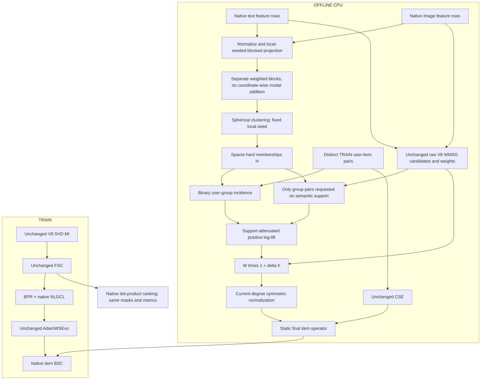

# STAIR6-v1 — Latent Cluster Association Enrichment for WMSG-CSE

> **Canonical revised specification — 2026-10-13.**
> **Primary architecture:** STAIR6-v1 / **LCAE-WMSG-CSE** (Latent Cluster Association Enrichment of the Weighted Multimodal Semantic Graph with Candidate Support Expansion).
> **Reviewer verdict:** **IMPLEMENT WITH MODIFICATIONS**. Clusters are unlabeled content groups, not reconstructed Amazon taxonomy or substitute/complement labels.
> **Source modes:** `latent` is the runnable primary; `metadata` retains the verified-taxonomy experiment. No automatic switch between them.
> Historical metadata-only specification: [STAIR6_v1_Metadata_Design.md](STAIR6_v1_Metadata_Design.md). Engineering instructions and verification receipts: [STAIR6_v1_Implementation.md](STAIR6_v1_Implementation.md).

## 1. Executive summary

**[FACT]** The current processed Baby bundle supplies interactions and text/image feature rows, but no verified ASIN mapping or Amazon taxonomy. Downloading Amazon metadata alone cannot bind it to those processed row IDs.

**[DECISION]** Implement an explicit alternative using existing content vectors to define static latent groups. Pool **TRAIN-user co-interest between distinct groups**, then enrich only the existing V8 semantic edges. Keep V8 MI, FSC, CSE, BPR, NLGCL, scorer, optimizer and evaluation unchanged.

**[HYPOTHESIS]** Pooling TRAIN preferences at the level of content groups can provide useful weighting evidence for cross-group semantic neighbors whose item-level co-occurrence is sparse. The additional behavioral aggregation, rather than clustering alone, is the potential source of improvement.

This changes the original estimand: LCAE tests **latent-group association**, while metadata CAE tests **taxonomy association**. Neither detects complements, causal compatibility or negative preference. This is not evidence that category blindness caused V8 saturation.

No numerical metric gain, publication acceptance, universal coverage, two-second runtime or no-OOM guarantee is asserted. CPU preprocessing, caches, exact zero-intervention recovery and diagnostics make the hypothesis testable.

## 2. Historical evidence and remaining bottleneck

The prior report audited `docs/EStair.md`, V8 experiment/audit reports, source and saved telemetry. Its detailed historical findings remain in the archived metadata design. They are not new LCAE measurements.

| Dataset | Comparator | R@10 | R@20 | N@10 | N@20 |
|---|---|---:|---:|---:|---:|
| Baby | V4 reported | 0.0678 | 0.1056 | 0.0364 | 0.0461 |
| Baby | V8 selected TEST | 0.0675 | 0.1054 | 0.0365 | 0.0462 |
| Sports | V4 reported | 0.0765 | 0.1143 | 0.0419 | 0.0517 |
| Sports | V8 selected TEST | 0.0762 | 0.1142 | 0.0420 | 0.0518 |
| Electronics | V4 reported | 0.0458 | 0.0678 | 0.0260 | 0.0316 |
| Electronics | V8 selected TEST | 0.0460 | 0.0680 | 0.0260 | 0.0317 |

**[OBSERVATION]** These rounded single-run results show small N@20 differences, with slight R@20 regression on Baby/Sports. They do not establish statistical superiority, equivalence or global SOTA. V8 Baby selected epoch430; Sports/Electronics selected500 at the horizon.

V5.2 cautioned against expanding higher-order topology. V6 cautioned against a negligible intervention dose. LCAE therefore keeps support fixed and measures the actual normalized-operator/BSC perturbation. It does not attempt to resolve all STAIR weaknesses in one model.

**[FACT — source]** V8 WMSG uses a floor-plus-positive-cosine power on text top5 and visual top1, sums directed modality weights before max-symmetrization. It does not implement the inverse-frequency equation sometimes attributed to it. The new latent-view weights5/6 and1/6 are used only for clustering, not to change WMSG fusion.

## 3. Methodology-focus review of the pseudo-category proposal

Review provenance: one separately invoked methodology seat and the primary agent's publication/contribution assessment; same model family, **NOT_CALIBRATED**, no human independent review. There was no fixed five-seat panel or cross-provider upload.

| Proposal claim | Review finding | Final correction |
|---|---|---|
| Code can recover missing Amazon categories | Clustering supplies different latent groups; names and hierarchy are not identified | Explicit `category_source=latent`; no invented ASINs/category names |
| GMM probabilities plug into current CAE | Dense positive membership makes binary user-group incidence universal | Sparse hard one-hot H in primary |
| Every feature row gives meaningful coverage | Zero/invalid content does not define a semantic direction | Invalid rows neutral; report informative coverage |
| Spherical KMeans on GPU takes2seconds | No hardware/catalog/iteration evidence | CPU blocked implementation; measured stage scopes |
| Clustering is academically novel by itself | Prototype/clustering methods have substantial prior art | Claim controlled behavioral pooling only if supported |
| Shrinkage n/(n+5) is Bayesian reliability | No likelihood/prior derives this formula here | Call it support attenuation; no calibrated uncertainty claim |
| Same-group co-occurrence is useful pair evidence | Self-incidence is tautological | h_aa=0; within-group edges get neutral enrichment |
| Cluster-ID permutation is a placebo | Global ID relabeling is mathematically invariant | Permute **item assignments**, recompute associations |
| More groups/more complex GMM gives higher metrics | Unsupported and increases search/variance | C50 primary; C100 only a declared validation arm |

### 3.1 The dense-soft-membership failure

If every item has H_ia>0 for every group, binary OR incidence makes Z_ua=1 for every active user and group. Then n_a=n_ab=N_*, log-lift=log1=0. The proposed probability matrix cannot simply be loaded into the current statistics. A weighted-incidence model would require a different probabilistic/statistical definition.

### 3.2 The same-cluster dosage trap

With hard assignments, h_ij=h_(c_i,c_j), and h_aa=0. Therefore every within-cluster semantic edge is neutral. Since kNN and clustering use the same content, within-cluster edges may dominate. This is a likely mechanism for parity, not a reason to inflate the diagonal. Measure within/cross-group semantic mass, active cross-group mass and actual operator/BSC dose before long runs.

## 4. Verified literature and scope of borrowing

- **Concept Decompositions for Large Sparse Text Data Using Clustering** — Inderjit S. Dhillon, Dharmendra S. Modha; *Machine Learning*42:143–175,2001; DOI10.1023/A:1007612920971. Spherical content clustering is established methodology, not a new LCAE component. [Publisher](https://doi.org/10.1023/A:1007612920971), [author institution](https://bigdata.oden.utexas.edu/publication/concept-decompositions-for-large-sparse-text-data-using-clustering/).
- **Improving Graph Collaborative Filtering with Neighborhood-enriched Contrastive Learning** — Zihan Lin, Changxin Tian, Yupeng Hou, Wayne Xin Zhao; **WWW2022**, arXiv2202.06200. NCL uses structural/semantic neighborhoods and prototype contrastive learning. This supports studying latent groups, not transferring its gains to static content-group enrichment. LCAE adds no prototype loss or learned-embedding clustering. [Paper](https://arxiv.org/abs/2202.06200), [official source and venue](https://github.com/RUCAIBox/NCL).
- **Unsupervised Learning of Visual Features by Contrasting Cluster Assignments** — Mathilde Caron, Ishan Misra, Julien Mairal, Priya Goyal, Piotr Bojanowski, Armand Joulin; NeurIPS2020. SwAV learns view-consistent assignments; this implementation does not reproduce SwAV or claim its representation quality. [Official paper](https://proceedings.neurips.cc/paper/2020/file/70feb62b69f16e0238f741fab228fec2-Paper.pdf).
- **Gaussian random projection**: standard components drawn from N(0,1/r); fixed rank is a computational approximation. The implementation follows that distribution, without claiming that r64 establishes a prescribed distortion bound on the whole catalog. [Official documentation](https://scikit-learn.org/stable/modules/random_projection.html).

STAIR/FREEDOM/category-prior/relation-learning references and their transfer limitations are retained in the archived design. No paper justifies a specific LCAE percentage improvement. NCL must not be mislabeled SIGIR2022; the official repository identifies WWW2022.

## 5. Final architecture and information boundary

Primary: **LCAE-WMSG-CSE**, static, zero additional trainable parameters. Metadata CAE remains a distinct secondary source requiring the original verified files; absence of metadata never silently creates pseudo-labels under a taxonomy claim.

Clustering uses the same full-catalog feature availability as V8: **transductive content preprocessing**. TRAIN interactions alone determine group associations. Valid/test interactions are never used for fitting the groups or evidence. Their hashes bind the evaluation protocol; hashing is not model fitting. Hyperparameters are selected on validation, never TEST.



Why each component exists: projection controls offline raw-feature cost; clustering defines pooling units; TRAIN log-lift supplies behavioral evidence beyond content; bounded enrichment changes only relative edge weights; normalization/CSE preserve the native operator construction. A new encoder, consensus loss, dynamic gate or relation classifier has no supported role here.

## 6. Symbols and precise mathematical specification

| Symbol | Definition |
|---|---|
| N_u,N_i | Native user/item counts |
| d | Ranking embedding dimension,64 in primary |
| F_m in R^(N_i x D_m) | Raw FP32 text/visual feature matrices in native item order |
| r,C,T | Projection rank per modality, group count, maximum Lloyd passes |
| G_m in R^(D_m x r) | Fixed Gaussian projection for modality m |
| x_i in R^(2r) | Unit concatenated content view, or zero for invalid content |
| c_i | Hard group ID, or -1 for unknown |
| H in R^(N_i x C) | Sparse one-hot item-group memberships |
| R in {0,1}^(N_u x N_i) | Unique TRAIN user-item incidence for statistics |
| Z in {0,1}^(N_u x C) | Binary user-group incidence |
| n_a,n_ab,N_* | Distinct-user marginals, joint counts, observed-group population |
| W,S_CF,S8 | Native raw WMSG, normalized CSE and final V8 operators |
| h_ab,h_ij,delta | Group association, pooled edge score and enrichment strength |
| S6 | Final LCAE item BSC operator |

### 6.1 Independent modal normalization and projection

For each valid raw row f_(m,i), normalize its direction, project, then normalize again:

\[
\widehat f_{m,i}=f_{m,i}/\|f_{m,i}\|_2,\qquad
(G_m)_{ab}\sim\mathcal N(0,1/r),\qquad
q_{m,i}=\widehat f_{m,i}G_m,\qquad
z_{m,i}=q_{m,i}/\|q_{m,i}\|_2.
\tag{1}
\]

Implementation scales each FP32 row by its largest absolute component before L2 normalization to prevent norm overflow. A view is invalid when that maximum or projected norm is <=1e-8. Nonfinite input fails explicitly. No centering/SVD is added to this grouping branch; native V8 MI whitening is unchanged.

With both views valid:

\[
x_i=[\sqrt{5/6}\,z_{t,i};\sqrt{1/6}\,z_{v,i}],\quad
x_i^\top x_j=(5/6)z_{t,i}^\top z_{t,j}+(1/6)z_{v,i}^\top z_{v,j}.
\tag{2}
\]

The two blocks are distinct coordinate spaces. Text coordinate k need not align with image coordinate k. For a single valid view, set the other block0 and renormalize x_i; effective valid-view weight becomes1. For two invalid views, x_i=0 and no assignment is fabricated. This is not cross-modal alignment or a fix for coordinate-wise FSC/BSC.

### 6.2 Spherical hard grouping

Optimize the finite-pass objective on informative rows:

\[
\max_{c,\mu}\sum_{i\in I_*}x_i^\top\mu_{c_i},\quad \|\mu_a\|_2=1.
\tag{3}
\]

Assignment: c_i=argmax_a x_i^T mu_a; ties use smallest ID. Update: normalize sum of assigned x_i. K-means++ initialization uses cosine distance max(0,2-2x_i^Tmu), local seeded generator, and O(N_i) nearest-distance state. Empty/zero-resultant centers are reseeded with distinct-position worst-fit rows in stable order; duplicate content can still yield fewer occupied groups. Convergence stops at unchanged assignments or T passes; assignments are recomputed after the last center update.

No global RNG mutation; no per-epoch refresh. Requesting more clusters than informative items fails. A partition with fewer than two occupied groups fails. Empty requested groups are reported, not concealed as semantic discoveries.

\[
H_{ia}=\mathbb1[c_i=a],\quad \sum_aH_{ia}=1\ (i\in I_*),\qquad H_{i,:}=0\ (i\notin I_*).
\tag{4}
\]

Hard assignment is a computational/statistical choice, not a probability estimate. No GMM, temperature or dense softmax H in primary.

### 6.3 TRAIN-only pooling and association

\[
Z_{ua}=\mathbb1[\sum_iR_{ui}H_{ia}>0],\quad
U_*=\{u:\sum_aZ_{ua}>0\},\quad N_*=|U_*|,
\quad n_a=\sum_{u\in U_*}Z_{ua},\quad n_{ab}=\sum_{u\in U_*}Z_{ua}Z_{ub}.
\tag{5}
\]

Duplicate interactions contribute once to statistics; native training sampler/FSC adjacency retain their original semantics.

\[
h_{ab}=\begin{cases}
\dfrac{n_{ab}}{n_{ab}+t_c}\tanh\!\left(\max\!\left(0,\log\dfrac{n_{ab}N_*}{n_an_b}\right)\right),
&a\ne b,\ n_{ab}\ge c_{\min},\ n_a n_b N_*>0,\\
0,&\text{otherwise}.
\end{cases}
\tag{6}
\]

Primary c_min2,t_c5. These are support attenuation and a bounded positive association, not calibrated Bayesian reliability, conditional independence evidence, complementarity or causal utility. Large pooled counts can make attenuation almost1. Exposure/history confounding remains.

Compare n_ab*N_* and n_a*n_b with Python integers before log evaluation: exact independence must yield h0, not a rounding-induced tiny positive value. Compute only requested unordered pairs from existing semantic edges, using sorted CSC user postings; never dense C² or item² matrices.

### 6.4 Existing-edge enrichment and normalization

\[
h_{ij}=\sum_{a,b}H_{ia}h_{ab}H_{jb}
=h_{c_i,c_j}\text{ on informative hard-assigned rows},\qquad
W'_{ij}=W_{ij}(1+\delta h_{ij}),\quad 0\le\delta\le1.
\tag{7}
\]

h_ij0 when either row is unknown or c_i=c_j. Same-group edges remain neutral; negative association is not interpreted as dislike. Only existing semantic edges are weighted. WMSG remains native:

\[
f(a)=0.05+0.95[\max(0,a)]^2,\qquad
B=B_t+B_v,\quad W_{ij}=\max(B_{ij},B_{ji}).
\tag{8}
\]

Let d'_i=sum_j W'_ij. Normalize with new degrees, preserving native isolated identity:

\[
S'_{sem}=\mathcal N(W'),\quad
\mathcal N(W')_{ij}=W'_{ij}/\sqrt{d'_id'_j}\text{ on active rows},\quad
S_6=(1-\eta_{eff})S'_{sem}+\eta_{eff}\bar S_{CF}.
\tag{9}
\]

eta0.1; globally empty raw CF implies effective eta0 as in V8. No CSE reweighting or support expansion. Although raw edge weights never shrink, unchanged normalized edges can shrink because degrees increase.

**Exact bypass:** category_mode off or delta0 returns the native V8 path without clustering, metadata loading or graph reconstruction. Enabled all-zero associations fail with InactiveCategorySignal instead of presenting a baseline run as LCAE.

### 6.5 Backbone, training loss and ranking

Let beta_k=0.1+0.9(k/d)^gamma; a=1-beta. Native FSC on the user-item operator A_UI:

\[
E^{\ell+1}=(A_{UI}E^\ell)\odot a,\quad
\bar E=\left(\sum_{\ell=0}^3E^\ell\right)\odot\frac{1-a}{1-a^4},\quad
\hat y_{ui}=\bar U_u^\top\bar V_i.
\tag{10}
\]

Loss remains L_BPR+0.01 L_NLGCL^V8. NLGCL keeps I1 query->U0 keys and U1 query->V0 keys, original in-batch denominator/duplicates, tau0.2,alpha0.5,G1. No prototype/cluster loss, consensus, explicit extra L2 or category parameters. User AdamW directions remain unsmoothed; item directions use native BSC with S6.

## 7. Theoretical guarantees and limitations

### PROPOSITION: symmetry, nonnegativity and fixed support

h_ab=h_ba from joint counts. One-hot or valid row-normalized sparse H gives symmetric h_ij in [0,1]. Thus 1<=1+delta*h<=2, W' is symmetric nonnegative and support(W')=support(W). This proves construction properties, not semantic usefulness.

### THEOREM: normalized operator bound

On nonisolated nodes S'=D'^(-1/2)W'D'^(-1/2) is symmetric and similar to P=D'^(-1)W', a nonnegative row-stochastic matrix. Every eigenvalue has absolute value<=1; symmetry makes spectral norm the maximum absolute eigenvalue. Isolated identity adds eigenvalues1. Native CF obeys the same bound; convexity gives:

\[
\|S_6\|_2\le(1-\eta_{eff})\|S'_{sem}\|_2+\eta_{eff}\|\bar S_{CF}\|_2\le1.
\tag{11}
\]

S6 need not be PSD. The claim does not apply to arbitrary directed normalization or normalized Laplacian, whose norm can be2.

### PROPOSITION: finite BSC bound

For item-direction column j, native weights w_(l,j)=(1-beta_j)beta_j^l/(1-beta_j^4) sum1, beta_j in[0,1). With P_j(S)=sum_(l=0)^3 w_(l,j)S^l:

\[
\|P_j(S_6)\|_2\le1,\quad \|P(S_6)D_t\|_F\le\|D_t\|_F.
\tag{12}
\]

This bounds relative smoothing of an incoming direction. It does not bound absolute Adam-preconditioned directions or prove optimizer convergence. L3 is a finite polynomial, not an infinite-series assumption.

### DERIVATION: nonzero raw dose is insufficient

Uniform component scaling W'=kW cancels under normalization. For contractions S,T, telescoping gives ||S^l-T^l||_2<=l||S-T||_2 and ||P_j(S)-P_j(T)||_2<=(sum_l l*w_(l,j))||S-T||_2. This is an upper bound, not a lower bound on meaningful change.

### INVARIANCE boundaries

A global permutation of group IDs changes H and h consistently but preserves h_ij and S6 exactly in mathematical arithmetic. It is an indexing test, not a placebo. Separate modal rotations after projection preserve concat Gram similarity if centers rotate consistently; fixed random projection of rotated raw features does not establish exact raw-basis invariance. It is only a distributional/approximation argument. Row-domain graph application is equivariant under shared embedding rotation, but coordinate-wise backbone filters are still basis dependent.

Operator bounds cannot exclude oversmoothing, head amplification, ecological fallacy or wrong update-direction compatibility. Nothing here proves improved Recall/NDCG.

## 8. Engineering specification

| Module | Input/output | Trainable/device | Integration |
|---|---|---|---|
| Raw modality projection | CPU FP32 N_i x D_t/D_v -> N_i x2r | No,CPU; blocked GEMM | Observe native V8 feature rows; no ASIN alignment |
| Spherical clustering | Unit rows -> int64 assignments[N_i], FP32 centers[C,2r] | No,CPU, local RNG | Once before graph replacement; saved cache |
| Membership | Assignments -> FP32 CSR[N_i,C], <=N_i nonzeros | No,CPU | Same requested-pair association interface as metadata CAE |
| Binary TRAIN incidence | Unique TRAIN keys,H -> int64 CSR[N_u,C] | No,CPU | All held-out interaction values excluded |
| Association query/pooling | CSC postings,existing semantic edges -> FP32 scores[nnz(W)] | No,CPU | No full HhH^T; no dense item²/category² |
| Graph enrichment | Raw W,score,raw CF -> native CSR S6 | No,CPU then native model transfer | Replace mAdj; do not retain both item operators on GPU |
| Training/evaluation | Native FreeRec batches -> native loss/scores | Embeddings only,GPU/CPU | Inherited MI/FSC/NLGCL/optimizer/scorer |

No autograd history is kept in preprocessing. Hard grouping/statistics have no trainable gradient path. Native item updates receive the changed BSC operator; forward loss at identical starting weights remains the same.

### 8.1 Configuration defaults

```yaml
category_mode: cae
category_source: latent
category_strength: 0.5
category_min_count: 2
category_shrinkage: 5.0
latent_clusters: 50
latent_projection_dim: 64
latent_iterations: 20
latent_chunk_size: 2048
latent_seed: 2718
latent_memory_budget_mib: 128.0
```

Clustering seed stays fixed independently of training seed. Ranking d64 does not set projection r; matched256D experiments can reuse the same feature grouping. Changing r/C/seed/source changes model identity and cache/checkpoint contracts. C100, r128 and different modality views belong to declared sensitivity studies, not hidden default tuning.

### 8.2 Cache/provenance contract

Bind dataset, ordered feature file hashes and actual array hashes, split hashes, algorithm/source revision, NumPy/Torch versions, Torch CPU thread setting, cluster settings and effective block. Save assignments, centers, hashes and deterministic diagnostics. Runtime/cache-hit/timing stay outside checkpoint identity. Centers/assignments are CPU preprocessing artifacts, not model parameters or fabricated Amazon metadata.

Cache corruption yields visible warning and recomputation. Exact content reproducibility is validated within the recorded environment; BLAS/hardware near-tie differences across environments are not guaranteed bitwise identical. Prefer reusing frozen assignments when comparing training seeds/hardware; compare fingerprints explicitly.

Metadata mode retains original one-to-one ASIN attestation/hash checks; the latent mode uses existing native row order instead of synthesizing that mapping. Source revision changes invalidate old experiment checkpoints; do not silently resume pre-redesign CAE as the new model.

## 9. Computational complexity and memory

Let D=D_t+D_v, F=2r, B be the effective block, M=nnz(W), K_req requested distinct group pairs.

- Projection: O(N_i*D*r); local projection storage O(max(D_m)*r), fused O(N_i*F).
- Initialization: O(C*N_i*F), O(N_i) distance state.
- Lloyd: O(T*N_i*C*F) plus sparse label accumulation O(T*N_i*F); block logits O(B*C), not item².
- Membership: O(N_i) nonzeros. User-group incidence O(|R|) assignment work and distinct user/group storage.
- Group counting: requested sorted-posting searches, not dense C². Pooling hard rows O(M) plus CSR bookkeeping.
- Training: same S6 support and number of SpMMs as V8; no additional train-time parameters/branch. Cache/preprocessing/hash work and changed weight distribution are real costs.
- Inference: native FSC and scorer; no group lookup or clustering.

The workspace guard estimates fused rows, labels/scores, centroid/accumulation state, projection and block temporaries. It can lower B or fail before allocation. It excludes caller raw features, baseline kNN/SVD/CF workspace, runtime libraries and total process RSS. The parent V8 full SVD remains potentially expensive. No guarantee of <800MiB VRAM or universal no-OOM follows.

For N_i63001,r64: fused128D FP32 alone is30.76MiB; assignments are0.48MiB. These are formula-based component sizes, not measured Electronics total memory. Preprocessing and GPU throughput must be profiled on the target data/environment.

## 10. Minimal code changes and organization

```text
models/stair6_v1_latent_categories.py   # new content grouping, memberships and provenance
models/stair6_v1_categories.py          # shared TRAIN association; verified metadata adapter
models/stair6_v1_graph.py               # support-preserving enrichment and group/dose diagnostics
models/stair6_v1.py                     # explicit source selection; inherit V8 representation/loss
stair6_v1_config.py                    # latent/metadata validation, no automatic fallback
main_stair6_v1.py                      # native trainer, manifests, preprocess-only entry
configs/Amazon2014{Baby,Sports,Electronics}_STAIR6_v1.yaml
 tools/audit_stair6_v1_latent.py        # feature-only grouping preflight
 tools/audit_stair6_v1_metadata.py      # retained verified-metadata preflight
 tests/test_stair6_v1_latent_categories.py
 tests/test_stair6_v1_{categories,graph,pipeline}.py
```

All V8/V7 and original main.py sources stay unchanged. No new loss/smoother file is appropriate: adding a redundant class would conceal that the V8 mechanisms are inherited. Launcher must bridge direct dataset locations to FreeRec's writable Processed layout without altering feature rows or split values.

## 11. Why this might beat V8 — causal chain and counterexample

Potential limitation: sparse item-level co-interest -> content groups share more TRAIN users -> cross-group association estimates have greater support -> nonuniform enrichment of existing cross-group semantic edges -> BSC mixes different item-update directions -> positive-vs-negative margins may improve -> Recall/NDCG may improve.

Every arrow after aggregation is a hypothesis. Competing explanation: pooled associations are exposure/head effects -> enrich generic neighbors -> damp minority/tail directions -> worse ranking. Another explanation: clustering repeats the same WMSG geometry -> within-group mass dominates -> h_aa0 and uniform normalization eliminate the dose -> parity.

V8 does not pool TRAIN incidence over content groups; its CSE uses item-level co-occurrence. This mathematical distinction does not by itself demonstrate useful additional information. Compare item-level reweighting and assignment placebo before claiming a pooling contribution.

## 12. Diagnostics and staged GO/NO-GO

| Diagnostic | Definition | Interpretation |
|---|---|---|
| Informative coverage | |I_*|/N_i; per-view valid counts | Actual usable content coverage, not guaranteed100% |
| Occupancy/entropy | counts[C], max fraction, -sum p_a log p_a/logC | Collapse/generic groups;2 occupied minimum is runtime validity, not scientific sufficiency |
| Assignment margin | best minus second centroid cosine; quantiles | Boundary uncertainty; no calibrated probability |
| Same-group semantic mass | sum W_ij*1[c_i=c_j>=0]/sum W | Quantifies neutral diagonal share |
| Cross-group active mass | sum W_ij*1[h_ij>0]/sum W | Measures where evidence reaches semantic support |
| Operator dose | ||S6-S8||_F/||S8||_F | Uniform-weight cancellation and negligible intervention |
| BSC probe dose | ||P(S6)X-P(S8)X||_F/||P(S8)X||_F | Deterministic CPU proxy, not actual Adam/ranking improvement |
| Real direction dose | Same formula with actual incoming Adam D_t | Confirms effective training intervention |
| Margin change | mean(s_ui+ - s_ui-) versus matched V8 | Mechanism-to-ranking test |
| Tail/head ranking | Train-degree strata R20/N20 | Detects popularity amplification |
| Association replication | Refit counts on disjoint TRAIN-user subsets | Tests support stability/history confounding |

Clustering audit readiness means **READY_FOR_GRAPH_DIAGNOSTICS**, not readiness to claim improved metrics. `--preprocess-only` then builds the complete native backbone/graph and logs group/normalized/BSC dose without optimizer steps.

NO-GO: malformed/nonfinite inputs, collapsed groups, no positive requested association, numerically negligible normalized intervention, or consistently adverse pilot trend. A tiny positive float must not satisfy activation. No arbitrary dosage threshold is sold as a validated ranking threshold: inspect dose against exact/uniform placebos and real direction changes.

WEAK-GO: finite measurable intervention with small positive pilot trend within uncertainty. GO: reproducible validation gain over matched V8, mechanism beyond placebo and no material subgroup/efficiency regression. Full training follows only after pilot evidence; final multi-seed TEST follows a frozen validation choice.

## 13. Ablation and falsification plan

| Arm | Single question | If hypothesis is false |
|---|---|---|
| V8 / off / delta0 | Does bypass exactly recover backbone? | Implementation invalid if graph/steps differ |
| LCAE C50,r64,delta0.5 | Does pooled association add utility? | Parity/regression: retain V8 |
| Global group-ID renaming | Is implementation index invariant? | Indexing/cache bug, not scientific gain |
| Degree-stratified **item-assignment** permutation | Does real content partition matter? | Equal gain supports generic weighting explanation |
| Uniform raw multiplier | Is degree normalization understood? | Nonparity suggests construction error |
| Item-level association on same edges | Does grouping add beyond item CF? | No advantage weakens pooling claim |
| Text-only grouping | Does image information help partitioning? | Keep simpler text-only backup if equally strong |
| C100 sensitivity | Does granularity alter available cross-group evidence? | Do not select by TEST or add diagonal inflation |

A content-only same-cluster edge gate is a distinct comparator, not an unnoticed modification of LCAE. Placebo assignments must be permuted within prespecified train-degree strata and group-count bundles preserved; recompute Z/counts. Relabeling cluster names alone is a no-op.

These are experimental arms, not all default implemented CLI features. The current production path implements primary latent, metadata and exact off/zero controls; analytical controls can call membership/graph builders on copied CPU artifacts.

## 14. Matched evaluation and statistics

Compare V8 and LCAE at the same d, split, feature rows, seeds, LR/decay, sampler, batch, horizon, validation frequency and selection rule. Primary R10/R20/N10/N20; validation N20 selects checkpoint, selected TEST is reported once after freezing choices. Original full-ranking seen-item masks and native denominator remain unchanged.

Three training seeds minimum, five if feasible; report mean/std and paired differences/intervals. Clustering seed sensitivity is a separate experiment factor, not a chance to pick a fortunate cluster realization for each model seed. Pair bootstrap users for a fixed-run ranking interval when appropriate; do not treat3seed nonsignificance as proof of equivalence. Correct for testing multiple configurations or designate one primary comparison in advance.

Dataset hypotheses: Baby may benefit from pooling but generic clusters can dominate; Sports may have functional/content groups with noisy co-interest; Electronics may have strong exposure/history confounding and CPU preprocessing cost. These are hypotheses until measured. No Sports/Electronics feature or clustering distribution is fabricated from Baby.

## 15. Implementation verdict and practical next step

**IMPLEMENT WITH MODIFICATIONS:** use explicit LCAE latent mode to remove the external taxonomy prerequisite while preserving the scientific distinction. Do not call generated groups ground-truth categories, infer Amazon labels, add fake manifest attestations or claim complements/sign detection.

The source architecture is implemented with a fixed static CPU grouping branch and no new train-time model parameters. Verification/preflight receipts are recorded separately in the implementation report. Successful code tests do not establish metric improvement; successful clustering does not establish useful graph intervention.

Next: feature-only preflight -> full graph/dose preflight -> matched small pilot -> same-budget full runs -> multi-seed/placebo confirmation. If cross-group evidence or dose collapses, reject this mechanism or explicitly test a new hypothesis. Do not force the desired percentage through uncontrolled architecture stacking.
