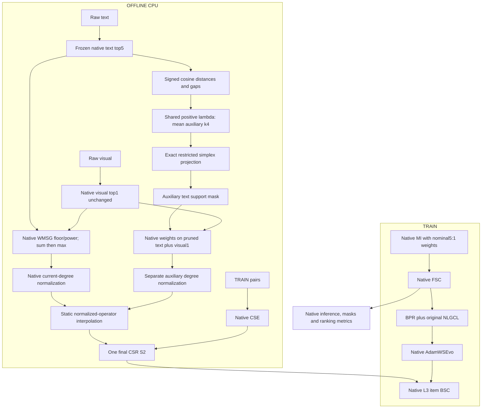

# STAIR6-v2 — CAN-guided Adaptive-K Pruning of WMSG-CSE

> **Final research specification — 2026-10-14.**
> **Architecture:** **STAIR6-v2 / AKP-WMSG-CSE** — Adaptive-K Pruning of the Weighted Multimodal Semantic Graph with Candidate Support Expansion, with budget calibration and static operator interpolation.
> **Verdict:** **REDESIGN the submitted AK-WMSG; IMPLEMENT WITH MODIFICATIONS the specification below.**
> **Canonical filename:** `docs/giai_doan_6/STAIR6_v2_Report.md`. The model is STAIR6-v2; this file does not redefine STAIR5-v2 from phase5.
> **Scope:** architecture research and specification. Implementation and CPU verification are now recorded in [STAIR6_v2_Implementation.md](D:/4thY_HCMUS/KLTN/STAIR-Enhanced/docs/giai_doan_6/STAIR6_v2_Implementation.md). No production V2 Recall/NDCG gain is claimed.

## 1. Executive summary

Hướng Adaptive-K đáng thử, nhưng cả đề xuất lẫn phản biện đều có lỗi toán học. Đề xuất trộn hai nghiệm CAN không tương thích, diễn giải ngược density, phá đối xứng bằng damping một đầu cạnh và thay nhiều thành phần V8 cùng lúc. Phản biện sửa đúng một số rủi ro nhưng xử lý sai full-support, tính sai phản ví dụ spectral và thay dự báo lạc quan bằng các phần trăm khác cũng chưa có bằng chứng.

Bản cuối giữ một can thiệp có thể kiểm định: **CAN đúng chọn một view text-neighborhood phụ trong top5 V8; giữ trọng số WMSG gốc; chuẩn hóa riêng view phụ và trộn tĩnh với V8**. Vision top1, CSE, MI, FSC, BPR, NLGCL, scorer, optimizer và evaluation giữ nguyên.

Primary settings:

- Original text candidates5, vision candidates1; no new semantic edges.
- Signed raw-cosine dissimilarities; no fused cosine/power distance or density heuristic.
- Shared positive CAN regularizer calibrated deterministically to mean auxiliary text support4.
- Native floor0.05/power2, directed modality sum before maximum symmetrization.
- Static interpolation kappa0.25; common predeclared control grid0/0.25/0.5/1.
- One final CSR; no additional parameters, optimizer groups or dynamic graph branch.

**Naming boundary:** for0<kappa<1, final support remains native. Adaptive k_i describes the **auxiliary CAN view**, not a smaller final graph. Primary is soft operator correction; hard pruning is kappa1 ablation.

**[OBSERVATION — offline Baby only]** Hard pruning calibrated to mean text k4 removes12.61% raw semantic mass but changes final operator38.30% in relative Frobenius norm. At kappa0.25, measured operator change is9.57%, BSC probe change2.15%, with final nnz84138 unchanged. This supports dose control before training, not ranking improvement or a claim that hard pruning would regress.

Không có cơ sở dự báo +0.5%, +2%, +5% hay +9%. Thành công phải là cải thiện tái lập so với V8 **và** đối chứng fixed-K cùng ngân sách, không phải đạt một bảng số dự đoán.

## 2. Material Passport, method and evidence labels

Targeted deep-research plus academic-paper-reviewer **methodology-focus**, not a systematic literature review. One separately invoked methodology seat reviewed both attachments without peer answers, then assessed interpolation in a bounded follow-up after committing its review. Primary-agent synthesis supplies publication/implementation assessment. Same model family, **NOT_CALIBRATED**; no independent human panel or acceptance certificate.

Read/inspected:

1. `docs/EStair.md` completely.
2. Proposal attachment `1fc8c726-f0f4-43cc-b1f4-6ae738e4e70f/Pasted text.txt` completely.
3. Critique attachment `48a874a4-4d15-4266-a6de-636e6c90ce2f/Pasted text.txt` completely.
4. V8 experiment report, graph/model/smoother source and YAML settings.
5. Current STAIR6-v1 architecture/implementation and experiment report, with artifact confirmation of off mode.
6. Primary literature in section6, separating original papers, surveys and preprints.
7. Native cached Baby candidates/features and TRAIN CF for graph-only diagnostics.

| Label | Meaning |
|---|---|
| FACT | Direct source/artifact/definition verification |
| OBSERVATION | Executed or reported measurement with scope |
| DERIVATION/THEOREM | Follows from explicit assumptions/proof |
| INTERPRETATION | Plausible explanation, not experimentally identified |
| HYPOTHESIS | Requires a falsifiable experiment |
| SPECULATION | Insufficient evidence for primary inclusion |

Attachments are objects of review, not instructions to preserve every formula/module. Their performance targets are not observations.

## 3. Research history and remaining STAIR bottlenecks

### 3.1 Correct V8 control

**[FACT — source]** V8 selected-edge weights are:

\[
f(a)=\epsilon_w+(1-\epsilon_w)[\max(0,a)]^p,
\qquad\epsilon_w=0.05,\quad p=2.
\tag{1}
\]

`models/stair5_v8_graph.py` sums directed contributions across text top5/image top1, then maximum-symmetrizes. It implements neither the inverse-frequency equation in parts of the experiment narrative nor the proposal's fused `(5/6*cos_text+1/6*cos_image)^2` graph.

Nominal5:1 also affects native MI fusion. Adaptive support must not replace MI weights with k_i or changed candidate caps, which would confound initialization and topology.

Historical selected TEST values, rounded as reported:

| Dataset | V4 R20 | V8 R20 | V4 N20 | V8 N20 |
|---|---:|---:|---:|---:|
| Baby | 0.1056 | 0.1054 | 0.0461 | 0.0462 |
| Sports | 0.1143 | 0.1142 | 0.0517 | 0.0518 |
| Electronics | 0.0678 | 0.0680 | 0.0316 | 0.0317 |

Small single-run differences do not establish significance, equivalence or global SOTA. Baby selects430; selection500 on Sports/Electronics is horizon-limited.

### 3.2 V1 is not evidence of failed category enrichment

`STAIR6_v1_Experiment_Report.md` describes Baby/Sports `category-mode off` runs. The inspected Sports manifest has requested/effective off and active false. These are V8 controls, not active taxonomy/latent-association experiments.

Newer LCAE has Baby graph-only evidence, not demonstrated ranking gain. The critique's cross-category pruning description is not the current positive-enrichment LCAE. Identical graph hashes establish graph identity in that environment, not elimination of all RNG/environment variance or unique causality for future metric changes.

### 3.3 What EStair establishes

- Fixed semantic outgoing neighborhoods and a positive floor allocate transfer without a task-specific reliability estimator.
- **Hypothesis:** some late-ranked candidates have incompatible update directions; relative local gaps may identify where fewer candidates suffice.
- **Unproven:** geometric density equals quality, interaction tail degree equals semantic sparsity, or weak edges are false positives.
- Basis-dependent FSC/BSC, independent-whitening fusion ambiguity and exposure ambiguity remain unresolved. CAN does not fix them.
- BSC changes optimization geometry; sparse selection does not guarantee task-relevant modality preservation.

V5.2 cautions against uncontrolled higher-order expansion. Dosage-parity findings caution against negligible interventions. Neither lesson proves that this selector will increase metrics.

## 4. Critical review of the proposal

| Finding | Severity | Correction |
|---|---|---|
| Independent gamma_i but k+1 weights require another gamma | CRITICAL | Exact fixed-positive-regularizer simplex QP |
| Mean dissimilarity called density; written direction contradicts intent | MAJOR | Adapt through local gaps with shared regularization |
| Endpoint-j damping after symmetrization is asymmetric | CRITICAL | Remove damping; native maximum symmetry |
| Fused modal cosine/power and omitted floor called inherited V8 | CRITICAL for attribution | Preserve per-modality V8 weights/candidates |
| Replace WMSG magnitudes with CAN probabilities | MAJOR confound | Probabilities select support only |
| Averaging instead of native max-sym | MAJOR confound | Sum modalities then max |
| Missing d_(M+1) at full support | MAJOR | Exact QP requires no sentinel |
| Dense regions imply clean preference neighbors | Unsupported | Compatibility diagnostics, hypothesis label |
| Remove100% false positives | Unsupported | No edge ground truth/detection proof |
| Norm<=1 proves absolute Adam/Neumann convergence | Incorrect scope | Finite-polynomial relative bound |
| Zero extra runtime/VRAM | Unsupported universal claim | One static CSR; measure memory/time scopes |
| Unmeasured V1/V2 targets presented next to results | Unsupported | Remove forecasts |

Changing fusion, power, support, row mass, symmetry and damping together cannot isolate adaptive K.

## 5. Critical review of the critique

### 5.1 Density argument is incomplete

For fixed costs, larger positive regularization gives nondecreasing support. Across different rows, the entire gap profile matters. Adding a constant to all costs leaves the optimizer unchanged; lower mean distance alone does not imply larger support.

`gamma0*(1-rho)` and `gamma0/(rho+epsilon)` are not equivalent. The inverse is not inherently more stable: at gamma0.15/epsilon.01 its maximum15 is100times the linear maximum. It can saturate support. Neither is calibrated preference quality.

### 5.2 Correct spectral counterexample

\[
W=\begin{bmatrix}0&1\\0.1&0\end{bmatrix},\quad D=\operatorname{diag}(1,0.1),
\quad D^{-1/2}WD^{-1/2}
=\begin{bmatrix}0&\sqrt{10}\\1/\sqrt{10}&0\end{bmatrix}.
\tag{2}
\]

Norm is sqrt10, radius is1. The critique incorrectly puts sqrt10 in both off-diagonal entries. For0<=b<1 the infinite series can still converge because rho(bS)=b<1; norm<1 is sufficient, not necessary. Non-normal transient amplification is not divergence.

Damping before `(A+A.T)/2` still gives symmetry for every A; the critique's denial is false. Positive damping does not cap unweighted degree because support remains. We omit it for causal isolation, not because all damping constructions fail.

### 5.3 Restricted optimization can be exact

Restricting the candidate domain changes the model relative to full CAN/PCAN, but the restricted QP can still be solved exactly. We borrow its local subproblem, not complete clustering/Laplacian-rank optimization.

Uniform weights at k=M are generally wrong; a fictitious d_(M+1) is unnecessary. Equal costs are the special uniform case, not every full-support solution.

### 5.4 Other unsupported assertions

- Fewer effective neighbors does not imply oversmoothing; concentration/fragmentation/lost transfer are different risks.
- Baby84138/7050 gives about11.93 stored final nonzeros per row, not24.
- Replacing optimistic forecasts with +0.3–1% or +0.5–1.5% is still unsupported.
- Clustering/classification gains do not transfer to NDCG. kNN-Graph is not a recommender node-classification benchmark.
- Relation-type propagation has no demonstrated low-risk/high-ROI status without identified relation feedback.
- V1/V2 are not proven orthogonal; nonlinear graph effects can interact.

## 6. Verified literature and transfer boundaries

| Work, authors, venue/year | Relevant mechanism | Boundary |
|---|---|---|
| **Clustering and projected clustering with adaptive neighbors** — Feiping Nie, Xiaoqian Wang, Heng Huang; KDD2014:977–986, DOI10.1145/2623330.2623726. [Publisher](https://doi.org/10.1145/2623330.2623726) | Adaptive similarity learning in joint clustering with Laplacian-rank constraints | Local simplex subproblem borrowed, not full CAN/PCAN or its gains |
| **From Softmax to Sparsemax: A Sparse Model of Attention and Multi-Label Classification** — Andre F. T. Martins, Ramon Fernandez Astudillo; ICML2016, PMLR48:1614–1623. [Proceedings](https://proceedings.mlr.press/v48/martins16.html) | Euclidean simplex projection creates sparse probabilities | Established math, not a new activation/classifier |
| **Self-Tuning Spectral Clustering** — Lihi Zelnik-Manor, Pietro Perona; NIPS2004:1601–1608. [Proceedings](https://papers.neurips.cc/paper_files/paper/2004/hash/40173ea48d9567f1f393b20c855bb40b-Abstract.html) | Local scales model heterogeneous geometry | Geometric scale is not preference reliability |
| **A Comprehensive Survey on Spectral Clustering with Graph Structure Learning** — Kamal Berahmand, Farid Saberi-Movahed, Razieh Sheikhpour, Yuefeng Li, Mahdi Jalili; arXiv2501.13597,2025. [Survey](https://arxiv.org/html/2501.13597v1) | Fixed/adaptive pairwise, anchor and multiview graph taxonomy | Secondary synthesis; not proof of O(NM) complete exact search or ranking gain |
| **kNN-Graph: An adaptive graph model for k-nearest neighbors**, v1 — Jiaye Li, Gang Chen, Hang Xu, Shichao Zhang; arXiv2601.16509,2026; preprint. [Version1](https://arxiv.org/html/2601.16509v1) | Kernelized sparse self-representation, density-aware L1, HNSW/precomputed class decisions | Class-consistency kernel; L1 sparsity differs from L2-simplex behavior; not direct recommender evidence |
| **A Tale of Two Graphs: Freezing and Denoising Graph Structures for Multimodal Recommendation** — Xin Zhou, Zhiqi Shen; ACM MM2023, DOI10.1145/3581783.3611943. [Paper](https://arxiv.org/abs/2211.06924), [source](https://github.com/enoche/FREEDOM) | Static item graphs, degree-sensitive interaction denoising | Supports static engineering, not this selector's semantic reliability |
| **Mining Latent Structures for Multimedia Recommendation** — Jinghao Zhang, Yanqiao Zhu, Qiang Liu, Shu Wu, Shuhui Wang, Liang Wang; ACM MM2021, DOI10.1145/3474085.3475259. [Author paper](https://sxkdz.github.io/files/publications/ACMMM/LATTICE/LATTICE.pdf) | Modality-aware learned item graphs | Representation-side learned structure differs from frozen optimizer-side selection |
| **Multi-View Graph Convolutional Network for Multimedia Recommendation** — Penghang Yu, Zhiyi Tan, Guanming Lu, Bing-Kun Bao; ACM MM2023, DOI10.1145/3581783.3613915. [Paper](https://arxiv.org/abs/2308.03588) | Behavior-guided purification/fusion | Content similarity and task information are distinct; no CAN guarantee |
| **Spectrum-based Modality Representation Fusion Graph Convolutional Network for Multimodal Recommendation** — Rongqing Kenneth Ong, Andy W. H. Khong; WSDM2025, DOI10.1145/3701551.3703561. [Paper](https://arxiv.org/abs/2412.14978) | Spectral modality fusion/noise filtering | Larger intervention that would confound the support test |
| **STAIR: Manipulating Collaborative and Multimodal Information for E-Commerce Recommendation** — Cong Xu, Yunhang He, Jun Wang, Wei Zhang; AAAI2025, arXiv2412.11729. [Paper](https://arxiv.org/abs/2412.11729), [source](https://github.com/yhhe2004/STAIR) | MI/FSC and optimizer updates | Unchanged backbone |

The2026 citation is a verified preprint, not invented as an accepted SIGIR/KDD recommender paper. Papers provide precedents, not a numeric V8 improvement forecast.

## 7. Candidate comparison and final choice

| Candidate | Main hypothesis/risk | Decision |
|---|---|---|
| CAN probabilities on fused top15 | Joint neighborhood/weights benefit; multiple V8 confounds | Reject primary |
| Density-gamma plus hub damping | Absolute density identifies utility; saturation and tuning risks | Conditional ablation only |
| CAN hard support on original text5 | Local gaps help prune; degree renormalization may cause large dose | kappa1 endpoint |
| CAN auxiliary pruning + static interpolation | Same selector tested at controlled dose; final support not hard-adaptive | **Primary AKP-WMSG-CSE** |
| Adaptive text top15, mean budget5 | Useful omitted neighbors; new-edge/nnz drift risks | **Backup AKX**, distinct hypothesis |
| Fixed global text4 | Global sparsity is sufficient | Mandatory simpler control; prefer if equally good |

Exact math, sparse feasibility, source isolation and falsifiability favor interpolated pruning. This is qualitative scientific judgment, not a calibrated probability of gain. One extra static dose coefficient is justified by measured operator perturbation; its default is a cautious pilot choice, not a proved optimum.

## 8. Final architecture principles and diagram

**Core hypothesis:** *Unnecessary outgoing transfer after a local semantic candidate gap, rather than insufficient higher-order connectivity, is a remaining source of suboptimal V8 item updates; an auxiliary CAN pruning view may correct it better than globally reducing K.*

This bottleneck is not yet empirically identified. If fixed-K/shuffled allocation matches the gain, the item-specific hypothesis fails.



No learned gate, category/consensus loss, signed relation or inference change. Only item-update smoothing receives the new static operator.

## 9. Symbols and canonical construction

| Symbol | Definition |
|---|---|
| N_u,N_i,d | User/item counts, primary ranking dimension64 |
| F_t,F_v | Native raw text/image matrices in processed item order |
| R | Binary TRAIN interaction CSR of shape [N_u,N_i], after deduplicating pairs |
| A_UI | Native symmetric normalized user-item adjacency of shape [N_u+N_i,N_u+N_i] |
| E^ell, bar E | FSC layer embeddings and their native weighted aggregate |
| C_i^t,C_i^v | Frozen directed text5/image1 candidate IDs, excluding self |
| a_ij^m | Native selected-edge cosine in modality m |
| d_ij | Selector cost1-a_ij^t, unrelated to node degree |
| p_i | CAN probability vector, not final edge weights |
| lambda | Shared positive simplex regularizer, not backbone gamma |
| k_i | Number of positive auxiliary text probabilities |
| W8,W_P | Native/auxiliary raw symmetric WMSG matrices |
| S_sem8,S_P | Separately normalized semantic operators |
| bar S_CF | Native normalized CF with isolated identity fallback |
| kappa,eta_eff | Static dose and effective CF fraction |
| S8,S2 | Native V8/final proposed item BSC operators |
| beta_j,L | Native BSC coordinate coefficient and L3 |
| D_t | Detached, unsmoothed Adam-preconditioned item directions at training step t; not node-degree matrix D |

Selection/calibration use content only. TRAIN is used for unchanged CSE and diagnostic strata; valid/test interaction values never select edges. Full-catalog content fitting is transductive as in V8.

### 9.1 Candidate contract

Primary uses exact native cached text5/image1 IDs. Validate distinct IDs, row ownership, no self, item range, dtype and checksum. No extra search is required.

Compute text cosines with the native selected-edge helper used for WMSG:

\[
d_{ij}=1-a_{ij}^t\in[0,2],\qquad j\in C_i^t.
\tag{3}
\]

Do not use1-f(a), which flattens every nonpositive cosine. Do not fuse modalities before selection. Sort costs stably; ties use original cached candidate rank. Map the result back to original IDs.

Zero-norm rows do not justify arbitrary sparse tie-breaking. Equal costs give uniform QP probabilities and retain all5; record these as uninformative. Nonfinite features/costs fail. The visual singleton remains unchanged.

### 9.2 Restricted CAN objective and exact KKT solution

For sorted finite costs d_1<=...<=d_M, primary M5:

\[
p^*=\arg\min_{p\ge0,\,\mathbf1^\top p=1}
[d^\top p+\lambda\|p\|_2^2],\qquad\lambda>0.
\tag{4}
\]

**THEOREM — unique restricted optimizer.** Hessian2lambda*I is positive definite and the simplex is compact/convex. The unique solution satisfies:

\[
p_j^*=\left[\frac{\theta-d_j}{2\lambda}\right]_+,\qquad
\theta_k=\frac{2\lambda+\sum_{r=1}^k d_r}{k},\qquad
k=\max\{r:d_r<\theta_r\}.
\tag{5}
\]

For k<M, d_k<theta_k<=d_(k+1); omit the upper condition at k=M. Stationarity, nonnegativity, the sum constraint and inactive-coordinate inequalities establish KKT optimality; strict convexity gives uniqueness. Equivalently project -d/(2lambda) onto the simplex.

Subtract d_1 before cumulative sums for numerical stability. Adding c to all costs adds only the constant c to the objective, so probabilities are unchanged.

For d=(0,.2,.8),lambda.3, p=(2/3,1/3,0). The submitted k+1 formula gives(4/7,3/7,0), optimizing another regularizer. For d=(0,.2),lambda.3, full support remains(2/3,1/3), not uniform. Equal costs give p_j=1/M.

The boundary expression using d_(k+1) holds only if:

\[
2\lambda=k d_{k+1}-\sum_{r=1}^kd_r.
\tag{6}
\]

Do not select k with one lambda then use equation6 weights with another implicit lambda. No sentinel distance or uniform full-support fallback is necessary.

### 9.3 What actually adapts

Define sorted-row activation thresholds:

\[
q_{i,r}=\frac12\left(r d_{i,r}-\sum_{j=1}^r d_{i,j}\right),
\qquad k_i(\lambda)=\#\{r:q_{i,r}<\lambda\}.
\tag{7}
\]

**DERIVATION:** d_r<theta_r iff lambda>q_r. Also q_(r+1)-q_r=r(d_(r+1)-d_r)/2>=0. Thus support is nondecreasing in lambda for a fixed row and adapts to **relative spacing**, even with shared lambda.

It does not follow that denser/more reliable items get larger k. Flat weak similarities retain all candidates. A low-similarity row with near-equal distances may retain more than a high-similarity row with a sharp gap. Mean distance, semantic quality and preference compatibility differ.

### 9.4 Feature-only budget calibration

Primary target mean auxiliary text support4, cap5. It is a prespecified pruning budget, not selected by accuracy, and supports an exact fixed4 control. Individual k_i may range1–5; mean4 is not a lower bound.

1. Compute q in FP64 from sorted shifted costs.
2. Sort combined thresholds. Total H(lambda)=sum_i k_i(lambda) is a staircase; target B=4*N_i.
3. If the Bth/(B+1)th thresholds differ, choose their midpoint, giving B selected occurrences.
4. If ties straddle B, compare feasible totals immediately below/above that breakpoint; choose closest, tie-breaking toward fewer edges.
5. Require positive finite lambda and |mean k-4|<=0.04 (1% engineering tolerance). If unattainable, report explicit calibration NO-GO. Do not force masks, invent probabilities, impose uniform top4 or silently alter target.
6. Record actual lambda/interval, tie blocks, budget error and mask hash. Check KKT, not just count.

The1% limit is an implementation constraint, not a validated ranking threshold. All-equal rows can make pruning infeasible. No validation/TEST metric participates. Target3/4.5 studies must be declared separately.

### 9.5 Keep native WMSG magnitudes

Let m_ij=1[p_ij>0] for text candidates; strict active-set inequalities avoid inventing support from rounding noise. Probabilities are diagnostics only.

\[
B^8_{ij}=\mathbf1[j\in C_i^t]f(a^t_{ij})+
\mathbf1[j\in C_i^v]f(a^v_{ij}),
\quad
B^P_{ij}=m_{ij}\mathbf1[j\in C_i^t]f(a^t_{ij})+
\mathbf1[j\in C_i^v]f(a^v_{ij}).
\tag{8}
\]

\[
W^8_{ij}=\max(B^8_{ij},B^8_{ji}),\qquad
W^P_{ij}=\max(B^P_{ij},B^P_{ji}).
\tag{9}
\]

Sum modalities **before** max, zero diagonal, coalesce/sort. Retained magnitudes use equation1, not p_j, p_j*f(a) or unit row-mass graph weights.

W_P is symmetric nonnegative, W_P<=W8 entrywise and support is a subset. Removed outgoing text may remain through visual/reverse contributions. Incoming counts/final undirected degrees need not be <=k_i. No hub-capping claim.

### 9.6 Separate normalization and interpolation

Use each graph's own weighted degrees:

\[
S_{sem8}=\mathcal N(W8),\quad S_P=\mathcal N(W_P),\quad
\mathcal N(W)=D^{-1/2}WD^{-1/2}.
\tag{10}
\]

Preserve native isolated identity. Image top1/positive floor ensures no primary semantic isolate on a valid catalog, but retain general fallback. CF must use **normalize_cf_graph_with_fallback**, not the semantic normalizer: even degree-summation precision changes hashes.

For completeness, unchanged CSE uses binary item counts n_i=sum_u R_ui and pair counts c_ij=sum_u R_ui R_uj. Eligible distinct pairs have c_ij>=2; directed top5 ranks the native score

\[
q^{CF}_{ij}=\frac{c_{ij}}{c_{ij}+5}\frac{c_{ij}}{\sqrt{n_i n_j}}.
\]

Maximum-symmetrize those directed scores, then apply native current-degree normalization and isolated identity fallback to obtain bar S_CF. Compute pair products in bounded sparse blocks; do not form a dense RᵀR. This is retained V8 evidence scoring, not a new CAN feature, unbiased causal estimate or substitute/complement label.

\[
S_2=(1-\eta_{eff})[(1-\kappa)S_{sem8}+\kappa S_P]
+\eta_{eff}\bar S_{CF},\qquad\kappa\in[0,1].
\tag{11}
\]

Default kappa.25, eta.1; globally empty raw CF gives effective eta0 as V8. Blend **normalized operators**; no second normalization and no substitution with normalization of a raw-graph mixture.

Kappa0 must use exact native S8 bypass without CAN/mixing arithmetic. Kappa1 is hard pruning. At0<kappa<1 final support equals native S8 under these contracts: excluded auxiliary semantic contributions are attenuated, not deleted. The mixture is symmetric but not necessarily row-stochastic or the normalized form of a specified raw graph.

Materialize one FP32 CSR offline; release construction views before GPU transfer. No runtime two-graph branch or learned kappa.

### 9.7 Unchanged backbone

Native beta_j=.1+.9(j/d)^gamma_backbone, a=1-beta:

\[
E^{\ell+1}=(A_{UI}E^\ell)\odot a,\quad
\bar E=\left(\sum_{\ell=0}^3E^\ell\right)\odot\frac{1-a}{1-a^4},\quad
\hat y_{ui}=\bar U_u^\top\bar V_i.
\tag{12}
\]

MI keeps native SVD/fusion, nominal5:1 and user initialization. Loss is BPR+.01*NLGCL with I1->U0/U1->V0, G1,tau.2,alpha.5, native duplicates/negatives. No cluster, category, consensus, extra L2 or Dirichlet loss.

User AdamWSEvo remains unsmoothed; item BSC uses S2. No new parameters/groups.

## 10. Theoretical analysis

### 10.1 THEOREM — contraction

Each symmetric nonnegative graph normalized with current degrees is similar on active nodes to a row-stochastic matrix. Eigenvalue absolute values<=1; symmetry makes norm the largest absolute eigenvalue. Isolated identity preserves the bound. CF obeys the same construction. Convexity gives:

\[
\|S_2\|_2\le(1-\eta_{eff})[(1-\kappa)\|S_{sem8}\|_2+
\kappa\|S_P\|_2]+\eta_{eff}\|\bar S_{CF}\|_2\le1.
\tag{13}
\]

These are normalized adjacencies, not Laplacians. Negative eigenvalues can occur; no PSD claim. Exact-arithmetic theorem allows small declared FP32 validation tolerances, not ad-hoc spectral rescaling that changes the baseline.

### 10.2 PROPOSITION — finite BSC bound

\[
P_j(S)=\sum_{\ell=0}^3w_{\ell j}S^\ell,\quad
w_{\ell j}=\frac{(1-\beta_j)\beta_j^\ell}{1-\beta_j^4},
\quad w_{\ell j}\ge0,\quad\sum_\ell w_{\ell j}=1.
\tag{14}
\]

For0<=beta_j<1, ||P_j(S2)||_2<=1, hence ||P(S2)D_t||_F<=||D_t||_F. Incoming Adam direction D_t may be large. No absolute-gradient, optimizer-convergence, stability-at-every-step or ranking guarantee follows.

The implemented L3 recurrence is finite. An infinite-series discussion requires rho(beta*S)<1; norm<1 is sufficient, not necessary.

### 10.3 DERIVATION — exact operator-dose scaling

Let S_hard use kappa1. Then:

\[
S_2-S8=\kappa(S_{hard}-S8),\qquad
\frac{\|S_2-S8\|_F}{\|S8\|_F}
=\kappa\frac{\|S_{hard}-S8\|_F}{\|S8\|_F}.
\tag{15}
\]

This controls normalized-operator dose, unlike uniform raw scaling that cancels in normalization. BSC dose is not linear because it contains powers. For contractions, telescoping gives ||S^l-T^l||_2<=l||S-T||_2:

\[
\|P_j(S_2)-P_j(S8)\|_2\le
\left(\sum_{\ell=1}^3\ell w_{\ell j}\right)\|S_2-S8\|_2.
\tag{16}
\]

It is an upper bound, not a minimum/beneficial change guarantee.

### 10.4 Limits

Probabilities are continuous on a fixed candidate domain, but support changes at thresholds. Cosine ties/rounding can change masks across hardware; freeze hashes. No gradients through static hard selection are needed.

Raw modality cosine is invariant to exact within-modality orthogonal rotation; coordinate-wise MI/FSC/BSC are not generally invariant. No independent-whitening alignment fix is claimed. Contraction/fixed support cannot eliminate popularity bias, oversmoothing or incompatible updates.

## 11. Executed numerical and Baby diagnostics

Receipt: [can_math_and_baby_audit.json](D:/4thY_HCMUS/KLTN/STAIR-Enhanced/reports/stair6_v2/can_math_and_baby_audit.json), revision2. Offline analysis, not production V2 tests or training.

### 11.1 Mathematical fixtures

100 random restricted QPs, M5/15, seed2718, compared with independent SciPy SLSQP solutions: maximum probability difference2.22e-7, analytic KKT residual3.34e-16. Additive shift invariance and support monotonicity over lambda grids were checked; full-support/equal-cost and corrected spectral examples verified.

Environment: Torch2.10.0+cpu, NumPy2.5.4, SciPy1.18.1. These finite fixtures support arithmetic, not exhaustive production correctness.

### 11.2 Real Baby native cached candidates

7050items/19445users, original text5/image1 checksummed caches and TRAIN CF. No additional search/SVD, optimizer or ranking evaluation.

| Diagnostic | Value |
|---|---:|
| Shared calibrated lambda | 0.10227920114994049 |
| Mean auxiliary text k | 4.0000 |
| Counts k1/2/3/4/5 | 352 / 821 / 1047 / 1085 / 3745 |
| Flat-cost rows | 13 |
| Mean CAN probability n_eff | 3.0346 |
| Semantic nnz: native / CAN / fixed4 | 59852 / 50944 / 50024 |
| Hard final nnz: native / CAN / fixed4 | 84138 / 75354 / 74466 |
| Removed raw semantic mass | 12.6137% |
| Hard relative operator delta | 38.2958% |
| Hard BSC probe delta | 9.8025% |

n_eff belongs to CAN probabilities, **not** WMSG propagation magnitudes. Fixed4/CAN have equal directed budgets but different reciprocity/final nnz. About53.12% retain all5; other rows vary, so this is not a fixed4 mask.

### 11.3 Measured interpolation

| kappa | Final nnz | Operator delta | BSC probe delta |
|---:|---:|---:|---:|
| 0 | 84138 | 0 | 0 |
| 0.25 | 84138 | 9.5740% | 2.1546% |
| 0.5 | 84138 | 19.1479% | 4.4747% |
| 1 | 75354 | 38.2958% | 9.8025% |

Probe: FP32[N_i,8], seed2718, first8 native beta coordinates of d64/gamma.1/L3. It is not actual Adam direction, all-coordinate training behavior, loss conflict or metric gain.

CPU baseline hash matches current local native-parent preflight. Revision2 restored native CF normalization/summation precision; generic semantic normalization would change the hash. This does not assert cross-platform identity with historical GPU runs. Rerun matched current controls.

**[INTERPRETATION]** Large hard dose motivates interpolation as a precaution, not proof of instability. **[HYPOTHESIS]** Controlled correction can improve ranking while preserving useful V8 transfer.

## 12. Causal mechanism and falsification

Potential bottleneck -> transfer over all text5 edges, including floor -> local distance gap -> auxiliary omission of post-gap candidates -> different normalized item-update mixing -> static attenuation -> less conflicting transfer -> better positive-negative margins -> potentially higher Recall/NDCG.

The gap-to-preference and update-to-generalization links are unproven. Neither follows from QP optimality/norm bounds.

Alternative explanations: global sparsity alone helps; tails contain useful attributes; only kappa tuning matters; environment ties explain tiny changes. Fixed4, shuffled-k, same-dose tuning and current controls distinguish them. Prefer fixed4 if equally strong.

## 13. Engineering specification

| Module | Input/output | Device/trainable | Integration |
|---|---|---|---|
| Candidate reader | int64[2,5N_i]/[2,N_i], raw FP32 -> FP64[N_i,5] costs | CPU,No | Native prepare inputs; no new search |
| CAN solver | Costs,positive lambda -> probabilities, bool mask, int64 k | CPU,No | Exact QP; no autograd |
| Budget calibration | FP64 thresholds -> lambda/interval/diagnostics | CPU,No | Content-only target4 |
| Auxiliary graph | Native IDs/features/mask -> W_P,S_P CSR | CPU,No | Reuse weights/sum/max and native normalization |
| Interpolation | Native/auxiliary semantic,CF,kappa -> one FP32 CSR S2 | CPU then normal transfer,No | Replace mAdj; release construction views |
| Model/trainer | Native batches -> original loss/score/artifacts | Embeddings only | V8 methods/coach inherited |

No MLP/projection/category/EMA or extra loss. No auxiliary parameters/groups.

### Numerical contracts

FP64 sorting/thresholds from native FP32 cosine; stable ID mapping, self/duplicate rejection. Check nonnegative p, row sum1, KKT residual and active set. Do not silently renormalize a wrong solution. Positive lambda only; budget infeasible means explicit NO-GO. Equal costs retain full support. Solver state cannot refresh during training/inference.

### Cache/checkpoint contracts

Bind ordered features/splits, native candidates, cost digest, actual lambda/interval, budget/tolerance, mask, floor/power, kappa, CF signature, final operator and algorithm/source/runtime versions. Cache corruption warns/recomputes. Strict resume rejects changed sources/masks/operators. Runtime seconds/cache-hit flags are telemetry, not identity. No silent V8-to-active warm-start.

## 14. Minimal code changes — implementation plan

```text
models/stair6_v2_can.py          # simplex solution, thresholds and budget calibration
models/stair6_v2_graph.py        # WMSG reuse, masks, native CF, static interpolation
models/stair6_v2.py              # inherit STAIR5_v8_Model; prepare/operator changes only
stair6_v2_config.py             # pure config/arm validation
main_stair6_v2.py               # native coach/manifests/preprocess-only/strict resume
configs/Amazon2014Baby_STAIR6_v2.yaml
configs/Amazon2014Sports_STAIR6_v2.yaml
configs/Amazon2014Electronics_STAIR6_v2.yaml
tests/test_stair6_v2_can.py
tests/test_stair6_v2_graph.py
tests/test_stair6_v2_pipeline.py
```

No new smoother/loss file: reuse V8 smoother and AdamWSEvo. No mutation of main.py, V8/V7/V1 source.

Prepare: capture CPU features/IDs while parent prepare runs once -> preserve native state -> solve CAN -> call native WMSG builder with masked text/original visual -> normalize -> blend with original CF -> replace CPU mAdj -> delete transient arrays -> normal device transfer.

Keep nominal `num_neighbors: 5-1` for MI. CAN cap5 is separate. Native whitening runs once/modality; no added SVD. Extend existing data/source extra-state contracts.

### Proposed config delta

```yaml
can_mode: prune                 # off is exact V8
can_text_candidate_cap: 5
can_visual_candidate_cap: 1
can_target_mean_text_k: 4.0
can_budget_relative_tolerance: 0.01
can_interpolation: 0.25
can_solver_dtype: float64
can_memory_budget_mib: 64.0
can_probe_dim: 8
can_probe_seed: 2718
can_placebo_seed: 2718
```

Future flags, not currently registered CLI. No primary density modulation, damping, CAN probability weights or learned kappa. Off/kappa0 bypass returns native object/path without reconstruction.

Preserve V8 per-dataset settings: Baby backbone gamma.1/decay.3, Sports gamma.2/decay.1, Electronics gamma.4/decay.1; LR.001, batches1024/1024/4096. Match Electronics effective historical CL chunk128 instead of blindly copying older YAML1024; apply equally to new V8/V2 controls.

### Required implementation tests and acceptance contracts

- `test_stair6_v2_can.py`: independent constrained reference solutions, primal/KKT residuals, additive-cost shift invariance, support monotonicity, full-support nonuniform fixture, equal-cost neutrality, exact breakpoint inequalities, calibrated budget/tie-block infeasibility and stable ID remapping. Set explicit FP64 numerical tolerances; do not hide errors by renormalizing output.
- `test_stair6_v2_graph.py`: sum-before-max fixture with overlapping modalities, unchanged retained weights, support subset, visual preservation, own-degree normalization, isolated identity, finite/nonnegative symmetric CSR, empty-CF effective eta, kappa endpoint recovery and linear operator-dose identity. Small dense eigensolvers may verify synthetic fixtures; production graph construction remains sparse.
- `test_stair6_v2_pipeline.py`: zero/off parent bypass, identical initial embeddings and native evaluator outputs, model/optimizer parameter identity, finite BPR/NLGCL backward gradients, graph buffers with no grad_fn, cache invalidation, checkpoint save/load plus strict changed-mask rejection, and smoke/resume logging. Verify separate graph candidate cap does not change MI5:1.

Audit the parent source lifecycle before coding: retain the raw modality arrays and original semantic/CF states at their construction hooks, rather than rerunning parent prepare or trying to recover them from the blended operator. Make preprocessing-only export support identical to training prepare. These are planned tests/hooks, not claims that a production V2 suite already passed.

## 15. Computational complexity and memory

Let N=N_i, M=5, d=64 and E be stored directed nonzeros. Primary preprocessing reuses the exact native candidate cache; it does not perform a second full-catalog nearest-neighbor search.

| Operation | Time | Working storage | Difference from V8 |
|---|---:|---:|---|
| Original exact candidate discovery | O(N²(D_t+D_v)) | Block-dependent O(BN), plus features | Unchanged; cached whenever valid |
| Selected text-edge cosine | O(N M D_t) | Chunked feature gathers and O(NM) costs | Small extra offline pass; reuse cosine cache where valid |
| Row sorting/threshold construction | O(NM log M) | O(NM) | New, CPU FP64 |
| Global budget calibration | O(NM log(NM)) | O(NM) | New; deterministic threshold sort |
| Auxiliary sparse construction/normalization | O(E) apart from sparse sorting | O(E+N) | Offline only |
| One final sparse interpolation | O(E) apart from sparse sorting | Sparse construction views | Offline only; release temporary views |
| Native BSC per optimizer step | O(L E d) | O(E+Nd) | Same recurrence and number of SpMM calls |
| FSC, NLGCL, scoring | Native V8 cost | Native V8 storage | Unchanged |

For N=63001, one FP64[N,5] array is approximately 2.40 MiB; six such arrays are approximately 14.42 MiB. These figures exclude raw modalities, candidate IDs, masks, sparse assembly, sorting copies, Python objects and the parent V8 preprocessing. The proposed 64 MiB limit is a CAN-workspace engineering budget, **not** a bound on total process RAM. Enforce actual allocation estimates before building arrays and use chunking where necessary. Do not materialize N×N similarity or CAN matrices.

At 0<kappa<1 the final support remains the native union because the parent branch has positive weight and the auxiliary branch is a subset. Thus primary GPU sparse shapes, embedding parameters and number of sparse multiplications can match V8 exactly. Sparse accumulation order and values can still affect runtime. Benchmark wall time, preprocessing peak RSS, GPU peak allocated/reserved memory and evaluation cost; do not promise identical speed or an absolute OOM guarantee. The historical Electronics measurement 800.67 MiB already exceeds 800 MiB, so a strict <800 MiB claim is inappropriate.

At kappa=1 the final support may shrink, with potential speed savings to be measured. The expanded-pool backup can increase final nnz even at the same directed mean budget; symmetrization and CF overlap determine the final storage.

## 16. Fair experimental protocol

The primary comparator is a **fresh matched V8 control**, not a historical rounded table entry. Original STAIR and previous variants provide trajectory context; they do not replace a concurrent control.

Freeze these factors before evaluating V2: dataset/split and ordered-item hashes; feature hashes; native candidate IDs and tie policy; embedding dimension64; MI5:1; initialization seeds; FSC/BSC settings; NLGCL loss and chunk size; AdamWSEvo groups, learning rate and decay; train batch size; BPR negative sampler; epoch budget; evaluation interval; seen-item masking; ranking mode; and checkpoint selection by validation NDCG@20. Use the same 500-epoch horizon and native evaluation interval5 where this is the matched V8 protocol. Record effective runtime configuration, not only YAML defaults.

Report Recall@10, Recall@20, NDCG@10 and NDCG@20 at the single checkpoint selected by the same validation criterion. Freeze architecture/search decisions before final test evaluation. Do not select a different epoch separately for each test metric, tune on test results or award V2 a larger search/training budget. If an environment change is required, rerun V8 in that environment.

Three matched seeds are the minimum for a screening claim; five matched seeds are preferred for final claims. Content-only graph masks are fixed across training seeds. Placebo-mask randomness is a separate factor: record its seed and avoid choosing a favorable realization after viewing metrics. Deterministic candidate ordering and cache fingerprints prevent tiny nearest-neighbor tie differences from becoming an apparent architectural effect.

## 17. Ablation plan: one question per arm

| Arm | Change | Scientific question | Evidence supporting the hypothesis | Evidence against it |
|---|---|---|---|---|
| V8/off | Exact parent path | Is the new engine a faithful control? | Operator/initialization/checkpoint parity | Any unexplained discrepancy blocks training claims |
| Fixed3/Fixed4/Fixed5 | Text prefix budget; visual1 unchanged | Is global sparsity sufficient? | Adaptive beats the best matched fixed budget | Fixed budget matches or beats adaptive |
| AKP core | Mean text budget4; kappa0.25 | Does local gap-dependent allocation improve transfer? | Reproducible gain and compatible-transfer diagnostic | Parity/regression despite a measurable dose |
| Shuffled-k | Permute measured k_i within train-degree strata, keep top-k_i prefixes | Does item-specific allocation matter? | True allocation beats distribution-matched placebo | Placebo matches it |
| Hard AKP | Same mask, kappa1 | Does dosage explain outcomes? | Controlled dose helps more than hard endpoint | No systematic relation or hard endpoint wins consistently |
| CAN-weighted | Same support, replace native magnitudes by CAN probabilities | Is probability weighting necessary? | Added gain beyond masking alone | No benefit; retain simpler primary |
| Density-modulated lambda | Separate, explicitly defined conditional arm | Does local scale add information beyond gaps? | Beats shared-lambda core under equal search budget | No gain or unstable/dataset-dependent behavior |

Use the common kappa grid {0,0.25,0.5,1} for adaptive, fixed-budget and shuffled controls. The primary default is0.25, not a claimed optimum. Fixed3/4/5 tests expose whether the target4 choice itself explains results. Report all searched arms and equalize validation search budget; an adaptive model selected from many settings must not be compared only with untuned V8 or fixed4.

The placebo preserves the observed k distribution but can change symmetrized degrees and operator dose. Log these changes. If a ranking difference could be explained by dose rather than allocation, include a common-grid dose-matched comparison; do not call the placebo a perfect causal control. Generate its permutation from training-degree strata without validation/test outcomes. Do not use independent uniform random k in1..15 as the main placebo: that changes support budget and hypothesis simultaneously.

## 18. Mechanism diagnostics

All behavioral quantities use training interactions. No diagnostic is ground-truth evidence of substitute/complement relations.

| Diagnostic | Definition | Expected if the hypothesis holds | Falsification / limit |
|---|---|---|---|
| Auxiliary support | Histogram of k_i; mean, min/max, Pr(k_i=M) | Nontrivial allocation with feasible target | Saturated all5 or all1; no allocation mechanism |
| CAN concentration | n_eff(p_i)=1/sum_j p_ij² | Describes solver concentration | Not a propagation-weight diagnostic: p is discarded after masking |
| Actual propagation concentration | Normalize nonnegative row S_ij to r_ij; n_eff=1/sum_j r_ij² | Changes are heterogeneous but do not collapse tail rows | Low concentration/coverage loss associated with tail regression |
| Structural exposure | Incoming candidate count, symmetric degree, weighted degree, isolated count by train-degree quintile | Noise reduction without broad tail suppression | Head concentration or tail support loss increases |
| Raw and operator dose | Removed raw mass; ||S2-S8||_F/||S8||_F | Nonzero, controlled intervention | Essentially zero dose cannot support a strong causal claim |
| BSC dose | ||T_S2(D)-T_S8(D)||_F/||T_S8(D)||_F | Detectable change at matched beta/L | Random probe alone cannot establish useful update change |
| Update compatibility | Weighted mean cosine of unsmoothed item Adam directions D_i,D_j on retained vs omitted semantic edges | Omitted edges show lower compatibility, with degree/weight controls | No separation or opposite direction weakens gap-to-preference claim |
| Ranking margin | Mean s(u,i+)-s(u,i-) on a frozen train/validation diagnostic sample | Margin improves alongside validation metrics | Margin rises only on train; no generalization evidence |
| Head/tail ranking | Per-item-degree-quintile recall and exposure, plus user-history strata | Gain is not solely head amplification | Tail recall declines while aggregate gains are popularity-driven |
| Smoothing | E(X)=tr(Xᵀ(I-S)X), neighbor cosine, covariance effective rank | No unexplained representation collapse | Effective rank drops and neighbor cosine rises with regression |
| Spectral change | Sparse extremal eigenvalue estimates and fixed-seed trace probes | Operator bound is respected; change is characterized | Numerical violations block use; spectrum alone does not prove utility |

Define T_S(D) as the **actual native** BSC routine with its coordinate-specific coefficients, not an invented generic smoother. Profile occasional detached snapshots, not every batch. Update-direction cosine is undefined when either norm is negligible: mark such edges unknown using an explicit recorded magnitude tolerance, report coverage, and never divide zero into a normalized noisy direction. Compare retained/omitted edges within degree and original-weight strata; avoid confounding by the obvious fact that omitted edges have lower text cosine. This is a diagnostic, not a dynamic gate.

For row concentration exclude zero rows explicitly. For covariance effective rank use nonnegative eigenvalues normalized to probabilities and exp(-sum p log p), with a numerical floor and fixed sampling protocol. Dirichlet energy is measured here; no new positive Dirichlet penalty is added to the objective. For compatibility/margin diagnostics profile actual all-coordinate updates when affordable; the saved eight-coordinate random probe is only an inexpensive offline screen.

## 19. Dataset-specific reasoning

**Baby — [OBSERVATION]:** The local cache supports adaptive allocation and a substantial hard-pruning dose; kappa0.25 reduces that dose. These are graph measurements, not ranking results. **[HYPOTHESIS]:** Local text gaps can remove generic candidates while retaining image and CF support. The counter-hypothesis is that low-ranked text edges carry useful attributes for sparse users/items. Evaluate tails and late-epoch behavior rather than treating a short pilot as decisive.

**Sports — [HYPOTHESIS]:** Heterogeneous equipment and appearance could make a single fixed text budget imperfect. The available evidence does not prove semantic sign mismatch, complement/substitute labels or that CAN resolves them. Profile gap distributions, degree strata and update compatibility; a category-like explanation cannot be assumed from text distances alone.

**Electronics — [FACT]:** The cited processed dataset has63001 items and approximately1.25M training interactions; preprocessing, contrastive chunks and full-ranking evaluation are material costs. **[HYPOTHESIS]:** Redundant product descriptions could yield useful gap-dependent pruning, but flat/tied distances and sparse behavioral support may negate it. Audit target feasibility and final sparse storage first. Do not extrapolate Baby k distributions, dosage or gains to Electronics.

The missing category/ASIN metadata motivates a content-only method; it does not validate inferred categories or preference compatibility. No fabricated numerical gain is assigned to any dataset.

## 20. Statistical validation

For each seed pair b compute the absolute difference Delta_b=m_V2,b-m_V8,b and relative difference100 Delta_b/m_V8,b. Report each run, mean±sample standard deviation, paired difference confidence intervals and selected epochs. Relative gain is against the matched V8 comparator, not original STAIR.

With only three seeds, formal tests have very low power and fragile assumptions. Prefer five or more where feasible. A paired t-test requires a defensible difference-distribution assumption; Wilcoxon signed-rank has discreteness and symmetry limitations at small n. Report effect sizes and intervals even when p values are uninformative. User-level paired bootstrap at fixed checkpoints can characterize sampling uncertainty, but cannot replace training-seed variance or treat users across correlated runs as independent repetitions.

Preregister validation NDCG@20 as selection criterion and test NDCG@20/Recall@20 as main outcomes, with R@10/N@10 secondary. Disclose multiple configurations/datasets and avoid selective significant claims. Derive a practical-equivalence margin from fresh V8 repeated runs and deployment needs before evaluating final test outcomes; historical rounded single-run values cannot supply variance. A tiny positive mean with an interval including zero is inconclusive, not proven superiority.

## 21. Reviewer #2 attack: failure modes and mitigations

| Risk | Why it could happen | Diagnostic | Mitigation | Severity |
|---|---|---|---|---|
| Text gap is not preference compatibility | Semantic proximity is not ranking utility | Controlled retained/omitted update cosine and ranking margins | Reject the hypothesis if evidence fails; keep V8/fixed K | HIGH |
| Weak edges help long-tail items | Pruning removes less obvious useful transfer | Tail recall, neighborhood coverage | Static dose control; no forced hard pruning | HIGH |
| Normalization offsets raw pruning | Own-degree normalization redistributes retained mass | Raw/operator/BSC doses separately | Normalize correctly and compare the common dose grid | HIGH |
| Equal-cost rows defeat adaptive K | QP optimum is uniform over tied candidates | Flat-row count and support saturation | Neutral full support; never impose arbitrary pruning as CAN | MEDIUM |
| Budget target infeasible at a breakpoint | Many support transitions share a lambda | Achievable-count bracket and mean error | Explicit NO-GO or a newly preregistered budget; no hidden fallback | HIGH |
| Hub bias remains | Local outgoing support does not cap incoming degree | Incoming degree/exposure by degree quintile | Measure, disclose; do not claim hub correction | HIGH |
| Candidate ties differ by hardware | kNN/cache ordering changes support | Candidate/operator fingerprints | Freeze IDs and tie policy; rerun matched controls | HIGH |
| Gain is only kappa tuning | More validation trials favor the new arm | Fixed/shuffled arms on identical grid | Equal search budget and disclose all trials | HIGH |
| Expanded candidates repeat V5.2 dilution | Backup adds weak neighbors | New-edge diagnostics and dose/margin tests | Backup only; fixed-pool primary first | HIGH |
| Adaptive allocation adds no value | Fixed4 is already sufficient | Matched fixed3/4/5 and shuffled-k | Prefer the simpler fixed model if equivalent | HIGH |
| LCAE interaction is misattributed | V1 runs with categories off are mistaken for active results | Effective manifest and factorial controls | Do not combine unvalidated branches in primary | HIGH |
| Test leakage | Budget/gates are chosen using final test metrics | Configuration/history audit | Content-only calibration and validation-only selection | CRITICAL |
| CF precision changes the control | Generic normalization differs from native FP order | Exact native CPU fingerprint and recovery test | Reuse native CF routine, not a near-equivalent rewrite | HIGH |
| Cache/resume silently changes graphs | Mask/operator omitted from identity | Strict checkpoint/cache contract tests | Reject mismatched resumes | HIGH |
| Excess preprocessing memory | Sparse assembly creates large temporary copies | Peak RSS and allocation accounting | Chunk candidate costs; release views; no dense N×N arrays | HIGH |
| Novelty is weak | CAN, sparsemax and convex interpolation are established | Closest-method matrix and fixed-K comparison | Claim adaptation and tested mechanism, not a new solver | HIGH |

## 22. Staged GO / NO-GO protocol

| Stage | Work | Required decision |
|---|---|---|
| 0A: numerical contracts | QP reference/KKT, ties, boundary, translation invariance, monotone support | NO-GO for invalid simplex/KKT, missing full-support case or hidden fallback |
| 0B: parent recovery | Off/kappa0, native CF precision, same initialization/evaluator | NO-GO for unexplained parent differences |
| 0C: offline mechanism | All three dataset budgets, masks, raw/operator dose, storage | Proceed only with feasible calibration and explicit resource accounting |
| 1: smoke | 2–5 epochs, checkpoint roundtrip, finite gradients, stable memory | NO-GO for runtime failure, NaN/Inf or changed evaluation contract |
| 2: diagnostic pilot | 100 matched Baby epochs: V8, AKP, fixed4, shuffled-k; occasional update profiles | WEAK-GO for a favorable trend; no superiority claim from early curves |
| 3: complete horizon | Matched500 epochs on Baby/Sports; then Electronics after memory/speed screen | NO-GO for consistent regression or fixed-K superiority; otherwise expand validation |
| 4: causal ablations | Common kappa grid, fixed budgets, placebo and hard endpoint | Require evidence specific to allocation, not just more tuning |
| 5: seed validation | At least3, preferably5 matched seeds on final configuration | GO only for reproducible positive effect; STRONG-GO requires effect beyond noise plus mechanism evidence |

The historical Baby best epoch near430 means a100-epoch pilot cannot establish final parity or failure. A short consistent numerical or resource failure can stop immediately; an early ranking lag alone is insufficient to reject a late-converging architecture. Predeclare the stopping rule and use the same rule for both arms.

Use fresh V8 variance to set a practical-equivalence margin. Until that variance exists, classify parity as inconclusive rather than inventing a percent threshold. GO requires paired positive mean in the main outcomes with uncertainty reported; STRONG-GO requires robust gains, no material tail/dataset regression, and a defensible interval/statistical analysis. No criterion assumes that +5% or +7% is achievable. Record total elapsed time and peak memory alongside accuracy; a small gain with a large resource regression may be a deployment NO-GO.

## 23. Backup architecture and combination policy

### 23.1 AKX: expanded-pool adaptive selection

This is a separate hypothesis: the original top5 pool may omit useful semantic edges, so pruning inside it cannot repair a retrieval bottleneck. AKX discovers text15 candidates, keeps visual1, solves the same content-only QP with target mean text support5, preserves native WMSG magnitudes and uses the same static interpolation. Keep MI5:1; graph candidate cap is not the MI fusion ratio.

Compare against fixed5/10/15 from the **same15-candidate cache** and record inclusion of the native top5 under ties. Audit added-edge compatibility and resource costs before training. A mean directed budget5 does not guarantee original final nnz or degree distribution. AKX must not inherit a claim of lower memory from the pruning primary. If ties make the target infeasible, report it; do not silently replace the QP by fixed top5 or uniform selected weights.

Why not primary: V5.2 already warns against unsupported expansion; candidate-pool saturation has not been measured here. Activate AKX only if the fixed-pool experiment is unhelpful and offline diagnostics justify testing retrieval coverage. It may fail by repeating semantic dilution.

### 23.2 Interaction with STAIR6-v1 / latent categories

Do not infer a benefit from V1 controls whose category mode was off. First obtain credible active-LCAE evidence. Then use a four-cell factorial design: V8, V8+LCAE, V8+AKP, and V8+LCAE+AKP, with equal seeds/search budgets. Report main effects and their interaction.

If combined later, freeze CAN costs/masks from original raw text features; apply the same validated LCAE multiplier to native and auxiliary raw semantic branches before their separate normalizations and interpolation. Otherwise changing CAN costs and graph gates together confounds selection with category enrichment. This is a conditional research arm, not part of the final primary specification.

## 24. Novelty, expected outcomes and final verdict

| Element | Status | Defensible claim |
|---|---|---|
| Simplex quadratic CAN solution | BORROWED / STANDARD | Exact restricted-neighbor solver; no new optimization theorem |
| Shared-lambda feature-only budget | ADAPTED | Auditable support calibration; not proven optimal for recommendation |
| Native WMSG weights after selection | ADAPTED | Isolates support allocation from edge-weight changes |
| Convex normalized-operator interpolation | STANDARD | Controls a measured intervention dose with one static sparse operator |
| V8 MI/FSC/BSC/NLGCL/CSE | BORROWED | Preserved comparator architecture |
| Gap-to-update-compatibility investigation | RESEARCH HYPOTHESIS | Potential problem-formulation contribution if validated against strong controls |

CAN/sparsemax sparsity is not novel, and applying it to STAIR alone is insufficient for a top-tier novelty claim. A possible contribution is showing when local gap-based allocation improves recommendation updates under a rigorously controlled graph dose, and when it fails. Publication potential depends on repeated gains, mechanism diagnostics, efficient implementation and strong adaptive-neighbor/graph-denoising baselines. Fixed-K or shuffled allocation matching performance would materially weaken the proposed contribution.

**Conservative outcome:** Parity, or fixed4 performs equally well; select the simpler control.

**Conditional likely outcome:** If the unmeasured gap-to-preference link is real, a modest reproducible improvement is plausible, but no probability or numerical gain can be justified from current evidence.

**Optimistic outcome:** Benefits persist across datasets and seeds with better update compatibility and tail robustness; this remains a hypothesis, not an expected +6–9% result.

**Failure scenario:** CAN preferentially removes useful tail connections, changes normalization unhelpfully, or offers no advantage over fixed/shuffled allocation. Retain V8 and reject the adaptive-allocation hypothesis for these settings.

**Verdict: IMPLEMENT WITH MODIFICATIONS.** Implement **AKP-WMSG-CSE with mean auxiliary text budget4 and static kappa0.25**, preserving native edge weights, MI5:1 and the full V8 training/evaluation contract. Keep hard pruning and the common dose grid as ablations. Reject independent-gamma boundary formulas, full-support uniform fallback, density heuristics, asymmetric normalized operators and unsupported gain/zero-overhead claims. AKX is the backup; active category enrichment is not bundled into primary.

This document is the architectural specification. The subsequent authorized implementation now provides the primary model/trainer/config/test files; see `STAIR6_v2_Implementation.md` for executed CPU checks, synthetic training/resume and real Baby preprocessing. The earlier numerical audit remains in `reports/stair6_v2/can_math_and_baby_audit.json` (revision2). No production V2 training or ranking result is claimed.

## 25. Final quality checklist

- [x] Both supplied proposals read as evidence to critique, not instructions to obey uncritically.
- [x] Actual V8 implementation and effective V1 manifests checked; category-off controls distinguished from active variants.
- [x] CAN active-set equation, full-support case, ties and scalar-budget calibration specified.
- [x] Critique's symmetry and spectral counterexample errors corrected.
- [x] Native WMSG magnitudes, modal symmetrization order and CF summation precision preserved.
- [x] Auxiliary adaptive support distinguished from final support at 0<kappa<1.
- [x] Norm bounds proved under stated assumptions; no optimizer/ranking convergence claim inferred.
- [x] Numerical/Baby graph observations separated from unexecuted training hypotheses.
- [x] Primary references verified; no fabricated venue, paper or improvement magnitude.
- [x] Sparse data flow, cache identity, checkpoint contract, device and memory limits specified.
- [x] Fixed-K, distribution-matched placebo and common-dose controls can falsify the core claim.
- [x] Statistical uncertainty, dataset differences and staged stopping rules included.
- [x] No production source mutation or training required to complete this report.

The report was originally delivered under `STAIR5_v2_Report.md`; its current canonical path is `docs/giai_doan_6/STAIR6_v2_Report.md`, as referenced by the implementation request. The architecture is **STAIR6-v2**, not the earlier phase5 STAIR5-v2.
