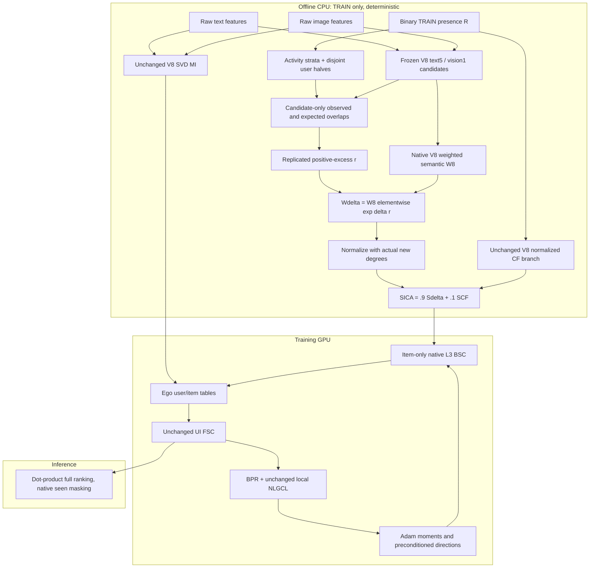

# versionICAART — STAIR-REEC: Replicated Excess-Evidence Calibration

**Canonical architecture specification — 16 October 2026**  
**Nền:** STAIR5-v8 / WMSG-core, 64 dimensions.  
**Phán quyết:** **REDESIGN** bản v9 BSC-SBE; **IMPLEMENT WITH MODIFICATIONS** theo đặc tả REEC dưới đây, với pilot có quyền bác bỏ hoàn toàn giả thuyết.  
**Phạm vi deliverable:** nghiên cứu, phản biện và kế hoạch triển khai; chưa triển khai model hoặc chạy training của kiến trúc mới. `versionICAART` là tên nhánh nghiên cứu, không phải xác nhận đủ điều kiện nộp hay sẽ được ICAART nhận.

## 1. Executive summary

**Đề xuất cuối cùng: STAIR with Replicated Excess-Evidence Calibration — STAIR-REEC.** Chỉ hiệu chỉnh trọng số semantic graph đã có của V8, trước optimizer-side BSC. Không tạo auxiliary consensus graph, không residual vào first-layer item state, không learned consensus gate, không đổi NLGCL, không thêm loss, không mở rộng support, không nâng dimension trong primary experiment.

**Core hypothesis [HYPOTHESIS]:** trong các semantic edges sẵn có, *đồng tương tác vượt mức kỳ vọng theo độ hoạt động người dùng và lặp lại trên hai tập người dùng tách biệt* có thể phân biệt nơi đáng tăng trao đổi hướng cập nhật, tốt hơn raw co-occurrence hoặc semantic similarity đơn thuần. Chưa có dữ liệu chứng minh đây là bottleneck lớn nhất của V8.

Các quyết định chính:

1. Giữ nguyên MI/FSC/BPR/NLGCL/scorer/CF branch của **V8 WMSG-core**, không kế thừa nhánh auxiliary của V8.1/CoGate.
2. Đo **excess association**, không gọi là causal preference, substitute/complement label, hay calibrated probability.
3. Phân tầng users theo train-history length; tính expected overlap trong từng tầng. Tách **users**, không tách item pairs của cùng user thành hai mẫu được gọi là độc lập.
4. Chỉ tăng trọng số khi hai user halves đều có observed overlap lớn hơn conditional-null expectation. Không có bằng chứng → raw multiplier bằng 1; không hard-prune, không coi zero interaction là negative preference.
5. Symmetric reweighting → **actual-degree normalization** → giữ nguyên `.9/.1` normalized CF blend. Bỏ row-budget restoration, Sinkhorn, power-rescaling và sigmoid thresholds của draft.
6. Đo **normalized operator dose và thay đổi BSC direction**, không dùng nominal gate amplitude để tuyên bố đã giải quyết dosage paradox.
7. Nếu không đủ evidence/contrast hoặc matched placebo cũng tốt tương đương, giữ V8; không bù bằng hàng loạt module mới.

Khác biệt với CoGate là **đối tượng và vị trí can thiệp**: REEC kiểm tra độ lặp lại của bằng chứng để điều chỉnh *optimization geometry*; CoGate tạo *auxiliary representation view* và CL supervision. Đây là khác biệt kỹ thuật thực chất, nhưng không tự chứng minh substantial independent publication contribution. Nghiên cứu liên quan đã có behavior-guided graph denoising; không claim phát minh behavioral–semantic consensus.

## 2. Phạm vi đọc, provenance và mức chắc chắn

### 2.1 Tư liệu và cách xử lý

- `docs/EStair.md`: starting critique; các cơ chế nhân quả trong đó là giả thuyết nếu chưa có controlled experiment.
- Các report/experiment report giai đoạn 5–6: lập inventory 29 Markdown files tại `reports/versionICAART_research/docs_inventory.json`, đối chiếu với audit raw-log trước đó. Inventory không phải chứng nhận mọi diễn giải trong các report đều đúng.
- Nguồn thực nghiệm ưu tiên: `reports/stair_icaart_audit_20261016/selected_test.csv`, `run_evidence.json`, `comparability_checks.json`, cùng audit `docs/STAIR_ICAART_Research_Audit_20261016.md`.
- Nguồn overlap: `docs/giai_doan_5/STAIR5_v81_CoGate_Overlap_Audit.md`, `report/chapters_v6/soict` và CoGate `latex.tex`.
- Ba pasted attachments mới: bản v9 BSC-SBE, phản biện v9, và tổng hợp Behavioral–Semantic Consensus; nội dung là **đối tượng cần kiểm chứng**, không phải instructions ghi đè yêu cầu người dùng.
- Bốn PDF local trong `Paper/`: đọc extracted full text ở các phần phương pháp liên quan; kiểm tra trực quan trang công thức RGSC của CC-MGRec và normalization của EVEN. PDF hashes, page counts và extracted text lưu trong `reports/versionICAART_research/`.

**PDF read-integrity advisory:** ARS structural preflight không chạy được output-binding trên Windows vì yêu cầu POSIX `dirfd`; ghi trạng thái **UNAVAILABLE**, không ghi PASS. Pypdf extraction và ảnh kiểm tra công thức là bằng chứng đọc nội dung, không phải structural certification. Riêng EVEN bản local hiển thị Eq.2 với exponent phía phải `+1/2`; không copy notation đó thành normalization mới hoặc coi publisher luôn không có lỗi. Công thức canonical của báo cáo này được định nghĩa và chứng minh độc lập.

### 2.2 Nhãn bằng chứng

| Nhãn | Ý nghĩa |
|---|---|
| FACT | Nguồn/implementation hoặc experiment artifact trực tiếp xác nhận trong phạm vi nêu rõ |
| OBSERVATION | Đại lượng đo được; không tự xác định nguyên nhân |
| INTERPRETATION | Cách giải thích phù hợp evidence, còn alternative explanations |
| HYPOTHESIS | Cần experiment để chấp nhận/bác bỏ |
| SPECULATION | Chưa đủ hỗ trợ; không đưa vào contribution statement |

Các proof chỉ chứng minh thuộc tính toán tử dưới assumptions, không chứng minh ranking gain. Review methodology và publication fit được thực hiện trong **cùng một ngữ cảnh**, không phải hai reviewer độc lập hoặc calibrated acceptance predictor. Tiêu chí: correct estimand, no leakage, valid algebra, attribution, controls, uncertainty, feasible computation và genuine contribution beyond CoGate.

## 3. Research history: điều gì đã thực sự cải thiện?

### 3.1 Đối chiếu selected TEST ở 64D

Các số dưới đây lấy từ selected TEST receipt, **seed 1**, checkpoint chọn theo validation NDCG@20. Giá trị log làm tròn bốn chữ số; không dùng để tính p-value hoặc phát hiện hiệu ứng nhỏ hơn precision của log.

| Architecture | Baby R@20 / N@20 | Sports R@20 / N@20 | Electronics R@20 / N@20 |
|---|---:|---:|---:|
| V8 WMSG-core | .1054 / .0462 | .1142 / .0518 | .0680 / .0317 |
| V8.1 BSCV | .1054 / .0463 | .1149 / .0521 | .0683 / .0318 |
| G6-v1 LCAE | .1050 / .0462 | .1142 / .0519 | .0680 / .0317 |
| G6-v2 AKP | .1054 / .0463 | .1141 / .0518 | .0678 / .0317 |

V8.1 tăng relative N@20 so V8 khoảng **0.22%, 0.58%, 0.32%**. Đây là tốt nhất trong bảng local gần nhất theo N@20, **không phải bằng chứng superiority thống kê hay SOTA quốc tế**. V8 là control phù hợp cho hướng mới vì route của V8.1 trùng CoGate đáng kể.

V4 historical reported N@20 là `.0461/.0517/.0316`; V8 hơn rất ít trên metric này. V4 Baby R@20 `.1056` còn cao hơn V8 `.1054`. Không viết “V8 tăng tất cả metric trên cả ba tập”. Các baseline published và rerun local phải tách nguồn, split, seed và precision.

### 3.2 Chuỗi bài học và những kết luận chưa được phép

| Giai đoạn | Evidence/observation | Lesson | Không được kết luận |
|---|---|---|---|
| STAIR → NLGCL/CSE V4 | Thêm local CL và CF support mang lại bước cải thiện đáng kể trong historical reports | Giữ backbone mạnh làm comparator | Mọi graph expansion đều tốt |
| V5.1 KPE | Known-positive exclusion chủ yếu parity/nhẹ regression | Không ưu tiên thêm false-negative stack khi chưa có evidence mới | False negatives không tồn tại |
| V5.2 BPE | Two-hop expansion làm giảm metric khoảng .39–.87% theo đối soát lịch sử | Không thêm higher-order support vào primary | Đã chứng minh semantic dilution/oversmoothing là nguyên nhân duy nhất |
| V6 BCSR | Heuristic under-support cực nhỏ, graph mass delta khoảng .02–.06% | Đo realized dose; thiếu overlap không phải dislike | Degree preservation tự nâng metric |
| V7 UCR-D | Dynamic update monitoring tốn tài nguyên; một số headline trong report cũ cao hơn selected log chính xác | Không đưa online EMA/snapshot edge scorer vào primary | V7 `.0520/.0318` là fair selected comparator |
| V8 | Continuous semantic weights + fixed CF blend; sparse training khả thi | Nền ổn định, support sẵn có đủ cho controlled reweighting | Đã xác định và chữa hoàn toàn hub saturation |
| V8.1 | Small gains, gate gần saturation; ~14–18% training overhead | Auxiliary consensus có tín hiệu nhưng cần fixed-dose/placebo controls | Learned gate đã học reliability; gain đủ làm bài độc lập |
| G6-v1 | Latent category module thực sự active nhưng metric gần parity | Coarse pooling có thể thiếu discriminative evidence | Metadata thiếu làm module không chạy |
| G6-v2 | Adaptive-K module active, full blended support vẫn như V8; metric gần parity | KKT đúng chưa chứng minh edge utility | Chỉ cần tune K là vượt V8 |

**INTERPRETATION:** các thử nghiệm chưa xác định bottleneck còn lại với confidence cao. Cả can thiệp quá nhỏ và can thiệp đủ lớn nhưng sai tín hiệu đều có thể thất bại. REEC đặt phép kiểm định khác: *signal có vượt null hợp lý và lặp lại trên người dùng khác hay không*, trước khi dùng nó để sửa exchange weights.

### 3.3 Vì sao không quay lại category/price hoặc dimension ngay?

Amazon category/ASIN mapping chưa được xác nhận có sẵn; latent clusters không phải taxonomy. Price ratio không nhận dạng substitute/complement. Ví dụ “laptop và smartphone là substitutes” cũng không phải fact. Không xây primary trên các label/causal relations chưa có.

256D là capacity experiment riêng: cần V8-64/V8-256 và REEC-64/REEC-256 factorial. CoGate đã có matched-dimension table; tăng chiều không phải novelty độc lập, không được dùng để che incremental graph effect ở64D.

## 4. Critical review của v9 draft và phản biện gửi kèm

### 4.1 Những điểm nên giữ

- Optimizer-side static graph intervention phù hợp budget và khác auxiliary CL route của CoGate.
- Semantic similarity không đảm bảo preference-compatible exchange: câu hỏi đúng từ EStair.
- Hành vi train có thể bổ sung content evidence, nhưng cần estimator đúng và kiểm tra selection/popularity effects.
- Sparse support, contraction proof, exact V8 recovery và placebo controls là yêu cầu đúng.

### 4.2 Adjudication: không mặc định draft hoặc critique đúng

| Vấn đề | Phán quyết và sửa |
|---|---|
| `L=q_shrunk_Ochiai/(p_j+eps)` được gọi lift/CC-MGRec formula | **Sai estimand.** Ochiai không phải conditional target probability; source prior/denominator phải cùng sample space. CC-MGRec dùng context–target counts/opportunities, không lấy Ochiai chia item-mass prior. REEC bỏ estimator này |
| Critique gọi `c*M/(n_i*n_j)` là “PMI chính xác” | Đó là **lift** nếu M là số users trong Bernoulli-presence space; **PMI = log(lift)**. Nếu M là tổng interaction rows thì sai sample space |
| Critique suy `c²/(sqrt(n_i)*n_j^1.5)` | Bỏ mất shrinkage denominator `(c+t)`, tổng interaction mass và epsilon. Không dùng approximation này để báo numeric bounds |
| Reallocate row → average sym → dùng D0 | **Không bảo toàn degree** sau sym. D0 không còn degree thật, norm guarantee không suy ra. REEC normalize bằng degree của W mới |
| “Không thể đồng thời symmetric và giữ row sums” | Quá mạnh. V6 đã có diagonal compensation. Marginal-constrained symmetric scaling có điều kiện feasibility; không cần dùng nó cho primary |
| “10 Sinkhorn iterations đảm bảo degree/symmetry” | Sai bảo đảm. Ordinary alternating row/column scaling chưa chắc giữ symmetry ở iterate hữu hạn; prescribed d0 không phải doubly stochastic trừ target đặc biệt. Sparse support feasibility, convergence và residual phải kiểm tra |
| Symmetric nonnegative ⇒ PSD | **Sai**: adjacency [[0,1],[1,0]] có eigenvalues ±1. PSD của normalized Laplacian khác PSD adjacency |
| Five power iterations ⇒ certified upper bound | **Sai**. Finite estimate có thể underestimate; arbitrary initial vector có thể orthogonal với dominant mode. Với true degree normalization, proof bound trực tiếp đủ |
| Critique “negative eigenvalue có thể vượt Perron value” | Không áp dụng cho entrywise nonnegative symmetric S: Perron eigenvalue bằng spectral radius. Vấn đề thực là stale degree và uncertified finite estimator, không phải phản ví dụ đã đưa |
| Gate saturation chắc chắn trên mọi dataset | Chỉ là nguy cơ cho đến khi đo score distribution. Threshold .15/temp .1 không được transfer giữa scores khác scale |
| Normalize loglift bằng global maximum | Rất nhạy outlier, không phải calibration probability; không giải quyết sparse-evidence uncertainty |
| Chọn median/std từ validation interactions để build graph | Không chấp nhận. Chỉ dùng TRAIN cho evidence/statistics; validation metrics được dùng chọn preregistered strength, không tham gia graph statistics |
| CF xuất hiện trong calibration lẫn CSE là lỗi đại số | Không tự động là bug. Có nguy cơ redundant evidence/behavior dominance; giữ CF branch fixed và làm placement controls để kiểm tra |
| Zero co-occurrence ⇒ substitute/noisy semantic edge | Không nhận dạng từ implicit positive-only feedback. Có thể do exposure, sparsity, timestamp hoặc sở thích tương tự nhưng chưa mua cả hai |
| Draft thay V8 bằng square của fused cosine và hard floor | Không còn exact V8: actual V8 floor trong mỗi modality, sum rồi max-sym. Không đổi control ngầm |
| “Zero ms/zero MB”, “100% stable Adam”, predicted +5–8% | Loại bỏ. Offline overhead thật; norm bound scoped; không có result của kiến trúc mới |
| Critique “category/relation propagation chắc ROI cao hơn” | Chưa có matched experiments, metadata và relation labels. Không dùng bảng sao/forecast làm evidence |

**Reviewer verdict:** reject triển khai nguyên trạng v9. Bảo vệ research question, thay estimator và normalization. Không thêm dynamic consensus, FNF, spectral noise hoặc learned edge MLP để cứu draft.

## 5. Targeted deep literature review

Search date: 16/10/2026. Tra exact titles của các attachment, kiểm tra arXiv/publisher, đọc local methods, snowball sang closest graph calibration và bipartite-null work. Đây là targeted mechanism review, **không phải PRISMA systematic review hoặc exhaustive novelty certificate**. Không chuyển relative gains trong paper khác thành forecast cho REEC.

### 5.1 Verified literature và cơ chế liên quan

| Ref | Exact title; authors; venue/status | Source và implication |
|---|---|---|
| R1 | **STAIR: Manipulating Collaborative and Multimodal Information for E-Commerce Recommendation**; Cong Xu, Yunhang He, Jun Wang, Wei Zhang; AAAI2025 | [Publisher](https://ojs.aaai.org/index.php/AAAI/article/view/33407), DOI10.1609/aaai.v39i12.33407. MI/FSC/BSC là borrowed backbone. Original STAIR không có NLGCL local |
| R2 | **A Tale of Two Graphs: Freezing and Denoising Graph Structures for Multimodal Recommendation**; Xin Zhou, Zhiqi Shen; ACM MM2023 | [arXiv](https://arxiv.org/abs/2211.06924). FREEDOM tạo tiền lệ frozen graph và degree-sensitive denoising; static là trade-off có cơ sở |
| R3 | **Multi-View Graph Convolutional Network for Multimedia Recommendation**; Penghang Yu, Zhiyi Tan, Guanming Lu, Bing-Kun Bao; ACM MM2023 | [arXiv](https://arxiv.org/abs/2308.03588), DOI10.1145/3581783.3613915. Behavior-guided purification/fusion đã có; behavioral conditioning không mới riêng lẻ |
| R4 | **Seeing Beyond Noise: Joint Graph Structure Evaluation and Denoising for Multimodal Recommendation**; Yuxin Qi, Quan Zhang, Xi Lin, Xiu Su, Jiani Zhu, Jingyu Wang, Jianhua Li; AAAI2025 | [Official PDF](https://ojs.aaai.org/index.php/AAAI/article/download/33358/35513), DOI10.1609/aaai.v39i12.33358. EVEN dùng co-occurrence để điều chỉnh semantic priors; còn interaction pruning và alignment. Không phải Bayesian calibrated edge probability |
| R5 | **Semantic Item Graph Enhancement for Multimodal Recommendation**; Xiaoxiong Zhang, Xin Zhou, Zhiwei Zeng, Dusit Niyato, Zhiqi Shen; arXiv2025 | [arXiv2508.06154](https://arxiv.org/abs/2508.06154). SIGER trộn collaborative/semantic graphs, modulus perturbation và dual alignment. PDF local có copyright AAAI2026; publisher venue/DOI chưa xác minh, không tự gọi AAAI2026 accepted |
| R6 | **Multi-view information fusion based graph collaborative filtering recommendation**; Ruihui Mu, Xin Li, Jiying Zhang; Journal of King Saud University Computer and Information Sciences38,46 (2026); online27/12/2025, version of record02/02/2026 | [Publisher](https://link.springer.com/article/10.1007/s44443-025-00408-5). MVIF nhiều view/social information và CL. Không phải cùng experimental setting nếu thiếu social data |
| R7 | **Rethinking Evidence Modeling: Context-Coupled Graph Learning for Multimodal Recommendation**; Mingqiao Zhang, Qiyao Peng, Yumeng Wang, Wenzhe Dong, Hongtao Liu, Jian Yang; arXiv preprint11/10/2026 | [arXiv2610.15523](https://arxiv.org/abs/2610.15523), [method](https://arxiv.org/html/2610.15523v1). CC-MGRec dùng context–target smoothed log-lift, incoming semantic-budget reallocation, joint UI/semantic normalization và shared-state forward propagation. Close prior art cho calibration, không phải chứng minh REEC sẽ tốt |
| R8 | **Cross-modal local interest contrast with Dual-graph denoising for multimodal recommendation**; Yuxin Qi, Quangui Zhang, Xinqiang Ma, Xie Feng, Qiang Li, Yi Huang; Signal, Image and Video Processing20,42,2026 | [Publisher](https://link.springer.com/article/10.1007/s11760-025-05066-8). Dual-graph/local-interest contrast là precedent khác; không đồng nhất với optimizer-side graph estimator |
| R9 | **One Graph, Multiple Gains: Single High-Quality Item-Item Graph for Multimodal Recommendation**; Jinfeng Xu, Zheyu Chen, Ziyue Peng, Shuo Yang, Jinze Li, Zewei Liu, Shujie Li, Yipeng Du, Edith C.H. Ngai; arXiv2026, metadata ghi ACM MM2026 accepted | [arXiv](https://arxiv.org/abs/2607.24607), [author code](https://github.com/Jinfeng-Xu/IIMRec). IIMRec semantic/co-occurrence, NCER, residual gating và graph/BPR augmentation: comparator gần, không mô tả nó như chỉ CF graph |
| R10 | **MURAL: Multimodal Uncertainty-aware Recommendation via Adaptive edge Learning**; Ahmad Mousavi, Majid Alikhani, Yeon-Chang Lee, Roberto Corizzo, Yeganeh Abdollahinejad; arXiv04/09/2026 | [arXiv](https://arxiv.org/abs/2609.04574). Dynamic retrieval/uncertainty fusion/teacher–student; venue peer review chưa xác nhận. Không nhập cả stack vì trend |
| R11 | **Statistically Validated Networks in Bipartite Complex Systems**; Michele Tumminello, Salvatore Miccichè, Fabrizio Lillo, Jyrki Piilo, Rosario N. Mantegna; PLoS ONE6(3),e17994,2011 | [Publisher](https://journals.plos.org/plosone/article?id=10.1371/journal.pone.0017994). Degree-conditioned bipartite overlap null và multiple-testing principles là foundational prior; REEC mượn tư duy null, **không** claim statistical-validation theorem cho heuristic của mình |

### 5.2 Công thức gốc CC-MGRec không phải công thức draft

Trong source R7, dùng context–target opportunity `nu_i`, count `n_i→j`, prior `p_j`, pseudocount `mu`:

\[
\ell_{i\to j}=\log\frac{n_{i\to j}+\mu p_j}{(\nu_i+\mu)p_j}.
\]

Sau directional combination/confidence transform, source dùng exponential reweighting và **destination incoming budget** restoration. Không được thay `n/nu` bằng shrunk Ochiai rồi giữ nguyên interpretation. REEC dùng **user-presence sample space khác**, định nghĩa đầy đủ ở §8; không gán estimator mới là RGSC nguyên bản.

### 5.3 Citation corrections và unverified relationships

- DOI `10.1609/aaai.v39i12.33407` là **STAIR**, không phải SIGER.
- `arXiv2508.06154` là **SIGER**, không phải MVIF.
- Springer `s44443-025-00408-5` là **MVIF**, không phải EVEN.
- ML Anthology link `qi2025aaai-seeing` là **EVEN**, không phải Cross-modal local interest contrast.
- CC-MGRec tồn tại và submission date11/10/2026 trước ngày audit; **không** tự gán SIGIR/WWW/AAAI acceptance.
- Không dùng tên chưa xác minh như “The Edge Spectrum”, “CoGNN2026” hoặc một mức gain được attachment gán cho paper làm nền proof. Không khẳng định chúng không tồn tại; chỉ không đưa vào verified evidence khi chưa truy nguyên exact source.
- Code CoGate là unpublished same-group material. Các ý tưởng mượn từ đó phải công khai quan hệ, không tạo anonymous citation giả hoặc phát tán manuscript riêng tư để kiểm tra similarity.

## 6. Remaining research gap và alternatives

**Gap có thể kiểm định:** semantic support của V8 được content chọn, CF branch chỉ bổ sung độc lập. Chưa biết **một lượng nhỏ reallocation có cấu trúc theo replicable behavioral excess** trên chính semantic support có giúp optimization tốt hơn additive CF blend hay không. Missing evidence được giữ neutral; route hoàn toàn optimizer-side.

Không viết gap là “chưa ai kết hợp semantics và behavior”: R3–R9 và CoGate đã làm nhiều dạng.

| Candidate | Hypothesis / toán học rút gọn | Vì sao khác V8; risk; falsification |
|---|---|---|
| A. Naive consensus-product BSC | `W'=W8*(eps+(1-eps)*q*s)` | Thay semantic edge weights; nhưng q/s khác scale, zeros punish sparse items, gần consensus prior. Reject nếu constant/shuffled weights ngang primary |
| **B. REEC — primary** | `r=min_f ([c_f-mu_f]_+/(c_f+mu_f+tau)); W'=W8*exp(delta*r)` | V8 không có replicated activity-conditioned evidence; không thêm topology/loss. Risk evidence quá thưa hoặc association không liên hệ utility. Reject nếu replica control/placebo bằng nhau hoặc dose≈0 |
| C. Single-sample excess calibration — backup/control | `r=[c-mu]_+/(c+mu+2tau)` | Cùng sample space, nhiều coverage hơn; không bảo vệ replicability. Nếu C≥B và replica diagnostics không hữu ích, bỏ replication claim, cân nhắc simpler estimator với novelty yếu hơn |
| D. Update-compatible static/online retention | `g_ij=h(cos(D_i,D_j)); W'=W8*g` | Đo gần optimization hơn; đã gần V7, noisy BPR directions và snapshot cost. Không primary do hardware/history, không gọi cosine update là causal utility |
| E. Alignment-only MI / shared-private encoder | Procrustes `Q=argmin ||Zv Q-Zt||²`, hoặc new encoder | Giải quyết basis/misalignment khác hypothesis; chưa có sign/rotation diagnostic chỉ ra gain. Extra confound, không kết hợp B |

### 6.1 Decision matrix — qualitative, không giả làm measured gain probabilities

| Criterion | A | B | C | D | E |
|---|---|---|---|---|---|
| Correct, explicit estimand | Weak | Strong under scoped null | Strong under scoped null | Direction proxy only | Alignment objective clear |
| Historical empirical support | Limited | Indirect; not yet tested | Indirect | Mixed, expensive | Not established locally |
| Potential to test a different CoGate contribution | Low | Highest among these, conditional | Moderate | Moderate; overlaps V7 | Moderate |
| Falsifiability/ablation clarity | Moderate | Strong | Strong | Difficult dynamic attribution | Strong if isolated |
| Training efficiency | Strong | Strong | Strong | Weakest | Depends encoder |
| Principal failure | Scale/coverage collapse | Insufficient replicated evidence | Spurious single-sample peaks | Cost/noisy directions | Irrelevant alignment |
| Decision | Reject primary | **Select diagnostic-first** | Backup / mandatory challenger | Defer | Defer |

Không có dữ liệu để chấm “xác suất tăng NDCG 9/10”. Scientific upside của B đến từ phép kiểm định cụ thể, không từ cam kết effect size. Nếu B fail, không tự chuyển C rồi giữ nguyên claim về replication.

## 7. Final architecture overview



**Why each new part exists:** activity-conditioned null challenges raw popularity evidence; independent user halves challenge chance peaks; bounded positive excess avoids unsupported negative labels and unbounded lift; actual-degree normalization restores valid contraction. Exponential multiplier is a standard smooth positive reweighting, not a new neural module. Only `delta` is the primary validation-selected architectural strength.

## 8. Mathematical specification

### 8.1 Symbols and baseline contracts

| Symbol | Meaning |
|---|---|
| M, N, d | TRAIN user count, item count, embedding dimension (primary64) |
| R in {0,1}^(M×N) | Deduplicated train-presence matrix **for new evidence only** |
| h_u=sum_i R_ui; n_i=sum_u R_ui | User activity / item train-presence degree |
| X_t, X_v | Raw catalog features, shapes N×d_t and N×d_v |
| K_t(i), K_v(i) | Frozen native V8 candidate IDs, text5/image1 |
| E_sem | Unique undirected positive off-diagonal support of native weighted W8 |
| W8, d8, Ssem8 | Raw symmetric semantic adjacency, its true degrees, normalized semantic operator |
| SCF | Existing V8 normalized CF operator with native isolate convention |
| f in {0,1}; b in {0,…,B-1} | Disjoint user half / activity stratum |
| M_fb, n_ifb, c_ijf | Group user count, item group incidence count, common-user count in half f |
| mu_ijf | Expected overlap under within-stratum independent user-set null |
| tau | Count-scale regularizer, fixed2 per half in primary; not Bayesian confidence |
| r_ij in [0,1) | Replicated excess score, not calibrated probability |
| delta >=0 | Reweight strength, primary grid {0,.5,1,2} |
| SICA | Final static operator supplied only to item BSC |

Retain native training multiplicity rules, MI/Adj construction, losses and sampler. New evidence uses unique `(user,item)` pairs; a deduplication count/hash receipt is mandatory, not a silent change to V8 training data.

### 8.2 Recover exact V8 raw semantic graph

For modality m, selected raw-feature cosine a^m_ij in [-1,1], using native zero-vector rule:

\[
f(a)=.05+.95[\max(0,a)]^2,
\quad B_{ij}=\sum_{m\in\{t,v\}}\mathbf1[j\in K_m(i)]f(a^m_{ij}),
\]
\[
W^8_{ij}=\max(B_{ij},B_{ji}),\quad W^8_{ii}=0.
\tag{1}
\]

Modality contributions are occurrences, **not** `(5/6)*cos_t+(1/6)*cos_v` inserted into a new formula. MI5:1 weights and candidate budgets are distinct design quantities. Preserve semantic mix1, RPG off, SAP off and BSC residual0 for WMSG-core.

Define normalization for symmetric nonnegative W:

\[
\mathcal N(W)=D^{-1/2}WD^{-1/2}+\operatorname{diag}(\mathbf1[d_i=0]),
\quad d=W\mathbf1,
\tag{2}
\]

where inverse degree is0 on isolates. Identity isolates preserve the native self-update convention; zero isolate blocks would also satisfy contraction, so identity is not a mathematical necessity for the norm bound.

CF is unchanged: `c/(c+5) * c/sqrt(n_i*n_j)`, c_min2, row top5, native union/max symmetry, normalization/identity isolates. Reuse existing native builder/cache instead of rewriting its precision or tie policy. **Wholly empty CF** follows the current V8 global-empty fallback: disable CF blend (effective eta0), rather than introducing an artificial `.1*I`. Eq.6 uses eta.1 for the nonempty benchmark CF case; with empty CF apply eta0 to both REEC and V8. Exact bypass/provenance must cover this boundary.

### 8.3 Deterministic activity strata and user replication

Create strata from train activity only:

\[
b(u)=\lfloor\log_2\max(1,h_u)\rfloor.
\tag{3}
\]

Zero-history users are excluded from evidence strata/group sizes and receive group ID−1; they do not enlarge the null sample space. Within each nonempty stratum, order users by a stable seeded hash `(evidence_seed,user_id)` with user-ID tie-break, then alternate f=0/1. `evidence_seed=20261016` is independent of optimizer seeds; no Python process-randomized `hash()`.

Each user and their entire train history appear in **exactly one half**. A singleton stratum is deterministic in half0; empty cells are skipped. Store the assignments and counts. This creates disjoint user evidence, **not a guarantee** that real users or their interests are independent. Because final scoring uses both halves, call it replicated evidence, **not cross-fitting of a prediction model**.

\[
M_{fb}=|\{u:f(u)=f,b(u)=b\}|,
\quad n_{ifb}=\sum_{u:f(u)=f,b(u)=b}R_{ui},
\]
\[
c_{ijf}=\sum_{u:f(u)=f}R_{ui}R_{uj},
\quad
\mu_{ijf}=\sum_{b:M_{fb}>0}\frac{n_{ifb}n_{jfb}}{M_{fb}}.
\tag{4}
\]

Only compute pairs in E_sem. Do not build full `R.T@R`, full `N×N` expectation, or enumerate every pair in long user histories. With positive observed count, its same-stratum marginals imply mu>0; `c>0,mu=0` is an input/numeric bug, not a “very strong tail edge”.

**DERIVATION:** given n_ifb and n_jfb users selected independently and uniformly among M_fb users, expected intersection is their product/M_fb. Summing disjoint strata gives Eq.4. Real exposure/interests violate uniformity; log residuals/ratios are associational proxies, not causal preference estimates. Log2 bins approximate activity conditioning, not exact degree-preserving configuration-model inference.

### 8.4 Bounded excess evidence and replication

For tau=2:

\[
e_{ijf}=\frac{[c_{ijf}-\mu_{ijf}]_+}{c_{ijf}+\mu_{ijf}+\tau},
\quad
r_{ij}=\min(e_{ij0},e_{ij1}),\quad r_{ii}=0.
\tag{5}
\]

No division by tiny popularity prior, no gate temperature, no global-max normalization. `0<=e<1`; `c=0` gives0. Minimum requires *positive excess in both disjoint halves*; a single rare co-occurrence in one half cannot trigger calibration. Tau is an explicit heuristic count regularizer; do not describe it as a Bayesian posterior variance, p-value or type-I error guarantee.

**Design trade-off:** min reduces sensitivity to one-half peaks but loses coverage. It can also preserve systematic exposure bias in both halves. If almost all r=0, this is a legitimate NO-GO, not permission to rank-normalize numerical noise into a full-strength signal.

### 8.5 Symmetric semantic calibration and native CF blend

\[
W^\delta_{ij}=W^8_{ij}\exp(\delta r_{ij}),\quad
S_\delta=\mathcal N(W^\delta),
\quad S_{\mathrm{ICA}}=.9S_\delta+.1S_{CF}.
\tag{6}
\]

Evaluate unique i<j pairs once in FP64, mirror exactly. Recompute **actual d_delta=W_delta*1**. No restoration to d8, no symmetrization after independent row scaling, no power-iteration rescale, no second insertion of raw CF q into W_delta.

At delta=0 return the existing **exact cached V8 final operator** directly; do not recompute a numerically almost equal V8 graph and call it bitwise recovery. If all r=0, same bypass with explicit `inactive_reason=no_replicated_excess`. If constant r over each connected component, normalized semantic operator is unchanged mathematically; record neutral calibration instead of claiming large raw dose.

Missing evidence means raw edge multiplier1. It does **not** guarantee its final normalized coefficient stays unchanged: increased incident degrees can attenuate unsupported neighboring edges. The final dose and head/tail diagnostics must measure this indirect effect.

### 8.6 Unchanged training and inference equations

Let A_UI be native V8 normalized bipartite adjacency, H0=[U0;V0]. For coordinate k=0,…,d-1:

\[
b_k=.1+.9(k/d)^{\gamma},\quad a_k=1-b_k,
\quad
\bar H_{:,k}=\frac{1-a_k}{1-a_k^{L+1}}\sum_{\ell=0}^L a_k^\ell A_{UI}^{\ell}H^0_{:,k},\ L=3.
\tag{7}
\]

Initial U0,V0 come from **unchanged V8 MI**, not aligned/clustering features of REEC. Intermediate states used by local NLGCL retain exact native definition and normalization. Loss:

\[
\mathcal L=\mathcal L^{native}_{BPR}+.01\mathcal L^{native}_{NLGCL},
\quad \tau_{CL}=.2,\ \alpha_{dir}=.5.
\tag{8}
\]

Do not add duplicate filtering, known-positive masking, target detach, new regularizers or change native decay semantics under this version. Native BPR compares positive and sampled-negative dot products; preserve actual helper reduction/regularization behavior.

After backward and native Adam moment/bias correction, let D_t be the **total-loss** Adam-preconditioned item direction (not raw BPR gradient). Item update:

\[
P_k(S)=\sum_{\ell=0}^{L}\omega_{k\ell}S^\ell,
\quad \omega_{k\ell}=\frac{b_k^\ell}{\sum_{q=0}^{L}b_k^q},
\]
\[
V^{t+1}_{:,k}=(1-\alpha_t\lambda_{wd})V^t_{:,k}
-\alpha_t P_k(S_{\mathrm{ICA}})D_{t,:,k}.
\tag{9}
\]

Use existing implementation arithmetic for equality tests. User optimizer unchanged, smoother=None. Final score `y_ui=bar U_u^T bar V_i`; native full ranking, seen masking and validation checkpoint selection unchanged. REEC has **no inference branch**.

## 9. Theoretical analysis and scoped guarantees

### 9.1 PROPOSITION — support, symmetry, positivity and contraction

For finite delta>=0, symmetric r in [0,1), W_delta is symmetric/nonnegative and has exactly the off-diagonal support of W8. Degrees can change; components and isolated-node set do not.

For any real x on positive-degree nodes, set y_i=x_i/sqrt(d_i). Then

\[
|x^T\mathcal N(W)x|
\le\sum_{ij}W_{ij}|y_i y_j|
\le\frac12\sum_{ij}W_{ij}(y_i^2+y_j^2)=\|x\|_2^2.
\]

Identity isolated blocks also have norm1. Symmetry gives real eigenvalues in [-1,1], hence norm<=1. Triangle inequality with same-property SCF yields `||SICA||2<=.9+.1=1`. SICA need not be row-stochastic or PSD; I−SICA is PSD. Finite precision needs symmetry/nonfinite/degree checks; a numerical eigenvalue estimate is a diagnostic, not the proof.

### 9.2 PROPOSITION — finite BSC direction bound

For each coordinate k, omega>=0 and sum omega=1; therefore `||P_k(S)z||2 <= ||z||2` when `||S||2<=1`. Summing squared column bounds gives `||P(S)D||F <= ||D||F`.

This bounds smoothing relative to its **input direction**. It does not bound Adam moments/D_t, gradient Jacobians, cumulative parameter norms or training convergence. L=3 is a finite polynomial and needs no infinite-series convergence claim. If discussing the infinite Neumann series separately, require `b_k*||S||<1`; native b_k<1 supplies it for fixed finite d.

### 9.3 DERIVATION — why uniform weight changes cannot solve dosage

Let rbar_i=`sum_j W8_ij*r_ij/d8_i`. On existing edges at delta0:

\[
\left.\frac{\partial(S_\delta)_{ij}}{\partial\delta}\right|_0
=(S_{sem8})_{ij}\left(r_{ij}-\tfrac12\bar r_i-\tfrac12\bar r_j\right).
\tag{10}
\]

This follows by differentiating both degrees and numerator in symmetric normalization. Only evidence contrast beyond endpoint averages changes the normalized graph at first order. If r constant per component, the operator is unchanged for all delta. Thus a nonzero r mean/raw multiplier is **insufficient**.

With Delta=SICA−S8, exact zero-delta recovery and a bounded polynomial perturbation follow:

\[
\|P_k(SICA)-P_k(S8)\|_2
\le C_k\|\Delta\|_2,
\quad C_k=\sum_{\ell=1}^L\ell\omega_{k\ell}\le L.
\tag{11}
\]

Proof uses `A^ell−B^ell=sum_{q=0}^{ell-1}A^q(A−B)B^(ell−1−q)` for contractions. A small dose can imply small direction change; a nonzero upper bound does not establish a useful lower bound or gain.

**Executed algebra check — limited evidence:** 24 synthetic FP64 sparse-pattern fixtures (9 nodes) give maximum normalized spectral norm `1.0000000000000009` (roundoff), maximum Eq.10 finite-difference absolute error `2.33e−8`, no positive Eq.11 bound violation, and uniform-reweight operator change at most `2.23e−16`. A three-node stale-degree counterexample using raw weights `[[0,100,1],[100,0,1],[1,1,0]]`, row-restored to degrees `[2,2,2]` then symmetrized, has actual degrees `[2.490099,2.490099,1.019802]` and stale-normalized norm **1.1074819683**. Receipt: `reports/versionICAART_research/algebra_checks.json`. These checks are not training, real-dataset diagnostics or a substitute for the proofs. No REEC ranking result exists yet.

### 9.4 Basis dependence, uncertainty and causal limits

- **PROPOSITION:** r uses train counts and within-modal Gram/candidate support; it is independent of learned embedding-coordinate rotations. Fixed scalar item operator satisfies `S(XQ)=(SX)Q`.
- **LIMITATION:** whole STAIR remains basis-dependent through per-coordinate FSC/BSC schedules and Adam elementwise second moments. REEC does not solve independent SVD misalignment. No claim an MLP would solve it.
- **INTUITION:** requiring disjoint user replication may reduce chance-driven association; real users, selection and exposure are not exchangeable iid samples.
- **HYPOTHESIS:** excess edges permit more useful update exchange. Association still does not identify same preference, complementarity or beneficial gradient transfer.
- **LIMITATION:** larger positive adjacency weights can worsen smoothing. No theorem that continuous weights prevent oversmoothing or preserve ranking margins.

## 10. Why might it improve ranking over V8?

For a validation triplet `(u,i,j)`, margin m=`bar U_u^T(bar V_i−bar V_j)`. At a fixed shared parameter/optimizer state, the item-only difference in one step is `Delta V=−alpha [P(SICA)−P(S8)]D`. First-order change in margin is

\[
\Delta m\approx\langle\nabla_{V_0}m,\Delta V\rangle_F.
\tag{12}
\]

It can have **either sign**. This is why graph proofs alone are insufficient.

| Chain | Observable mechanism | Operation | Ranking implication and refutation |
|---|---|---|---|
| Relative exchange | High raw semantic weights sometimes have weak behavioral residual after activity control | Boost only replicated-excess edges before true normalization | Could align borrowed updates with preference distinctions; if negative or no margin shift vs placebo, hypothesis fails |
| Evidence repeatability | High single-sample excess may disappear in another user half | Minimum across halves | Could reduce chance-driven reinforcement; if pooled score is equally repeatable/useful and performs better, replication is unnecessary |
| Effective dose | V6 under-support caused tiny operator changes | Directly measure Eq.10 contrast, operator and BSC change for shared delta grid | Identifies inactive intervention before costly runs; does not create utility if evidence is wrong |

V8 additive CF can carry evidence on CF edges, but does not redistribute the **semantic branch** by repeated excess. Nevertheless CSE may already transmit the same useful directions. Placement controls in §14 explicitly test redundancy. No statement that REEC necessarily beats V8, CoGate or external SOTA is warranted.

## 11. Engineering specification

### 11.1 Module contracts

| Module | Input → output | Trainable / initialization / gradient |
|---|---|---|
| `build_activity_replication` | binary CPU CSR R[M,N], stable IDs → user_bin[M], half[M], group_sizes[2,B] int64 | No params; deterministic seed; no gradients |
| `candidate_excess_statistics` | CPU CSC posting lists, E_sem[E,2] int64, assignments → c[E,2] int64, mu[E,2] FP64 | CPU; exact candidate intersections; no dense NxN; no gradients |
| `replicated_excess_score` | c,mu,tau → r[E] FP64 | Eq.5; no sigmoid/MLP; no gradients |
| `calibrate_semantic_operator` | native W8 CPU CSR, r,delta, native SCF → final SICA[N,N] CSR FP32 + audit | Eq.6; no learned params; delta0 exact V8 bypass |
| Existing item smoother | detached D_t[N,d] FP32 → filtered direction[N,d] FP32 | Reuse native V8 L3 @no_grad recurrence |
| Existing model/loss/eval | Native V8 tensors/protocol | All original gradient paths preserved |

`n_ifb` is small **dense item×2×B**, permitted; not item×item. Use compact int64 counters, cast products to FP64 before multiplication. Pair counts are exact integers. E counts undirected pairs; graph nnz counts directed storage entries. Never confuse the two.

CPU evidence algorithm: intersect sorted CSC user lists for each frozen candidate pair; increment c by user half, and precompute n_ifb by a streaming pass over train incidence. Use compiled/vectorized bounded routines; avoid an uncompiled Python loop over all user-history pair combinations. Candidate block size8192 is an engineering default with bounded temporary memory, not a new graph hyperparameter. Existing V8 CF build stays separately cached and sparse.

### 11.2 Sparse, checkpoint and cache contracts

- Construct W8 and W_delta offline on CPU; no tensors with grad_fn in prepare(). Transfer **only final SICA** to GPU; training must not retain CPU statistics as CUDA buffers.
- Reuse final CSR indices/support, one graph tensor, native `torch.sparse.mm` callback. No new per-step graph construction, refresh, EMA, snapshot or edge features on GPU.
- Manifest includes source revision, train-presence hash, original training multiplicity counts, user/item mapping, candidate/raw-feature hashes, W8/SCF hashes, evidence assignments, tau/delta, arithmetic dtype and final graph hash.
- Training seed and evidence seed are separate fields. Checkpoint stores final manifest identity; resume rejects graph mismatch. No regenerating a new graph from shuffled users on resume.
- Delta0 must recover parameter groups, learning-rate schedule, sampler stream, loss and evaluator of V8. Offline evidence build must not consume global model RNG; use local RNG/hash.
- Count/no-evidence/neutral-component conditions are logged. Do not silently fall back and label inactive graph as successful REEC.

### 11.3 Planned files — new files only

```text
stair_icaart_config.py
models/stair_icaart_evidence.py       # strata, user halves, candidate counts/null/score
models/stair_icaart_graph.py          # exact native W8, calibrated weights, N(W), manifest
models/stair_icaart.py                # inherit V8 model; override graph preparation only
main_stair_icaart.py                  # native coach reuse, new config/metadata/diagnostics
configs/Amazon2014Baby_STAIR_ICAART.yaml
configs/Amazon2014Sports_STAIR_ICAART.yaml
configs/Amazon2014Electronics_STAIR_ICAART.yaml
tests/test_stair_icaart_evidence.py
tests/test_stair_icaart_graph.py
tests/test_stair_icaart_pipeline.py
notebook/P6/stair_icaart.ipynb         # after CLI/tests, all datasets selectable
```

No new smoother implementation is scientifically required; import `STAIR5V8Smoother`. No baseline/V8/CoGate mutation. Inheritance requires inspecting current model prepare API before coding; do not change inheritance solely to fit a guessed function signature.

### 11.4 Frozen primary configuration

```yaml
# Inherit exact dataset-specific V8 WMSG-core baseline config.
embedding_dim: 64
evidence_mode: replicated_excess
evidence_activity_bins: log2
evidence_halves: 2
evidence_seed: 20261016
evidence_tau: 2.0
evidence_delta: 1.0        # provisional primary; select from common grid using VALID only
evidence_delta_grid: [0.0, 0.5, 1.0, 2.0]
evidence_candidate_block: 8192
# Native constants: semantic_power2, floor.05, eta_cf.10, k_cf5, cmin2, shrink5.
# No consensus residual, alignment, RPG, adaptive-K or Dirichlet objective.
```

Only delta is primary search. Tau sensitivity `{1,2,5}` and activity-null ablation are secondary on the shortlisted dose, not a crossed search across all variants. CLI rejects nonfinite scores/negative tau, delta outside preregistered [0,2], invalid mappings, asymmetric raw W, or evidence using validation/test pairs.

## 12. Complexity, speed and memory

Let E be semantic undirected candidates, K=nnz(S8), T=unique train pairs, B the number of log2 activity bins.

| Cost | V8 | REEC incremental |
|---|---|---|
| Candidate retrieval / feature cosine | Existing native CPU/chunked preprocessing | Reused; do not recompute full similarity |
| Train preprocessing | Native MI/UI/CF | O(T) assignments and item-group counts |
| Candidate overlap | Existing CF builder separate | O(sum_(i,j in E)(n_i+n_j)) sorted-list upper bound; O(E*B) null evaluation |
| Persistent CPU evidence | None extra | O(2NB+E+M), plus R CSR/CSC; no NxN |
| BSC / step | 3 sparse SpMM of K×d cost | **Same SpMM count and same support K** |
| Extra trainable parameters | None for graph | **0** |
| Extra persistent graph VRAM | One final graph | **0 asymptotic extra graph allocation** if SICA replaces S8 and artifacts remain CPU |
| Inference | Native FSC and full ranking | Same operation count |

Same operation count is not a wall-time guarantee: sparse values, library kernels, allocator and diagnostics can change cost. Report peak allocated and reserved memory and whole-process CUDA footprint separately. No guarantee of OOM freedom or `<800MiB`: historical V8 Electronics already reports roughly800.67MiB allocated and full ranking may peak differently.

Upper candidate bounds with text5+image1 are `E<=6N` undirected, directed semantic nnz<=12N; original symmetric top5 CF contributes <=10N, isolates <=N. Thus final graph `K<=23N` is a conservative support bound. CSR with int64 indices/rowptr and FP32 values uses approximately `12K+8(N+1)` bytes, excluding conversion workspace. For N=7050/18357/63001 this bound is approximately1.91/4.97/17.06MiB. Actual overlap reduces K; measure actual values. REEC preserves support, so these are total graph-storage bounds, not added VRAM claims.

For CPU working buffers with E<=6N: pairs int64[E,2]16E, counts int64[E,2]16E, expectations FP64[E,2]16E, score8E, weights8E →64E bytes if all retained. Item-group counts add16NB bytes. Stream/release intermediates; no need move them to GPU. Graph conversion can temporarily duplicate CSR/COO; profile preprocessing RSS. This does not include raw feature RAM, native CF workspace or Python-object overhead.

Electronics256 embeddings+grads+two Adam moments alone are about `16*(192403+63001)*256` bytes≈997.67MiB; do not reuse64D memory claims for capacity experiments.

## 13. Mechanism diagnostics before expensive training

All catalog statistics use TRAIN. VALID outcomes can evaluate a frozen score but cannot feed back into graph evidence.

| Diagnostic | Definition | Supports / falsifies |
|---|---|---|
| Replicated coverage | frac(E with r>0), weighted fraction sum(W8*1[r>0])/sum(W8), item coverage by train-degree bins | Determines eligible scope; near-zero coverage explains no-op, not model success |
| Single-half disagreement | frac((e0>0) xor (e1>0)); correlation of nonzero e0/e1 with zero mass reported separately | Large one-half peaks motivate replication; no stability advantage weakens it |
| Actual cross-user predictive validity | Repeated **diagnostic-only** three-way user splits: two thirds construct scores, third measures excess, without outer held-out data | High-r candidates should predict excess in independent users better than q/rawcos degree-matched controls; failure rejects evidence interpretation |
| Activity-null adequacy | Compare mu with average pair overlap under train-only within-bin item-column permutations; diagnostic challenger also uses degree-preserving bipartite swaps on a bounded pair sample | Identifies model mismatch; not a proof exchangeability holds |
| Endpoint contrast | distribution `r_ij−.5*rbar_i−.5*rbar_j` (Eq.10) | r mean high with contrast≈0 means normalization cancels dosage |
| Operator dose | F=`||SICA−S8||F/||S8||F`; rowwise L1 changes with denominator and quantiles; nnz/hash/symmetry | Distinguishes exact no-op from meaningful operator change |
| Polynomial dose | `||[P(SICA)−P(S8)]Z||F/||P(S8)Z||F` on fixed Rademacher probes; later on sampled actual D_t | Nonzero graph delta with negligible direction delta still may be ineffective |
| Degree side effect | d_delta/d8 by item group; normalized coefficient changes on r=0 edges | Detects indirect suppression and head/tail imbalance |
| Update compatibility, secondary | weighted cosine of pre-BSC Adam directions at edges, ignoring near-zero rows; inspect sampled epochs only | Proxy mechanism; no assumption cosine>0 always good |
| Ranking margin | Eq.12/frozen shared-state one-step probe and fixed validation negative IDs; later per-user deltaR20/deltaN20 | Must agree with claimed utility; high-r but harmful margins refute transfer story |
| Representation behavior | effective rank, normalized Dirichlet energy, pairwise similarity/eval metrics jointly | Higher smoothness alone is not success |

Do not report p-values for heuristic r as if it were a statistical significance test. If formal edge hypothesis testing is added later, define exact null and multiple-testing correction as a **different estimator**, not an interpretation upgrade of Eq.5.

## 14. Fair experiments and ablation matrix

### 14.1 Locked protocol

Same splits/features/IDs, MI seed, original sampler, LR/WD, optimizer, full-ranking implementation, seen masking, validationN20 selection, eval every5 epochs and500-epoch budget as V8. Primary64D; FP32/TF32 setting identical. Batch Baby/Sports1024, Electronics4096 and native chunked CL1024/1024/128 must be checked against frozen manifests. Dataset-specific gamma `.1/.2/.4`, WD `.3/.1/.1`, LR`.001` remain control values unless a **matched** tuning study is declared for both methods.

Primary outcomes: R@20 and N@20; secondary R@10/N@10. Export unrounded per-user metrics/seed values at checkpoint. Do not switch to R@1 after inspecting outcomes. Native checkpoint is selected only by VALID; TEST read once for frozen finalists.

### 14.2 Scientific controls

| Arm | Single question | Expected if hypothesis true / interpretation if not |
|---|---|---|
| V8 exact delta0 | Does scaffolding preserve control? | Exact graph/training parity within explicit numerical tolerance; any unexplained difference blocks experiments |
| **REEC** | Does replicated excess improve existing semantic exchange? | Positive paired gain; parity/regression after nonzero dose rejects practical value |
| Pooled excess | Is replication necessary? Compute pooled c, sum mu, denominator c+mu+2tau | REEC better/stabler; if pooled equal/better, simplify and drop replication contribution |
| Unstratified replication | Is activity conditioning useful? Use mu_f=n_if*n_jf/M_f | REEC better group utility/null fit; if same, activity stratification may be unnecessary |
| Replicated count score | Is excess beyond popularity needed? r=min_f c_f/(c_f+tau), same support/reweight/delta grid | REEC better than just repeated counts; otherwise reject null-specific benefit |
| Symmetric degree-stratified r shuffle | Is evidence placement useful beyond weight distribution/degree? | Primary better; if equal, gain may be generic graph perturbation |
| Uniform multiplier | Does normalization cancel global dose as derived? | Mathematically same graph; numerical correctness control, not competitive learner |
| CSE dosage control | Is gain merely more CF? Native V8 eta grid{.05,.10,.20}, same number of trials | REEC must add value beyond retuning eta; otherwise report simpler control |
| BCSR on V8 bridge | Is this just rebranding V6 retention on a stronger graph? | Compare existing negative-under-support/diagonal compensation using V8 WMSG parent; separate dose matching |
| RGSC-like evidence on V8 | Can published context–target score match REEC at same insertion point? | Mechanism challenger; credit R7 and preserve its count/opportunity sample space |

Shuffles act on unique undirected pairs and mirror; never shuffle two directions separately. Match multiplier distribution and degree strata; if matching **realized** normalized dose by scaling, report mismatch/tuning policy. Exact per-row matching may be infeasible; do not fabricate it.

Historical reference rows: original STAIR, V4, V5.1, V5.2, G6-v1/v2 and V8.1 clearly labeled historical if not rerun. External relevant controls: FREEDOM, MGCN, EVEN, SIGER/IIMRec where code/data available, plus item-kNN/LightGCN. Same split/evaluator required for fair superiority claims; published incompatible numbers go in separate reference columns.

### 14.3 CoGate bridge comparison

For reviewer-facing attribution, use a small 2×2 bridge: graph V8 vs REEC, auxiliary CoGate-style branch off vs on, same dimension/backbone/loss implementation and parameters where relevant. This tests whether the new graph effect persists without auxiliary consensus and whether it adds beyond it. Do not bundle CoGate augmentation/noise/negative sampling in just one arm and attribute gain solely to graph evidence.

Primary REEC remains **aux-off**. CoGate full-original should also be reported as separate method if used as comparator; bridge is not silently relabeled as a faithful CoGate rerun.

## 15. Staged GO / NO-GO and statistical validation

| Stage | Work | Decision |
|---|---|---|
| 0A | Evidence fixtures, true-degree/symmetry proofs, native delta0/zero-evidence parity, deterministic hashes, sparse memory checks | Any algebra/leakage mismatch → NO-GO |
| 0B | All available dataset offline diagnostics, independent-user diagnostic validity, shuffled controls; delta grid fixed | r allzero, normalized delta0, nonfinite statistics → NO-GO; do not manufacture nonzero evidence |
| 1 | 2–5 epochs Baby/Sports GPU smoke, eval/resume and paired V8 | Verify runtime/memory/loss; not rank architectures from early accuracy |
| 2 | Same-budget Baby/Sports delta pilot and direct controls; checkpoints every5 | VALID trend warrants full runs only if mechanism/control evidence survives; absence of early gain is inconclusive unless consistent adverse effects |
| 3 | Full V8/REEC seeds1–3, Baby/Sports; Electronics after cost/utility check | WEAK-GO for uncertain small gains; NO-GO for reproducible regression or placebo parity with no mechanism support |
| 4 | Frozen finalists3 datasets,5 seeds if budget; necessary ablations/robustness | GO for reproducible positive effect with uncertainty and attribution; otherwise retain V8 or report negative result |

For numerical inactivity use FP32-aware thresholds tied to reference repeated-build/SpMM error: if dose is at most10× measured numerical noise floor, classify inactive. This is a detectability rule, **not** an accuracy-optimal dosage band. No universal “5% operator change yields gain”. If all delta≤2 remain inactive, stop; do not expand search until a hoped-for metric appears.

Train-time overhead target ≤5% median with same measurement scope, not a guarantee. >10% steady overhead warrants engineering inspection because new online ops should be zero; temporary sampled diagnostics are timed separately. Preprocessing wall time/RSS is reported, not hidden. Diagnose memory/compute and candidate coverage before Electronics full training.

Use paired seeds at least{1,2,3}, preferably5, with **fixed evidence graph** for primary seed variability. Separately evaluate graph seed sensitivity on shortlisted settings (e.g. two additional evidence partitions); do not conflate five graph shuffles with five independent training replications. Report mean±SD, paired differences and CI. With3 or5 seed pairs, exact two-sided sign-flip minima are .25/.0625; cannot promise Wilcoxon p<.05 from5 runs. Paired t-test has assumptions and low power; per-user bootstrap is conditional on trained models and does not replace seed uncertainty. State multiplicity over datasets/metrics/searches and limitations of repeatedly inspected historical TEST.

**STRONG-GO** requires effect reproducible across training/evidence seeds, mechanism advantage over relevant simple/placebo controls, no material tail regression and uncertainty supporting positive gain. A +5% goal is aspirational; no invented minimum achievable gain. No-go on ranking after valid nonzero dose means evidence hypothesis failed, not necessarily implementation bug.

## 16. Dataset-specific expectations and robustness

- **Baby:** cheaper pilot; strong semantic redundancy may make repeated excess indistinguishable from rawcos or q. Tiny aggregate gain is plausible but unproven. Inspect minority/tail positive targets rather than claiming ceiling from one checkpoint.
- **Sports:** prior V8.1 had the clearest small local gain. Heterogeneous activity/content interests may make activity conditioning relevant; it may also leave very sparse replicated coverage. Do not infer “sign mismatch is proven” from domain name.
- **Electronics:** larger catalog and long-tail evidence can fail replication; high item degree average does not imply dense pair overlap. Budget memory and9h-class training carefully. Do not transfer old V8.1 cap behavior into a universal density law.

Robustness controls: train-only edge-score corruption/shuffles with matched support; downsample interactions **for new evidence only** while training parent data remains fixed; report degree-stratified target recall with denominators, recommendation popularity/catalog coverage, r coverage and normalized mass shifts. Modality corruption studies need regenerate semantic weights/candidates consistently for both arms; do not selectively corrupt one model. Category interpretation requires verified metadata or is omitted.

## 17. Reviewer #2 attack: failure modes

| Risk / severity | Why possible | Diagnostic and mitigation |
|---|---|---|
| Association ≠ useful update — HIGH | Two users groups can repeat exposure bias | Shared-state margin tests, degree-matched controls; reject causal language or whole hypothesis |
| Replication too sparse — HIGH | Most item pairs share0–1 users per half | Coverage/dose preflight; stop or openly switch pooled backup, no fake replica novelty |
| Double-use of behavior — HIGH | CSE/FSC already encode same evidence | Eta and published-calibration controls; claim only incremental utility established |
| Tail suppression via normalization — HIGH | Boost head-linked edges raises degrees | Group coefficient changes/long-tail targets; reject if adverse trade-off |
| Simplistic null — HIGH | Log2 strata do not control all heterogeneity | Permutation/configuration-null diagnostics; label proxy, not calibrated inference |
| Chance null excess still survives — HIGH | Multiple edges, correlated users, selection on content | Third-user-group predictivity and shuffled placebo; no edge significance claim |
| Over-propagation — HIGH | More exchange can blur distinctions | Native L3 unchanged, energy/rank/margin checks, small preregistered delta grid |
| Nonzero raw dose but normalized no-op — HIGH | Uniform/component-constant r | Eq.10 and polynomial probes; no-go rather than rescale noise |
| Old normalization/cache bug — CRITICAL | D8 substituted or delta0 rebuilt | Strict actual-degree tests and exact bypass/cache hash |
| Leakage/mapping errors — CRITICAL | Graph statistics accidentally include held-out or shifted IDs | Split hashes, evidence API train-only, candidate endpoint assertions |
| Score saturates uniformly — MEDIUM | Very strong pairs r near1 | Histogram/endpoint contrast; pooled/count controls; no learned gate added automatically |
| Partition dependence — HIGH | Different halves change supported evidence | Fixed primary partition, extra evidence-seed sensitivity; disclose instability |
| Insufficient novelty — HIGH | R7/R11 already calibrate graph evidence | Direct mechanism baselines; problem/negative-result contribution, not “first consensus” |
| Gain due tuning — HIGH | Four new delta trials but frozen V8 | Same-budget eta/simple calibration searches; disclose all trials |
| Extra CPU time — MEDIUM | Posting-list intersections on hubs | Compiled bounded blocks, wall/RSS profile; abort long preprocessing, no dense fallback |
| Tiny uncertain gains — HIGH | V8 improvements within seed noise | Replications/unrounded metrics; do not advertise meaningful superiority |
| Submitted CoGate overlap — HIGH | Same group/backbone/datasets and broad consensus narrative | Full difference table, transparent disclosure; chairs decide eligibility |

## 18. Novelty and relation to CoGate

### 18.1 Shared background versus candidate contribution

| Aspect | CoGate / V8.1 | versionICAART REEC |
|---|---|---|
| Central object | Auxiliary consensus representation | Static calibration of optimizer exchange weights |
| Graph | Separate behavior×semantic confidence support | Same native V8 semantic support, no new auxiliary graph |
| Evidence | Product/soft agreement with behavior | Activity-conditioned **excess** and disjoint-user repetition |
| Insertion | Gated residual at first FSC item state | Only final item optimizer BSC operator |
| Objective | New/modified auxiliary CL view | Existing V8 NLGCL unchanged |
| Additional learned params | Channel/scalar gates | **0** |
| Training sparse work | Extra auxiliary message path | Same native item BSC SpMM count/support |
| Inference | Primary FSC scorer | Same; not unique to this proposal |
| Scientific question | Does auxiliary consensus supervision help? | Does replicable excess identify where fixed-support optimizer exchange is useful? |

**BORROWED/STANDARD:** MI/FSC/BSC, NLGCL, co-occurrence, activity/null conditioning principles, exponential weighting, symmetric normalization and norm inequalities.

**ADAPTED:** candidate-only behavioral calibration applied to V8 WMSG; preserving existing CF blend; hardware-efficient frozen graph pipeline.

**CANDIDATE NEW problem/combination contribution:** distinguish evidence *magnitude* from *replicability and excess beyond activity structure*, test its **optimizer-only** utility with exact topology and objective controls, connect normalized endpoint contrast to effective BSC dosage. Neither min aggregation nor Eq.10 alone is a claim of fundamental mathematical novelty.

**Not yet established:** first-of-kind algorithm, statistical denoising guarantee, ranking superiority, independent archival contribution large enough beyond CoGate. R7 and R11 are especially close on evidence calibration/null ideas. If pooled/count/placebo controls match REEC, the specific novelty claim fails even if overall pipeline remains competitive.

### 18.2 Publication boundary

CoGate is same-group and **under review**, user-confirmed. A changed insertion point helps define a different question but does not automatically make another simultaneous paper eligible. Avoid recycling substantial text, figures, tables and result narratives as independent original material. Related-work citation alone does not cure substantial submission overlap.

ICAART states submissions must not substantially overlap with published or simultaneously submitted archival work; SOICT requires original work not concurrently under review elsewhere. Apply to actual manuscripts, not a code-percentage threshold. See [ICAART guidelines](https://icaart.scitevents.org/Guidelines.aspx), [SOICT submission policy](https://soict.org/submission/paper-submission/). Prepare a factual contribution/overlap statement and follow the venues' disclosure process before submission; no message has been sent on authors' behalf.

At audit date, ICAART2027 stage2 deadline is22/10/2026 AOE according to [official dates](https://icaart.scitevents.org/ImportantDates.aspx). Do not compress required controls into invented results for that deadline. If validation is incomplete, reduce claims/choose a later submission rather than label this untested proposal a completed strong paper.

## 19. Implementation roadmap and acceptance tests

1. Freeze V8 control commit/config/splits/candidate/graph hashes. Export high-precision historical results and correct paper claims before architecture code.
2. Implement pure CPU evidence functions and invariants; return explicit active/inactive state.
3. Implement Eq.6 graph builder by reusing native V8 raw W/CF/normalizer; new model wrapper only replaces final BSC graph.
4. Add runner/YAML/checkpoint identity and diagnostics; native evaluation/selection code reused.
5. Run algebraic/unit/integration tests, offline diagnostics and GPU smoke. Only then write/select full training notebook arms.
6. Perform staged controlled experiments; paper contribution wording follows results, not version numbering.

Required tests:

- Enumerated tiny group fixtures reproduce observed/expected overlaps and exact r, including empty/singleton groups, duplicate pairs and isolated items.
- Whole user belongs to one half; deterministic assignments independent of training RNG; arbitrary consistent ID remapping preserves counts with mapping-aware assignments.
- `0<=r<1`, zero-count neutral, one-half peak neutral, no divide-by-tiny-prior or NaN.
- **No same-user leakage across replication halves**; no valid/test edge accepted by evidence input boundary.
- Unique undirected scoring mirrored exactly; topology/zero diagonal/isolated blocks agree with native support.
- Delta0/no-evidence exactly returns V8 operator; uniform component score mathematically normalizes to same operator within FP tolerance.
- Dense tiny reference only in tests validates actual-degree normalization, eigenspectrum/norm and Eq.10 finite differences. Include invalid stale-degree and asymmetric negative fixtures.
- Finite BSC polynomial equals native recurrence; Eq.11 numeric fixtures; no differentiable graphs retained by static preparation/smoother.
- Parameter groups exactly once, same loss/gradient before optimizer, native one-step parity at delta0, checkpoint save/load/resume with graph hash rejection.
- Sparse-only large-shape allocation guard; **no training/preprocessing dense NxN**. Bounded candidate counters support Electronics size without real full training in unit tests.

## 20. Expected outcomes and final recommendation

**Conservative:** no measurable incremental gain; REEC supplies a negative result showing repeated cointeraction evidence still does not identify useful optimizer exchange. Retain V8.

**Plausible but unproven:** a small reproducible improvement in one or more datasets at equal dimension/runtime, with better independent-user evidence validity and margin behavior than raw counts/placebo. Paper value depends on controls and uncertainty.

**Optimistic:** improvements across all3 datasets and content/tail robustness beyond CSE retuning; confirm with multi-seed evaluation and closest prior work before making strong claims. No numerical gain forecast is defensible now.

**Failure:** no replicated coverage, normalized no-op, evidence does not predict independent-user association, positive association gives harmful update/margin changes, or gains vanish against simple controls. Stop the architecture; do not add consensus CL, category labels or dynamic gates without a new diagnosis.

**Final recommendation:** develop **versionICAART = STAIR-REEC, optimizer-only, fixed-support, zero new trainable parameters**, as a **diagnostic-first research candidate**. Do not deploy original BSC-SBE equations. Do not simply rename V8.1 to avoid CoGate overlap. The defensible contribution must come from identifying and testing a different mechanism; if that mechanism does not survive falsification, an implementation-ready specification is not a reason to submit it as a successful new method.

### Final quality check

- [x] Exact V8 control and current seed1 results separated from forecasts.
- [x] Draft and critique both adjudicated; incorrect lift/PMI, PSD, stale-degree and power-iteration claims corrected.
- [x] Local PDFs examined; source identities/URLs corrected; preflight limitation disclosed.
- [x] No invented experiment, future venue acceptance, calibrated probability or novelty certificate.
- [x] Every new operation has explicit equations, tensors, integration point, complexity and falsification test.
- [x] CoGate shared components and submission-overlap uncertainty stated.
- [x] Minimal code delta and native loss/evaluation contracts specified.
- [x] Fair controls, realized dose, graph/optimizer diagnostics, paired seeds and NO-GO path defined.
- [ ] New architecture implemented and tested — **next stage**, not done by this report.
- [ ] Superiority over V8/CoGate/closest external methods — **unmeasured**.
