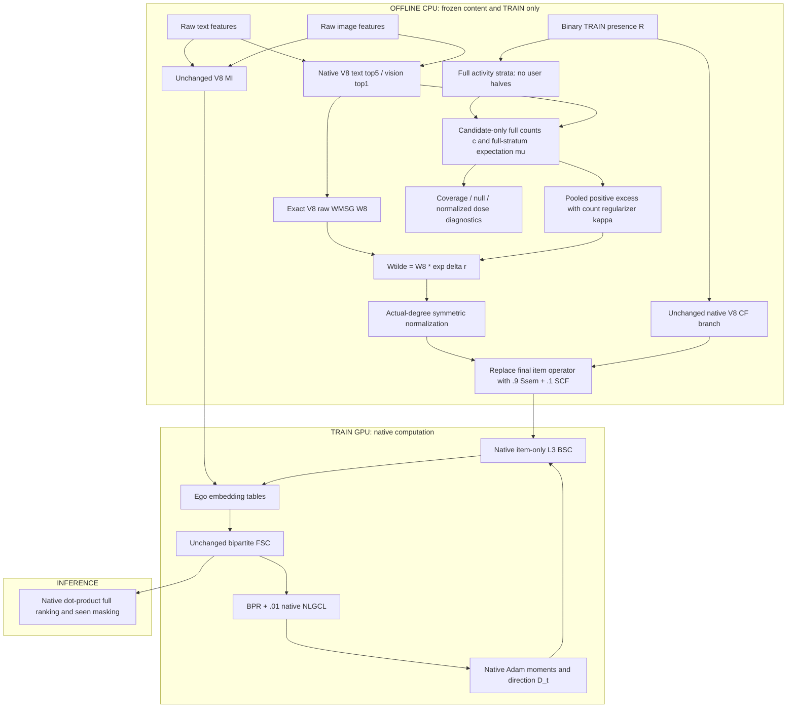

# versionICAART R2 — STAIR-PEEC: Pooled Excess-Evidence Calibration

**Canonical research and implementation specification — 16 October 2026.**
**Backbone:** STAIR5-v8 WMSG-core, primary embedding dimension 64.
**Decision:** **REVISE** the replicated estimator; retain the optimizer-only, fixed-support intervention.
**Status:** R1/REEC has two completed seed-1 runs. R2/PEEC is now implemented as a research candidate, **not a trained or validated improvement**. Source, configuration, notebook and test definitions were updated on 16 October 2026. Only text/AST/JSON checks were performed; no project tests, graph-construction experiment or training was run. See the [implementation audit](STAIR_versionICAART_Implementation_Audit.md).

The original specification is preserved in [the R1 archive](archive/STAIR_versionICAART_Report_REEC_20261016.md). Historical `replicated_excess` logs and checkpoints must keep their original names. They must never be relabeled as PEEC results.

> **Tóm tắt quyết định nghiên cứu:** Bản REEC hiện tại chưa vượt V8.1; lợi ích tăng thêm so với V8 còn rất nhỏ và mới có một seed. Không có cơ sở để tuyên bố giả thuyết replication đã thành công. Hướng tinh chỉnh chính là **PEEC — bằng chứng vượt kỳ vọng được tính gộp trên toàn bộ từng tầng người dùng**, bỏ điều kiện cứng phải dương ở cả hai nửa. Giữ nguyên V8, loss và đường BSC để kiểm tra riêng chất lượng estimator.
>
> **Điểm phát hiện mới:** `pooled_excess` đã có trong code vẫn cộng kỳ vọng tính theo hai nửa, nên chưa phải null tính trên toàn bộ từng tầng. Cần phân biệt ba arm: REEC cũ, pooled-half để kiểm tra việc bỏ `min`, và pooled-full để kiểm tra ảnh hưởng của cách tính null. Phương án giữ bậc bằng tối ưu KL chỉ là đối chứng có điều kiện; nó có thể giúp kiểm soát thay đổi chuẩn hóa nhưng cũng có thể triệt tiêu tín hiệu hữu ích. Chưa đưa vào primary trước ablation.
>
> **Phạm vi kết luận:** Bản tinh chỉnh đã được cập nhật mã nguồn; chưa chạy kiểm thử hoặc huấn luyện. Khả năng tăng Recall/NDCG phải được xác minh bằng đối chứng count, shuffle, CF-dose và nhiều seed thật. Các p-value sinh từ mẫu Gaussian trong notebook cũ không được sử dụng; pipeline mới đã bỏ phần sinh mẫu giả. Electronics chưa có kết quả REEC.

## 1. Executive decision

The strongest immediate research direction is **not** a larger consensus network. It is to determine whether the current evidence estimator discards useful but sparsely observed associations before they can influence BSC.

**Primary hypothesis [HYPOTHESIS]:** requiring positive excess in both user halves is an unnecessarily severe selection rule for the existing semantic support. A pooled, activity-conditioned, count-regularized estimator may improve useful coverage and ranking at the same online cost. This is the best-supported *next test*, not a demonstrated explanation of the current performance gap.

**Final R2 candidate: STAIR with Pooled Excess-Evidence Calibration — STAIR-PEEC.**

1. Preserve exact V8 MI, semantic candidates, WMSG weights, CF branch, FSC, BPR, NLGCL, optimizer schedule, scorer and evaluation protocol.
2. Replace the hard minimum across halves with a pooled excess score. Use all training users within each activity stratum for the final primary null; no user partition is needed to construct that graph.
3. Keep the original exponential calibration and actual-degree normalization for the primary candidate. This isolates evidence estimation from a separate normalization redesign.
4. Evaluate the already implemented `pooled_excess` as a **bridge control**: its expectation still depends on the two halves. It is not mathematically identical to the final split-free estimator.
5. Treat degree-preserving KL reallocation as a **conditional challenger**, not an automatic second module. The observed normalization side effects justify testing it, but do not prove that eliminating degree drift improves ranking.
6. Keep zero additional trainable parameters and the same native item-BSC sparse operations. Do not import the auxiliary consensus route of V8.1/CoGate.

**Important limit:** the current data do not identify a mechanism that can promise +3%, +5% or +7% improvement. PEEC can fail. The proposal is designed so that the reason for failure can be distinguished from a no-op, implementation error or tuning advantage.

## 2. Evidence provenance and integrity

### 2.1 Material examined

- [EStair.md](../EStair.md): source critique of semantic update compatibility, basis dependence, independent whitening, and BSC interpretation.
- The entire R1 architecture specification, its [implementation audit](STAIR_versionICAART_Implementation_Audit.md), current evidence/graph/config/model/runner source, and [the experiment narrative](STAIR_versionICAART_Experiment.md).
- Raw `manifest.json`, selected-checkpoint log tails and 500-line epoch telemetry for Baby and Sports under `logs/GD6/stair_icaart_artifacts/stair_icaart_artifacts/stair_icaart/`.
- V8 and V8.1 manifests/logs under `logs/GD5/`, including nested V8.1 backbone contracts; previous selected-test receipts in `reports/stair_icaart_audit_20261016/selected_test.csv`.
- The pre-audit `notebook/P6/stair_icaart.ipynb` and uploaded `logs/GD6/stair_icaart_artifacts/icaarts.ipynb`, especially old cell index32. The canonical notebook has since been rewritten; the uploaded raw artifact remains unchanged.
- Primary-source literature in §6. Reading depth is disclosed there. This is a targeted mechanism review, not an exhaustive systematic review or a novelty certificate.

The current REEC run uses commit `3a3cc39dd6b5fe1210c5759710b6c9dcb1f71027`, Python 3.13.15, PyTorch 2.11.0+cu128, FreeRec 0.9.7, Tesla T4, seed 1, and validation NDCG@20 selection. Compared V8/V8.1 runs have matching split/feature/candidate identities and common backbone source hashes. Environment equivalence is strong evidence of comparability, not a measurement of nondeterministic variance.

### 2.2 Evidence labels

| Label | Meaning |
|---|---|
| FACT | Direct source/code/artifact fact within its stated scope |
| OBSERVATION | Measured result; no causal explanation implied |
| INTERPRETATION | Plausible explanation with alternatives |
| HYPOTHESIS | Requires a discriminating experiment |
| SPECULATION | Insufficient support for adoption or a contribution claim |

The methodology review and research synthesis were performed inline in a shared context. They are **not independent reviewer replications**, and reviewer calibration status is **NOT_CALIBRATED**. Criteria are correct estimands, valid algebra, controls, no leakage, reproducibility, empirical attribution, and feasible cost. No venue acceptance score is inferred.

### 2.3 Results that must not enter the evidence base

**FACT (historical notebook):** cell index32, labeled `Cell 9b`, generates `sample_reec` and `sample_v8` with `rng.normal(...)` around aggregate metrics, then computes t-tests, Wilcoxon, bootstrap intervals and effect sizes. These are simulated samples, not measured runs, user metrics or folds. The same cell substitutes V8 results when REEC results are missing.

Consequences for all subsequent research and papers:

- `stair_icaart_statistical_significance.csv` is **invalid empirical inference**; do not cite its p-values, intervals or effect sizes.
- `stair_icaart_paper_table.tex` requires regeneration from measured records. In particular, Electronics is **NOT RUN** for REEC; fallback values are not results.
- Recall@1 was not monitored in the two REEC logs. Report it as **NOT MEASURED**, not zero and not a V8 copy.
- Do not interpret `p > .05` as equivalence, even when a future test uses real observations. An equivalence claim requires a justified margin and an appropriate design.
- These findings invalidate the synthetic statistical layer, **not** the logged Baby/Sports training metrics.

The source audit removed synthetic inference and missing-result substitution from the canonical notebook. Native unrounded selected-checkpoint receipts are exported for future runs. Raw artifacts and historical results remain unchanged; no replacement empirical results are invented.

## 3. What the experiments actually establish

### 3.1 Selected TEST, seed 1, 64D

Each row uses the checkpoint selected by validation NDCG@20. Values are printed to four decimal places. Equal printed values are not proof of exact equality.

| Dataset | Model | Selected epoch | R@10 | R@20 | N@10 | N@20 |
|---|---|---:|---:|---:|---:|---:|
| Baby | V8 | 430 | .0675 | .1054 | .0365 | .0462 |
| Baby | V8.1 | 430 | .0679 | .1054 | .0366 | .0463 |
| Baby | R1/REEC | 430 | .0674 | .1054 | .0365 | .0462 |
| Sports | V8 | 500 | .0762 | .1142 | .0420 | .0518 |
| Sports | V8.1 | 500 | .0767 | .1149 | .0423 | .0521 |
| Sports | R1/REEC | 500 | .0764 | .1142 | .0421 | .0519 |
| Electronics | V8 | 500 | .0460 | .0680 | .0260 | .0317 |
| Electronics | V8.1 | 500 | .0462 | .0683 | .0261 | .0318 |
| Electronics | R1/REEC | — | NOT RUN | NOT RUN | NOT RUN | NOT RUN |

Receipts: Baby REEC selected TEST is log line 1897; Sports REEC selected TEST is line 1904 in their respective `*_replicated_excess_d1.0_seed1.log` files. Baby's six-decimal summary before loading the best model describes the last checkpoint, not the selected epoch 430. Do not mix the two.

**OBSERVATION:** REEC is slightly better than V8 on Sports N@20, approximately +0.19% using rounded values, and approximately tied on Baby N@20. It does not surpass V8.1 on these runs. The roughly +3.8% Sports N@20 versus original STAIR includes gains inherited from the V8 pipeline; it is not REEC's isolated contribution.

**OBSERVATION:** Baby selected VALID N@20 is .044328 for REEC, .044067 for V8, and .044213 for V8.1. Better validation performance did not translate into better printed TEST N@20. This rules out selecting new variants from their historical test gap and calling that generalization evidence.

### 3.2 Mechanism measurements

| Quantity | Baby | Sports | Scope |
|---|---:|---:|---|
| Undirected semantic candidates | 29,926 | 78,872 | E, not directed sparse nnz |
| Positive replicated score | 563 | 1,232 | Both halves have positive excess |
| Positive edge fraction | 1.8813% | 1.5620% | Score eligibility |
| Positive raw-weight coverage | 2.3131% | 1.9330% | Fraction of W8 mass, before normalization |
| Mean positive score | .32352 | .35199 | Conditional on r>0 |
| One-half sign disagreement | 8.5511% | 8.4479% | Does not identify false edges |
| Relative operator Frobenius dose | 4.7241% | 4.5328% | Final operator relative to V8 |
| Relative polynomial probe dose | 1.5053% | 1.3457% | Coordinate 32, 8 fixed Rademacher probes, L=3 |
| Median row-relative L1 dose | .0970% | 0% | Distribution is highly localized |
| Minimum r=0 semantic coefficient ratio | .79801 | .76005 | Extreme indirect attenuation; median ratio is 1 |

**INTERPRETATION:** the implementation is active; it is not the earlier V6 case of effectively zero graph perturbation. However, the intervention is localized and the stored polynomial probe changes less than the raw graph. Neither observation proves insufficient dose or harmful over-smoothing. The probe is not the whole-coordinate BSC map on actual Adam directions.

### 3.3 Runtime and memory

| Dataset | Model | Fit minutes | Mean train seconds/epoch | Peak allocated MiB |
|---|---|---:|---:|---:|
| Baby | V8 | 19.31 | 2.199 | 145.17 |
| Baby | REEC | 19.50 | 2.232 | 145.17 |
| Baby | V8.1 | 21.94 | 2.513 | 148.23 |
| Sports | V8 | 41.66 | 4.678 | 223.71 |
| Sports | REEC | 40.91 | 4.614 | 223.71 |
| Sports | V8.1 | 48.64 | 5.512 | 224.61 |

Total REEC preprocessing is 24.014 s / 30.172 s. The nested REEC graph-builder timers are .674 s / 1.698 s. The total timer includes parent preparation and must not be attributed entirely to the new estimator. Cache state matters. Epoch allocator measurements do not certify whole-process GPU usage or OOM freedom. Same online sparse work does not mean zero extra wall time.

## 4. Methodology-focused post-mortem

| Suspected cause | Evidence | Mechanism | Confidence in causal explanation | Alternative / discriminating test |
|---|---|---|---|---|
| Hard replication rejects useful sparse evidence | Only 1.56–1.88% of semantic edges eligible | One weak half zeros an otherwise informative association | Medium; eligibility fact is high confidence | One-half edges may really be unreliable. Compare legacy pooled vs replicated at fixed null and matched dose |
| Minimum conflates strength with reproducibility | Code uses min(e0,e1) | It is a conservative selector, not an estimator with a calibrated uncertainty guarantee | Medium | A useful regularizer may intentionally shrink. Compare score distributions, third-user predictivity and ranking |
| Indirect normalization suppresses useful edges | r=0 coefficient minima .798/.760 | Endpoint degree growth reduces neighboring normalized coefficients | Medium-low for ranking harm | These could be appropriately suppressed edges. Conditional degree-budget challenger and head/tail margin diagnostics |
| User partition is a nuisance for pooled inference | Existing pooled sums half-conditioned expectations | Arbitrary split changes the null even with identical full counts | Low-medium; algebraic dependence is certain | Its effect could be negligible. Separate pooled-half from pooled-full, measure across partition seeds |
| Behavior already represented by FSC/CSE | Same train R and native CF are retained | Reweighting may be redundant with existing information | Medium-low | Placement might still matter. Measure supported-edge overlap and compare an equal-budget eta search |
| Statistical association does not predict update utility | No actual-direction/margin evidence yet | Exposure or broad popularity can repeat across users | Unknown | Test shared-state directions and validation margins; never infer utility from coverage alone |
| Underpowered tuning | Only delta=1 current primary | A useful estimator could need a different bounded intervention | Unknown | Shared {0,.5,1,2} grid for estimators; compare after dose matching |
| Over-smoothing / popularity amplification | Not directly measured | Stronger effective exchanges can blur distinctions | Low | Effective rank, normalized energy, head/tail metrics and actual margins |
| Optimization bug / stalled BPR | No direct evidence; final BPR close to V8 | Would create systematic loss or parameter mismatch | Low on current artifacts | Delta0 parity, gradients before step, evaluator identity and checkpoint contracts |
| Seed/selection variance | One training seed, rounded output | Small outcome differences may vary across runs | High as limitation; unknown magnitude | Real paired seeds and unrounded per-user metrics |

**Methodology verdict:** major revision of the evidence claim is required. Current runs establish feasibility and small point-estimate changes; they do not validate replication as denoising, equivalence to V8.1, causal compatibility, or international SOTA.

### 4.1 Socratic stress test

**Nếu một cạnh không lặp lại trên hai nửa, tại sao gọi nó là nhiễu?** Không có bằng chứng đủ để gọi như vậy. Thiếu lực thống kê, phân khúc người dùng và exposure khác nhau đều tạo ra bất đồng. Do đó, replication chuyển thành tiêu chí chẩn đoán thay vì điều kiện bắt buộc của estimator chính.

**Nếu một cạnh lặp lại, tại sao hướng cập nhật của hai item phải tương thích?** Không suy ra được. Cùng exposure hoặc đồng mua có thể tồn tại trong cả hai nửa. Phải đo hướng Adam và margin; không đổi tên association thành compatibility.

**Có phải chỉ cần tăng delta để vượt V8.1?** Không. Eq.13 cho thấy chuẩn hóa loại phần biến thiên đồng đều và có thể làm giảm hệ số ở cạnh khác. Delta lớn hơn còn có nguy cơ khuếch đại sai bằng chứng.

**Bỏ min có làm mất đóng góp về replication?** Có thể. Nếu pooled tốt hơn thì phải bỏ tuyên bố replication là đóng góp hiệu quả. Chọn một estimator đơn giản tốt hơn là giữ một đóng góp yếu để bảo vệ tên phương pháp.

**Vì sao không thêm consensus residual hoặc nâng lên256D?** Hai thay đổi này kiểm tra giả thuyết khác, tăng confounding và có thể quay lại vùng đóng góp của CoGate. Chúng không chứng minh estimator mới có ích. Giữ support V8 cũng có giới hạn: phương pháp không thể tạo ra quan hệ hữu ích nằm ngoài candidate support; nếu đây mới là bottleneck thì PEEC sẽ thất bại và cần một nghiên cứu topology riêng.

## 5. Revisit EStair without treating its hypotheses as facts

| EStair issue | Current conclusion | R2 action |
|---|---|---|
| Semantic similarity does not ensure compatible updates | Foundational concern remains; association is still only a proxy | Measure actual update/margin utility; do not rename co-occurrence as compatibility |
| Coordinate-dependent FSC/BSC | Mathematical dependence exists; harm is unmeasured | Keep schedule fixed for attribution; separate rotation/permutation diagnostics |
| Independently whitened modalities may be misaligned | Fusion cross-terms can depend on signs/bases | Do not insert Procrustes into a graph-estimator experiment without a controlled MI result |
| BSC changes optimization geometry | Smoothing is not a hard modality reconstruction constraint | Preserve native optimizer and state exactly; do not claim permanent information preservation |
| Entropy/uncertainty is not incremental utility | No local held-out utility study identifies this bottleneck | Avoid uncertainty MLPs whose target cannot be validated |
| Dense preprocessing and hardware limits | Sparse training does not eliminate preprocessing costs | Candidate-only CPU statistics, native chunked retrieval, no new dense item-pair matrix |

An invariant scalar edge score does not make the complete model rotation invariant: coordinate schedules and Adam's elementwise second moment remain basis-dependent. Cross-modal alignment and rotation equivariance solve different problems.

## 6. Targeted literature review: what to borrow, and what not to infer

Search/reverification date: **16 October 2026**. Sources are publisher proceedings, author papers/arXiv, and official technical documentation. Search families: behavior-guided semantic denoising; graph calibration and marginal budgets; uncertainty/diffusion; spectral-filter mismatch; bipartite nulls; sparse matrix scaling. Paper gains on different splits/backbones are not forecasts for this project.

### 6.1 Verified references

| ID | Exact work, authors and status | Relevant mechanism and decision |
|---|---|---|
| R1 | **STAIR: Manipulating Collaborative and Multimodal Information for E-Commerce Recommendation** — Cong Xu, Yunhang He, Jun Wang, Wei Zhang; AAAI 2025; DOI 10.1609/aaai.v39i12.33407. [Official](https://ojs.aaai.org/index.php/AAAI/article/view/33407) | Preserve MI/FSC/BSC; distinguish source architecture from local NLGCL/CSE additions |
| R2 | **A Tale of Two Graphs: Freezing and Denoising Graph Structures for Multimodal Recommendation** — Xin Zhou, Zhiqi Shen; ACM MM 2023; DOI 10.1145/3581783.3611943. [Author paper](https://arxiv.org/abs/2211.06924) | FREEDOM supports competitive frozen graphs and degree-sensitive denoising; does not imply all static graph estimators work |
| R3 | **Multi-View Graph Convolutional Network for Multimedia Recommendation** — Penghang Yu, Zhiyi Tan, Guanming Lu, Bing-Kun Bao; ACM MM 2023; DOI 10.1145/3581783.3613915. [Author paper](https://arxiv.org/abs/2308.03588) | MGCN uses behavior-guided purification/fusion. Behavioral conditioning is established prior art; do not claim it as a new principle |
| R4 | **Seeing Beyond Noise: Joint Graph Structure Evaluation and Denoising for Multimodal Recommendation** — Yuxin Qi, Quan Zhang, Xi Lin, Xiu Su, Jiani Zhu, Jingyu Wang, Jianhua Li; AAAI 2025; DOI 10.1609/aaai.v39i12.33358. [Official](https://ojs.aaai.org/index.php/AAAI/article/view/33358) | EVEN evaluates semantic structure with behavior-driven confidence, also denoises interactions and aligns modalities. Motivates a confidence challenger, not REEC's specific min rule |
| R5 | **Rethinking Evidence Modeling: Context-Coupled Graph Learning for Multimodal Recommendation** — Mingqiao Zhang, Qiyao Peng, Yumeng Wang, Wenzhe Dong, Hongtao Liu, Jian Yang; arXiv preprint, 11 Oct 2026, venue unverified. [Methods](https://arxiv.org/html/2610.15523v1) | CC-MGRec calibrates semantic weights from smoothed context-target log-lift and restores destination budgets. This motivates separating evidence from normalization; its shared forward graph is different from item-BSC-only calibration |
| R6 | **One Graph, Multiple Gains: Single High-Quality Item-Item Graph for Multimodal Recommendation** — Jinfeng Xu, Zheyu Chen, Ziyue Peng, Shuo Yang, Jinze Li, Zewei Liu, Shujie Li, Yipeng Du, Edith C. H. Ngai; 2026, author metadata states ACM MM acceptance. [Paper](https://arxiv.org/abs/2607.24607) | IIMRec fuses semantic/co-occurrence information, uses NCER and multiple graph applications. Close comparator; its BPR augmentation is not optimizer-gradient smoothing |
| R7 | **IGDMRec: Behavior Conditioned Item Graph Diffusion for Multimodal Recommendation** — Ziyuan Guo, Jie Guo, Zhenghao Chen, Bin Song, Fei Richard Yu; arXiv 2025, author metadata states IEEE TMM acceptance, final publisher DOI not verified here. [Paper](https://arxiv.org/abs/2512.19983) | Behavior-conditioned diffusion is a stronger learned graph challenger, but adds denoising/augmentation computation and confounds the minimal estimator test |
| R8 | **Teach Me How to Denoise: A Universal Framework for Denoising Multi-modal Recommender Systems via Guided Calibration** — Hongji Li, Hanwen Du, Youhua Li, Junchen Fu, Chunxiao Li, Ziyi Zhuang, Jiakang Li, Yongxin Ni; author metadata states WSDM 2025 acceptance. [Paper](https://arxiv.org/abs/2504.14214) | GUIDER changes feedback treatment, BPR and alignment through OT distillation. Useful alternative hypothesis; no evidence yet that feedback denoising is the local bottleneck |
| R9 | **MURAL: Multimodal Uncertainty-aware Recommendation via Adaptive edge Learning** — Ahmad Mousavi, Majid Alikhani, Yeon-Chang Lee, Roberto Corizzo, Yeganeh Abdollahinejad; arXiv preprint, 4 Sep 2026, venue unverified. [Paper](https://arxiv.org/abs/2609.04574) | Adaptive retrieval, uncertainty fusion and teacher-student alignment. Retain as external alternative, not a reason to import a stack |
| R10 | **Collaborative Filtering Meets Spectrum Shift: Connecting User-Item Interaction with Graph-Structured Side Information** — Yunhang He, Cong Xu, Jun Wang, Wei Zhang; author metadata states KDD 2025 acceptance. [Paper](https://arxiv.org/abs/2502.08071) | SSC addresses spectral changes when side information augments UI propagation. Our UI FSC graph is unchanged; its motivation does not automatically transfer to the separate item optimizer graph |
| R11 | **GSPRec: On Improving Item Representations in Graph Signal Processing for Collaborative Filtering** — Ahmad Bin Rabiah, Julian McAuley; arXiv v3, 21 Jul 2026, venue unverified here. [Versioned paper](https://arxiv.org/abs/2505.11552v3) | Studies coupling of item proximity and band/low-pass filters. A different graph and filter can interact; importing a bandpass without an actual-direction diagnosis is not justified |
| R12 | **Statistically Validated Networks in Bipartite Complex Systems** — Michele Tumminello, Salvatore Miccichè, Fabrizio Lillo, Jyrki Piilo, Rosario N. Mantegna; PLoS ONE 2011; DOI 10.1371/journal.pone.0017994. [Official](https://journals.plos.org/plosone/article?id=10.1371/journal.pone.0017994) | Heterogeneity-conditioned projection nulls are foundational. Borrow the principle of checking overlap against marginals; our shrinkage score is not its validated-edge test |
| R13 | **A review of matrix scaling and Sinkhorn's normal form for matrices and positive maps** — Martin Idel; arXiv 2016. [Paper](https://arxiv.org/abs/1609.06349) | Scaling feasibility and marginal constraints matter. Relevant to the optional KL challenger, not a guarantee for arbitrary finite Sinkhorn iterations |
| R14 | **Sinkhorn Distances: Lightspeed Computation of Optimal Transport** — Marco Cuturi; NeurIPS 2013. [Official](https://papers.neurips.cc/paper_files/paper/2013/hash/af21d0c97db2e27e13572cbf59eb343d-Abstract.html) | Entropic optimization is standard machinery. Neither entropic projection nor its application to STAIR alone constitutes a new component |

Reading scope: R1 and R4 are source/publisher-verified with relevant local method extracts from the prior audit; R5's calibration equations were reread directly; R2/R3/R6–R11 were checked against current author abstracts and metadata for this revision; R12–R14 supply foundational scope, with proofs of our own constructions supplied below. No claim that all reported experiments or all repository implementations were independently reproduced.

**Version correction:** GSPRec v3 has a different title and revised abstract from its older temporal-filtering draft. Do not use the earlier 6.77% headline as a current result or a forecast. The name also collides with other graph-sequence papers; use title, authors and arXiv version together.

### 6.2 Mechanism-to-shortcoming map

| Local issue | Relevant sources | Specific lesson adopted | Unsupported leap rejected |
|---|---|---|---|
| Sparse replicated eligibility | R4, R12 | Use behavior with a stated null and bounded count regularization; test all-data estimation | More co-occurrence always means safer propagation |
| Degree/normalization side effects | R5, R13, R14 | Separate calibration from marginal constraints; optional symmetric KL challenger | Row-normalize then symmetrize preserves old degrees |
| Association versus recommendation utility | R3–R8 | Evaluate ranking-linked evidence and compare task-driven alternatives | Edge significance or semantic agreement proves useful Adam transfer |
| Stronger graph might over-smooth | R1, R10, R11 | Measure polynomial response, actual directions and margins together | Spectral shift correction or high-pass filtering must improve this backbone |
| Cost and reproducibility | R1, R2 | Keep a frozen sparse primary; report actual preprocessing/runtime | Static means free; extra accuracy is guaranteed by a larger learned graph |

R5's context-target opportunity counts and popularity prior are a different sample space from user-presence counts. Do not replace its conditional probability with Ochiai divided by popularity and call it lift. Its destination-budget restoration on a directed block also cannot simply be symmetrized and normalized with stale degrees to obtain our spectral guarantee.

## 7. Alternative architectures and selection

| Candidate | Hypothesis / explicit mechanism | Why V8 cannot already do it | Principal risk | Falsification / disposition |
|---|---|---|---|---|
| **A. Pooled excess, actual-degree normalization** | Hard two-half selection wastes usable evidence; r=[c-mu]+/(c+mu+kappa), W'=W8 exp(delta r) | V8 does not apply conditional excess on semantic support | More low-count noise; collateral degree effects persist | Must beat replicated and placement controls. **PRIMARY** |
| **B. Pooled excess plus reference-degree KL allocation** | Degree drift, rather than score quality, cancels gains; minimize KL(W||W') with W1=d8 and symmetry | V8 has no evidence-conditioned fixed-budget allocation | Constraints can erase useful changes; preprocessing solver overhead | Cross with A in a controlled normalization study. **CONDITIONAL BACKUP** |
| C. Adaptive update-compatible gate | Actual D_i and D_j identify transfer quality better than counts | V8 has no task-direction edge gate | Noisy mini-batch directions, V7 cost, differentiating through optimizer needs unrolling | Diagnose first; no dynamic gate in R2 |
| D. Aligned MI/shared-private modality representation | Initialization interference is the real bottleneck | Independent SVD fusion is unchanged in V8 | Changes a different mechanism without local failure evidence | Separate sign/rotation/alignment controls first; defer |
| E. Bandpass / affine SSC-modified BSC | Native filter suppresses useful modes despite a good graph | Native polynomial is fixed | Filter and graph tuning confounded; SSC's motivating UI change is absent | Requires actual spectral/direction evidence and equal-budget V8 filter controls; defer |
| F. Signed relation/category gate | Substitute/complement labels are missing | No relation-type propagation in V8 | Relations not identifiable from absent co-occurrence, price or taxonomy alone | Reject as primary without valid labels/exposure design |

**Decision matrix:** relative judgments below are design assessments, not measured probabilities of beating V8.1.

| Criterion | A | B | C | D | E |
|---|---|---|---|---|---|
| Connection to observed artifacts | Strong: sparse eligibility | Moderate: degree side effects measured, harm unmeasured | Indirect | Theoretical issue only | Indirect |
| Mathematical specificity | Strong | Strong if solved/validated | Proxy and optimizer path need care | Alignment objective can be explicit | Requires a new filter derivation |
| Online efficiency | Same as V8 | Same as V8 | Worse / unmeasured | Architecture-dependent | Potentially similar, unmeasured |
| Ablation clarity | Strong | Strong only if crossed separately | Difficult | Strong in a separate study | Requires graph/filter factorial |
| Implementation burden | Lowest | Moderate offline | Highest online | Moderate | Moderate |
| Component novelty | Low | Low: standard constrained projection | Established family | Established family | Established family |
| Current choice | First | Conditional | Diagnostic only | Defer | Defer |

No candidate currently merits a claim of high-probability >5% growth. Choose A for the next experiment because it asks the most direct question with the smallest confounding change. Choose B only if normalization evidence supports its additional constraint. Neither is selected because it sounds more novel.

## 8. Final primary architecture: STAIR-PEEC

### 8.1 Hypothesis and boundaries

**One-sentence hypothesis [HYPOTHESIS]:** sparse evidence loss caused by hard split-wise acceptance, rather than a lack of model capacity, is a plausible remaining limitation of REEC's calibration of V8 semantic update exchange.

R2 separates **estimation** from **validation**: estimate a bounded association with all train data; use disjoint-user diagnostics to evaluate reliability. A diagnostic split does not become a hard graph-construction requirement.

The graph remains train-only and static. No new item pairs, latent categories, online snapshots, teacher, auxiliary graph, projector, consensus residual, changed denominator, negative mask, additional loss or dimension increase enters the primary.

### 8.2 Data flow



The optional degree-budget challenger replaces only the normalization/calibration box and is **not** part of this primary flow.

### 8.3 Symbol table

| Symbol | Definition |
|---|---|
| M,N,d | User count, item count, embedding dimension; primary d=64 |
| R in {0,1}^(M×N) | Canonical deduplicated TRAIN presence for new evidence; parent training multiplicity is unchanged |
| h_u,n_i | Train user history length and item presence degree |
| X_t,X_v | Raw features of shapes N×d_t and N×d_v |
| K_m(i), E | Frozen modality candidate IDs; E is unique undirected positive off-diagonal support of W8 |
| W8,d8,Ssem8 | Native raw symmetric semantic weights, row degrees, normalized semantic operator |
| b(u), M_b, n_ib | Activity stratum, number of active users in stratum, item incidences within it |
| c_ij, mu^F_ij | Full observed candidate overlap and full-stratum expected overlap |
| c_ijf, mu_ijf | Legacy half-specific counts and expectations, f=0,1 |
| tau,kappa | Legacy per-half count regularizer tau=2; pooled kappa=2tau=4 for controlled comparison |
| r_ij, delta | Bounded excess score; shared strength grid {0,.5,1,2} |
| SCF, eta | Exact native normalized CF graph; eta=.10 when CF is globally nonempty |
| S_R2 | Final static item optimizer graph, not UI FSC adjacency |
| A_UI,H0 | Unchanged normalized bipartite adjacency and stacked ego tables [U0;V0] |
| D_t | Total-loss Adam-preconditioned item update direction before BSC |

## 9. Mathematical specification

### 9.1 Preserve exact V8 graph and initialization

On cached native candidates, use the raw-feature cosine a^m_ij and native zero-vector convention:

\[
f(a)=0.05+0.95[\max(0,a)]^2,\qquad
B_{ij}=\sum_{m\in\{t,v\}}\mathbf1[j\in K_m(i)]f(a^m_{ij}),
\]
\[
W^8_{ij}=\max(B_{ij},B_{ji}),\qquad W^8_{ii}=0.
\tag{1}
\]

Text5/image1 are candidate budgets. Do not replace the occurrence sum with a 5:1 weighted average of cosines. Preserve semantic_mix=1, SAP off, relation gate off, residual off. Keep the original MI weighted sum of independently whitened features; its limitations are isolated in §5, not silently fixed here.

For any symmetric nonnegative W:

\[
\mathcal N(W)=D^{-1/2}WD^{-1/2}+\operatorname{diag}(\mathbf1[d_i=0]),
\qquad d=W\mathbf1.
\tag{2}
\]

Inverse degrees are zero on isolates. Identity isolate blocks preserve the native convention; zero blocks would also satisfy the norm bound. Use native CF construction and cached arithmetic, with c_min=2, top5 and shrinkage5, instead of reimplementing it. A globally empty CF branch uses the native eta=0 fallback for both V8 and R2.

### 9.2 Split-free, full-activity null

For active users only, with h_u=sum_i R_ui>0:

\[
b(u)=\lfloor\log_2 h_u\rfloor,\qquad
M_b=|\{u:b(u)=b\}|,\qquad
n_{ib}=\sum_{u:b(u)=b}R_{ui}.
\tag{3}
\]

Zero-history users receive bin -1 and do not enter M_b. Compute only for {i,j} in E:

\[
c_{ij}=\sum_uR_{ui}R_{uj},\qquad
\mu^F_{ij}=\sum_{b:M_b>0}\frac{n_{ib}n_{jb}}{M_b}.
\tag{4}
\]

**DERIVATION:** if the n_ib and n_jb user sets are selected independently and uniformly within stratum b, expected intersection is n_ib*n_jb/M_b. Sum across disjoint strata. This null approximates activity heterogeneity; it does not model all exposure, exact user-degree constraints, temporal intent or causal preference.

Use CPU integer counts and FP64 products/expectations; cast before multiplying marginals. Positive observed overlap implies positive expectation under these correctly formed groups. `c>0,mu=0` indicates invalid input or arithmetic, not an infinite-strength edge.

### 9.3 Primary score: pooled excess with controlled shrinkage

\[
\kappa=2\tau=4,\qquad
r^F_{ij}=\frac{[c_{ij}-\mu^F_{ij}]_+}{c_{ij}+\mu^F_{ij}+\kappa},\qquad r^F_{ii}=0.
\tag{5}
\]

Kappa is a count-scale regularizer, not an estimated Bayesian variance or an edge-significance threshold. Fixing it at4 keeps the same total regularizer as the existing pooled control. Only delta is searched in the primary comparison.

**PROPOSITION:** 0<=r<1, and c=0 gives r=0. For c=1, r<1/5; for delta<=2, that edge's raw boost is less than exp(.4), approximately1.492. Thus one count is allowed to contribute weakly without being promoted to a certified reliable edge. These are magnitude bounds, not noise-rejection guarantees.

No quantile/rank normalization is used to inflate tiny scores. No negative score is assigned to an unobserved pair. Replication is measured by diagnostics rather than enforced by min aggregation.

### 9.4 The bridge estimator is different

Retain exact legacy semantics for historical comparisons:

\[
r^{R}_{ij}=\min_f\frac{[c_{ijf}-\mu_{ijf}]_+}{c_{ijf}+\mu_{ijf}+\tau},
\]
\[
r^{H}_{ij}=\frac{[c_{ij0}+c_{ij1}-\mu_{ij0}-\mu_{ij1}]_+}
{c_{ij0}+c_{ij1}+\mu_{ij0}+\mu_{ij1}+2\tau}.
\tag{6}
\]

`replicated_excess` implements rR; existing `pooled_excess` implements rH. The new primary mode `pooled_activity_excess` must implement rF. **It is implemented in the revised source, but remains untested and untrained.**

**PROPOSITION — removing the hard minimum:** rH>=rR for every candidate. If either half's excess is nonpositive, rR=0 and the result follows. Otherwise let d_f=c_f+mu_f+tau and e_f=(c_f-mu_f)/d_f. Then rH=(d_0 e_0+d_1 e_1)/(d_0+d_1), a weighted average at least min(e0,e1). Consequently positive eligibility cannot decrease for this bridge estimator. This does **not** imply its normalized dose, utility or ranking must increase.

**DERIVATION — a pooled count is not a pooled null:** within a stratum containing both halves, write M=M0+M1 and p_if=n_if/M_f. Then

\[
\mu^H_{ij,b}-\mu^F_{ij,b}
=\frac{M_0M_1}{M}(p_{i0}-p_{i1})(p_{j0}-p_{j1}).
\tag{7}
\]

Therefore sum(mu_half) is not generally the full-stratum expectation. The difference can have either sign. A stratum with only one nonempty half contributes zero difference. No monotonicity claim between rF and rR is warranted after changing the null. R1→bridge isolates acceptance/aggregation; bridge→primary isolates null scope.

### 9.5 Calibration, normalization and fusion

\[
\widetilde W_{ij}=W^8_{ij}\exp(\delta r^F_{ij}),\qquad
S_{\mathrm{sem},R2}=\mathcal N(\widetilde W),
\]
\[
S_{R2}=(1-\eta)S_{\mathrm{sem},R2}+\eta S_{CF},\qquad \eta=.10.
\tag{8}
\]

Score each unique i<j once and mirror exactly. Recompute actual degrees of Wtilde. Never substitute d8 after simple symmetrization. Delta0, all-zero score, or mathematically neutral component-constant reweighting must use a documented V8 bypass where applicable; delta0 and all-zero must return the exact cached operator.

**Known limitation, retained deliberately:** raw r=0 edges have multiplier1, but their normalized coefficients can change through endpoint degrees. Eq.8 is not a guarantee of local neutrality. The optional challenger in §11 tests whether controlling those degrees helps.

### 9.6 Exact native training and inference

For coordinate k=0,...,d-1, define native b_k=.1+.9(k/d)^gamma and a_k=1-b_k. With L=3:

\[
\bar H_{:,k}=\frac{1-a_k}{1-a_k^{L+1}}
\sum_{\ell=0}^{L}a_k^\ell A_{UI}^{\ell}H^0_{:,k}.
\tag{9}
\]

Keep native intermediate FSC states supplied to NLGCL. Preserve the exact helpers and reductions:

\[
\mathcal L=\mathcal L^{V8}_{BPR}+.01\mathcal L^{V8}_{NLGCL},\qquad
\tau_{CL}=.2,\quad \alpha_{dir}=.5.
\tag{10}
\]

After total-loss backward and native Adam bias correction:

\[
D_t=\widehat m_t/(\sqrt{\widehat v_t}+\epsilon),\qquad
P_k(S)=\sum_{\ell=0}^{3}\omega_{k\ell}S^\ell,\quad
\omega_{k\ell}=\frac{b_k^\ell}{\sum_{q=0}^{3}b_k^q},
\]
\[
V^{t+1}_{:,k}=(1-\alpha_t\lambda_{wd})V^t_{:,k}
-\alpha_t P_k(S_{R2})D_{t,:,k}.
\tag{11}
\]

Use native arithmetic for parity. User smoother remains None; decay is separate; no graph parameters are optimized. All existing parameters occur in exactly one native optimizer group. Final score is y_ui=bar U_u^T bar V_i. Full ranking, seen masking, monitor selection and checkpoint loading remain unchanged. The new graph has no inference branch.

## 10. Theoretical guarantees and their limits

### 10.1 PROPOSITION — support and contraction

Finite delta and finite r preserve W8's positive off-diagonal support, symmetry, nonnegativity, components and isolates. For any real x on positive-degree nodes, set z_i=x_i/sqrt(d_i). Then

\[
|x^T\mathcal N(W)x|
\le\sum_{ij}W_{ij}|z_i z_j|
\le\tfrac12\sum_{ij}W_{ij}(z_i^2+z_j^2)=\|x\|_2^2.
\tag{12}
\]

Isolate identity blocks also have norm1. Symmetry implies spectrum in[-1,1] and norm<=1. The native CF branch has the same property; triangle inequality gives ||S_R2||2<=1.

This operator need not be row-stochastic or positive semidefinite. A finite power iteration is not a certified upper bound. Neither this result nor a flat epoch VRAM trace proves stable Adam moments, bounded trajectories, statistical generalization or absence of OOM.

### 10.2 PROPOSITION — finite polynomial bound

Because omega>=0 and sum omega=1, ||P_k(S)z||2<=||z||2 for a contraction S. Sum squared column norms to obtain ||P(S)D||F<=||D||F. This bound is relative to the input D, which may itself be large.

The L3 polynomial is finite and needs no infinite-series convergence claim. For a separate infinite Neumann series, require b_k||S||<1. Native finite-d schedules have b_k<1.

### 10.3 DERIVATION — realized dose depends on endpoint contrast

For raw W8 with weighted row mean rbar_i=sum_j W8_ij*r_ij/d8_i:

\[
\left.\frac{\partial S_{\delta,ij}}{\partial\delta}\right|_{0}
=S_{\mathrm{sem},8,ij}
\left(r_{ij}-\tfrac12\bar r_i-\tfrac12\bar r_j\right).
\tag{13}
\]

Uniform/component-constant raw boosts cancel under normalization. Greater score mean or eligibility does not guarantee a greater normalized perturbation. For an r=0 edge the exact coefficient ratio is

\[
\frac{S_{\delta,ij}}{S_{\mathrm{sem},8,ij}}
=\sqrt{\frac{d^8_i d^8_j}{d^\delta_i d^\delta_j}}.
\tag{14}
\]

For contractions A,B, telescoping noncommuting matrix products gives

\[
\|P_k(A)-P_k(B)\|_2\le
\left(\sum_{\ell=1}^{3}\ell\omega_{k\ell}\right)\|A-B\|_2\le3\|A-B\|_2.
\tag{15}
\]

This is an upper bound, not a positive lower bound or a ranking theorem. The empirical Rademacher ratio is not the same norm as Eq.15.

### 10.4 PROPOSITION / LIMITATION — invariance and stationary points

The graph estimator is invariant to learned embedding rotations; a fixed scalar item operator obeys S(XQ)=(SX)Q. The complete method retains coordinate-dependent FSC/BSC and elementwise Adam, hence is not generally rotation equivariant.

For fixed S, native P_k(lambda) is strictly positive for lambda in[-1,1] and b_k<1: sum_l=0^3 (b_k lambda)^l=(1-(b_k lambda)^4)/(1-b_k lambda)>0. Thus P_k is invertible. In a simplified fixed-preconditioner gradient update, it does not create a new set of unconstrained stationary points. Finite optimization, implicit bias, decay and full Adam dynamics can differ; no convergence or ranking equivalence is asserted.

## 11. Conditional backup: reference-degree evidence reallocation

### 11.1 Why it is conditional

Observed coefficient attenuation is not sufficient evidence that degree preservation improves recommendation. Preserving every original degree can also preserve harmful hub influence and erase a useful perturbation. Therefore this module is not bundled into PEEC-full before comparison with Eq.8.

Its purpose is to test a separate hypothesis: **the useful quantity is allocation among neighbors at a fixed semantic budget, rather than a change in per-item semantic degree.** R5 motivates the question; R13/R14 provide standard optimization machinery. This is not a new Sinkhorn theorem.

### 11.2 Complete constrained problem

Let q_e=W8_e exp(delta*r_e)>0 for each undirected edge e={i,j}, and let A_E be the unsigned vertex-edge incidence matrix: each column has1 at i and j. Define the unique optimizer

\[
w^*=\arg\min_{w\ge0}\sum_{e\in E}
\left[w_e\log(w_e/q_e)-w_e+q_e\right]
\quad\text{subject to }A_Ew=d^8.
\tag{16}
\]

Mirror w* into W*. No new self-loops or off-support edges are allowed. Baseline W8 is a strictly positive feasible point on E. The feasible set is compact since each edge weight is bounded by its endpoint degrees. The objective is continuous on the nonnegative domain and strictly convex; therefore the minimizing edge weights exist and are unique. The optimum is positive on E: a zero-weight edge admits a feasible direction toward W8 with a negative-infinite one-sided KL derivative.

**PROPOSITION:** equality constraints preserve the reference degree vector at the exact solution. KKT conditions give w*_ij=q_ij exp(a_i+a_j) for suitable multipliers a. Multipliers need not be unique on bipartite components, although W* is unique.

An implementable sparse dual is

\[
F(a)=\sum_{e=\{i,j\}}q_e e^{a_i+a_j}-\sum_i d^8_i a_i,
\qquad \nabla F(a)=W(a)\mathbf1-d^8.
\tag{17}
\]

Evaluate F/gradient by edge-array exponentiation and scatter-add, O(E+N) per evaluation. The incidence matrix is conceptual; never materialize a dense N-by-E array. Use a deterministic CPU FP64 convex solver with line search, a=0 initialization, component/gauge handling, max200 iterations and a separate reported preprocessing time budget. Never form a dense Hessian. Stop only if max_(i:d8_i>0) |d*_i-d8_i|/d8_i<=1e-6 and finite/symmetry checks pass; isolates retain raw degree0. Iterations alone are not convergence certification. Solver failure is a failed challenger, not a silently relabeled primary fallback.

For numerical safety, even an accepted approximate solution is normalized with its **measured actual degrees** via N(W*), not stale d8. Thus the contraction proof still applies, while degree preservation is stated only within the measured tolerance. Blend the same native CF branch. Delta0 returns cached V8 exactly.

**LIMITATION:** this preserves row budgets, not individual r=0 coefficients. Gains to selected neighbors require reallocation from other neighbors. On a tree component its edge weights are uniquely fixed by degrees, so the challenger is necessarily neutral there. Evidence resembling a diagonal rescaling can also disappear. Log realized dose after solving; do not claim this module resolves dosage automatically.

### 11.3 Required comparison

After the primary score is screened, use a small crossed comparison: replicated versus pooled-full evidence, each with actual-degree normalization versus reference-degree allocation. Hold tau/delta/CF/backbone fixed or disclose any explicit dose matching. Do not claim a normalization benefit from comparing only old REEC with pooled-plus-KL.

## 12. Causal chain to recommendation metrics

| Operation | Measured starting point | Hypothesized causal chain | Refutation |
|---|---|---|---|
| Remove hard min | Very low eligible edge fraction | More supported associations contribute → changed useful exchanges → better positive-vs-negative margins → higher R/N | Greater coverage but placebo-level/harmful margins or no reproducible ranking gain |
| Full-stratum null | Pooled-half still depends on arbitrary partition | Remove nuisance partition dependence → more stable graph estimator → less seed-sensitive optimization → better generalization | Null difference negligible or full null worse on independent-user predictivity and validation |
| Optional fixed-budget allocation | Some unsupported coefficients attenuate substantially | Prevent degree drift while reallocating evidence → avoid harmful collateral exchanges → protect tail/positive margins | No metric/group benefit, lost useful dose, or simpler eta/delta tuning matches it |

At a shared parameter and Adam state, let DeltaV=-alpha[P(S_R2)-P(S8)]D. For validation margin m_uiq=bar U_u^T(bar V_i-bar V_q), the first-order item contribution is

\[
\Delta m_{uiq}\approx\langle\nabla_{V_0}m_{uiq},\Delta V\rangle_F.
\tag{18}
\]

Include FSC's Jacobian in this derivative; an ego-item dot product is not the complete scorer. The sign can be negative. These shared-state probes are local diagnostics, not causal evidence about the complete independently trained trajectories.

## 13. Engineering and minimal implementation delta

### 13.1 Exact module contracts

| Module | Input → output | Placement / gradient / initialization |
|---|---|---|
| Full activity statistics | Binary CPU CSR/CSC R[M,N] → bins[M], M_b[B], n_ib[N,B] int64 | Static CPU; no RNG for primary, no gradients |
| Candidate pooled statistics | Sorted CSC postings and pairs[E,2] int64 → c[E] int64, muF[E] FP64 | CPU candidate intersections and bounded blocks; no dense NxN |
| Pooled score | c,muF,kappa → r[E] FP64 | Eq.5; no trainable parameters |
| Actual-degree calibration | Native W8 CSR, r,delta, native SCF → S_R2 CSR FP32 plus metadata | CPU FP64 assembly, then final FP32; exact V8 bypass |
| Optional budget solver | Same raw q and d8 → w*, solver status/residuals | CPU only, separately timed, not active by default |
| Native model/loss/smoother | Existing tensors and detached D_t[N,d] | Reuse native autograd paths and @no_grad item-BSC |

No new auxiliary embedding tensor is retained on GPU. Only the final graph replaces mAdj. Intermediate c/mu/r, raw graphs, solver vectors and independent-user diagnostic tables remain CPU artifacts or are released.

### 13.2 Implemented source delta — runtime verification pending

| File | Necessary change | Must preserve |
|---|---|---|
| `models/stair_icaart_evidence.py` | Add pure full-activity aggregation and candidate pooled-count/null functions; add Eq.5; retain all legacy modes byte-for-byte in semantics | Old `pooled_excess` remains Eq.6, not silently redirected |
| `models/stair_icaart_graph.py` | Route estimator from versioned config; reuse native W8/CF and calibrator; add null-scope, score and normalization diagnostics | Cached V8 return at delta0; pair-order alignment; no new support |
| `models/stair_icaart.py` | Reuse preparation wrapper, bind new evidence contract to checkpoint | Native fit/encode/eval/loss unchanged |
| `stair_icaart_config.py` | Add mode `pooled_activity_excess`; conditional validation for active halves0; add versioned normalization enum if backup is implemented | Historical modes still require two halves; no ambiguous tau reinterpretation |
| `main_stair_icaart.py` | Extend manifest/CLI declarations, unrounded selected metrics and honest NOT_RUN/NOT_MEASURED export | Native coach/evaluator/selection and param groups |
| Dataset YAMLs | Create distinct R2 configs with explicit mode and artifact namespace; retain R1 configs | Native dataset-specific hyperparameters |
| `notebook/P6/stair_icaart.ipynb` | Define separate arms/output directories; remove synthetic inference and missing-result substitution before more runs | No hidden baseline overwrite; nonzero return code is failure |
| Existing ICAART tests | Add equations/null-scope fixtures, inherited parity and provenance checks | Do not mark tests passed before execution |

No new optimizer or smoother is needed. Do not mutate V8/CoGate or alter existing R1 caches/checkpoints in place. A new contract version must prevent loading an old graph under the PEEC name.

### 13.3 Primary configuration — implemented, execution pending

```yaml
description: STAIR-PEEC-versionICAART-R2
embedding_dim: 64
evidence_mode: pooled_activity_excess   # NEW full-activity estimator
evidence_activity_bins: log2
evidence_halves: 0                     # NEW mode has no active partition
evidence_tau: 2.0                      # pooled kappa = 2 * evidence_tau = 4
evidence_delta: 1.0                    # initial value, not a measured optimum
evidence_candidate_block: 8192
# No extra primary hyperparameters. Normalization is actual-degree.
# Inherit exact V8 data, MI/FSC/BPR/NLGCL, optimizer and evaluation settings.
```

For the new mode, `evidence_seed` is inactive and must not affect graph construction; record `active_partition: false` and `active_halves: 0`. A placebo uses its own local RNG. Reject silently ignored mode combinations and nonfinite/negative parameters. Keep the legacy seed20261016/two-half contracts intact for R1 and bridge controls.

Primary grid delta={0,.5,1,2}; tau=2 stays fixed. Count-regularization sensitivity is secondary and receives a matched search budget. The optional solver adds numerical tolerance/iteration limits, not learned parameters or a new ranking-strength grid.

### 13.4 Complexity and practical resource boundaries

Let T=nnz(R), E=undirected semantic candidates, K=nnz(final operator), B=activity bins. Full-stratum pooling takes O(T) incidence aggregation, O(E*B) expectation work, and at most O(sum_(i,j in E)(n_i+n_j)) sorted-posting intersection work. Compile/vectorize bounded hot paths; do not enumerate all pairs in long user histories. Native CF construction remains separately cached.

Persistent additional CPU arrays are approximately: pairs16E bytes, c8E, mu8E, r8E, calibrated raw weights8E, and group counts8NB plus M-user bin storage. Streaming can reduce simultaneous buffers. Feature storage, Python overhead, native CF workspace and CSR conversion are additional.

Online cost remains O(L*K*d), L=3, exactly the native BSC operation count, with one final CSR graph. Additional trainable parameters=0; inference operation count is unchanged. Optional budget solving adds O(J*E) offline evaluations, where J is measured solver work, not a guaranteed fixed iteration count.

Current measured final graph nnz for REEC is84,138 Baby and206,296 Sports; native V8 Electronics graph nnz739,381. With int64 indices and FP32 values, CSR payload is approximately12K+8(N+1) bytes, roughly1.02/2.50/8.94 MiB respectively. These are graph payloads, not total VRAM and not additional graph allocations. Transfer/conversion temporarily duplicates memory unless released.

No dense N×N matrix is permitted. Existing blockwise native candidate retrieval is retained; new evidence and calibration use only E. No claim of guaranteed sub800MiB Electronics usage is made: historical V8 is already around800.67MiB in its measurement scope. Dimension256 is a separate capacity study with matched controls, not a rescue switch for this experiment.

## 14. Diagnostics that can falsify the mechanism

All construction statistics are TRAIN-only. Diagnostics may evaluate validation ranking, but cannot feed held-out interactions into c,mu,W or score fitting.

| Diagnostic | Definition | Supporting pattern | Falsifying / adverse pattern |
|---|---|---|---|
| Eligible evidence | |{e:r_e>0}|/E and sum W8_e 1[r>0]/sum W8_e, by degree bins | Pooled obtains useful extra coverage | Coverage increases but no independent-user utility |
| Null-scope sensitivity | Distribution of muH-muF, score changes and graph fingerprints over legacy partition seeds | Full null removes a material nuisance | Difference negligible; do not sell it as the main gain |
| Unseen-user association | Repeated diagnostic train-user partitions: fit scores on one user group, measure excess on a disjoint group with its own null | Score predicts held-out-user association beyond degree/rawcos controls | Replication/pooled both only reflect selection or popularity |
| Null adequacy | Compare muF with within-bin column-permutation overlap on sampled candidate pairs; optionally degree-preserving swaps | Expectation matches the stated approximate null | Systematic mismatch; no calibrated inference claim |
| Endpoint contrast | Eq.13 distribution, not raw r alone | Evidence has usable normalized contrast | High score but nearzero normalized perturbation |
| Operator perturbation | ||S-S8||F/||S8||F; per-row L1 ratio quantiles | Active intervention above measured numeric noise | No-op or strongly concentrated harm |
| Polynomial probe | Fixed probes Z and native weights at k in{0,16,32,48,63}; report each coordinate | Effect survives native polynomial | Dose evaporates or concentrates in one coordinate |
| Actual-direction dose | At a frozen shared state, ||P(S)D-P(S8)D||F/||P(S8)D||F, with denominator and absolute norm | Changed graph affects real directions | Probe dose is unrelated to actual update |
| Direction agreement | Weighted cos(D_i,D_j), only rows above a registered magnitude/noise floor | High-r exchange is more compatible than matched controls | High-r selects conflicting or nearzero/noisy directions |
| Validation margin | Eq.18 on fixed validation users/positive/negative IDs, before/after local shared-state update | Positive margin shift versus matched perturbations | Better association but negative margin utility |
| Collateral coefficients | Ratio in Eq.14 on r=0 edges; distribution and item degree strata | No disproportionate harmful subgroup effect | Tail-associated margins/recall deteriorate |
| Redundancy | Weight fraction of r>0 semantic edges also supported by native CF, and conditional utility | Useful residual effect beyond CF | Gain disappears under eta control |
| Smoothing/rank | tr(V^T(I-S)V)/||V||F², effective rank and pairwise similarity, alongside ranking | Useful ranking without collapse | Lower energy with reduced rank and worse ranking |
| Recommendation popularity | Mean log(1+train-degree) of recommended items, tail R20 and catalog coverage | Gains not entirely head-concentrated | Metric improvement purchased by unacceptable tail suppression |

For the rank diagnostic, define p_l=sigma_l/sum_q sigma_q and effective_rank(V)=exp(-sum_l p_l log p_l), with zero singular values contributing0 and an explicit zero-matrix case. Compute from a d-by-d Gram matrix or a bounded fixed sample; never form an item-by-item Gram matrix.

For direction probes, never assign score1 to zero-norm vectors. Report excluded mass and magnitude distribution. Use a small fixed epoch set, e.g.30/100/300/500, with diagnostics separately timed. Do not add CUDA synchronization, graph copies or edge loops to every training step. If alternate-operator probes need extra buffers, evaluate after exporting the frozen direction to CPU or in a separate diagnostic pass, and report their cost outside the primary training footprint. A frozen-state alternate-operator probe is not the difference between two fully trained models.

Independent-user predictivity is a necessary check of the *association* story, not sufficient proof of ranking value. Test the complete chain, including actual margins and controlled training.

## 15. Experimental design and fair search

### 15.1 Locked protocol

Same train/valid/test files and IDs, features, MI initialization, optimizer seed, sampler stream, learning rate/decay, batch size, epoch budget500, evaluation every5, full-ranking implementation, masking and validation N@20 checkpoint selection as the V8 control. Primary64D, FP32 and TF32 settings matched. Preserve native dataset-specific gamma/WD and Electronics chunked loss settings from frozen configs/manifests.

Primary metrics: R@20 and N@20; secondary R@10 and N@10. Export unrounded aggregate and per-user metrics at the selected checkpoint. Missing metrics stay null/NOT_MEASURED, unrun datasets stay NOT_RUN. Do not compare Baby last-epoch six-decimal summaries with selected-checkpoint values from another model.

### 15.2 Minimal first-round arms

| Arm | Evidence / normalization | Single research question |
|---|---|---|
| A0 | Exact V8 | Does scaffolding preserve the baseline? |
| R1 | Existing replicated_excess, actual-degree | Historical mechanism anchor; current delta1 exists |
| P0 | Existing pooled_excess, actual-degree | Does removing hard min help under the same half-conditioned null? |
| **P1** | **New pooled_activity_excess, actual-degree** | Does a split-free null improve/simplify the pooled estimator? |
| C0 | Pooled count c/(c+kappa), actual-degree | Is excess conditioning better than merely changing shrinkage/coverage? |
| Q1 | Degree-stratified symmetric shuffle of P1 scores | Does evidence placement matter? |

Run strength pilots with the same grid and budget for R1/P0/P1. Placebo is generated from the shortlisted primary score at the same delta, with score distribution preserved and degree strata recorded. Existing shuffle mode shuffles R1 scores; it is **not** a P1 placebo without modification. Report realized-dose mismatch; any additional matching search is disclosed. Do not silently compare a larger P1 perturbation with a weaker placebo.

Use native V8 eta in{.05,.10,.20} as an equal-budget simple challenger in final attribution. R2 must add useful information beyond a modest retuning of the CF blend. Limit secondary tau searches; publish every attempted configuration, including failed ones.

### 15.3 Conditional second-round arms

Only if useful evidence survives but degree effects remain a credible concern, compare R1/P1 × actual-degree/reference-budget normalization (§11). Select the normalization by validation and mechanism diagnostics, then freeze it. Do not append dynamic gates, alignment or bandpass filters to whichever variant lost.

V8.1 and full-original CoGate are reference methods, not interchangeable controls. If comparing a CoGate-style auxiliary bridge, keep it separately labeled and do not use it in the primary PEEC claim. Higher64D/256D capacity must be a separate factorial with matched V8 controls.

## 16. Statistics, selection and reproducibility

1. Use real paired training seeds at least{1,2,3}, preferably5. An unchanged graph is shared across primary training seeds. Full-null P1 has no evidence partition seed; permutation seeds are placebo randomness, not training replications.
2. For R1/P0, report additional evidence-partition sensitivity separately. A different partition is not an independent training seed.
3. Report mean±SD, every seed result, paired differences, and intervals appropriate to the sampling unit. Per-user paired bootstrap conditional on trained models does not replace training-seed uncertainty.
4. With three/five pairs, exact two-sided sign-flip minima are .25/.0625. Do not promise significance from a handful of runs or force a t-test when assumptions are implausible.
5. Do not treat epochs or correlated checkpoints as independent replicates. Never create Gaussian samples around aggregate scores to obtain p-values.
6. Fix primary endpoints and disclose multiple datasets/metrics/configurations. Any family-wise testing correction is stated explicitly; an exploratory result is not relabeled confirmatory.
7. Historical TEST has already been inspected repeatedly. A new preregistration can constrain future decisions, but cannot retroactively make this benchmark untouched. Select variants using VALID only; freeze the shortlist before reading its new TEST outcomes.
8. Statistical nonsignificance is not equivalence, and a tiny significant effect is not automatically practically important. Define the practical margin using real V8 variance, cost and subgroup impact; that variance has not yet been estimated here.

Official test semantics: [SciPy paired t-test documentation](https://docs.scipy.org/doc/scipy/reference/generated/scipy.stats.ttest_rel.html). This source defines the test, not permission to use synthetic data or a guarantee of its assumptions.

## 17. Staged execution, Electronics and stopping rules

| Stage | Work | GO / NO-GO |
|---|---|---|
| 0 | Remove invalid statistical exports from the future pipeline; freeze provenance; implement missing score/null contracts and parity checks | Any leakage, false fallback result or graph mismatch blocks new runs |
| 1 | Offline P0/P1 score and dose diagnostics on Baby/Sports; optionally Electronics preprocessing only | Finite/symmetric/support-correct, active above numerical noise; coverage is not an accuracy pass |
| 2 | Same-budget Sports pilots, e.g.150 epochs, with V8 and R1 anchors; retain full validation trajectories | Large consistent regression or cost fault can stop; lack of early gain is inconclusive because current best is epoch500 |
| 3 | Full500 for at most two validation-shortlisted candidates; confirm on Baby | Positive repeatable trend and mechanism evidence; no test-guided winner selection |
| 4 | Real paired seeds on frozen finalists and necessary count/placebo/eta controls | GO if gain persists and the claimed evidence mechanism survives; otherwise simplify/stop |
| 5 | Full Electronics for the frozen method, followed by essential final controls | Complete the benchmark honestly, including regressions and failures |

**Current recommendation:** do not prioritize another full Electronics run of an unchanged R1 configuration merely because the catalog is larger. Two other datasets do not determine its outcome, but neither provides evidence of an imminent large gain. Preprocessing can establish its score coverage, null sensitivity and normalized dose before committing a roughly9-hour-class run. No Electronics metric or probability of beating V8.1 is predicted.

**Budget rules:** online median epoch overhead target<=5% versus V8 at the same scope; >10% steady unexplained overhead triggers engineering inspection. These are engineering targets, not performance guarantees. Optional solver time is reported separately, with no hidden dense fallback. There is no universal optimal operator-dose percentage.

**Stopping rule:** if pooled estimators with valid nonzero dose do not improve reproducibly, or if matched count/shuffle/eta challengers explain the gain, reject the claimed excess-evidence contribution. Do not continue adding modules until a favorable test number appears.

## 18. Reviewer #2 attack on the revised proposal

| Risk | Why it can happen | Diagnostic / mitigation | Severity |
|---|---|---|---|
| Pooled adds chance peaks | Removing min trades conservatism for coverage | Third-user predictivity, count and shuffle controls, fixed kappa | HIGH |
| Null is wrong for exposure | Activity strata are coarse and item marginals are estimated | Null adequacy checks; never claim causal debiasing | HIGH |
| More degree drift | More positive scores can increase endpoint degrees | Coefficient/margin groups; bounded delta; conditional budget challenger | HIGH |
| Full null barely differs | Large strata make split fluctuations negligible | Report difference magnitude; drop a null-scope contribution if immaterial | MEDIUM |
| Reweighting redundant with CSE | Same behavior already influences CF | Support overlap and eta controls | HIGH |
| Positive association gives harmful updates | Users can co-buy items for unrelated reasons | Actual D and local-margin probes; no substitute/complement interpretation | HIGH |
| Tail evidence weak | Sparse items still have small or zero overlaps | Coverage and tail metrics with denominators; retain baseline edges | HIGH |
| Fixed-budget variant is a no-op | Degree constraints remove useful edge variation | Post-solver dose and component diagnostics; do not force nonzero weights | HIGH |
| Solver arithmetic invalid | Finite iterations do not ensure marginals | Residual checks and actual-degree normalization; fail closed | CRITICAL |
| Larger dose creates over-propagation | Native polynomial compounds strong exchanges | Rank/energy/margin and matched-dose controls | HIGH |
| Gain is tuning | Extra variants get more trials than baseline | Fixed search budget and complete attempted-run ledger | HIGH |
| Statistical illusion recurs | Notebook fills missing outputs or simulates replications | Null results, raw receipts and real seed/user vectors only | CRITICAL |
| Weak novelty | Behavior calibration and pooling are established | Closest-method controls and modest contribution wording | HIGH |
| CoGate overlap still substantive | Same group, backbone, data and broad consensus narrative | Factual contribution disclosure; assess actual manuscripts, not renamed modules | HIGH |

## 19. Novelty, CoGate boundary and publication claims

| Aspect | CoGate / V8.1 family | PEEC primary |
|---|---|---|
| Scientific object | Auxiliary consensus representation and contrastive learning | Conditional association estimator for optimizer exchange |
| Graph path | Extra consensus message into first-layer auxiliary state/query | Reweight only existing V8 semantic support before BSC |
| Learnable gate | Channel gate / scalar MLP | None |
| Objective | Changed auxiliary representation or contrastive path | Native V8 objective unchanged |
| Online added message path | Present | Absent |
| Main new falsifiable question | Does auxiliary consensus supervision help? | Does pooled excess, beyond counts and CF tuning, identify useful fixed-support optimization exchanges? |

**STANDARD/BORROWED:** MI/FSC/BSC, NLGCL, co-occurrence, activity conditioning, count regularization, positive excess, exponential reweighting, symmetric normalization, sparse storage, optional KL projection and its solver.

**ADAPTED:** split-free pooled association on the frozen semantic candidate support, applied specifically to item optimizer geometry, with direct normalized-dose and margin diagnostics.

**CANDIDATE problem/combination contribution:** distinguish sparse-evidence selection from exchange utility and normalized budget effects, and establish a reproducible optimizer-only benefit through controlled estimator/null/normalization comparisons. This contribution exists only if the experiments support it.

**NOT CLAIMED:** a new consensus principle; a new estimator theory solely because min was removed; proof of denoising or ranking gain; first use of behavior to calibrate semantics; automatic eligibility as a separate concurrent paper; SOTA from local V8 comparisons.

The CoGate manuscript is same-group and under review, as user-confirmed. Architectural differences help define a distinct study but do not certify independence of two submissions. Avoid substantial reuse of text/figures/result narratives and follow actual venue policies. See [ICAART guidelines](https://icaart.scitevents.org/Guidelines.aspx). No submission or external communication is performed by this document.

## 20. Implementation roadmap and final verdict

1. Preserve R1 logs/configs/report archive; repair the future reporting pipeline before generating any new statistical table.
2. Use existing P0 bridge to test hard-min removal without introducing a new graph/optimizer module.
3. P1 full-stratum estimator, controls, versioned config/checkpoints and new PEEC YAMLs are implemented. Runtime validation is the next gate; retain the existing loss, scorer and smoother.
4. Verify future fixtures: full counts/null, singleton/empty bins, duplicates, r bounds, Eq.7, exact delta0, support identity, inherited gradients before step, checkpoint mismatch rejection and sparse-only allocations. **No test is marked run or passed in this revision.**
5. Execute controlled diagnostics/pilots and real paired runs according to §§14–17. Only then consider the optional reference-degree challenger.
6. Freeze the winning method from validation and mechanism evidence; complete Electronics and report uncertainty/negative results. Paper wording must follow those outcomes.

**Final verdict: IMPLEMENT WITH MODIFICATIONS as a research candidate, not as an established accuracy upgrade.** Primary R2 is **PEEC-full with actual-degree normalization**. R1/REEC remains the historical control; existing pooled-half is the necessary bridge; reference-degree KL allocation is a conditional backup. No auxiliary consensus branch is added to rescue the metric.

**Conservative outcome:** parity or regression; retain V8 and report that this evidence family did not add useful optimizer information.
**Plausible but unproven outcome:** a small reproducible gain with stronger coverage and better ranking-linked utility than matched simple controls.
**Optimistic outcome:** improvement over V8.1 across datasets at near-V8 online cost, established by actual multi-seed results. No numeric forecast is defensible.
**Failure outcome:** more association without useful margins, uncontrolled subgroup harm, placebo/count parity, or benefits explained by extra tuning. Stop the claim rather than rename another stack.

### Final quality record

- [x] Current REEC results and proposed PEEC results are explicitly separated.
- [x] Synthetic inference, missing Recall@1 and unrun Electronics are excluded.
- [x] Hard selection, null scope, dose and normalization are separate hypotheses with separate controls.
- [x] Full-stratum equations, legacy bridge semantics, tensor contracts and code delta are specified.
- [x] Contraction proof uses actual degrees; no row-stochastic, PSD-adjacency or stable-Adam overclaim.
- [x] Relevant current paper versions and publication-status limits are stated.
- [x] CoGate relationship and standard/borrowed components are acknowledged.
- [x] Fair search, real paired seeds, uncertainty and falsification/NO-GO are required.
- [x] PEEC primary source/config/notebook and regression-test definitions implemented; static syntax checks only.
- [ ] Project tests, real graph diagnostics and training — **NOT RUN by user instruction**.
- [ ] Optional reference-degree KL challenger — **not implemented; conditional backup only**.
- [ ] PEEC improves ranking or qualifies as an independent publishable method — **unmeasured**.
